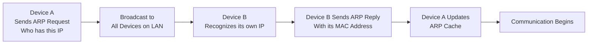
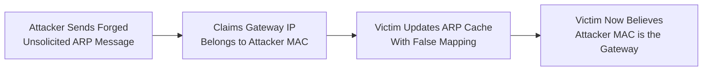
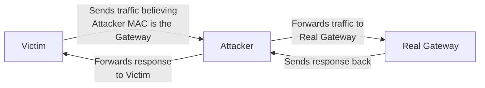

| Topic | Level | Reading Time | Prerequisites |
|---|---|---|---|
| ARP and ARP Cache Poisoning | Intermediate | ~18 min | Basic understanding of IP addressing, MAC addresses, and local network communication |

> **Goal of this section:**
>  You will understand how the ARP protocol works normally, and how an attacker can exploit its lack of authentication to carry out **ARP Cache Poisoning** and turn themselves into a Man-in-the-Middle between the victim and the gateway.

## Learning Objectives

By the end of this section, you will be able to:

- Explain how **ARP (Address Resolution Protocol)** works in its normal, legitimate flow.
- Describe what an **unsolicited ARP** message is and why it exists for legitimate purposes.
- Explain why the lack of **authentication** in ARP makes **ARP Cache Poisoning** possible.
- Trace the exact path traffic takes once an attacker poisons the ARP cache and becomes a **Man-in-the-Middle (MITM)**.
- Explain why ARP poisoning alone does not automatically expose encrypted application data.

## Table of Contents

- [What Is ARP](#what-is-arp)
- [The Normal ARP Process](#the-normal-arp-process)
- [Unsolicited ARP: A Legitimate Feature](#unsolicited-arp-a-legitimate-feature)
- [The Root Problem: No Authentication in ARP](#the-root-problem-no-authentication-in-arp)
- [ARP Cache Poisoning](arp-cache-poisoning)
  - [Why the Default Gateway Is the Prime Target](#why-the-default-gateway-is-the-prime-target)
  - [How the Poisoning Happens](#how-the-poisoning-happens)
- [Becoming the Man-in-the-Middle](#becoming-the-man-in-the-middle)
- [Diagram: Normal ARP Flow vs. Poisoned ARP Flow](#diagram-normal-arp-flow-vs-poisoned-arp-flow)
- [Diagram: Traffic Path After Poisoning](#diagram-traffic-path-after-poisoning)
- [Limits of ARP Poisoning](#limits-of-arp-poisoning)
- [Defenses Against ARP Cache Poisoning](#defenses-against-arp-cache-poisoning)
- [Career Connection](#career-connection)
- [Key Terms Glossary](#key-terms-glossary)
- [Summary](#summary)

## What Is ARP

**ARP (Address Resolution Protocol)** is a protocol used to discover the **MAC Address** associated with a specific IP address for a device on the **local network**.

The problem ARP solves is simple: devices on the local network actually communicate with each other using MAC addresses at the **Data Link Layer**, but applications and protocols mostly work with IP addresses. ARP is the link that connects these two worlds.

## The Normal ARP Process

To understand the process in practice, imagine that **Device A** wants to communicate with **Device B**, but it doesn't know B's MAC address.

The process happens in the following steps:

1. **Device A** sends an **ARP Request** asking: "Who has this IP Address?"
2. The ARP Request is sent as a **broadcast**, meaning every device on the local network receives it. The **destination MAC address** in this case is `FF:FF:FF:FF:FF:FF`.
3. **Device B** notices that this IP address is indeed its own, so it responds with an **ARP Reply** containing its MAC address.
4. **Device A** stores this **IP-to-MAC mapping** in something called the **ARP Cache**, and then uses it to communicate directly with Device B without needing to repeat the request.

This process can be summarized in the following sequence:

> **ARP Request → ARP Reply → ARP Cache Update → Communication**

> [!NOTE]
> The ARP Cache is essentially a table that maps IP addresses to their corresponding MAC addresses. It is updated periodically and temporarily (not permanently) to reflect changes in the network.

## Unsolicited ARP: A Legitimate Feature

**Unsolicited ARP** is an ARP message sent without any previous ARP Request from another device.

This behavior has legitimate, accepted uses, including:

- Announcing a new IP-to-MAC mapping.
- Updating the ARP caches on the network.
- Notifying other devices that a specific MAC address has changed.

A practical example: when a **router** starts up, it can announce that its IP address is associated with a specific MAC address, so the other devices on the network update their ARP caches without needing to send an ARP Request themselves.

## The Root Problem: No Authentication in ARP

The fundamental problem is that the ARP protocol **doesn't provide any built-in authentication mechanism**. This means any device on the network can receive and accept an ARP message even if it was sent by someone other than the legitimate owner of the IP address it mentions.

> [!IMPORTANT]
> This lack of authentication isn't a programming error or a bug. It is part of the original design of the ARP protocol, because it was designed at a time when trust assumptions inside the local network were completely different from those of modern network environments.

As a result, the legitimate **unsolicited ARP** feature can be **abused** by an attacker to announce a **false IP-to-MAC mapping**, and this is what opens the door to the **ARP Cache Poisoning** attack.

## ARP Cache Poisoning

### Why the Default Gateway Is the Prime Target

In an **ARP Cache Poisoning** attack, the attacker sends **forged unsolicited ARP messages** while pretending to be another device on the network.

The attacker can target any device, but impersonating **the Default Gateway** is especially dangerous, because the gateway is responsible for handling all traffic leaving the local network for the internet or other networks.

### How the Poisoning Happens

The attack steps happen as follows:

1. The attacker sends a forged ARP message claiming that the gateway's IP address is associated with their own (the attacker's) MAC address.
2. The victims receive this message, and since ARP has no authentication, they may update their ARP caches with this false mapping.
3. The victims now believe that the attacker's MAC address represents the legitimate gateway.
4. As a result, when any victim tries to send traffic outside the local network, it puts the attacker's MAC address in the Ethernet frame instead of the gateway's real MAC address.

With that, the victim's **ARP cache** has been **poisoned**, and the traffic is actually being directed to the attacker's machine.

> [!WARNING]
> A common mistake is for students to think that ARP Poisoning changes the IP address of the victim or the gateway. In reality, what changes is only the **IP-to-MAC mapping** inside the victim's ARP cache; the original addresses themselves don't change.

## Becoming the Man-in-the-Middle

Once the ARP cache is poisoned, the communication path changes from:

**Victim → Gateway**

to:

**Victim → Attacker → Real Gateway**

The attacker can use tools such as **Ettercap** to **intercept** this traffic and **forward** it to the real destination, so the connection continues normally from the victim's point of view.

The process happens in detail as follows:

- When the victim sends a frame, it reaches the attacker's machine, because the victim believes the attacker is the gateway.
- The attacker then **forwards** this traffic to the real gateway, so the request continues on its way to its original destination normally.
- Likewise, the gateway's response can also be routed through the attacker, who then forwards it to the victim.

The final traffic path becomes:

**Victim → Attacker → Gateway → Attacker → Victim**

With that, the attacker is officially positioned as a **Man-in-the-Middle (MITM)** between the victim and the gateway.

## Diagram: Normal ARP Flow vs. Poisoned ARP Flow

The following diagram shows the sequence of the normal ARP process:

And this diagram shows how the attacker poisons the victim's ARP cache:

## Diagram: Traffic Path After Poisoning

The following diagram shows the complete traffic path after the attack succeeds, and how the attacker positions themselves as a Man-in-the-Middle:

## Limits of ARP Poisoning

Despite how dangerous ARP Cache Poisoning is, **this attack alone doesn't mean the attacker can automatically read encrypted application data**.

Protocols such as **HTTPS** and **VPN** provide an additional layer of end-to-end protection, which means that even if the attacker manages to intercept the traffic, the content of the data itself may remain unreadable unless that encryption is broken separately.

> [!TIP]
> ARP Poisoning gives the attacker a **position** in the traffic path, but that doesn't necessarily mean **visibility into content**. These are two different concepts, and it's important to distinguish between them.

## Defenses Against ARP Cache Poisoning

Several mechanisms are used to reduce the risks of ARP Cache Poisoning:

| Mechanism | Protective Role |
|---|---|
| **Dynamic ARP Inspection (DAI)** | A switch feature that validates ARP messages before accepting them |
| **Static ARP Entries** | Manually fixing the IP-to-MAC mapping for sensitive devices such as the gateway |
| **Port Security** | Restricting the number and types of MAC addresses allowed on each switch port |
| **Network Monitoring Tools** | Detecting abnormal or repeated changes in the ARP mappings |
| **End-to-End Encryption (HTTPS/VPN)** | Protecting the content of the data even if the attacker succeeds in intercepting the traffic |

## Career Connection

Understanding ARP and ARP Cache Poisoning has direct applications in several career paths:

- In **Pentesting**, performing ARP Poisoning with tools such as Ettercap is used in ethical penetration tests to assess how well the network withstands MITM attacks.
- In the **SOC**, monitoring the network to detect suspicious ARP messages or sudden changes in the ARP mappings is a core part of the threat detection process.
- In security-focused **Network Engineering**, enabling features such as **Dynamic ARP Inspection** on switches is part of the secure design of the network infrastructure.

## Key Terms Glossary

| Term | Definition |
|---|---|
| **ARP (Address Resolution Protocol)** | A protocol used to discover the MAC address associated with a specific IP address on the local network. |
| **ARP Request** | A broadcast message in which a device asks who owns a specific IP address. |
| **ARP Reply** | A response containing the MAC address of the owner of the requested IP address. |
| **ARP Cache** | A temporary table on a device that maps IP addresses to their corresponding MAC addresses. |
| **Unsolicited ARP** | An ARP message sent without a previous ARP Request, which has legitimate uses. |
| **ARP Cache Poisoning** | An attack in which the attacker sends forged ARP messages to change the victims' ARP mappings. |
| **Default Gateway** | The device responsible for routing traffic leaving the local network to other networks. |
| **Man-in-the-Middle (MITM)** | An attack in which the attacker places themselves between the two parties of a communication to monitor or manipulate it. |

## Summary

- **ARP** is used to discover the MAC address associated with a specific IP address on the local network, through the sequence: ARP Request → ARP Reply → ARP Cache Update → Communication.
- **Unsolicited ARP** is a legitimate feature used to update ARP caches without a previous request, but the lack of **authentication** in ARP makes it exploitable.
- In **ARP Cache Poisoning**, the attacker sends forged ARP messages claiming to be the default gateway, convincing the victims to accept a false IP-to-MAC mapping.
- Once the poisoning succeeds, the traffic path changes from Victim → Gateway to Victim → Attacker → Gateway → Attacker → Victim, and the attacker is positioned as a **Man-in-the-Middle**.
- Tools such as **Ettercap** are used to intercept and forward traffic so that the connection continues normally from the victim's point of view.
- ARP Poisoning alone **doesn't mean the ability to read encrypted data**; protocols such as HTTPS and VPN provide additional protection at the content level.
- Effective protection relies on mechanisms such as **Dynamic ARP Inspection**, **Static ARP Entries**, and **Port Security**, alongside end-to-end encryption.
