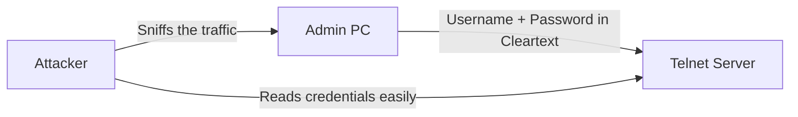
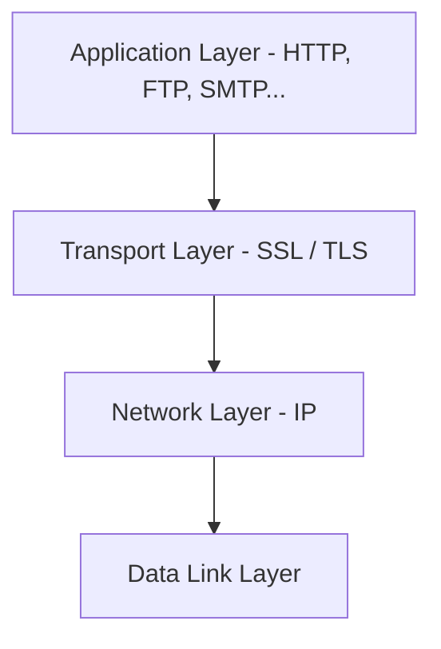
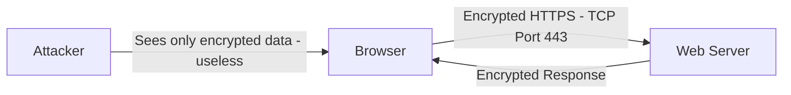

> **Goal of this section:**
> You'll understand why Telnet is dangerous and how SSH solves that problem. And by the end, you'll understand the difference between SSL and TLS and how HTTPS protects your data on the internet.
---

## Table of Contents
- [SSH — Secure Shell](#ssh--secure-shell)
- [SSL & TLS](#ssl--tls)
- [HTTPS](#https)
- [Summary](#summary)

---

## SSH — Secure Shell

### The Problem: Telnet

**Telnet** was an old protocol used for remote connections — meaning you control another machine remotely over the CLI.

The big problem is that Telnet sends **everything in cleartext**:
- The username
- The password
- Every command you type
- All the output that comes back

So if an attacker performs **packet sniffing** on the network, they'll see everything word for word!

---

### The Solution: SSH (Secure Shell)

**SSH** is the encrypted version of Telnet — it does the same job (remote CLI access) but encrypts everything.

| Property | Telnet | SSH |
|---------|--------|-----|
| **Encryption** | No — cleartext | Yes — fully encrypted |
| **Port** | TCP 23 | TCP 22 |
| **Security** | Insecure | Secure |
| **Usage** | Abandoned (Legacy) | The current standard |
| **Password protection** | Exposed | Encrypted |

> [!IMPORTANT]
> SSH encrypts **everything**: the username, the password, the commands, and the output. Even if an attacker performs a packet capture, they'll find gibberish — they won't be able to read anything.

> [!TIP]
> In the real world, SSH isn't used only for remote login — you can also use it for **Secure File Transfer (SFTP/SCP)**, **Port Forwarding**, and **Tunneling**.

---

## SSL & TLS

### The Relationship Between Them

- **SSL (Secure Sockets Layer)** — the old version, which evolved over the years
- **TLS (Transport Layer Security)** — the newer and more secure version; it's essentially SSL in a better form
- Both do the same job: **encrypting communications at the Transport Layer level**

> [!NOTE]
> In practice, when people say "SSL" they're usually talking about "TLS" — because SSL is now considered deprecated and insecure, and TLS is what's actually used.

---

### Where Do They Operate?

SSL/TLS operate at **OSI Layer 4 (the Transport Layer)**.

This means they can encrypt **any protocol that runs over TCP**:

| Protocol | Encrypted Version | Port |
|-----------|-----------------|------|
| HTTP | **HTTPS** | 443 |
| FTP | **FTPS** | 990 |
| SMTP | **SMTPS** | 465 |
| IMAP | **IMAPS** | 993 |
| POP3 | **POP3S** | 995 |

---

### The Very Common Mistake!

> [!WARNING]
> **The common mistake:** many people say that SSL/TLS operate on **TCP Port 443** — that's wrong!
>
> **The truth:** **Port 443** is the port for **HTTPS** (meaning HTTP + TLS) — not for TLS itself.
>
> SSL/TLS are **Transport Layer protocols**, and Transport Layer protocols aren't assigned port numbers. Port numbers are assigned only to **Application Layer protocols**.

---

## HTTPS

### What Is HTTPS?

**HTTPS = HTTP + SSL/TLS**

It's the regular web HTTP protocol, but encrypted using SSL or TLS.

### HTTPS Properties

- **Port:** TCP 443
- **Encryption:** it encrypts **everything** between the browser and the web server in both directions
- **The Certificate:** the web server must have an **SSL/TLS Certificate** issued by a trusted **CA (Certificate Authority)**
- **The indicator:** the browser shows a **lock (🔒)** in the address bar

> [!IMPORTANT]
> When you see `https://` and a lock in the browser, it means:
> 1. The connection is encrypted — no one can read it
> 2. The server has a trusted certificate — you're really talking to the right site, not a fake one

> [!WARNING]
> The presence of HTTPS doesn't mean the site is **safe or trustworthy** — it only means the connection is **encrypted**. Phishing sites use HTTPS too!

---
## Summary
#### SSH
- **Telnet** = remote CLI without encryption — everything in cleartext over TCP 23
- **SSH** = the same job but fully encrypted over TCP 22
- SSH is the current standard, and Telnet is completely abandoned

#### SSL & TLS
- **SSL** is old, **TLS** is the newer and more secure version
- They operate at **OSI Layer 4** and can encrypt any TCP protocol
- Port 443 isn't for TLS — it's specifically for HTTPS

#### HTTPS
- **HTTP + TLS** = **HTTPS over TCP Port 443**
- It encrypts all the traffic in both directions
- The lock in the browser means encryption is present — not necessarily that the site is safe or trustworthy
