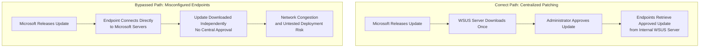

| Topic | Level | Reading Time | Prerequisites |
|---|---|---|---|
| OS Hardening and Patch Management | Intermediate | ~22 min | Basic understanding of operating systems and general security concepts |

> **Goal of this section:**
> You'll understand how to reduce the attack surface of any operating system through hardening, understand why updates matter and the danger of zero-days, and see how large organizations manage updates centrally using a tool like WSUS, plus a real-world scenario from the job that shows what happens when that management breaks down.

## Learning Objectives

By the end of this section, you will be able to:

- Define **OS Hardening** and explain the concept of an **Attack Surface**.
- List the key practices used to harden an operating system, from removing unwanted accounts to restricting access to critical assets.
- Explain why keeping systems updated matters, and define a **Zero-Day Vulnerability**.
- Explain why large organizations need **centralized patch management** instead of letting every device update independently.
- Describe how **WSUS** works and the security benefit of requiring administrator approval before deployment.
- Interpret a real-world scenario showing what happens when centralized patching is bypassed.

## Table of Contents

- [OS Hardening: Reducing the Attack Surface](#os-hardening-reducing-the-attack-surface)
- [What Is an Attack Surface](#what-is-an-attack-surface)
- [Key Hardening Practices](#key-hardening-practices)
- [Updates and Patches](#updates-and-patches)
- [Zero-Day Vulnerabilities](#zero-day-vulnerabilities)
- [Why Automatic Updates Aren't Always Enough](#why-automatic-updates-arent-always-enough)
- [Patch Management at Scale](#patch-management-at-scale)
  - [Network Congestion](#network-congestion)
  - [Stability Risks](#stability-risks)
- [WSUS: Centralized Update Management](#wsus-centralized-update-management)
- [Real Case Scenario: What Happens Without Centralized Patching](#real-case-scenario-what-happens-without-centralized-patching)
- [Hardening and Patching Flow Diagram](#hardening-and-patching-flow-diagram)
- [Career Connection](#career-connection)
- [Key Terms Glossary](#key-terms-glossary)
- [Summary](#summary)

## OS Hardening: Reducing the Attack Surface

**OS Hardening** is the process of reducing a computer system's **attack surface**, making it as hard as possible for an attacker to find a way in.

## What Is an Attack Surface

An **Attack Surface** is the total number of points through which an attacker could theoretically try to enter, interact with, or exploit a given system.

This includes: open network ports, running services, user accounts, installed software, and more.

> [!IMPORTANT]
> The larger the attack surface, the more opportunities the attacker has. The core idea of hardening is to reduce these points to the absolute minimum, not to try to protect each point individually.

## Key Hardening Practices

The following table summarizes the most important practices for reducing the attack surface:

| Practice | Description |
|---|---|
| **Removing unwanted accounts** | Every extra account is a potential entry point, especially default and guest accounts, which are rarely monitored |
| **Enforcing strong password policies** | Across all accounts on the system |
| **Restricting remote access to encrypted methods** | For example, using **SSH** instead of **Telnet**, because Telnet transmits data (including passwords) in unencrypted plain text |
| **Restricting access to critical assets** | Follows the principle of **least privilege**; for example, the password file should be readable only by the admin, not by every user |
| **Removing unwanted software and services** | Even if they're legitimate, every installed program is a potential vulnerability. If you're not using it, it's an unnecessary risk |

> [!TIP]
> This is the same logic we explained earlier in the Port Scanning topic: every unnecessary open port is a potential door an attacker can discover and exploit. The hardening principle here extends the same idea to the entire system.

## Updates and Patches

Keeping the operating system and all installed applications up to date is one of the simplest yet most important security practices. For personal devices, it's generally recommended to enable automatic updates, so patches are applied without you having to remember to do it manually.

> [!NOTE]
> Not every update is about new features or minor bug fixes; some updates specifically fix security vulnerabilities, and those deserve special attention from security professionals.

On **Windows** specifically, the automatic update option is generally considered safe to enable, since it only installs the most important updates automatically rather than every minor update.

## Zero-Day Vulnerabilities

A **Zero-Day** is a vulnerability that is discovered and can be exploited by attackers **before** the vendor releases an official fix for it. Once the vendor becomes aware of it, it usually rushes to release a patch.

## Why Automatic Updates Aren't Always Enough

> [!WARNING]
> If automatic updates are disabled on your machine, you remain **vulnerable** to that zero-day exploit until you install the patch manually, even if the fix already exists.

## Patch Management at Scale

Although automatic updates are generally good for individual devices, enabling automatic updates everywhere can have unintended negative consequences in certain situations. In large organizations (roughly 1,000+ devices or more), a **centralized patch management system** becomes necessary instead of having each device manage its own updates.

### Network Congestion

If a thousand devices all independently try to download the same large update files from the internet at the same time, this can flood and slow down the organization's network **bandwidth**.

### Stability Risks

Sometimes a particular patch, even though it comes from the vendor itself, can cause unexpected problems, conflicts, or crashes on certain systems or configurations. Testing updates before wide deployment is essential; you don't want a bad patch breaking hundreds of machines at once.

> [!IMPORTANT]
> This is where centralized patch management tools come in, one of the best known being **Windows Server Update Service (WSUS)**.

## WSUS: Centralized Update Management

**WSUS** is a Microsoft update management solution that lets organizations centrally manage, approve, and distribute Windows updates across all the systems on their network.

The path looks like this: `Microsoft → WSUS Server → Endpoints (laptops, desktops, servers)`

Individual devices **don't connect directly** to Microsoft's servers to download updates. Instead, all devices get approved updates from the internal WSUS server, which itself downloads the updates from Microsoft once and distributes them internally.

> [!IMPORTANT]
> **A critical security feature**: no device receives an update unless it has been explicitly approved by an admin.

The main benefits of WSUS:

- **Reduces internet bandwidth usage**: updates are downloaded once by WSUS, not by each device separately.
- **Gives the admin precise control**: over exactly which updates are deployed and when.
- **Improves visibility**: the admin can see which devices have or haven't received a particular patch.

## Real Case Scenario: What Happens Without Centralized Patching

**Situation Observed**: devices inside an organization's network were observed connecting directly to Microsoft's update servers instead of going through the internal WSUS server.

**The result**: this caused huge, unexpected traffic that was noticed on the network, as a large number of individual devices were independently downloading the same update files over the internet at the same time.

**Why this is a problem**:

- It completely defeats the purpose of having a centralized patch management system like WSUS.
- It consumes a large amount of internet bandwidth unnecessarily, since the same update data is downloaded repeatedly by many devices instead of once by the WSUS server.
- It also means updates are no longer being centrally approved/tested before deployment, which brings back the stability and control risks WSUS was designed to prevent in the first place.

> [!IMPORTANT]
> **The lesson learned**: this is a real-world example that shows why patch management settings need to be actively monitored. Misconfigured devices that bypass the intended update path can silently cause network performance problems and undermine security controls without anyone noticing.

## Hardening and Patching Flow Diagram

The following diagram shows the correct path for centralized patch management versus the incorrect path that happened in the real scenario:

## Career Connection

Understanding OS hardening and patch management has direct applications across several career paths:

- In **System Administration**, applying hardening practices and managing WSUS is a core part of any system administrator's daily work.
- In **SOC**, monitoring update-related network traffic helps detect devices that bypass the intended update path (like the real scenario we explained).
- In **Vulnerability Management**, prioritizing patch deployment, especially critical ones like zero-day fixes, is a core part of shrinking the window of exposure.
- In **GRC**, having a documented centralized patch management policy is part of the compliance requirements in several security standards.

## Key Terms Glossary

| Term | Definition |
|---|---|
| **OS Hardening** | The process of reducing an operating system's attack surface by removing unnecessary components. |
| **Attack Surface** | The total set of points through which an attacker can try to enter or exploit a system. |
| **Least Privilege** | The principle of granting users and systems only the minimum privileges needed to perform their tasks. |
| **Zero-Day Vulnerability** | A vulnerability that is discovered and exploited before the vendor releases an official fix. |
| **Patch Management** | The organized process of distributing, approving, and installing security updates across systems. |
| **WSUS (Windows Server Update Service)** | A centralized Microsoft solution for managing, approving, and distributing Windows updates. |
| **Network Congestion** | Network traffic overload caused by downloading large amounts of data from multiple sources at the same time. |

## Summary

- **OS Hardening** reduces a system's attack surface by reducing the points an attacker could exploit, such as open ports, accounts, and installed software.
- Key practices include removing unwanted accounts, enforcing strong passwords, using SSH instead of Telnet, applying the principle of least privilege, and removing unused software.
- Automatic updates are very important, especially because they close the window of exposure to **Zero-Day** vulnerabilities, but disabling them leaves the machine open to exploitation even when the fix exists.
- In large organizations, centralized patch management is necessary to avoid the **Network Congestion** and **Stability Risks** that come from letting each device manage its own updates.
- **WSUS** provides a centralized solution that ensures no device receives an update without explicit admin approval, which reduces bandwidth consumption and improves visibility.
- A real-world scenario showed how devices bypassing WSUS and connecting directly to Microsoft caused network congestion and brought back the stability risks WSUS was designed to prevent.

