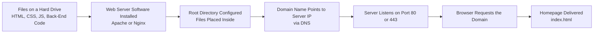

| Topic | Level | Reading Time | Prerequisites |
|---|---|---|---|
| How Websites Are Built and Hosted | Beginner | ~14 min | None |

> **Goal of this section:**
> You'll understand what a website actually is under the hood, the difference between the Front-End and the Back-End, and how a set of files on your machine becomes a website you can reach from anywhere in the world through a domain and a web server.

## Learning Objectives

By the end of this section, you will be able to:

- Explain what a website actually is at the file level.
- Distinguish between **Back-End** and **Front-End** code and name common languages for each.
- Explain the role of the **Homepage**, **Domain Name**, **Web Server Software**, and **Root Directory** in making a website reachable.
- Explain how a web server listens for incoming connections using ports 80 and 443.
- Distinguish between **HTTP** and **HTTPS** in terms of encryption.

## Table of Contents

- [What a Website Actually Is](#what-a-website-actually-is)
- [Two Types of Code](#two-types-of-code)
- [Where the Files Actually Live](#where-the-files-actually-live)
- [Making Your Website Reachable](#making-your-website-reachable)
  - [The Homepage](#the-homepage)
  - [The Domain Name](#the-domain-name)
  - [Web Server Software](#web-server-software)
  - [The Root Directory](#the-root-directory)
- [How the Server Listens](#how-the-server-listens)
- [HTTP vs. HTTPS](#http-vs-https)
- [From Files to a Live Website Diagram](#from-files-to-a-live-website-diagram)
- [Career Connection](#career-connection)
- [Key Terms Glossary](#key-terms-glossary)
- [Summary](#summary)

## What a Website Actually Is

A **Website** is essentially a collection of files: code, images, videos, **fonts**, and other resources.

> [!NOTE]
> There's no "magic" involved: a website is just files, organized in folders, waiting to be **requested** and **delivered**.

## Two Types of Code

Building a website means writing two types of code:

### Back-End Code

This code runs on the server and handles the **logic**, databases, user accounts, request processing, and so on.

Examples of back-end languages: **PHP**, **Python**, **Node.js**, **Java**.

### Front-End Code

This is what the browser downloads and displays to the user. It consists of:

- **HTML** (the structure).
- **CSS** (the styling and appearance).
- **JavaScript** (the interactivity).

## Where the Files Actually Live

All these files live together on a hard drive, whether that's your personal computer, a company server, or a cloud provider such as **AWS** or **Google Cloud**.

> [!TIP]
> No magic: a website is files, organized in folders, waiting to be requested and delivered.

## Making Your Website Reachable

For your website to be available to the world, you need four core elements:

### The Homepage

Every website needs a **homepage**, the default file that loads when someone visits the site (usually named `index.html`).

### The Domain Name

For the website to be reachable over the internet, you need a **domain name** (for example, `example.com`). The domain is just a **human-friendly** name that is translated into a numeric IP address through **DNS**.

> [!TIP]
> If you've studied DNS before, you'll remember this is exactly the same "phonebook" concept we explained there: the domain is the name, and the IP is the actual number.

### Web Server Software

You can turn any computer into a web server by installing **web server software**. **Apache** and **Nginx** are the most popular, and this software's job is to listen for incoming connections and serve the files.

### The Root Directory

You configure a **root directory** on that server, which is the folder that contains your website's files (starting with the homepage). When someone visits your domain, the server looks inside this folder to find what to send.

## How the Server Listens

Once the software is installed, it opens certain **network ports**. A port is essentially a numbered "door" on the server that a specific piece of software listens on.

Web traffic usually uses port **80** or **443**, while other services use different ports (such as 22 for SSH and 21 for FTP).

The server is constantly waiting for incoming requests directed to its domain. When a browser tries to reach your website, it sends its request specifically to port 80 or 443 on the server's IP address.

## HTTP vs. HTTPS

| Port | Protocol | Description |
|---|---|---|
| **80** | **HTTP** | **Unencrypted** |
| **443** | **HTTPS** | **Encrypted** using **TLS** |

> [!IMPORTANT]
> The difference between the two isn't just a port number; it's a fundamental difference in security. HTTP traffic can be intercepted and read by anyone, while HTTPS protects the content of the communication through encryption.

## From Files to a Live Website Diagram

The following diagram summarizes the full journey from mere files on a hard drive to a live, reachable website:

## Career Connection

Understanding how websites are built and hosted has direct applications across several career paths:

- In **SOC** and **Web Application Security**, understanding a website's structure (front-end/back-end, domain, root directory) is essential for understanding any attack that targets web applications.
- In **Cloud Security**, knowing how servers are hosted and connected to the internet is a core part of securing cloud infrastructure.
- In **Pentesting**, understanding where the root directory is and how the server is configured helps identify potential weaknesses such as unauthorized access to files.

## Key Terms Glossary

| Term | Definition |
|---|---|
| **Back-End Code** | Code that runs on the server and handles logic, databases, and accounts. |
| **Front-End Code** | Code that the browser downloads and displays to the user (HTML, CSS, JavaScript). |
| **Homepage** | The default file that loads when the website is visited. |
| **Domain Name** | A human-friendly name that is translated into an IP address through DNS. |
| **Web Server Software** | Software such as Apache or Nginx that listens for incoming connections and serves the website's files. |
| **Root Directory** | The folder on the server that contains the website's files, starting with the homepage. |
| **Port** | A numbered door on the server that a specific program listens on for specific traffic. |
| **HTTP / HTTPS** | The Hypertext Transfer Protocols, unencrypted and encrypted (via TLS), respectively. |

## Summary

- A **Website** is essentially a collection of files: code, images, videos, and fonts, stored together on a hard drive.
- Building a website requires two types of code: **Back-End** (runs on the server) and **Front-End** (downloaded and displayed in the browser, built from HTML, CSS, and JavaScript).
- For the website to be reachable, it needs a **Homepage**, a **Domain Name** (translated into an IP through DNS), **Web Server Software** (such as Apache or Nginx), and a **Root Directory** containing the files.
- The server listens on specific ports, usually **80** for unencrypted HTTP traffic or **443** for HTTPS traffic encrypted with TLS.
- The difference between HTTP and HTTPS is fundamental from a security standpoint: the first is unencrypted and can be intercepted, while the second is protected by encryption.

