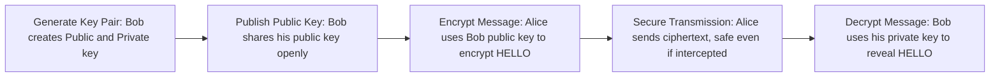

> **Goal of this section:**
> You'll understand how Asymmetric Encryption works with two different keys, which of the Security Properties (CIA + Non-repudiation + Key Exchange) it achieves, and why, even though it solved one of Symmetric's big problems, there's still another problem that needs a solution — which is the basis of the topic that comes after it.

## Table of Contents
- [What is Asymmetric Encryption?](#what-is-asymmetric-encryption)
- [The Two Keys](#the-two-keys)
- [The Four Golden Rules](#the-four-golden-rules)
- [How Asymmetric Encryption Works](#how-asymmetric-encryption-works)
- [Which Security Properties Does It Achieve?](#which-security-properties-does-it-achieve)
- [Advantages & Disadvantages](#advantages--disadvantages)
- [Common Asymmetric Algorithms](#common-asymmetric-algorithms)
- [Symmetric vs Asymmetric — Comparison](#symmetric-vs-asymmetric--comparison)
- [The Problem That's Still Not Solved](#the-problem-thats-still-not-solved)
- [Summary](#summary)
- [SOC Analyst Perspective](#soc-analyst-perspective)

---

## What is Asymmetric Encryption?

Asymmetric Encryption (also called Public Key Cryptography) came along to solve the **Key transfer problem** that Symmetric Encryption suffered from (as we saw in the previous Section).

The core idea: instead of one Key shared between the two parties, each party now has **a different pair of keys that are mathematically linked to each other** (a Mathematically Linked Key Pair).

> [!NOTE]
> This is the foundation of Digital Signatures and all Secure Web Browsing — every time you open a website over HTTPS, Asymmetric Encryption is working in the background.

---

## The Two Keys

| Key | Description |
|---|---|
| **Public Key** | Known to everyone; there's no problem at all with anyone seeing it or getting it. It's used only for encryption |
| **Private Key** | Highly secret; it must never leave your device under any circumstances. It's used only to decrypt what was encrypted with its matching Public Key |

> [!WARNING]
> If the Private Key leaks even once, all the data encrypted with its matching Public Key is fully exposed, and every signature made in your name can be forged. Protecting the Private Key is a top security priority.

---

## The Four Golden Rules

The golden rule you should know by heart:

| Goal | Key used |
|---|---|
| Sending an encrypted message | The recipient's **Public Key** |
| Decrypting a message you received | Your own **Private Key** (the recipient's) |
| Creating a Digital Signature on a file | The sender's **Private Key** |
| Verifying a signature you received | The sender's **Public Key** |

> [!IMPORTANT]
> The decisive rule that separates the two uses:
> - If you encrypt with a **Public Key** → the goal is **Confidentiality** — only the owner of the matching Private Key can decrypt it
> - If you encrypt (sign) with a **Private Key** → the goal is **Authenticity** (proof of identity) — anyone with the Public Key can confirm that the owner of the Private Key is the one who signed

---

## How Asymmetric Encryption Works

If Alice wants to send a secret to Bob, the process goes like this:

**In detail:**

1. **Key Generation:** Bob creates a unique key pair — Public (K_pub) and Private (K_priv)
2. **Public Key Distribution:** Bob sends his K_pub to Alice (this key can be sent completely openly; there's no risk)
3. **Message Encryption:** Alice encrypts "HELLO" using Bob's K_pub, producing unreadable Ciphertext
4. **Secure Transmission:** Alice sends the Ciphertext to Bob. Even if an attacker intercepts it, it will remain Gibberish (meaningless text)
5. **Message Decryption:** Bob uses his secret K_priv to decrypt the message and turn it back into "HELLO"

> [!IMPORTANT]
> Even if a hacker sees the entire encrypted message, only Bob has the Private Key needed to decrypt it. The attacker can't do anything, even with the message right in front of them.

---

## Which Security Properties Does It Achieve?

Just as we asked with Symmetric Encryption, let's apply the same question here: which of the 5 principles (Confidentiality, Integrity, Authentication, Non-repudiation, Key Exchange) does Asymmetric Encryption achieve?

| Security Property | Achieved? | How |
|---|---|---|
| **Confidentiality** | Yes | When you encrypt with the recipient's Public Key |
| Integrity | No (on its own) | Encryption itself doesn't prove the message wasn't changed — it needs Hashing/Signature |
| **Authentication** | Yes (partially) | When you sign with the Private Key, anyone with the Public Key can confirm that the owner of the Private Key is the one who signed |
| **Non-repudiation** | Yes (partially) | Since no one else holds a copy of the Private Key, its owner can't deny having signed |
| **Key Exchange** | Yes | This is essentially the reason Asymmetric Encryption was created — to solve the problem of delivering the Key securely |

> [!NOTE]
> Notice that Authentication and Non-repudiation here come from the **signing** process (Signing with the Private Key), not from ordinary encryption (Encrypting with the Public Key). The next topic (**Digital Signatures**) will explain this mechanism in full detail.

A quick comparison with Symmetric:

| Security Property | Symmetric | Asymmetric |
|---|---|---|
| Confidentiality | ✅ | ✅ |
| Integrity | ❌ (without AEAD) | ❌ (without a Signature) |
| Authentication | ❌ | ✅ (via signing) |
| Non-repudiation | ❌ | ✅ (via signing) |
| Key Exchange | ❌ (its problem) | ✅ (its solution) |

---

## Advantages & Disadvantages

### Advantages

- **Solves Key Distribution:** Public Keys can be shared openly and securely; there's no risk in delivering them
- **Authentication:** Allows the sender's identity to be verified through Digital Signatures
- **Non-repudiation:** Provides proof that a specific message came from one specific sender

### Disadvantages

- **Slower:** Significantly slower than Symmetric Encryption
- **Computationally Expensive:** Needs much more processing power
- **Data Size:** Not suitable for encrypting large amounts of data directly

> [!WARNING]
> Because Asymmetric Encryption is slow and computationally expensive, no one uses it to encrypt huge data (such as files or Video streams) directly. It's used only in critical stages such as Key Exchange and Authentication, and then it hands the job over to Symmetric Encryption to transfer the actual data quickly.

### Key Applications

- **Key Exchange:** Securely delivering Symmetric Keys
- **Digital Signatures:** Ensuring Integrity and Authenticity
- **TLS/HTTPS Handshakes:** Initiating secure connections over the web
- **Secure Email:** Encrypting and signing emails (such as PGP)

---

## Common Asymmetric Algorithms

| Algorithm | Note |
|---|---|
| **RSA** | Named after Rivest, Shamir, Adleman — the most common, used for secure data transfer and digital signatures |
| **ECC (Elliptic Curve Cryptography)** | Provides the same level of security as RSA but with smaller keys — faster and more efficient, especially for mobile devices and power-constrained environments |

---

## Symmetric vs Asymmetric — Comparison

| Criterion | Symmetric | Asymmetric |
|---|---|---|
| Speed | Very fast | Slow |
| Key transfer | A big problem (Distribution Problem) | Secure and easy (the Public Key can be shared) |
| Ideal use | Large amounts of data | Small data, or exchanging the Keys themselves |
| Number of keys | One shared key | A key pair (Public + Private) |

---

## The Problem That's Still Not Solved

Asymmetric Encryption solved the Key Distribution problem, but it opened the door to a completely new problem.

> [!IMPORTANT]
> **The problem:** If Bob creates a key pair and tells Alice "this is Alice's Public Key" while lying — Alice won't know, and any message she encrypts with that Public Key can be decrypted by Bob instead of the real Alice. This isn't a mathematical problem in the encryption itself; it's an **Identity Binding** problem — how do I make sure this Public Key really belongs to the person who claims it's theirs?

**The part that will solve this problem:** the **Digital Certificates & Certificate Authority (CA)** topic that comes next, which binds the Public Key to a real, trusted identity through a trusted third party (CA).

---

## Summary

- Asymmetric Encryption uses **a pair of different keys**: a Public Key (for encryption) and a Private Key (for decryption)
- The golden rule: encrypting with the Public Key = Confidentiality | signing with the Private Key = Authenticity
- It achieves **Confidentiality, Authentication (partially), Non-repudiation (partially), and Key Exchange**
- Its main drawback: **slow and computationally expensive**, not suitable for encrypting huge data directly
- The best-known algorithms: **RSA** (the most common) and **ECC** (faster and lighter)
- It solved the Key Distribution problem but opened a new one: **how do we trust that the Public Key really belongs to its owner?** → to be solved in the Digital Certificates & CA topic

---

## SOC Analyst Perspective

- When you analyze Traffic containing a TLS Handshake, you'll find Asymmetric Encryption working only at the start of the connection (Key Exchange + Authentication), and after that the connection switches to Symmetric — if you see an unusual Handshake or an untrusted Certificate, that's the first place to look for problems
- MITRE ATT&CK: Techniques such as **T1573.002 (Asymmetric Cryptography)** describe attackers using Asymmetric Encryption inside C2 channels to secure the connection and make it harder to detect with Deep Packet Inspection
- A common risk in real environments: **Self-Signed Certificates** or expired certificates — these are a sign that no trusted third party (CA) is vouching for the server's identity, which is exactly the Identity Binding Problem we talked about, and it must be reviewed immediately as Suspicious Activity
- Practical tools: Wireshark and OpenSSL are used to inspect Certificate details and the Key Exchange Algorithm used in any TLS Session during an Incident Investigation
