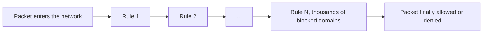
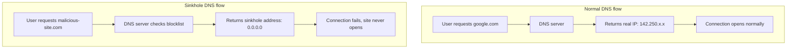
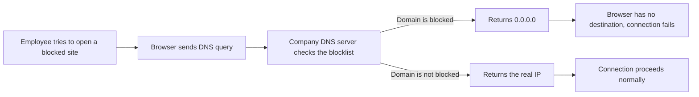
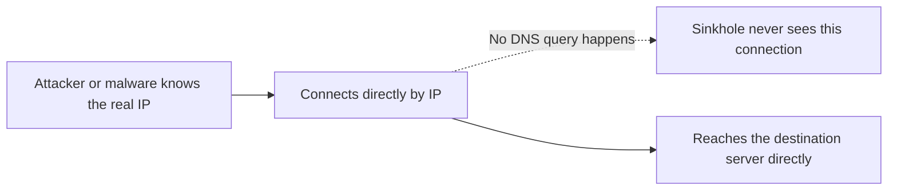
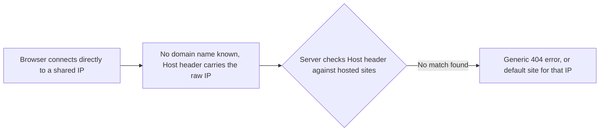
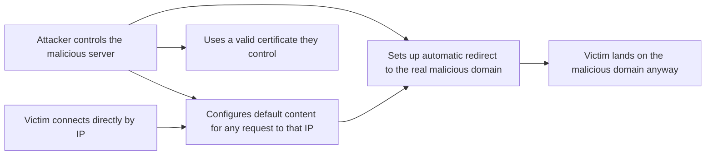
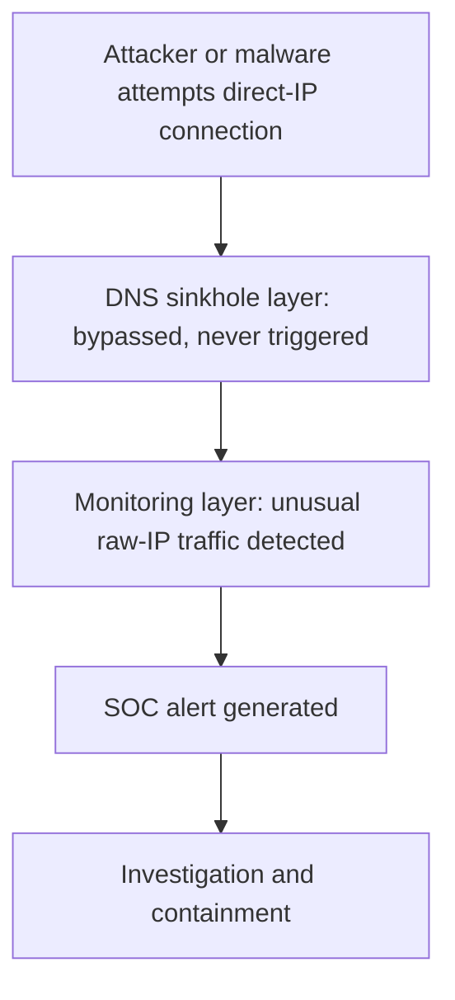

| Topic | Level | Reading Time | Prerequisites |
|---|---|---|---|
| DNS Sinkhole: How It Works and How It Can Be Bypassed | Intermediate | ~20 min | Defense in Depth Model, basic idea of DNS and HTTPS |

> **Goal of this section:**
> You'll understand why blocking with the Firewall alone isn't Scalable, what a DNS Sinkhole is and how it works step by step, what its Limitations are, and what could allow someone to bypass this technique.


## Learning Objectives

By the end of this section, you will be able to:

- Explain why blocking thousands of domains at the **firewall** alone does not scale, and how a **DNS sinkhole** solves that problem.
- Describe the step-by-step flow of a DNS sinkhole, from the employee's browser to the blocked connection.
- Explain the theoretical bypass of connecting directly to an IP address instead of a domain name.
- Explain why **Virtual Hosting** and the HTTP **Host header** make a blind IP bypass unreliable in most cases.
- Explain why a **TLS certificate mismatch** creates a second, independent obstacle to the same bypass.
- Explain how a sophisticated attacker could still exploit this gap, and why the attempt itself usually gets caught from a SOC perspective.
- Describe additional controls (DNS RPZ, egress filtering, IOC blocklists) that close this gap more completely.

## Table of Contents

- [Learning Objectives](#learning-objectives)
- [The Problem: Why Not Just Block at the Firewall](#the-problem-why-not-just-block-at-the-firewall)
  - [The Scalability Issue](#the-scalability-issue)
- [The Solution: DNS Sinkhole](#the-solution-dns-sinkhole)
  - [The Core Idea](#the-core-idea)
  - [Normal Flow Versus Sinkhole Flow](#normal-flow-versus-sinkhole-flow)
- [How the Sinkhole Works Step by Step](#how-the-sinkhole-works-step-by-step)
- [Why Sinkholing Is Valuable Beyond Blocking](#why-sinkholing-is-valuable-beyond-blocking)
- [The Sinkhole Issue: Where the Technique Breaks](#the-sinkhole-issue-where-the-technique-breaks)
  - [The Theoretical Bypass](#the-theoretical-bypass)
  - [Why Browsers Skip DNS for Raw IPs](#why-browsers-skip-dns-for-raw-ips)
- [Virtual Hosting and the Host Header](#virtual-hosting-and-the-host-header)
- [The Certificate Problem: SSL/TLS and SNI](#the-certificate-problem-ssltls-and-sni)
- [How a Sophisticated Attacker Could Still Exploit This](#how-a-sophisticated-attacker-could-still-exploit-this)
- [Why This Bypass Still Gets Caught](#why-this-bypass-still-gets-caught)
  - [The SOC Perspective](#the-soc-perspective)
  - [Defense in Depth in Action Again](#defense-in-depth-in-action-again)
- [Strengthening the Defense Further](#strengthening-the-defense-further)
- [Full Bypass Attempt Walk-Through](#full-bypass-attempt-walk-through)
- [Career Path Connections](#career-path-connections)
- [Key Terms Glossary](#key-terms-glossary)
- [Summary](#summary)

## The Problem: Why Not Just Block at the Firewall

### The Scalability Issue

Imagine you're a **Security Admin** at a large company, and you want to stop employees from accessing certain websites, whether they're malicious sites, social media, or anything outside company policy.

The first approach that comes to mind is creating **block rules on the firewall**. But this approach has a big problem:

- Every **packet** that crosses the network has to pass through **all the rules** on the firewall.
- If you have thousands of **blocked domains**, you'll create thousands of rules.
- Every additional rule increases the **processing load** on the firewall.
- The result: increased **latency** across the whole network, and even legitimate traffic is affected.



> [!WARNING]
> Using the firewall alone to block thousands of domains is not a scalable approach. Every additional rule eats into performance. The firewall is not the right place to block domains at that scale.

## The Solution: DNS Sinkhole

### The Core Idea

The idea is very simple and clever: **instead of putting the block on the firewall, put it on the company's DNS server**.

A **DNS sinkhole** is a technique that relies on **changing the DNS response** for blocked websites. Instead of the DNS server returning the real IP of the blocked site, it returns a fake address such as `0.0.0.0`, known as the **sinkhole address**.

### Normal Flow Versus Sinkhole Flow

```text
Normal DNS Flow:
User -> DNS Server -> "IP of google.com is 142.250.x.x" -> Connection Opens

Sinkhole DNS Flow:
User -> DNS Server -> "IP of malicious-site.com is 0.0.0.0" -> Connection Fails
```



> [!TIP]
> The sinkhole is smarter than a firewall block in this scenario because it adds no load to the firewall and does not affect latency. The whole decision happens at the DNS level, before any connection is even attempted.

## How the Sinkhole Works Step by Step

The steps in detail:

- The employee tries to open a blocked website in the **browser**.
- The browser sends a **DNS query** to the company's DNS server.
- The company DNS server sees that this domain is on the list of **blocked domains**.
- Instead of returning the real IP, it returns `0.0.0.0` (the **sinkhole address**).
- The browser can't find a **destination** to connect to, so the website doesn't open at all.



> [!IMPORTANT]
> The firewall does not get involved at all in the sinkhole flow. The blocking happens at the DNS resolution level, before any packet is even sent on the network. This saves massive resources on the firewall and preserves network performance.

## Why Sinkholing Is Valuable Beyond Blocking

The sinkhole isn't just a blocking tool; it's also a **detection tool**. If a device on the network makes a DNS query for a domain known to be malicious, that's a **very strong signal** that the device is infected, and this happens **before** any actual damage is done.

> [!IMPORTANT]
> A DNS sinkhole is not just a blocking tool. It is also a detection tool. The moment a device queries a known-malicious domain, that log entry itself becomes an early indicator of compromise.

## The Sinkhole Issue: Where the Technique Breaks

### The Theoretical Bypass

The sinkhole is an excellent technique, but a **bypass** is possible in one case: **if the user types the IP address directly into the browser instead of the domain name**.

The sinkhole relies on the **assumption** that the user or the malware will use the **domain name**, not a preconfigured IP address, to reach the server.



### Why Browsers Skip DNS for Raw IPs

When you type `google.com`, the browser performs a **DNS lookup**. But when you type `142.250.x.x` directly, the browser recognizes that it's an IP address and **skips the DNS lookup entirely**. So the sinkhole won't work, because it only intercepts **DNS queries**.

> [!NOTE]
> This is a normal, expected behavior of every browser and most network clients. There is nothing malicious about the mechanism itself; it becomes a security concern only when someone deliberately uses it to avoid a DNS-based control.

## Virtual Hosting and the Host Header

This is where a very important concept comes in, called **Virtual Hosting**: **a single web server with a single IP address can host more than 1000 different websites** at the same time.

How is that possible? When you open a website by its domain name, the browser sends a hidden **Host header** with the request that tells the web server:

```text
Host: google.com
```

The web server reads this Host header and serves the right content. But when you type the IP directly:

```text
Host: 142.250.x.x
```

The server doesn't know exactly which website you want, because it has **thousands of websites on the same IP**.

| Scenario | Host Header | Result |
|---|---|---|
| You typed `google.com` | `Host: google.com` | The server returns Google's content |
| You typed `142.250.x.x` | `Host: 142.250.x.x` | The server doesn't know what to return, usually `404 Not Found` |



> [!NOTE]
> Virtual Hosting saves IP addresses significantly. A company can buy a single IP and host thousands of websites on it. This makes direct IP access harder and far less predictable in its results.

## The Certificate Problem: SSL/TLS and SNI

If the server returns content even when accessed by IP, a second problem appears: the **SSL/TLS certificate**. The certificate is issued for the **domain name**, **not for the IP address**.

What happens in detail:

- The browser connects to the IP directly.
- The server sends its **SSL certificate**.
- The browser sees that the certificate was issued for `google.com`.
- You requested `142.250.x.x`, not `google.com`.
- The browser sees that there's a **mismatch**, and it blocks the connection or returns a **security warning**.

This concept is related to something called **SNI (Server Name Indication)**, in which the browser tells the server which domain it wants **before** the encrypted connection is fully established, with logic similar to the Host header but happening earlier, during the **TLS handshake**.

| Obstacle | What Fails | Why |
|---|---|---|
| Virtual Hosting | Application-level routing | The server does not know which of many hosted sites the visitor wants, since there is no domain name in the Host header |
| SSL/TLS Certificate Mismatch | Cryptographic identity check | The certificate's domain name does not match the raw IP address requested, triggering a browser security warning |

> [!IMPORTANT]
> The SSL/TLS certificate is an additional protection layer that compensates for part of the sinkhole bypass. Even if the user types the IP directly, the certificate mismatch prevents the secure connection in most cases. These are two separate and independent failures, not one problem with two names.

## How a Sophisticated Attacker Could Still Exploit This

So if all of this concerns ordinary employees, what could a **skilled attacker** do?

The scenario:

- The attacker has a server with a known IP, for example `45.33.x.x`.
- The attacker has set up a **configuration** on the server so that when someone requests the IP directly, the server performs a **redirect** to a malicious domain.
- This way, the attacker has tried to bypass the sinkhole by skipping DNS completely.



An attacker who controls their own server **doesn't have the Virtual Hosting problem** at all, because they can configure the server to serve the malicious content **by default** for any request to that IP, with a certificate that matches whatever they want, since they control the certificate themselves.

> [!WARNING]
> This means the theoretical bypass is not purely theoretical. A determined attacker who owns the destination server can eliminate both obstacles, Virtual Hosting and the certificate mismatch, by controlling both sides of the connection.

## Why This Bypass Still Gets Caught

### The SOC Perspective

The reasons this bypass is **limited in practice**:

| Reason | Details |
|---|---|
| Virtual Hosting Problem | The server can't serve the right content without a Host header and usually returns `404 Not Found` |
| SSL/TLS Certificate Mismatch | The browser refuses the connection or shows a warning because the certificate isn't for that IP |
| SOC Detection | The SOC team watches the DNS logs, and if someone isn't making a DNS query for a known domain, that in itself is suspicious |

In practice, this bypass is **not commonly used successfully** by attackers, because typing a raw IP address instead of a domain name is **abnormal behavior** that draws attention immediately. Ordinary users and software **almost always** use domain names.

> [!WARNING]
> If an attacker attempts this bypass, they draw attention to themselves. Who among us types an IP address in the browser to open a website? This is very unusual behavior and it triggers the SOC team immediately.

> [!TIP]
> From a SOC analyst's perspective, the sinkhole is not just a blocker, it is also a detection tool. Seeing a user query a blocked domain is one indicator of a suspicious attempt. Seeing a connection to a raw IP with no preceding DNS query is a second, independent indicator. Together they give excellent context for investigation.

### Defense in Depth in Action Again

This is an excellent example of **Defense in Depth**: the sinkhole layer was bypassed, but the monitoring layer **caught the pattern of the bypass attempt itself**.



> [!IMPORTANT]
> This is a security principle worth naming directly: an attacker technically defeating one control, in this case DNS sinkholing, does not mean they defeated the overall defense. The attempt to do so created a new, more obvious signal that a different layer picks up.

## Strengthening the Defense Further

Organizations strengthen this protection even further in ways such as:

- **DNS RPZ (Response Policy Zones):** a more advanced version of sinkholing that allows precise, centrally managed policies for how malicious domains are handled across the organization's entire DNS infrastructure.
- **Egress filtering:** restricting which external IP addresses and ports internal devices are allowed to connect to in the first place, which prevents bypass attempts based on a direct IP, regardless of whether DNS is used or not.
- **IOC (Indicator of Compromise) blocklists:** keeping lists of IP addresses known to be malicious (not just domains), which firewalls and proxies can block directly; this closes exactly the gap that the DNS sinkhole alone leaves open.

Combining DNS sinkholing with IP-based blocking at the firewall level is **yet another example of Defense in Depth**: using two independent controls, so that bypassing one (DNS) **doesn't automatically bypass** the other (IP-based egress filtering).

| Control | What It Covers | Independent of |
|---|---|---|
| DNS Sinkhole | Blocks resolution of known-malicious domain names | Relies on the client using DNS at all |
| Egress Filtering | Blocks direct connections to disallowed external IPs and ports | Works regardless of whether DNS was used |
| IOC Blocklists | Blocks known-malicious IPs directly at the firewall | Closes the exact gap a pure DNS-based control leaves open |

> [!TIP]
> If your organization relies only on DNS-based blocking, ask what happens the moment a client bypasses DNS entirely. If the honest answer is "nothing", egress filtering and IP-based IOC blocking are the next investments to make.

## Full Bypass Attempt Walk-Through

A table summarizing the complete attempt, from the first bypass attempt until it's detected:

| Step | What Happens | Layer Involved |
|---|---|---|
| 1 | Malware or attacker attempts to connect directly by IP, skipping DNS | Bypass attempt |
| 2 | DNS sinkhole never sees the query, so it cannot intervene | DNS Sinkhole layer, bypassed |
| 3 | Shared hosting may return a generic error due to a missing Host header | Virtual Hosting obstacle |
| 4 | The browser may show a certificate mismatch warning | SSL/TLS and SNI obstacle |
| 5 | A sophisticated attacker configures their own server to bypass both obstacles | Attacker-controlled evasion |
| 6 | The raw-IP connection itself is an unusual pattern | Monitoring layer, anomaly detected |
| 7 | SOC investigates and contains the incident | Detection and response |

## Career Path Connections

| Career Path | How This Topic Applies |
|---|---|
| SOC Analyst | Monitors DNS logs and direct-IP connection anomalies as early indicators of infection or bypass attempts |
| Penetration Tester | Tests whether egress filtering and DNS-based controls can actually be bypassed in a target environment |
| GRC | DNS filtering and egress controls are often required by security frameworks and vendor risk assessments |
| Cloud Security | Cloud-native DNS firewall services implement the same sinkholing concept for cloud workloads |

## Key Terms Glossary

| Term | Definition |
|---|---|
| DNS Sinkhole | A defensive DNS technique that returns a fake IP address for queries to known-malicious domains |
| Sinkhole Address | The fake, non-routable IP address, commonly 0.0.0.0, returned instead of the real one |
| Blocked Domain List | A list of domains an organization has decided to prevent resolution for |
| Non-Routable IP | An IP address, such as 0.0.0.0, that cannot actually be used to reach a real destination |
| Virtual Hosting | A configuration where one physical server with one IP address hosts many separate websites |
| Host Header | An HTTP header that tells the server which hosted website the client wants |
| SNI | Server Name Indication, a TLS extension where the client states the desired domain before the encrypted connection is fully established |
| SSL/TLS Certificate Mismatch | A security warning triggered when a certificate's domain name does not match the address requested |
| Egress Filtering | Restricting what external destinations internal devices are allowed to connect to |
| IOC | Indicator of Compromise, an artifact such as an IP address or file hash associated with malicious activity |
| DNS RPZ | Response Policy Zones, an advanced, centrally managed form of DNS-based policy enforcement |

## Summary

- **Firewall blocking does not scale:** thousands of rules increase the processing load and affect latency for the whole network.
- **DNS sinkholing solves the scale problem:** blocking happens at DNS resolution, before any packet is sent, with no additional load on the firewall.
- **The mechanism is simple:** the DNS server returns `0.0.0.0` instead of the real IP for blocked websites.
- **Sinkholing is also a detection tool:** any query for a blocked domain is an early indicator that a specific device is infected.
- **The only theoretical bypass:** typing an IP address directly makes the browser skip the DNS lookup entirely.
- **Virtual Hosting usually breaks the bypass:** without a Host header, the server doesn't know which of its many websites is intended.
- **The SSL/TLS certificate adds a second, independent obstacle:** the mismatch between the domain name in the certificate and the requested IP triggers a security warning.
- **A sophisticated attacker can eliminate both obstacles:** if they control the server and the certificate, they can configure everything in their favor.
- **The bypass attempt itself is a red flag:** traffic to a raw IP is abnormal and quickly draws the SOC's attention.
- **This is Defense in Depth in action:** one layer was bypassed, but another layer caught the trace of the attempt.
- **Additional controls close the gap further:** DNS RPZ, egress filtering, and IOC blocklists cover exactly what DNS sinkholing alone leaves open.

