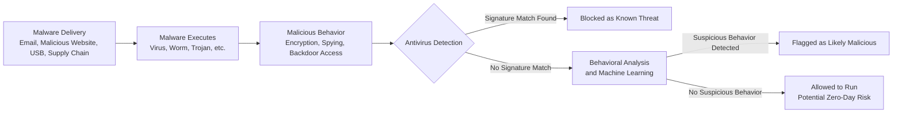

| Topic | Level | Reading Time | Prerequisites |
|---|---|---|---|
| Malware and Antivirus | Beginner | ~30 min | Basic understanding of operating systems and general security concepts |

> **Goal of this section:**
> You'll understand the most common types of malicious software (malware), how each type behaves and spreads, and how protection methods (antivirus) evolved from relying on signatures alone to using behavioral analysis and machine learning.

## Learning Objectives

By the end of this section, you will be able to:

- Describe how **Keyloggers** operate and distinguish between hardware and software forms.
- Explain the main factors behind the explosive growth of malware over the decades.
- List the common delivery methods attackers use to get malware onto a victim's system.
- Distinguish between different malware families — **Virus**, **Worm**, **Trojan**, **Ransomware**, **Spyware**, **Adware**, **Rootkit**, **Backdoor**, **Fileless Malware**, and **Botnet** — based on how each one spreads and behaves.
- Explain how **signature-based detection** works and why it fails against zero-day malware.
- Explain how modern antivirus combines signatures, **behavioral analysis**, and **machine learning** to detect new threats.

## Table of Contents

- [Keyloggers: Recording Every Keystroke](#keyloggers-recording-every-keystroke)
- [The Explosive Growth of Malware](#the-explosive-growth-of-malware)
- [How Malware Gets Delivered](#how-malware-gets-delivered)
- [Virus: Malware That Needs a Host](#virus-malware-that-needs-a-host)
- [Worm: Malware That Spreads Itself](#worm-malware-that-spreads-itself)
- [Trojan: The Disguise Attack](#trojan-the-disguise-attack)
- [Ransomware: Holding Data Hostage](#ransomware-holding-data-hostage)
- [Spyware: The Silent Watcher](#spyware-the-silent-watcher)
- [Adware: The Annoying (But Less Dangerous) One](#adware-the-annoying-but-less-dangerous-one)
- [Rootkits: The Master of Hiding](#rootkits-the-master-of-hiding)
- [Backdoor: The Secret Entrance](#backdoor-the-secret-entrance)
- [Fileless Malware: Attacks That Leave No Trace](#ileless-malware-attacks-that-leave-no-trace)
- [Botnet: An Army of Hijacked Devices](#botnet-an-army-of-hijacked-devices)
- [Antivirus Method 1: Signature-Based Detection](#antivirus-method-1-signature-based-detection)
- [Antivirus Method 2: Behavior-Based Detection](#antivirus-method-2-behavior-based-detection)
- [Malware Families at a Glance](#malware-families-at-a-glance)
- [Malware Delivery and Detection Diagram](#malware-delivery-and-detection-diagram)
- [Career Connection](#career-connection)
- [Key Terms Glossary](#key-terms-glossary)
- [Summary](#summary)

## Keyloggers: Recording Every Keystroke

A **Keylogger** is a tool (hardware or software) that silently records every keystroke (**key**) you make on your keyboard.

Picture it as a hidden "tape recorder" under your desk, except instead of recording sound, it records every letter, number, and symbol you type, in the exact order you typed them.

This means it can capture:

- Usernames and passwords as you log in to accounts.
- Credit card numbers typed into checkout forms.
- Private messages, emails, searches: literally anything you type.

There are two main forms of Keyloggers:

- **Hardware Keyloggers**: a small physical device connected between the keyboard and the computer (like a small USB dongle). This type was more common in the past because it is invisible to antivirus software, since it doesn't run as code on the computer at all.
- **Software Keyloggers**: this is the most common form today. It is a small piece of malicious code that runs in the background inside the operating system, silently recording keystrokes and sending them to the attacker.

## The Explosive Growth of Malware

If we look at the volume of malware over the decades, we see truly explosive growth:

| Year | Approximate number of known malware samples |
|---|---|
| 1990 | About 1,300 samples |
| 2000 | About 50,000 samples |
| 2010 | About 200 million samples |
| Today | Billions of samples, with hundreds of thousands of new samples discovered every day |

> [!NOTE]
> This explosive growth is no accident; there are clear reasons behind it, which we'll go through in detail.

Why did this number explode like this?

- The internet became widespread, giving attackers a global distribution network.
- Malware became financially profitable (ransomware payments, selling stolen data on dark web markets, renting out botnets as a service).
- Malware-building tools became easier to use. Attackers no longer need deep programming skills; there are now "malware-building kits" sold on underground forums, sometimes called **malware-as-a-service**.
- **Automated malware variation**: attackers use tools that automatically generate millions of slightly modified copies of the same malware (changing its fingerprint a little each time), specifically to evade signature-based detection, which we'll explain in detail later.

## How Malware Gets Delivered

There are several main ways malware actually reaches the victim:

### Email — The Most Common Delivery Method

Email is the **number one method** for delivering malware:

- Malicious attachments disguised as invoices, resumes, shipping notifications, or urgent documents.
- **Phishing links** inside emails that lead to fake login pages or trigger automatic downloads.

> [!IMPORTANT]
> This is exactly why organizations invest heavily in email filtering and monitoring: it is the single biggest door attackers use.

### Malicious Websites (Domains)

Simply visiting a compromised or fake website can trigger a **drive-by download**: the malware downloads and installs itself just by the page loading, sometimes exploiting a browser vulnerability without you clicking anything at all.

Attackers also register domains that look almost identical to the real ones (for example, `micros0ft.com` with a zero instead of the letter o) to trick users into visiting them.

### Other Delivery Methods

- **USB Drives**: malware files that run automatically when a USB device is plugged in (famously used in the **Stuxnet** attack).
- **Software Bundling**: malicious files hidden inside free downloads such as cracked software or pirated games.
- **Supply Chain Attacks**: the attacker compromises the update system of a legitimate software vendor, so victims install the malware disguised as an official, trusted update.

> [!TIP]
> Think of malware delivery as the different ways a thief can get into your house: through the front door (email), through an open window (a vulnerable website), or by disguising himself as a delivery worker (a fake software update).

## Virus: Malware That Needs a Host

A **Virus** attaches itself to a legitimate file and spreads when the user executes that infected file.

Example: if you double-click `notepad.exe` and that particular copy is infected, you execute the malicious code attached to it without knowing.

Its key characteristics:

- It needs **user action** to spread: someone has to open the infected file or run the infected program. It cannot spread on its own.
- It spreads with the same logic as a biological virus: it infects a **host**, replicates, and looks for new hosts to infect.
- Once active, it stays **resident in memory**, meaning that even after you close the infected program, the virus may keep running in the background, looking for other executable files on your system to infect next.
- Its effects: data corruption, file damage, and noticeable performance degradation because it consumes system resources.

> [!NOTE]
> Like the flu, it needs a carrier (the infected file) to actually move from person to person; it can't "teleport" across the room by itself.

## Worm: Malware That Spreads Itself

A **Worm** is fully self-replicating and spreads automatically across networks without any user interaction.

Unlike a virus, a worm is an independent, **standalone** program; it doesn't need to attach to another file in order to travel.

Think of a worm basically as a "vulnerability scanner with legs": it actively scans the network looking for machines with a specific **unpatched** vulnerability, and the moment it finds one, it exploits it, copies itself onto that machine, and then repeats the process from there.

Its key characteristics:

- It exploits vulnerabilities directly (no phishing, no tricking a user into clicking).
- It consumes huge amounts of **bandwidth** as it scans and spreads, which can disrupt networks even without directly damaging files.
- It can spread extremely fast. A famous historical example: the **SQL Slammer** worm (2003) infected about 75,000 vulnerable servers in less than 10 minutes.
- It needs no human interaction at all; it can spread while everyone is asleep, without a single click from any person.

> [!TIP]
> If a virus is like the flu (it needs contact between people), a worm is like an automatic sprinkler system that malfunctions and sprays itself through every open window in the building, entirely on its own, without anyone opening a door for it.

## Trojan: The Disguise Attack

Named after the mythical Trojan Horse, a **Trojan** is malware disguised as something legitimate and desirable, such as a free game, a cracked installer, or an email attachment labeled as an invoice.

The critical difference: a Trojan needs **the user to agree and install it themselves**, believing it is something safe or useful. Once installed, the malicious payload activates alongside (or instead of) whatever it was pretending to be.

What Trojans typically do once installed:

- Act as a **backdoor** (giving attackers remote access).
- Act as a **downloader**, silently pulling in additional, more dangerous malware after the initial installation.
- Act as a spying tool, silently monitoring the victim.

> [!IMPORTANT]
> Most modern cyberattacks start with a **Trojan**. It is usually the attacker's way of gaining a **first foothold** inside the system, after which they escalate to more dangerous tools such as ransomware or spyware.

## Ransomware: Holding Data Hostage

**Ransomware** encrypts the victim's files using very strong encryption that is practically impossible to break, then demands a payment (**ransom**), often in cryptocurrency, in exchange for the decryption key.

Its key characteristics:

- It uses strong encryption algorithms; without the attacker's key, the files effectively cannot be recovered, even by security experts.
- Common entry points: phishing emails (malicious attachments and links) or compromised **RDP (Remote Desktop Protocol)** connections. Attackers often brute-force weak RDP passwords to reach the machine directly.
- The impact can be catastrophic: ransomware is known to have frozen entire companies, hospitals, and even city governments, halting all operations until the systems were restored.
- Modern ransomware often adds **Double Extortion**: attackers don't just encrypt your files; they first steal a copy of them and threaten to leak the sensitive data publicly if the ransom isn't paid, even if you have backups.

> [!TIP]
> The safest defense is **regular backups**, ideally stored offline or on a separate, isolated system (so the ransomware can't reach and encrypt them too). If your files are safely backed up somewhere else, a ransomware attack becomes a minor nuisance instead of a disaster.

> [!NOTE]
> Imagine someone breaks into your house, steals nothing, but welds a locked steel box around all your furniture and leaves a note saying: "Pay me, or you'll never get your things back."

## Spyware: The Silent Watcher

**Spyware** is malware designed specifically to silently monitor the user's activity without their knowledge.

Common Spyware capabilities:

- **Keyloggers** (recording every keystroke, as we explained at the beginning).
- Screen recording and taking **screenshots**.
- Browser tracking: monitoring the websites you visit, your search history, and saved passwords.
- **Credential stealers**: specifically hunting for usernames and passwords stored in browsers or applications.

The main goal: **account theft**, stealing enough personal information to hijack email accounts, banking logins, social media, and so on.

> [!WARNING]
> An important and often overlooked point: traditional antivirus solutions are often bad at detecting spyware, and when they do detect it, detection is often weak or inconsistent, because spyware is specifically designed to blend in and mimic normal system behavior rather than acting noisily like a virus or a worm.

Specialized tools exist specifically to fight this category. For example, **Spybot** is a tool built specifically to hunt spyware and adware, because general-purpose antivirus is often not enough on its own.

## Adware: The Annoying (But Less Dangerous) One

**Adware** is malware that bombards the user with unwanted ads: popups, browser redirects, and ads injected into web pages where they shouldn't be.

It is often silently bundled inside free software: you download a free tool, and the adware silently installs alongside it, sometimes without any clear option to decline the installation.

Compared to other types of malware, adware is generally less destructive; it doesn't usually steal your banking details or encrypt your files.

But it shouldn't be taken lightly:

- It can noticeably slow down your system and browser.
- Some types of adware also track your browsing habits to serve more targeted (and more intrusive) ads, which blurs the line between adware and spyware.
- Some adware families are known to act as a **gateway**, silently downloading more dangerous malware later.

## Rootkits: The Master of Hiding

A **Rootkit** is malware designed specifically to hide itself, and any other malware installed alongside it, from detection.

What makes rootkits especially dangerous is **where** they run:

- They embed themselves at very low levels of the system: the **kernel** (the core of the operating system) or even the **boot sector** (the code that runs before the operating system has even finished loading).
- Running at this level means the rootkit can literally intercept and manipulate what the operating system itself reports. For example, it can hide its files from file listings or hide its running process from the task manager, effectively lying directly to the very tools you would normally use to detect it.

Because of this, rootkits give attackers **persistent**, highly stealthy access and are often used to maintain long-term control over a compromised system without being noticed.

They are known for being extremely hard to remove. In many serious cases, security professionals recommend wiping the operating system completely and reinstalling it from scratch, because you effectively can't trust anything the infected system reports about itself anymore.

> [!WARNING]
> If other types of malware are like a thief hiding in your closet, a rootkit is like a thief who reprogrammed your home's security cameras to show an empty room: even if you look directly at the footage, you won't see him.

## Backdoor: The Secret Entrance

A **Backdoor** is a hidden method that lets an attacker remotely access a system, bypassing the normal authentication mechanism entirely (without needing a valid username and password).

Backdoors are often installed by **Trojans** as their main payload: once the Trojan tricks you into installing it, one of its first actions is often to silently open this hidden entrance for the attacker.

Once the backdoor is in place, the attacker can typically:

- Execute commands remotely on the victim's machine, as if sitting at the keyboard themselves.
- Steal data directly from the system.
- Deploy additional malware whenever they want.

> [!NOTE]
> Imagine a thief who, on his first visit, steals nothing; he just quietly installs an extra hidden door at the back of your house that nobody but him knows about, so he can come and go freely, at any time, without needing a key or triggering an alarm.

## Fileless Malware: Attacks That Leave No Trace

**Fileless Malware** is a modern, advanced technique that doesn't rely on saving traditional files to disk at all.

Instead, it runs directly in memory (**RAM**) and often abuses trusted, legitimate system tools that already exist inside the operating system, most notably **PowerShell** (the scripting and automation tool built into Windows) or other native administrative tools.

Why this is so effective for attackers:

- Traditional antivirus often works by scanning files on disk; if no malicious file was ever written to disk, there is often nothing for the antivirus to scan or flag.
- Since it lives in memory, it can leave almost no **forensic trace**: if you restart the machine (which clears RAM) before the investigation starts, the evidence can actually disappear.

This technique is a **hallmark** of **APT (Advanced Persistent Threat)** attacks, the term used for sophisticated attacker groups, often state-sponsored or highly skilled, that prioritize staying hidden for long periods over fast, noisy damage.

> [!TIP]
> Instead of leaving a fingerprint on a stolen object (a file on disk), the attacker is like a ghost whispering instructions directly into the house's intercom system (PowerShell), using the house's own trusted equipment to do the dirty work, then vanishing without leaving anything physical behind.

## Botnet: An Army of Hijacked Devices

A **Botnet** is a huge group of compromised devices (**bots** or **zombies**), all silently controlled remotely by a single attacker known as the **botmaster**.

These infected devices can include ordinary computers, but increasingly they also include **IoT** devices, such as security cameras, routers, and smart home devices, because these are often poorly secured and rarely monitored by their owners.

> [!IMPORTANT]
> This takes us straight back to the **SYN Flood** topic we studied earlier: a botnet is exactly the kind of infrastructure an attacker uses to launch large-scale attacks like that.

Common uses of a botnet:

- **DDoS** attacks: ordering thousands of bots to flood a specific target at the same time (like the SYN flood attack we studied).
- Sending **Spam**: mass distribution of phishing emails or ads from thousands of different infected machines at once, which makes them hard to block by simply blacklisting a single source.
- Spreading **Ransomware**: using the botnet as a distribution mechanism to deploy ransomware to a large number of targets at the same time.

> [!TIP]
> The botmaster is like a puppeteer controlling thousands of puppets at once from a single set of strings. Each individual puppet (infected device) may look harmless on its own, but their combined, coordinated power can be devastating.

## Antivirus Method 1: Signature-Based Detection

This method is directly tied to a concept we explained earlier: calculating a file's **hash** (such as SHA-256 or MD5).

How signature-based antivirus works:

1. The antivirus calculates the hash of the file you are trying to open or run.
2. It compares that hash against a huge database of known malware hashes.
3. If there is a match, the file is immediately flagged as malicious and is blocked or alerted on.
4. If there is no match, the file is marked as clean and allowed to run.

Beyond hashes alone, signature-based detection also looks for:

- **Unique code patterns**: specific code sequences that malware analysts extracted from known samples.
- **Unique strings**: specific pieces of text embedded inside the malicious code itself (such as a distinctive error message or a specific command the malware uses).

> [!WARNING]
> Since new malware is constantly being created (remember the explosive growth we explained), antivirus companies have to update their signature databases very frequently, often every few minutes, just to keep up with that pace.

The main weakness of this method: it can only catch malware that has **already been discovered, analyzed, and added** to the database somewhere in the world. Any brand-new malware that has never been seen before (often called **zero-day malware**) will pass completely unnoticed by signature-based detection, simply because there is no matching record to compare it against yet.

## Antivirus Method 2: Behavior-Based Detection

Since signature-based detection alone is no longer enough against the volume and sophistication of today's malware, mature organizations **don't rely on signature-based detection alone**.

Modern anti-malware solutions combine three layers of defense:

1. **Signature-Based Detection**: the traditional method based on hashes and pattern matching, still very useful for fast, efficient detection of known threats that have already been analyzed.
2. **Behavioral Analysis**: instead of only checking what the file "looks like," this method watches "what the file actually does" while it runs. For example: is this program suddenly trying to encrypt hundreds of files rapidly? Is it trying to modify critical system settings? Is it trying to disable the antivirus itself? These are major **behavioral red flags**, regardless of whether the file matches any known signature.
3. **Machine Learning**: trained on huge datasets of software known to be malicious and software known to be safe, machine learning models can identify suspicious characteristics and patterns in brand-new, never-before-seen files. This is essentially a statistical prediction, based on what the model has learned, that the file is likely malicious, even without an exact match to a specific signature.

> [!IMPORTANT]
> The main advantage of this multi-layered approach: it can detect brand-new, never-before-seen malware (**zero-days**) by focusing on suspicious behavior and characteristics, instead of requiring the malware to already be recorded somewhere.

> [!TIP]
> Instead of only checking a book of wanted-person photos (signature-based), modern security also has a guard watching how people actually behave in the building (behavioral analysis), like someone suspiciously trying every door handle in the hallway, plus a trained profiler (machine learning) who can flag someone as suspicious based on subtle patterns, even if that person has never been caught before.

## Malware Families at a Glance

The following table summarizes the key differences between the various types of malware:

| Type | Needs a Host File | Needs User Action | Main Behavior |
|---|---|---|---|
| **Virus** | Yes | Yes | Attaches to a file and spreads when it is executed |
| **Worm** | No | No | Self-replicates and spreads by exploiting vulnerabilities |
| **Trojan** | No | Yes | Disguises itself as legitimate software to trick the user into installing it |
| **Ransomware** | Depends on the entry method | Depends on the entry method | Encrypts files and demands a ransom |
| **Spyware** | Depends on the entry method | Depends on the entry method | Silently monitors user activity |
| **Adware** | No, often bundled with software | Depends on the entry method | Displays unwanted ads |
| **Rootkit** | No | Depends on the entry method | Hides itself and other files from detection |
| **Backdoor** | No, often a Trojan payload | Depends on the entry method | Provides remote access that bypasses authentication |
| **Fileless Malware** | No | Depends on the entry method | Runs only in memory, abusing system tools |
| **Botnet** | No | No (after the initial infection) | A network of compromised devices used for mass attacks |

## Malware Delivery and Detection Diagram

The following diagram shows the malware journey from delivery to detection:

## Career Connection

Understanding malware families and how to detect them is essential across several career paths:

- In **SOC**, distinguishing between different malware types helps prioritize alerts and determine how fast to respond.
- In **Malware Analysis** and **Reverse Engineering**, understanding how each type works is essential for analyzing new samples and extracting signatures from them.
- In **Digital Forensics**, dealing with threats like **Fileless Malware** requires specialized skills to collect evidence from memory before it disappears.
- In **Incident Response**, quickly identifying the malware type (for example, ransomware versus a rootkit) determines the appropriate containment and response strategy.

## Key Terms Glossary

| Term | Definition |
|---|---|
| **Keylogger** | A tool that silently records every keystroke on the keyboard. |
| **Virus** | Malicious software that attaches to a legitimate file and spreads when the user executes it. |
| **Worm** | Malicious software that self-replicates and spreads across networks without human interaction. |
| **Trojan** | Malicious software disguised as a legitimate program to trick the user into installing it voluntarily. |
| **Ransomware** | Malicious software that encrypts the victim's files and demands a ransom for decryption. |
| **Spyware** | Malicious software designed to secretly monitor user activity. |
| **Adware** | Malicious software that displays unwanted ads in an annoying way. |
| **Rootkit** | Malicious software that hides itself and any other software from detection by running at low levels of the system. |
| **Backdoor** | A hidden method that gives an attacker remote access, bypassing normal authentication mechanisms. |
| **Fileless Malware** | Malicious software that runs entirely in memory without writing files to disk. |
| **Botnet** | A group of compromised devices controlled by a single attacker to carry out mass attacks. |
| **Signature-Based Detection** | A detection method based on matching a file against a database of known signatures (hashes and patterns). |
| **Zero-Day Malware** | Brand-new malicious software that has not yet been analyzed or recorded in any database. |
| **Behavioral Analysis** | A detection method that monitors a program's behavior while it runs instead of relying only on what it looks like. |
| **Machine Learning (in Antivirus)** | Models trained on huge amounts of data to predict how likely a new file is to be malicious based on its patterns. |

## Summary

- **Keyloggers** record every keystroke; they exist as hardware (rare today) or software (the most common), and are used to steal credentials or for authorized employee monitoring.
- **Malware** grew explosively from about 1,300 samples in 1990 to hundreds of millions and billions today, driven by profitability and easy-to-use creation tools.
- Malware is delivered mainly through email and malicious websites, as well as USB devices and compromised software updates.
- Each type of malware has a distinctive behavior: **Virus** (needs a host file and user action), **Worm** (spreads on its own without a user), **Trojan** (disguised, tricks the user into installing it), **Ransomware** (encrypts and extorts), **Spyware** (monitors secretly), **Adware** (unwanted ads), **Rootkit** (hides everything), **Backdoor** (secret remote access), **Fileless Malware** (memory only, hard to trace), and **Botnet** (an army of compromised devices for large-scale attacks).
- Antivirus evolved from relying on **signature-based detection** alone (fast, but blind to new/unknown threats) to a modern combined approach using signatures + behavioral analysis + machine learning, which allows brand-new malware to be detected based on its behavior, not just its appearance.

