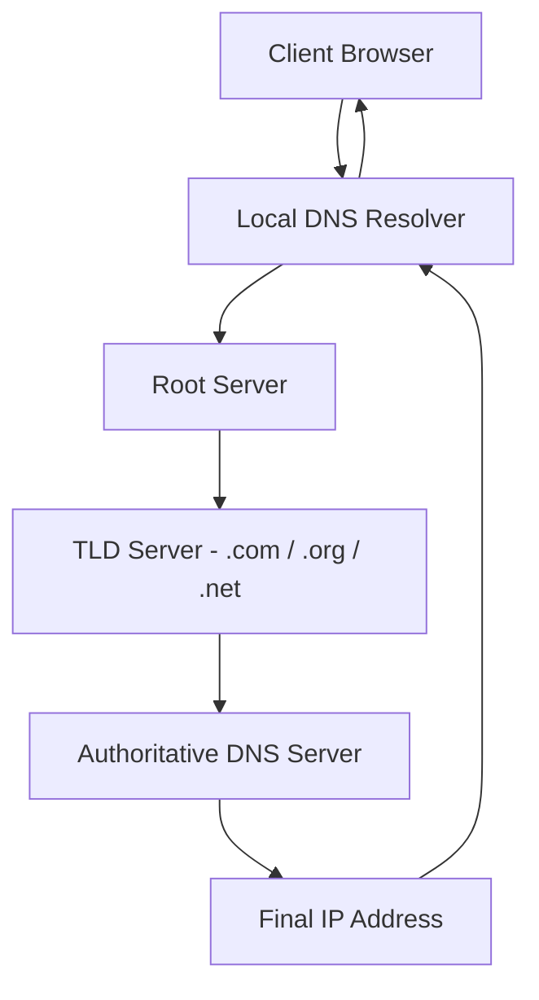
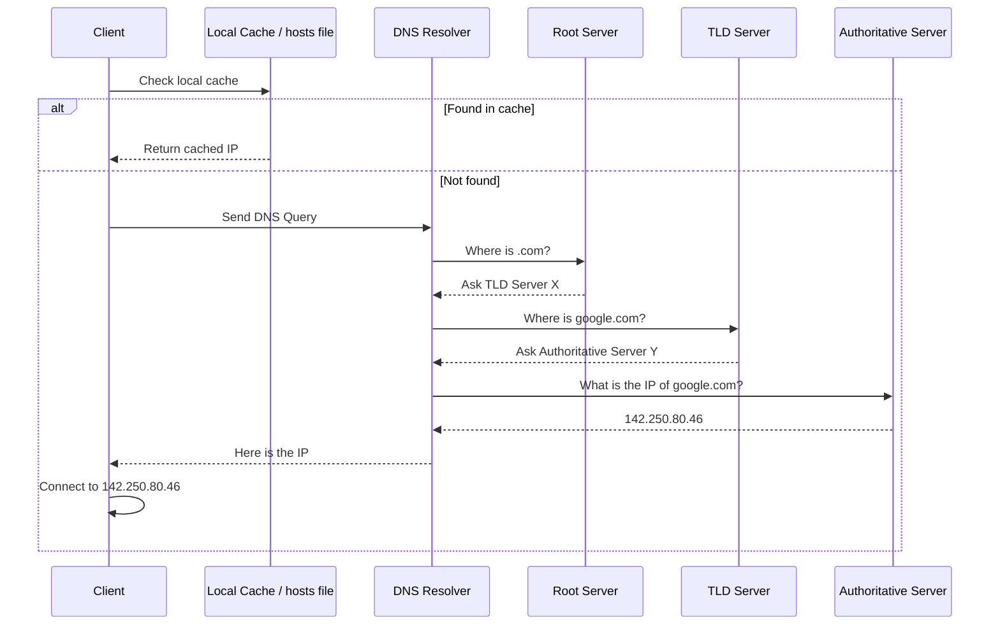
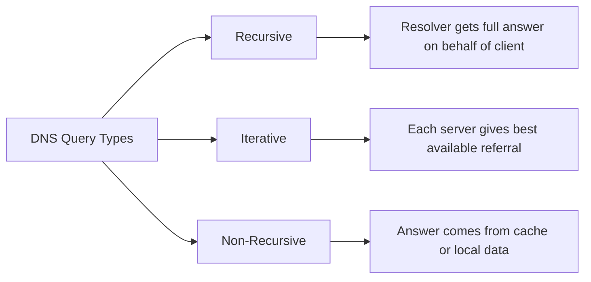
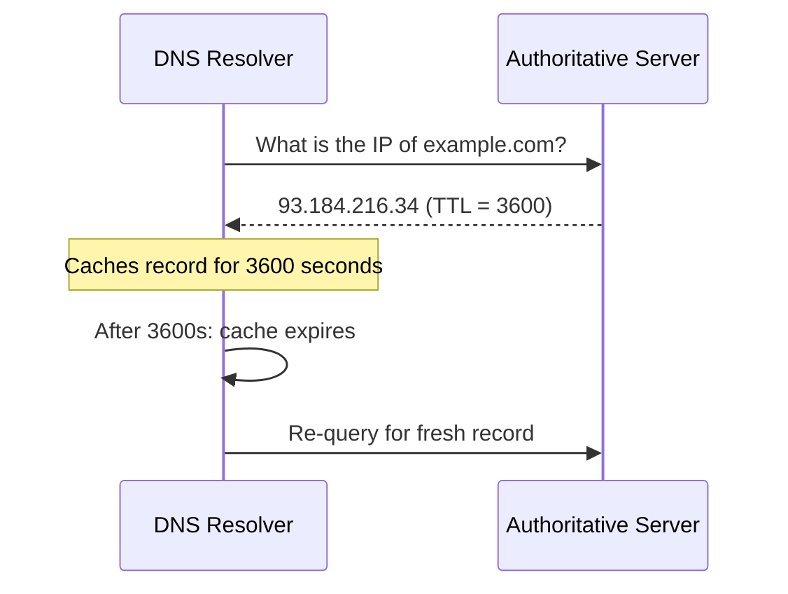
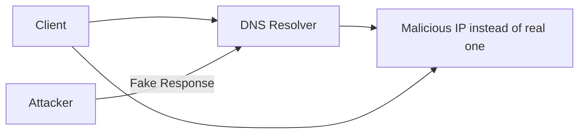
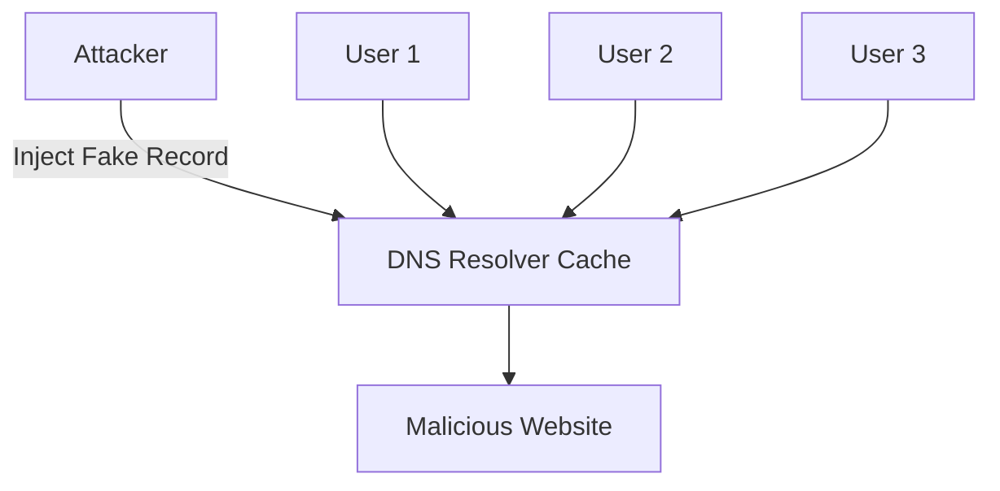
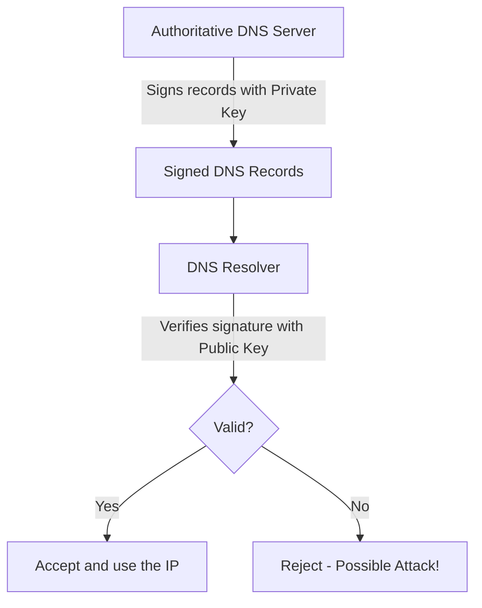

> **Goal of this section:** You'll understand how DNS translates the names we type, such as `google.com`, into IP addresses that devices can communicate with, and you'll learn the possible security risks and how to protect against them.

---

# Domain Name System (DNS) — How the Internet Finds Its Way

## Table of Contents

- [DNS Overview](#dns-overview)
- [DNS Hierarchy](#dns-hierarchy)
- [DNS Resolution Process](#dns-resolution-process)
- [Types of DNS Queries](#types-of-dns-queries)
- [Common DNS Record Types](#common-dns-record-types)
- [DNS Caching and TTL](#dns-caching-and-ttl)
- [Reverse DNS](#reverse-dns)
- [DNS Security Threats](#dns-security-threats)
- [DNS Security — DNSSEC](#dns-security--dnssec)
- [Summary](#summary)

---

## DNS Overview

**DNS (Domain Name System)** is like the internet's "phone book."

When you type `www.google.com` in the browser, you're not typing the server's real IP address. DNS is what takes that name and returns the matching IP address so your device knows how to connect to it.

**A simple example:**

```
User types:    www.google.com
DNS resolves:  142.250.80.46
Browser connects to: 142.250.80.46
```

> [!NOTE]
> DNS runs on **Port 53** and mostly uses **UDP**, but if the response is large it switches to **TCP**.

---

## DNS Hierarchy

DNS isn't a single server — it's a **distributed hierarchical system**. That means there are many levels that work together to get the answer.



### Levels of the DNS Hierarchy

| Level | Name | Role |
|--------|-------|-------|
| 1 | **Root Servers** | The starting point — directs the query to the right TLD |
| 2 | **TLD Servers** | Manage extensions such as `.com`, `.org`, `.net` |
| 3 | **Authoritative DNS Servers** | Hold the actual records for the domain and return the IP |
| 4 | **Local DNS Resolver** | Performs the lookup on behalf of the client (usually provided by the ISP) |

> [!IMPORTANT]
> The **Root Servers** don't know the IP of every site — they only know who is responsible for each **TLD**. That's what makes the system distributed and fast.

---

## DNS Resolution Process

When you type a site's name in the browser, the following happens step by step:



### The Steps in Detail

**Step 1 — Check Local Cache:**

The client first looks at the **hosts file** on its own machine:
- **Windows:** `C:\Windows\System32\drivers\etc\hosts`
- **Linux/Unix:** `/etc/hosts`

If it finds the IP there, it uses it right away without asking any DNS server.

**Step 2 — DNS Resolver:**

If it's not in the cache, the request is sent to the **DNS Resolver** (usually provided by the ISP, or one you set yourself, such as Google's `8.8.8.8`).

**Steps 3 → 5 — Iterative Queries:**

The resolver asks:
1. The **Root Server**: who is responsible for `.com`?
2. The **TLD Server**: who has the records for `google.com`?
3. The **Authoritative Server**: what is the IP of `google.com`?

**Step 6 — Response + Cache:**

The resolver returns the IP to the client and keeps it in the **Cache** so the next time is faster.

**Step 7 — Connect:**

The client connects to the IP it received.

> [!TIP]
> You can perform a manual **DNS Lookup** using these commands:
> ```bash
> # Windows
> nslookup google.com
>
> # Linux / macOS
> dig google.com
> host google.com
> ```

---

## Types of DNS Queries

There are 3 types of DNS queries:



| Type | Description | Who Uses It |
|------|-------|-------------|
| **Recursive** | The resolver does all the work and returns the complete answer | The client with the resolver |
| **Iterative** | Each server returns the best answer it has or refers to another server | The resolver with the Root/TLD/Auth servers |
| **Non-Recursive** | The answer comes directly from the cache or from local data | A resolver or authoritative server |

> [!NOTE]
> Usually, the client sends a **Recursive Query** to the resolver, and the resolver sends **Iterative Queries** to the rest of the servers.

---

## Common DNS Record Types

DNS doesn't just translate names into IP addresses — it has many types of records for different purposes:

| Record Type | Function | Example |
|--------------|---------|------|
| **A** | Maps a domain to an IPv4 address | `google.com → 142.250.80.46` |
| **AAAA** | Maps a domain to an IPv6 address | `google.com → 2607:f8b0::...` |
| **CNAME** | Alias — points to another domain name | `www.example.com → example.com` |
| **MX** | Specifies the domain's mail server | Used by email to route messages |
| **PTR** | Reverse lookup — from an IP to a domain name | `142.250.80.46 → google.com` |
| **NS** | Specifies the authoritative name servers | The ones responsible for the domain |
| **TXT** | Stores descriptive text | Used in SPF and DKIM for email security |

> [!TIP]
> If you work in email security, **MX** and **TXT** records are the most important, because they control how emails are sent and verified.

---

## DNS Caching and TTL

### Caching

DNS stores answers in the **Cache** in order to:
- Speed up resolution the next times
- Reduce the load on DNS servers

### TTL (Time To Live)

**TTL** is the time (in seconds) that a DNS record stays stored in the cache before it's refreshed.

```
TTL = 3600  →  The record is cached for one hour
TTL = 86400 →  The record is cached for 24 hours
TTL = 300   →  The record is cached for only 5 minutes
```



> [!NOTE]
> If you're doing a **Migration** of a site (changing its IP), you need to lower the TTL well enough before the change so the change propagates quickly across the internet.

---

## Reverse DNS

**Reverse DNS (rDNS)** does the exact opposite — instead of translating a name into an IP, it translates **an IP into a name**.

```
Forward DNS:  google.com      → 142.250.80.46
Reverse DNS:  142.250.80.46   → google.com
```

### It's Used In:

- **Email Validation:** servers check that the mail server has correct reverse DNS before accepting the email (to prevent spam)
- **Network Troubleshooting:** when you run `traceroute`, for example, it shows you names instead of IPs
- **Security Analysis:** analyzing logs and identifying the source of traffic

> [!NOTE]
> Reverse DNS works using a special type of record called a **PTR Record**, and it lives in a special domain called `.in-addr.arpa`.

---

## DNS Security Threats

DNS is one of the most attacked protocols, because it's so fundamental and wasn't originally designed to be secure.

### 1. DNS Spoofing / Cache Poisoning



**What happens?**

The attacker sends a **Fake DNS Response** to the resolver, giving it a wrong IP instead of the real one. The resolver stores this wrong IP in its cache, and every user who asks it gets directed to a fake site.

**The risk:** data theft, phishing, malware installation.

---

### 2. Man-in-the-Middle (MITM) Attack


**What happens?**

The attacker places themselves **between the client and the DNS server** — usually by using **ARP Spoofing** on the local network. They see the requests and send fake replies.

> [!WARNING]
> This attack is hard to detect, because the client doesn't know someone is in the middle. HTTPS and DNSSEC help mitigate the risk.

---

### 3. Hosts File Manipulation (Client Cache Poisoning)

**What happens?**

The attacker (or **Malware**) modifies the **hosts file** on the victim's machine directly:

```
# Windows: C:\Windows\System32\drivers\etc\hosts
# Linux:   /etc/hosts

# Malicious entry:
192.168.1.100   www.bank.com
```

Now, when someone types `www.bank.com` on this machine, it's directed to the wrong IP without asking any DNS server at all.

> [!IMPORTANT]
> The **hosts file** takes priority over DNS. That means even if DNS is correct, if the hosts file has been modified — the machine won't know.

**For protection:** review the hosts file periodically and use antivirus.

---

### 4. DNS Server Cache Poisoning

**The difference from Client Cache Poisoning:**

In Client Cache Poisoning, the attack targets only one machine. Here, the attacker targets **the DNS resolver itself**, so every user who uses the same resolver is affected.



> [!WARNING]
> This is one of the most dangerous attacks, because it affects **thousands of users** at the same time with a single attack.

---

### Comparing the Threat Types

| Attack Type | Target | Scope | Difficulty |
|-----------|-------|--------|---------|
| **DNS Spoofing** | DNS Resolver | All users of the resolver | Medium |
| **MITM** | The local network | Limited to the network | High |
| **Hosts File Manipulation** | A single machine | Only one machine | Low (if they have access) |
| **Server Cache Poisoning** | DNS Server | Very wide | High |

---

## DNS Security — DNSSEC

**DNSSEC (DNS Security Extensions)** is the main solution to DNS spoofing problems.

### The Core Idea

DNSSEC adds a **digital signature** to every DNS record — just like signing a paper to prove that you're the one who wrote it.



### How Does It Work?

**Step 1 — Signing:**
- The authoritative server signs every DNS record with its own **Private Key**.

**Step 2 — Verification:**
- When the resolver receives the response, it verifies the signature using the available **Public Key**.

**Step 3 — Decision:**
- If the signature is valid ✅ → the response is accepted.
- If the signature is invalid ❌ → the response is rejected and an error appears.

### DNSSEC Guarantees:

| Guarantee | Meaning |
|--------|--------|
| **Data Integrity** | The DNS records weren't modified along the way |
| **Authentication** | The response comes from the real server |
| **Protection against Spoofing** | The attacker can't inject fake records |

> [!IMPORTANT]
> DNSSEC **doesn't encrypt** DNS traffic — it only verifies authenticity. If you want privacy too, you use **DNS over HTTPS (DoH)** or **DNS over TLS (DoT)**.

> [!NOTE]
> Not all domains support DNSSEC. You can check with this command:
> ```bash
> dig +dnssec google.com
> ```

---

## Summary

### Key Points You Learned in This Section:

- **DNS** is a distributed hierarchical system that translates **Domain Names** into **IP Addresses** — it runs on **Port 53** using **UDP/TCP**.

- The **DNS Hierarchy** consists of 4 levels: **Root Servers → TLD Servers → Authoritative Servers → Local Resolver**.

- **The resolution process** starts at the **Local Cache** (hosts file), and if the answer isn't there, it goes to the DNS resolver, which asks the servers step by step.

- There are 3 query types: **Recursive** (the resolver gets the complete answer), **Iterative** (each server refers to the next), and **Non-Recursive** (the answer comes from the cache).

- The most important **DNS Record Types**: `A` (IPv4), `AAAA` (IPv6), `CNAME` (Alias), `MX` (Mail), `PTR` (Reverse), `TXT` (Security/Verification).

- **TTL** determines when the cache is refreshed — very important for migrations and performance.

- **Reverse DNS** does the opposite (IP → Domain) and is used in email validation and security analysis.

- **The most dangerous security threats:** DNS Spoofing, MITM, Hosts File Manipulation, and Server Cache Poisoning — all of which aim to direct the user to fake sites.

- **DNSSEC** is the solution: it adds **Digital Signatures** to DNS records to verify their authenticity — it guarantees **Integrity** and **Authentication**, but not **Encryption**.
