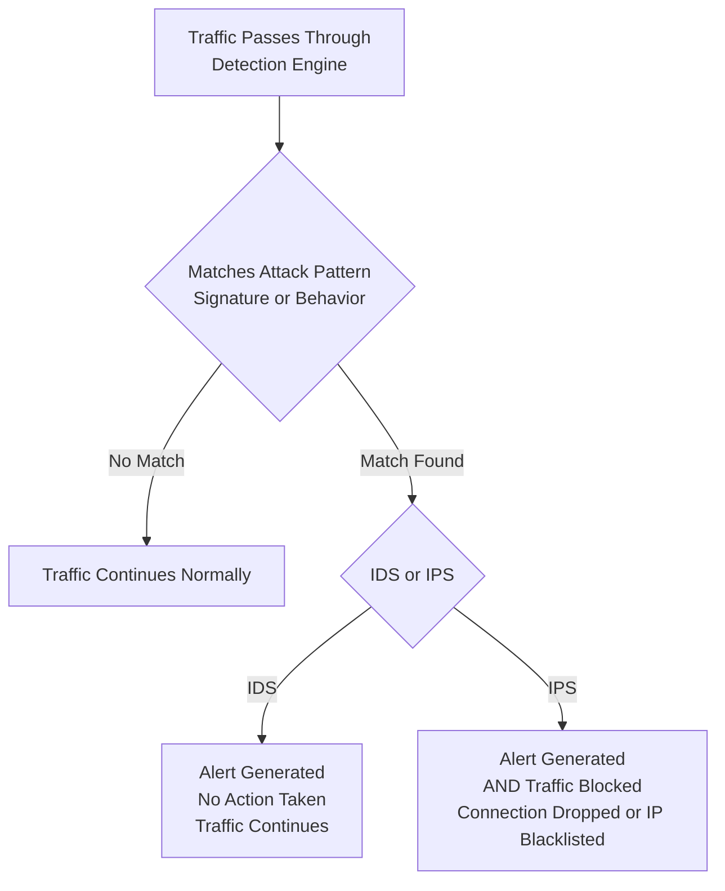

| Topic | Level | Reading Time | Prerequisites |
|---|---|---|---|
| Detection vs. Prevention: IDS and IPS | Intermediate | ~22 min | Basic understanding of firewalls, TCP/IP, and the SSH protocol |

> **Goal of this section:**
>  You'll understand the difference between a system that only detects and reports (**IDS**) and a system that takes actual action (**IPS**), and we'll break down a real rule in Suricata/Snort format line by line so you understand how an SSH brute-force attempt is actually detected.


## Learning Objectives

By the end of this section, you will be able to:

- Define an **IDS (Intrusion Detection System)** and explain why its only job is detection, not blocking.
- Distinguish between **signature-based** and **behavior-based (anomaly)** detection methods.
- Distinguish between **NIDS** and **HIDS** based on where each one monitors.
- Define an **IPS (Intrusion Prevention System)** and explain how it differs from an IDS in terms of action.
- Explain the risk of **False Positives** in an IPS and why its rules must be carefully tuned.
- Read and interpret a real **Suricata/Snort** rule line by line to detect an SSH brute-force attempt.

## Table of Contents

- [IDS: The Security Camera of Your Network](#ids-the-security-camera-of-your-network)
- [How an IDS Identifies Attacks](#how-an-ids-identifies-attacks)
- [Why an IDS Can Afford to Be Thorough](#why-an-ids-can-afford-to-be-thorough)
- [Two Types of IDS: NIDS and HIDS](#two-types-of-ids-nids-and-hids)
- [IPS: The Security Guard Who Actually Steps In](#ips-the-security-guard-who-actually-steps-in)
- [The Big Risk: False Positives](#the-big-risk-false-positives)
- [Why IPS Rules Must Be Carefully Tuned](#why-ips-rules-must-be-carefully-tuned)
- [Breaking Down a Suricata/Snort Rule](#breaking-down-a-suricatasnort-rule)
- [IDS vs. IPS at a Glance](#ids-vs-ips-at-a-glance)
- [Detection and Response Flow Diagram](#detection-and-response-flow-diagram)
- [Career Connection](#career-connection)
- [Key Terms Glossary](#key-terms-glossary)
- [Summary](#13-summary)

## IDS: The Security Camera of Your Network

An **IDS (Intrusion Detection System)** sits **inline** inside your network and monitors every packet that passes through it, like a security camera that continuously records and analyzes traffic.

Its only job is **detection**. It doesn't block anything; it just identifies suspicious activity and reports it (**alerts**).

## How an IDS Identifies Attacks

An IDS identifies attacks in two main ways:

- **Signature-Based**: Matching traffic against a database of known attack patterns (just as antivirus software matches against known virus signatures).
- **Behavior-Based (Anomaly Detection)**: Noticing that something looks abnormal compared to normal traffic patterns, even if it doesn't match any known signature.

## Why an IDS Can Afford to Be Thorough

Since detection is its only job, an IDS can **afford** to have a large, detailed rule list and deep inspection capabilities.

> [!NOTE]
> The reason is that it has no concern about blocking legitimate traffic by mistake, because it doesn't block anything at all. This design freedom allows it to be very precise and thorough without any operational cost to the business.

## Two Types of IDS: NIDS and HIDS

There are two main types of IDS:

| Type | Where it monitors | What it watches for |
|---|---|---|
| **NIDS (Network-Based IDS)** | Traffic at the level of the network as a whole | Attacks such as port scans, exploit attempts, or abnormal spikes in traffic |
| **HIDS (Host-Based IDS)** | A specific individual device or server | Suspicious activity on the device itself (such as unexpected file changes or unusual login attempts) |

> [!TIP]
> Think of a security guard sitting in a monitoring room watching cameras. He notices something suspicious and reports it immediately, but he doesn't run out and physically stop the intruder himself. That's exactly what an IDS does: detect and report.

## IPS: The Security Guard Who Actually Steps In

An **IPS (Intrusion Prevention System)** starts with exactly the same work as an IDS; it has to detect the attack first before it can do anything about it.

The difference: as soon as the IPS detects something harmful, it **doesn't just report it**; it **actually takes action**, such as automatically blocking the traffic, **dropping the connection**, or putting the source IP on a blacklist (**blacklisting**).

> [!TIP]
> Going back to the security guard analogy: the IPS is a guard who, when he sees someone suspicious on camera, doesn't just report it. He runs out and physically stops them. That's very powerful, but if he grabs the wrong person by mistake (a **false positive**), that's a real problem too.

## The Big Risk: False Positives

The big risk here is **False Positives**.

If the IPS mistakenly identifies legitimate traffic as an attack and blocks it, it could **accidentally stop real business traffic**; for example, it might block real customers from reaching your website because it wrongly treated their normal traffic as an attack.

> [!WARNING]
> This can cause **real financial damage**. An IPS isn't just a security tool; it's a system that can directly affect business continuity if it's misconfigured.

## Why IPS Rules Must Be Carefully Tuned

Because of this risk, IPS rules must be written, tested, and **tuned** very carefully; you are effectively giving this system the authority to make automatic decisions that affect your business.

> [!IMPORTANT]
> IPS rules are usually written in **Suricata** or **Snort** format, two of the most widely used **open-source** IDS/IPS engines in the industry.

## Breaking Down a Suricata/Snort Rule

Let's break this rule down piece by piece:

```
alert tcp any any -> any 22 (
    msg:"Possible SSH brute force attempt";
    flags:S;
    threshold:type both, track by_src, count 5, seconds 60;
    sid:100100;
    rev:1;
)
```

| Part | Meaning |
|---|---|
| `alert tcp any any -> any 22` | Watch any TCP traffic, from any source IP and any source port, headed to any destination IP on port 22 (the standard port for **SSH**, used for remote login to servers). |
| `msg:"Possible SSH brute force attempt"` | The **human-readable label** shown in the alert, describing what was detected. |
| `flags:S` | Look only at packets with the **SYN flag** set, meaning it specifically looks for new connection attempts (the first step of the TCP handshake). |
| `threshold:type both, track by_src, count 5, seconds 60` | If the same source IP tries to start 5 or more new SSH connections within 60 seconds, trigger the alert. |
| `sid:100100` | A **unique ID** for this specific rule, used to identify it in the logs. |
| `rev:1` | The rule's revision number, useful for tracking updates as the rule is improved over time. |

> [!IMPORTANT]
> This pattern, multiple rapid login attempts in a short time, is a classic sign that someone is trying to guess passwords (a **brute-force attack**).

**In plain English**: If any single IP address tries to start 5 or more SSH connections within one minute, treat it as a possible brute-force login attempt and trigger the alert.

## IDS vs. IPS at a Glance

The following table summarizes the fundamental difference between the two systems:

| Criterion | IDS | IPS |
|---|---|---|
| Primary function | Detection and alerting only | Detection and taking actual action |
| Deployment position | Usually outside the direct traffic path (**out-of-band**, or monitoring) | Directly in the traffic path (**inline**) |
| Main risk | False alerts that may be ignored (they don't affect the traffic itself) | Wrongly blocking legitimate traffic (a **false positive** actually affects the business) |
| Rule-tuning sensitivity | Less sensitive, because a false alert doesn't stop anything | Much more sensitive, because a wrong block can disrupt real services |

## Detection and Response Flow Diagram

The following diagram shows the difference between the IDS response path and the IPS response path for the same detected threat:



## Career Connection

Understanding the difference between IDS and IPS has direct applications in several career paths:

- In **SOC**, analyzing IDS/IPS alerts and understanding the difference between them is the foundation of day-to-day security incident investigation.
- In **Detection Engineering**, writing and tuning Suricata or Snort rules is a core part of building an organization's detection and response capabilities.
- In **Network Security Engineering**, deciding to place an IPS instead of an IDS (or vice versa) at certain points in the network is a strategic decision that balances security against business continuity.
- In **Incident Response**, knowing whether traffic was blocked automatically (IPS) or only reported (IDS) guides the next response steps.

## Key Terms Glossary

| Term | Definition |
|---|---|
| **IDS (Intrusion Detection System)** | A system that monitors traffic and detects suspicious activity, and only alerts without blocking. |
| **IPS (Intrusion Prevention System)** | A system that detects suspicious activity and takes actual action to block or stop it. |
| **Signature-Based Detection** | A detection method based on matching traffic against previously known attack patterns. |
| **Behavior-Based Detection (Anomaly Detection)** | A detection method based on noticing traffic deviating from normal, expected patterns. |
| **NIDS (Network-Based IDS)** | A detection system that monitors traffic across the entire network. |
| **HIDS (Host-Based IDS)** | A detection system installed on an individual device or server to monitor activity on it specifically. |
| **False Positive** | An alert or security action taken against activity that is actually normal and harmless. |
| **Suricata / Snort** | Widely used open-source engines for writing and running IDS/IPS rules. |
| **Brute-Force Attack** | An attack that relies on trying a large number of login attempts to guess the correct credentials. |

## Summary

- An **IDS** monitors traffic and detects suspicious activity, but its only job is alerting; it doesn't block anything.
- Detection is done in two ways: **signature-based** (matching against known patterns) and **behavior-based** (noticing deviations from normal).
- There are two types of IDS: **NIDS** monitors the network as a whole, and **HIDS** monitors a specific individual device.
- An **IPS** starts with the same detection as an IDS, but then **takes actual action**, such as automatic blocking or dropping the connection.
- The biggest risk with an IPS is **False Positives**, which can block legitimate business traffic and cause real financial damage.
- IPS rules must be tuned very carefully, and they are usually written in **Suricata** or **Snort** format.
- A real rule example shows how repeated SSH login attempts (5 or more attempts within 60 seconds from the same IP) are detected as a possible **brute-force attack**.

