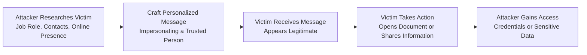

| Topic | Level | Reading Time | Prerequisites |
|---|---|---|---|
| Social Engineering and Phishing | Beginner | ~16 min | None |

Goal of this section: You'll understand how attackers exploit human psychological behavior to gain access to sensitive information or privileges, and you'll learn the difference between regular Phishing and targeted Spear Phishing.

## Learning Objectives

By the end of this section, you will be able to:

- Define **Social Engineering** and explain why humans can be the weakest link in a security system.
- Identify common social engineering techniques such as **phishing**, **spear phishing**, **pretexting**, **baiting**, and **impersonation**.
- Explain how attackers use **reconnaissance** (research) to make an attack more convincing.
- Distinguish between **Phishing** and **Spear Phishing** in terms of scope and targeting.
- Recommend practical mitigations that organizations can use to reduce the risk of social engineering attacks.

## Table of Contents

- [What Is Social Engineering](#what-is-social-engineering)
- [Why Humans Are the Weakest Link](#why-humans-are-the-weakest-link)
- [Reconnaissance: How Attackers Research Their Targets](#reconnaissance-how-attackers-research-their-targets)
- [High-Value Targets: Privileged Employees](#high-value-targets-privileged-employees)
- [Common Social Engineering Techniques](#common-social-engineering-techniques)
- [Phishing in Depth](#phishing-in-depth)
  - [How a Phishing Attack Works](#how-a-phishing-attack-works)
  - [Malicious Links and Attachments](#malicious-links-and-attachments)
- [Spear Phishing: Targeted and Personalized Attacks](#spear-phishing-targeted-and-personalized-attacks)
- [Phishing vs. Spear Phishing](#phishing-vs-spear-phishing)
- [Attack Flow Diagram](#attack-flow-diagram)
- [Mitigations and Best Practices](#mitigations-and-best-practices)
- [Career Connection](#career-connection)
- [Key Terms Glossary](#key-terms-glossary)
- [Summary](#13-summary)

## What Is Social Engineering

**Social Engineering** is the use of **psychological manipulation** to convince a person to perform a specific action or reveal information that should have stayed protected.

Instead of trying to break into a complex technical system, the attacker targets the human element directly and tries to exploit the nature of human behavior itself to reach their goal.

> [!NOTE]
> The fundamental difference between a technical attack and Social Engineering is that the first targets a vulnerability in a system or in code, while the second targets a vulnerability in a person's thinking or behavior.

## Why Humans Are the Weakest Link

In many cases, **humans are the weakest point in a security system**, because attackers can exploit natural human emotions and behaviors such as:

- **Trust**.
- **Curiosity**.
- **Fear**.
- A sense of **urgency**.

> [!IMPORTANT]
> No matter how strong and expensive the technical protection systems are, Social Engineering can bypass them completely, because the attacker isn't trying to break the system; they're trying to convince a human to open the door for them.

## Reconnaissance: How Attackers Research Their Targets

Before carrying out the attack, attackers often do **research** on their targets through **social media** and **publicly available information**.

The goal of this research is to understand:

- The victim's **interests**.
- Their daily **habits**.
- Their personal and professional **relationships**.
- Their job **responsibilities**.

This information helps the attacker build a more convincing attack scenario, because they can use real details that make the message or request seem logical and legitimate.

## High-Value Targets: Privileged Employees

A **highly privileged employee** can be a very valuable target for the attacker, because compromising their account can provide **access** to very sensitive systems and information inside the organization.

> [!WARNING]
> Attackers don't only target technical staff or senior executives; anyone with important access privileges (such as an employee in the accounting or HR department) can be an attractive target if their account can open the door to a sensitive system.

## Common Social Engineering Techniques

The following table shows the most common Social Engineering techniques:

| Technique | Description |
|---|---|
| **Phishing** | Sending fraudulent messages to a large number of potential victims while impersonating a trusted entity |
| **Spear Phishing** | A targeted, personalized version of phishing aimed at a specific person or organization |
| **Pretexting** | Inventing a fake scenario or story to convince the victim to share information or perform an action |
| **Baiting** | Luring the victim with something attractive (such as a USB device or a free offer) to push them into performing a harmful action |
| **Impersonation** | Pretending to be a trusted person (such as a technical support employee or a manager) to gain the victim's trust |

Since Social Engineering relies on the human element, **technical security controls alone cannot completely prevent social engineering**. They need to be combined with:

- **Security awareness training**.
- **Strong authentication**.
- **Verification procedures**.
- **Phishing-resistant MFA**.

## Phishing in Depth

### How a Phishing Attack Works

**Phishing** is a type of Social Engineering attack in which the attacker sends **fraudulent messages** to a large number of potential victims, usually pretending to be a trusted organization or service.

One of the most common phishing methods is for the attacker to create a **fake login page** that looks like a familiar banking, email, or company website, and to try to convince the victim to enter their username and password on it.

### Malicious Links and Attachments

Phishing messages can also contain **malicious links or attachments** designed to:

- Deliver **malware** to the victim's device.
- **Redirect** the victim to a malicious website.

> [!WARNING]
> A fake login page can look exactly like the original website, and the only difference is often in subtle details such as the URL, which makes checking the link before entering any data an essential step.

## Spear Phishing: Targeted and Personalized Attacks

**Spear Phishing** is a more **targeted** form of phishing that focuses on a specific person or organization instead of sending a random message to a large number of people.

Before starting a spear phishing attack, the attacker often researches the victim, including:

- Their **job role**.
- The company they work for.
- Their **contacts**.
- Their interests and **online presence**.

This research helps the attacker make the message look as legitimate and convincing as possible.

An example of this: the attacker might **impersonate a manager** and send an employee a convincing request asking them to open a specific document or provide sensitive information.

## Phishing vs. Spear Phishing

The main difference between the two types is that **Phishing** is generally **broad and opportunistic**, while **Spear Phishing** is **targeted and personalized**.

| Criterion | Phishing | Spear Phishing |
|---|---|---|
| Targeting scope | Broad, a large number of victims | Narrow, a specific person or organization |
| Level of personalization | Low, a generic message | High, based on detailed research about the victim |
| Level of persuasiveness | Medium | Very high because of the personalization |
| Preparation effort required from the attacker | Relatively little | Significant, including detailed reconnaissance |

## Attack Flow Diagram

The following diagram shows the stages of a Spear Phishing attack, from research to achieving the goal:

## Mitigations and Best Practices

Organizations can reduce the risk of phishing and social engineering in general through:

- **Security Awareness Training**: training employees to recognize phishing and manipulation attempts.
- **Email Filtering**: email filtering tools that detect suspicious messages.
- **MFA (Multi-Factor Authentication)**: an additional layer of protection even if the password is compromised.
- **URL Protection**: tools that scan links before the user opens them.
- **Verifying unusual requests through a separate communication channel**: such as contacting the person who supposedly sent the request directly, instead of replying to the same suspicious message.

> [!TIP]
> If you receive an unexpected request from your "manager" or a colleague asking for sensitive information or a money transfer, the best course of action is to verify it through a completely different communication channel (such as a direct phone call) instead of replying to the same message.

## Career Connection

Understanding Social Engineering and Phishing is very important in several career paths:

- In **SOC** work, analyzing phishing messages reported by employees is an essential part of the daily job.
- In **Pentesting**, ethical **phishing simulations** are used to measure employee awareness and improve training.
- In **GRC**, establishing policies and procedures for verifying sensitive requests is an essential part of organizational risk management.

## Key Terms Glossary

| Term | Definition |
|---|---|
| **Social Engineering** | Using psychological manipulation to convince a person to perform an action or reveal protected information. |
| **Phishing** | An attack in which the attacker sends fraudulent messages to a large number of victims, impersonating a trusted entity. |
| **Spear Phishing** | A targeted, personalized version of phishing aimed at a specific individual or organization. |
| **Pretexting** | Inventing a fake scenario to convince the victim to share information or perform an action. |
| **Baiting** | Luring the victim with something attractive to push them into performing a harmful action. |
| **Impersonation** | Pretending to be a trusted person to gain the victim's trust. |
| **Reconnaissance** | The phase of gathering information about the target before carrying out the attack. |
| **Phishing-Resistant MFA** | A type of multi-factor authentication specifically designed to resist phishing attempts. |

## Summary

- **Social Engineering** relies on psychological manipulation rather than exploiting technical vulnerabilities, and humans are often the weakest point in a security system because of trust, curiosity, fear, and a sense of urgency.
- Attackers perform **reconnaissance** on their victims through social media and publicly available information to increase the attack's chances of success.
- **Privileged employees** are especially valuable targets for attackers.
- Among the most common Social Engineering techniques: **phishing**, **spear phishing**, **pretexting**, **baiting**, and **impersonation**.
- **Phishing** is broad and opportunistic and targets a large number of people, often through fake login pages or malicious links/attachments.
- **Spear Phishing** is more targeted and personalized, and relies on detailed research about the victim before the attack is carried out.
- Effective protection requires a mix of **security awareness training**, **MFA**, **email filtering**, **URL protection**, and verifying unusual requests through a separate communication channel.
