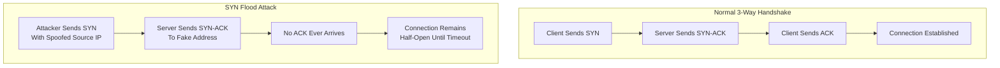

| Topic | Level | Reading Time | Prerequisites |
|---|---|---|---|
| SYN Flood Attacks | Intermediate | ~20 min | Basic understanding of TCP/IP and how network connections are established |

> **Goal of this section:**
>  You will understand how the TCP 3-Way Handshake works normally, and how an attacker can exploit this exact step to launch a **SYN Flood** and deny real users access to the server.

## Learning Objectives

By the end of this section, you will be able to:

- Explain the normal **3-Way Handshake** process used to establish a TCP connection.
- Describe the resource burden a server carries while waiting for a handshake to complete.
- Explain how a **SYN Flood** attack abuses this burden to cause a **Denial of Service (DoS)**.
- Explain why an attacker does not need millions of real machines to overwhelm a server.
- Explain the role of **spoofed source IP addresses** in guaranteeing the handshake never completes.
- Compare **timeout reduction** and **SYN Proxying** as defenses, and evaluate their limitations.

## Table of Contents

- [Quick Refresher: The 3-Way Handshake](#quick-refresher-the-3-way-handshake)
- [Why This Attack Works: The Server's Burden](#why-this-attack-works-the-servers-burden)
- [The Basic Attack Concept](#the-basic-attack-concept)
- [Common Misconception: Do You Need a Million Computers](#common-misconception-do-you-need-a-million-computers)
- [The Trick: Fake Source IP Addresses](#the-trick-fake-source-ip-addresses)
- [Attack Flow Diagram](#attack-flow-diagram)
- [Defenses and Their Limitations](#defenses-and-their-limitations)
- [Career Connection](#career-connection)
- [Key Terms Glossary](#key-terms-glossary)
- [Summary](#summary)

## Quick Refresher: The 3-Way Handshake

Before any two devices can communicate over **TCP** (such as your browser talking to a website), they have to go through a **3-Way Handshake** with the following steps:

1. **SYN**: The client says: "I want to start a connection."
2. **SYN-ACK**: The server replies: "Okay, I hear you, let's begin."
3. **ACK**: The client confirms: "Great, confirmed, let's actually begin."

> [!TIP]
> Think of this process like the start of a phone call: you dial (SYN), the other person picks up and says "Hello?" (SYN-ACK), and you reply "Hi, it's so-and-so" (ACK) before the actual conversation begins.

Once these three steps are complete, the connection is officially **established**, and actual data can be exchanged.

> [!IMPORTANT]
> The core problem is that a **SYN Flood** attack exploits exactly the first and second steps, and makes sure the third step (ACK) never happens.

## Why This Attack Works: The Server's Burden

A server doesn't deal with just one user. It needs to serve a large number of users at the same time, **in parallel**.

To do this, the server has to track **each session separately**, like a **receptionist** keeping a separate notebook for every waiting visitor.

The moment a SYN packet arrives, the server does the following:

1. It **reserves** memory for this potential connection.
2. It replies with a SYN-ACK.
3. It waits for the final ACK to confirm the handshake, usually for about **30 seconds**, before giving up and canceling the attempt.

This behavior, waiting and reserving memory "just in case," is completely normal and necessary for legitimate traffic, but it is **exactly what the attacker will exploit**.

> [!NOTE]
> Think of a receptionist: when someone comes up and just says "Hi," they immediately grab a notebook, write an initial placeholder line, and keep that notebook open for 30 seconds waiting for the visitor to say their name, even if the visitor never says another word.

## The Basic Attack Concept

The attacker sends a huge number of SYN packets, but deliberately **never completes the handshake** (never sends the final ACK).

Since the server has to reserve memory and wait about 30 seconds for every SYN it receives, the attacker effectively forces the server to open thousands of "notebooks" that will never be filled in.

Eventually, the server runs out of the memory (**available connection slots**) reserved for accepting new legitimate users.

**The result**: real users trying to connect (such as customers trying to load a website) are rejected or face very severe delays, which is a form of **Denial of Service (DoS)**.

> [!WARNING]
> Imagine 10,000 people standing in front of a receptionist, each one just saying "Hi" and walking away without finishing their sentence. The receptionist is now stuck holding 10,000 open notebooks, with no time or capacity left to help any real visitor who actually needs help.

## Common Misconception: Do You Need a Million Computers

A natural question may come to mind: if the server can end up holding millions of **half-open sessions**, does that mean the attacker needs millions of separate machines (**bots**), each sending just one packet?

**The answer: No, that's not how it works.**

It's true that the attacker usually controls multiple machines (a **botnet**, a group of "zombie machines" under their control), but each zombie machine **doesn't just send one SYN packet and stop**.

Instead, each zombie is ordered to fire off as many specially crafted SYN packets as possible, depending on its processing power, which could be thousands or millions of packets from a single machine.

> [!TIP]
> Instead of needing a million different people each ringing the doorbell once, the attacker only needs a small number of people, each with a device that rings the bell continuously, thousands of times per second.

In other words, the huge volume of fake sessions comes from **packet-crafting speed**, not from needing a separate real machine for each session.

## The Trick: Fake Source IP Addresses

Here is the key trick that makes this attack actually work: every SYN packet the attacker sends contains a **fake source IP address**, specifically an IP address that isn't assigned to any real device in the world.

> [!NOTE]
> It's like ordering thousands of pizzas for delivery, but instead of giving your real address, you give a street address that doesn't even exist. The pizza shop still makes the pizzas and sends the driver out, but the driver will never actually be able to deliver them, so they just waste time and resources.

When the server receives the fake SYN, it does exactly what it was designed to do: it replies with a **SYN-ACK** sent to that fake address.

And since that IP doesn't belong to any real device, nobody will ever receive that SYN-ACK, and therefore nobody can send the final ACK.

This guarantees that the handshake will **never complete**, and the connection stays permanently stuck in a **half-open** state, tying up the server's resources for the full timeout period (~30 seconds) every time.

## Attack Flow Diagram

The following diagram shows how a SYN Flood attack happens, from sending the fake packets to completely exhausting the server's resources:

```mermaid
flowchart LR
    A["Attacker Controls Botnet<br/>Multiple Zombie Machines"] --> B["Each Zombie Sends<br/>Massive Volume of SYN Packets"]
    B --> C["Each Packet Uses<br/>a Spoofed Source IP"]
    C --> D["Server Reserves Memory<br/>and Replies With SYN-ACK"]
    D --> E["SYN-ACK Sent to<br/>Nonexistent IP Address"]
    E --> F["No ACK Ever Returns<br/>Connection Stuck Half-Open"]
    F --> G["Server Memory Exhausted<br/>by Thousands of Half-Open Sessions"]
    G --> H["Legitimate Users<br/>Rejected or Delayed"]
```

The following diagram compares the normal handshake path with the attack path:

## Defenses and Their Limitations

There are two main approaches used to defend against SYN Flood attacks:

### Option 1: Shorten the Timeout Window

Instead of having the server wait 30 seconds for the ACK, it can be configured to give up much faster (for example, 5-10 seconds).

This reduces how long each fake session ties up memory.

> [!WARNING]
> **The limitation of this solution**: if the attack is strong enough (a very high packet rate), even a short timeout won't help, because the attacker can still flood the server faster than the old sessions expire.

### Option 2: SYN Proxying (Handshake Proxy)

Some advanced firewalls and load balancers can intercept the handshake on behalf of the server.

The firewall itself completes the 3-way handshake with the client first and verifies that the connection is real and legitimate. Only after the handshake is confirmed does the firewall establish the actual connection with the real server.

This means the fake SYNs are filtered out **before** they ever reach the real server or become a burden on it.

> [!TIP]
> Think of this solution like assigning a security guard who stops every visitor at the main gate, verifies their identity, and only then lets them walk to the real receptionist, so the receptionist never has to deal with a fake visitor in the first place.

The following table summarizes the difference between the two solutions:

| Solution | Advantage | Limitations |
|---|---|---|
| **Shortening Timeout** | Easy to implement and low cost | Limited effectiveness against very strong attacks (high packet rate) |
| **SYN Proxying** | Very effective; it stops the attack from reaching the real server at all | Requires advanced infrastructure (firewalls/load balancers) and a higher cost |

## Career Connection

Understanding SYN Flood has direct applications in several career paths:

- In the **SOC**, monitoring SYN packet rates and half-open sessions helps detect DoS attacks early.
- In **Network Security Engineering**, configuring firewalls and enabling SYN Proxying is a core part of designing an attack-resistant network infrastructure.
- In **Incident Response**, handling a real SYN Flood attack requires a precise understanding of how the attack works in order to mitigate its impact quickly.

## Key Terms Glossary

| Term | Definition |
|---|---|
| **3-Way Handshake** | The process of establishing a TCP connection in three steps: SYN, SYN-ACK, and ACK. |
| **SYN Flood** | An attack that abuses the handshake by sending a huge number of SYN requests without completing the connection, with the aim of exhausting the server's resources. |
| **Half-Open Session** | A TCP connection session that stopped at the SYN-ACK stage and never received a final ACK to complete it. |
| **Denial of Service (DoS)** | An attack that aims to prevent legitimate users from accessing a specific service. |
| **Botnet** | A group of compromised devices (zombie machines) controlled by the attacker to carry out attacks collectively. |
| **Spoofed Source IP** | A fake IP address placed as the source in a packet, usually not belonging to any real device. |
| **SYN Proxying** | A defensive mechanism in which an intermediary device (such as a firewall) completes the handshake on behalf of the server before passing the connection on. |

## Summary

- The **3-Way Handshake** is the normal way to establish a TCP connection, through the SYN, SYN-ACK, and ACK steps.
- The server reserves memory and waits about 30 seconds after every SYN to support multiple legitimate users at the same time, and this is the behavior the attacker exploits.
- In a **SYN Flood**, the attacker sends a huge number of SYN packets without ever completing the handshake, which exhausts the server's memory and prevents real users from accessing it (**Denial of Service**).
- The attacker doesn't need millions of real machines; a relatively small **botnet** can generate a huge volume of fake SYN packets at high speed.
- Each packet contains a **spoofed source IP** to make sure the server's SYN-ACK reply doesn't reach anyone, so the handshake will never complete.
- Defenses include **shortening the timeout** (limited effectiveness against strong attacks) and **SYN Proxying** (more effective, but more expensive).

