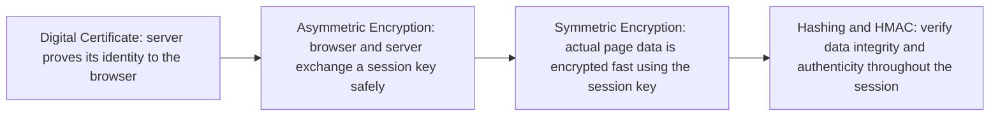

> **Goal of this section:**
> Get a quick overview of the entire cryptography journey from start to finish — how each topic works in brief, which security properties it provides, which it doesn't, and how that gap was solved in the next topic. This file isn't a replacement for the full details in each individual note; it's a mental map you can read in a few minutes to understand the full picture before diving into the details.

## Table of Contents
- [How to Read This Map](#how-to-read-this-map)
- [Security Properties — The 5 Measures](#security-properties--the-5-measures)
- [1. Symmetric Encryption](#1-symmetric-encryption)
- [2. Asymmetric Encryption](#2-asymmetric-encryption)
- [3. Hashing](#3-hashing)
- [4. HMAC](#4-hmac)
- [5. Digital Signature](#5-digital-signature)
- [6. Digital Certificate & CA](#6-digital-certificate--ca)
- [The Full Picture — Quick Reference Table](#the-full-picture--quick-reference-table)
- [Where It All Comes Together: TLS/HTTPS Handshake](#where-it-all-comes-together-tlshttps-handshake)
- [Summary](#summary)

---

## How to Read This Map

Each topic below is always explained with the same four points:

- **How it works (in brief):** just a sentence or two, not a detailed explanation
- **What it provides:** out of the 5 security properties
- **What it doesn't provide:** the gap or problem that still remains
- **How it was solved:** the next topic, which will close that gap

> [!NOTE]
> If you need the full details (the steps, examples, tables, diagrams), go back to the dedicated note for each topic. This file is only for connecting the pieces and seeing the big picture.

---

## Security Properties — The 5 Measures

Before we start the journey, you need to understand the 5 measures we'll use to evaluate every topic:

| Property | The Question It Answers |
|---|---|
| **Confidentiality** | Who can read the data? |
| **Integrity** | Has the data been changed? |
| **Authentication** | Who is this, really? |
| **Non-repudiation** | Can they deny having done it? |
| **Key Exchange** | How do we agree on a secret securely? |

---

## 1. Symmetric Encryption

- **How it works:** the same key is used for encryption and decryption between the two parties
- **Provides:** ✅ Confidentiality
- **Doesn't provide:** ❌ Key Exchange (this is actually its problem, not its solution) — how do I deliver the key securely to a remote party? ❌ Integrity, Authentication, Non-repudiation
- **How it was solved:** the **Key Exchange** problem was solved by **Asymmetric Encryption**, coming next

---

## 2. Asymmetric Encryption

- **How it works:** each party has a key pair (Public + Private). Encrypt with the public key, and decrypt with the matching private key
- **Provides:** ✅ Confidentiality, ✅ Key Exchange, ✅ Authentication (partially, through signing), ✅ Non-repudiation (partially, through signing)
- **Doesn't provide:** ❌ Integrity on its own (it needs hashing/signatures), and it introduces a new problem: **how do I trust that this public key really belongs to its owner?** (the Identity Binding Problem)
- **How it was solved:** the **Integrity** problem was solved by **Hashing**, and the **Identity Binding** problem was solved later by **Digital Certificate & CA**

---

## 3. Hashing

- **How it works:** a one-way function that takes any input and produces a fixed-size output (a hash), with no key and no way back
- **Provides:** ✅ Integrity only
- **Doesn't provide:** ❌ Authentication — anyone can compute the same hash, so an active attacker can modify the data and the hash together without being detected
- **How it was solved:** the **Authentication** problem was solved by **HMAC**

---

## 4. HMAC

- **How it works:** exactly like hashing, but a shared secret key is added into the calculation: `HMAC = hash(key, message)`
- **Provides:** ✅ Integrity, ✅ Authentication
- **Doesn't provide:** ❌ Non-repudiation (both parties have the same key, so neither can prove who actually sent it), ❌ Public Verification (you need to know the secret to verify), and it also suffers from poor scalability
- **How it was solved:** the **Non-repudiation and Public Verification** problem was solved by **Digital Signature**

---

## 5. Digital Signature

- **How it works:** signing with the sender's private key, and verifying with the public key available to everyone
- **Provides:** ✅ Integrity, ✅ Authentication, ✅ Non-repudiation
- **Doesn't provide:** ❌ Confidentiality (the message remains readable), and the same old asymmetric problem comes back: **the signature proves the link to the key, but it doesn't prove that the key really belongs to the claimed person**
- **How it was solved:** the **Identity Binding** problem was finally solved by **Digital Certificate & CA**

---

## 6. Digital Certificate & CA

- **How it works:** a document signed by a trusted third party (a Certificate Authority) that binds a public key to a real, verified identity
- **Provides:** ✅ Authentication (the main goal), ✅ Integrity (indirectly, through the CA's signature), ✅ Non-repudiation (indirectly)
- **Doesn't provide:** ❌ Confidentiality, and the trust itself is **policy-based, not mathematical** — meaning if someone plants a malicious root CA on your machine, the whole system collapses
- **How it was solved:** this is the last link in the chain — every problem that came up from the start has been solved by this point, and what's left is an administrative/operational responsibility (protecting the trust store, monitoring suspicious certificates)

---

## The Full Picture — Quick Reference Table

| Topic | Provides | Doesn't Provide (the Problem) | Solved By |
|---|---|---|---|
| **Symmetric Encryption** | Confidentiality | Key Exchange | Asymmetric Encryption |
| **Asymmetric Encryption** | Confidentiality, Key Exchange, Authentication*, Non-repudiation* | Integrity / Identity Binding | Hashing / Digital Certificate |
| **Hashing** | Integrity | Authentication | HMAC |
| **HMAC** | Integrity, Authentication | Non-repudiation, Public Verification | Digital Signature |
| **Digital Signature** | Integrity, Authentication, Non-repudiation | Confidentiality / Identity Binding | (Outside the scope of signing) / Digital Certificate |
| **Digital Certificate & CA** | Authentication, Integrity*, Non-repudiation* | Confidentiality, Policy-based trust risk | Operational management (Trust Store Hardening) |

*(* = partially or indirectly)*

---

## Where It All Comes Together: TLS/HTTPS Handshake

None of these topics are separate theory — they actually come together every time you open a website over **HTTPS**:

1. **Certificate:** the server presents its certificate to prove its identity
2. **Asymmetric Encryption:** the browser and the server use public/private keys to agree on a session key securely
3. **Symmetric Encryption:** the rest of the data transfer (the page, images, etc.) happens with that session key at high speed
4. **Hashing/HMAC:** they make sure the data hasn't changed throughout the session

> [!TIP]
> This is exactly the secret behind the strength of the hybrid design — each topic we studied plays its role at the right moment, rather than one technology doing everything.

---

## Summary

- The whole journey started from a single problem: **how do we secure data?**
- Every solution brought a new problem with it, and every new problem led to another solution after it
- The full logical order: **Symmetric → Asymmetric → Hashing → HMAC → Digital Signature → Digital Certificate & CA**
- In the end, none of these concepts are separate — they work together in one integrated system, such as TLS/HTTPS
- Understand each topic well on its own, but most importantly, understand **why** it came after the one before it, not just **how** it works
