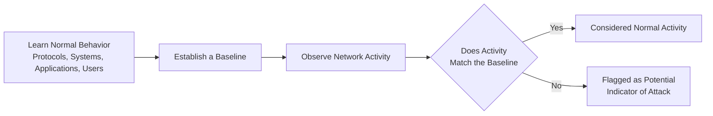

| Topic | Level | Reading Time | Prerequisites |
|---|---|---|---|
| Understanding Network Attacks: An Introduction | Beginner | ~8 min | Basic understanding of networking protocols and general security concepts |

> **The goal of this section:**  
>  You'll understand why knowing the "normal behavior" of a network is such an important foundation for detecting any attack, and you'll get an overview of the nature of network attacks before we go into the details of each attack individually.

## Learning Objectives

By the end of this section, you will be able to:

- Explain why understanding **normal network behavior** is a prerequisite for detecting attacks.
- Describe the role of a **Security Analyst** in learning how protocols, systems, applications, and users typically behave.
- Identify the different layers a network attack can target.
- List the common high-level goals attackers pursue when launching network attacks.

## Table of Contents

- [Why Normal Behavior Matters](#why-normal-behavior-matters)
- [The Analyst's Perspective](#the-analysts-perspective)
- [Layers Targeted by Network Attacks](#layers-targeted-by-network-attacks)
- [Common Goals Behind Network Attacks](#common-goals-behind-network-attacks)
- [Normal vs. Abnormal Activity Diagram](#normal-vs-abnormal-activity-diagram)
- [How to Approach the Attacks in This Series](#how-to-approach-the-attacks-in-this-series)
- [Career Connection](#career-connection)
- [Key Terms Glossary](#key-terms-glossary)
- [Summary](#summary)

## Why Normal Behavior Matters

In **network security**, a very fundamental part of the work is understanding **what normal network activity looks like**, so we can distinguish anything abnormal or suspicious.

This idea is simple but essential: without knowing "normal" well, you can't accurately identify "abnormal." If a security analyst doesn't have a clear picture of the network's usual behavior, they might miss a real attack, or, on the contrary, treat normal activity as a threat (this is called a **false positive**).

> [!IMPORTANT]
> Effective security isn't just knowing "what an attack looks like"; it's mainly knowing "what normal behavior looks like," so that any deviation from it becomes an **indicator** worth investigating.

## The Analyst's Perspective

**Security analysts** spend a lot of time learning how **protocols**, **systems**, **applications**, and **users** normally behave.

This understanding requires continuous, cumulative observation, not just theoretical reading, because "normal" behavior can differ from one organization to another, and from one department to another within the same organization.

Once that normal behavior is well understood, **unusual activities** can be noticed as **potential indicators** of an attack or a **security incident**.

> [!TIP]
> Building a clear **baseline** of normal behavior on the network is one of the most important tools that helps any security analyst detect deviations faster and more accurately.

## Layers Targeted by Network Attacks

Network attacks can target completely different layers of the technical environment, including:

| Targeted Layer | Examples |
|---|---|
| **Devices** | Network devices, endpoints, IoT devices |
| **Network Protocols** | ARP, DNS, TCP/IP |
| **Applications** | Websites, services, databases |
| **Users** | Employee accounts, credentials, permissions |

> [!NOTE]
> A single attack doesn't necessarily target just one layer; many advanced attacks start at one layer (such as the user, through phishing) and then move to another layer (such as applications or internal systems).

## Common Goals Behind Network Attacks

Attackers try to achieve a variety of goals through network attacks; among the most common:

- To **steal information**.
- To **gain unauthorized access**.
- To **disrupt services**.
- To use **legitimate credentials** to avoid detection.

> [!WARNING]
> Using legitimate credentials is one of the most dangerous scenarios, because the attacker's activity in this case can look "normal" on the surface, which brings us back to the importance of understanding normal behavior with high precision, rather than relying only on searching for "known attack patterns."

## Normal vs. Abnormal Activity Diagram

The following diagram shows the thought process a security analyst goes through to arrive at detecting a potential attack:

## How to Approach the Attacks in This Series

In the upcoming sections of the course, we'll study different network attacks (such as the ones we covered before, like ARP Cache Poisoning and the Watering Hole Attack, and other attacks still to come). The main goal with each attack isn't just memorizing its definition, but understanding:

- **What the attack looks like** from a technical standpoint.
- **Why it is abnormal** compared to the expected normal activity.

> [!TIP]
> As you read about any new attack in the course, always try to ask yourself: "If I were a security analyst looking at this traffic, what should have caught my attention that something wasn't normal?"

## Career Connection

The concept we explained in this section is the cornerstone of almost all security analysis work:

- In **SOC**, building and understanding the network's baseline is the foundation of day-to-day monitoring.
- In **Threat Hunting**, the ability to distinguish subtle deviations from normal behavior is the core skill for searching for threats that haven't been detected yet.
- In **Digital Forensics**, understanding normal behavior helps pinpoint where the attack started during the investigation after the incident has occurred.

## Key Terms Glossary

| Term | Definition |
|---|---|
| **Baseline** | The usual normal behavior pattern of a particular network, system, or user, used as a reference for comparison. |
| **Security Analyst** | A person who specializes in monitoring and analyzing security activity to detect potential threats. |
| **Indicator of Attack (IoA)** | A signal or behavioral pattern that indicates an attack may be in progress. |
| **False Positive** | A security alert that indicates a threat when the activity is actually normal and harmless. |
| **Unauthorized Access** | Access to a system or data without legitimate authorization. |

## Summary

- Understanding the network's **normal behavior** is the real foundation for detecting any abnormal or suspicious activity.
- Security analysts spend a lot of time studying the behavior of protocols, systems, applications, and users before they can distinguish deviations from it.
- Network attacks can target multiple layers, including devices, network protocols, applications, and users.
- Among attackers' most common goals: stealing information, gaining unauthorized access, disrupting services, or using legitimate credentials to avoid detection.
- When studying any new attack, the main goal is to understand what the attack looks like technically, and why it's considered anomalous compared to the expected normal activity.

