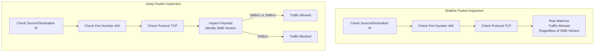

| Topic | Level | Reading Time | Prerequisites |
|---|---|---|---|
| Deep Packet Inspection (DPI) | Intermediate | ~18 min | Basic understanding of firewalls, firewall rules, TCP/IP, and port numbers |

 > **The goal of this section:**  
>  You'll understand the difference between the Shallow Inspection that a normal firewall performs and Deep Packet Inspection, and you'll see a real example that shows why a protocol like SMB needs deeper inspection than just looking at the port number.


## Learning Objectives

By the end of this section, you will be able to:

- Explain how a normal firewall performs **Shallow Packet Inspection** by reading only the header of a packet.
- List the three main pieces of information a shallow inspection checks: source/destination IP, port numbers, and protocol.
- Define **Deep Packet Inspection (DPI)** and explain how it goes beyond the header to examine the actual payload.
- Explain, using a real SMB example, why checking a port number alone is not always enough to make a safe security decision.
- Connect this concept to a real-world incident: the **WannaCry** ransomware and the SMBv1 vulnerability.

## Table of Contents

- [Why Start With the Normal Way](#why-start-with-the-normal-way)
- [Shallow Packet Inspection: Reading the Label](#shallow-packet-inspection-reading-the-label)
- [What Exactly Does Shallow Inspection Check](#what-exactly-does-shallow-inspection-check)
- [The Blind Spot in Shallow Inspection](#the-blind-spot-in-shallow-inspection)
- [Deep Packet Inspection: Opening the Box](#deep-packet-inspection-opening-the-box)
- [A Real Example: The SMB Problem](#a-real-example-the-smb-problem)
  - [Understanding the Rule](#understanding-the-rule)
  - [The Hidden Risk Behind Port 445](#the-hidden-risk-behind-port-445)
  - [What Is SMB, Exactly](#what-is-smb-exactly)
- [How DPI Solves the Problem](#how-dpi-solves-the-problem)
- [Shallow vs. Deep Inspection Diagram](#shallow-vs-deep-inspection-diagram)
- [Career Connection](#career-connection)
- [Key Terms Glossary](#key-terms-glossary)
- [Summary](#summary)

## Why Start With the Normal Way

Before we understand **Deep Packet Inspection (DPI)**, we first need to understand exactly what a normal firewall does, because DPI is actually **built on top of** that basic behavior.

## Shallow Packet Inspection: Reading the Label

Normal firewalls are a bit "lazy," but in a good way: that laziness is what makes them fast. They **don't read the actual content (payload)** of what's being sent. They only look at the **header**.

> [!NOTE]
> Think of it like the **shipping label** on a box. The firewall reads the label (who the sender is, who the recipient is, the type of package), but it never opens the box to see what's actually inside.

## What Exactly Does Shallow Inspection Check

Shallow inspection checks:

- **Source and Destination IP**: where is this traffic coming from, and where is it going?
- **Port Numbers**: what service is it trying to reach? (such as port 80 for web browsing, port 22 for SSH, etc.)
- **Protocol**: is this TCP or UDP traffic?

> [!TIP]
> Imagine a **security guard** at a building entrance who only checks your **ID badge** and which floor button you press in the elevator. He doesn't search your bag. That's exactly what shallow inspection is: checking the label, not the actual content.

## The Blind Spot in Shallow Inspection

The name to remember: this basic form of inspection is called **Shallow Packet Inspection**, or sometimes just **Packet Filtering**.

It's fast, simple, and works well for most ordinary everyday rules, but it has one very important **blind spot**, and that's what brings us to **Deep Packet Inspection**.

> [!IMPORTANT]
> The blind spot is that shallow inspection only checks the "outer wrapper" of the traffic, which means it can't distinguish between completely different uses of the same port or protocol, even if one of those uses is very dangerous.

## Deep Packet Inspection: Opening the Box

**Deep Packet Inspection (DPI)** does everything shallow inspection does — it checks the IP, the port, and the protocol — but then it goes one step further.

Once the header matches the rule, DPI actually **opens the box** and looks at the actual content being sent inside.

## A Real Example: The SMB Problem

### Understanding the Rule

Let's imagine the following rule:

```
ALLOW TCP 10.0.10.0/24 → 10.0.30.10 PORT 445
```

**Meaning**: allow any device in the network segment `10.0.10.0/24` to talk to the server `10.0.30.10` on port `445`.

### The Hidden Risk Behind Port 445

The problem is that port 445 only tells us that **SMB** traffic is being used, but it doesn't tell us exactly **which version of SMB** is being used.

> [!WARNING]
> **SMBv1** is an old, insecure version of SMB, and it's the very same protocol vulnerability that the **WannaCry ransomware** exploited globally in 2017. So simply allowing TCP 445 could, in theory, also let SMBv1 traffic through.

### What Is SMB, Exactly

**SMB (Server Message Block)** is a network protocol used mainly in Windows environments to share files, folders, printers, and other resources across the network.

It usually uses **TCP port 445**, and older SMB implementations could use NetBIOS over TCP on port 139.

A practical example: when you access `\\Server\SharedFolder` from a Windows machine, the SMB protocol is what **authenticates** you and gives you access to that shared resource.

## How DPI Solves the Problem

**Deep Packet Inspection** goes beyond the headers and examines the packet's **payload** to determine information about the application and the protocol actually in use.

As a result, DPI can identify the exact SMB version and allow or block the traffic based on precise **application-level information**.

> [!IMPORTANT]
> This means the organization can, for example, allow **SMBv2** and **SMBv3** (the newer, more secure versions) while specifically blocking **SMBv1**, even though both use exactly the same port 445. Shallow inspection can't possibly tell them apart, but DPI can.

## Shallow vs. Deep Inspection Diagram

The following diagram shows the difference between the decision path in shallow inspection and deep inspection for the same traffic:



## Career Connection

Understanding the difference between shallow and deep inspection has direct applications across several career paths:

- In **SOC**, understanding that a normal firewall doesn't distinguish between different protocol versions helps explain why some threats got through despite rules that look correct.
- In **Network Security Engineering**, enabling and using devices that support **DPI** (such as Next-Generation Firewalls) is an essential part of designing a layered defense.
- In **Vulnerability Management**, knowing the vulnerabilities of specific protocols (such as SMBv1) helps prioritize the rules that need DPI to verify them.

## Key Terms Glossary

| Term | Definition |
|---|---|
| **Shallow Packet Inspection** | Basic inspection that relies only on reading the packet header: source and destination address, port, and protocol. |
| **Deep Packet Inspection (DPI)** | Advanced inspection that goes beyond the header and examines the packet's actual content (payload). |
| **Header** | The part of the packet that contains the basic routing information, such as IP addresses and ports. |
| **Payload** | The actual content carried inside the packet, apart from the header information. |
| **SMB (Server Message Block)** | A network protocol used to share files and resources, common in Windows environments. |
| **SMBv1** | An old, insecure version of the SMB protocol, associated with a vulnerability exploited by WannaCry ransomware. |
| **WannaCry** | A global ransomware attack in 2017 that exploited a vulnerability in the SMBv1 protocol. |

## Summary

- A normal firewall performs **Shallow Packet Inspection**: it reads only the header (source and destination address, port, and protocol), without looking at the packet's actual content.
- Shallow inspection is like a security guard who only checks your ID badge without searching your bag: fast and simple, but it has a blind spot.
- The blind spot is clear in the **SMB** example: port 445 tells us SMB is being used, but not which version, and that could let the weak **SMBv1** through, the same vulnerability that **WannaCry** exploited in 2017.
- **Deep Packet Inspection (DPI)** does everything shallow inspection does, but it also opens and examines the packet's content (**payload**) to determine precise application-level information.
- Thanks to DPI, the organization can allow the more secure **SMBv2** and **SMBv3** while specifically blocking **SMBv1**, even though both use exactly the same port.

