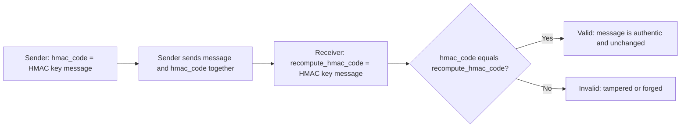

> > **Goal of this section:**
> You'll understand what HMAC is, how it differs from ordinary hashing, and how it ensures Integrity + Authentication together. You'll also see the problem HMAC itself can't solve, which leads us to the next topic.


## Table of Contents
- [Why Hashing Alone Is Not Enough](#why-hashing-alone-is-not-enough)
- [What is HMAC?](#what-is-hmac)
- [How HMAC Solves the Authentication Gap](#how-hmac-solves-the-authentication-gap)
- [HMAC Formula & Verification Flow](#hmac-formula--verification-flow)
- [Which Security Properties Does It Achieve?](#which-security-properties-does-it-achieve)
- [Hashing vs HMAC — Comparison](#hashing-vs-hmac--comparison)
- [What HMAC Does NOT Solve](#what-hmac-does-not-solve)
- [Summary](#summary)
- [SOC Analyst Perspective](#soc-analyst-perspective)

---

## Why Hashing Alone Is Not Enough

As we saw in the **Hashing** topic, there's a fundamental problem: if an active attacker manages to intercept the data in transit and modify **both the data itself and the hash attached to it at the same time**, the receiving party won't be able to detect the tampering, because the new hash will match the modified data perfectly.

> [!IMPORTANT]
> The root cause: anyone can compute an ordinary hash of any data, because the hash function itself is **not secret and has no key**. In other words, hashing only proves that "the data is consistent with itself"; it doesn't prove **who** actually produced it.

---

## What is HMAC?

**HMAC (Hash-based Message Authentication Code)** solves this problem by combining two things:

```
Cryptographic Hash Function + Secret Key
```

The goal: ensuring **Integrity + Authenticity** together at the same time.

> [!NOTE]
> The fundamental difference between it and ordinary hashing: HMAC uses a **Secret Key** shared between the sender and the receiver, while ordinary hashing has no key at all.

---

## How HMAC Solves the Authentication Gap

HMAC uses a secret key shared between the sender and the receiver. In this case, the attacker:

| Attacker | Situation |
|---|---|
| **1. Does NOT know the key** | Has no access to the secret key shared between the two legitimate parties |
| **2. Cannot generate valid HMAC** | Even if they modify the data, they can't compute a valid HMAC that matches the modified data, because they need the key to do that |

> [!IMPORTANT]
> This is exactly the difference from ordinary hashing: with hashing, anyone (even the attacker) can recompute the hash. With HMAC, only someone who has the secret key can compute a valid HMAC.

---

## HMAC Formula & Verification Flow

The basic formula:

```
HMAC = hash(key, message)
```

The sending and verification process goes like this:



**In detail:**

- **Sender:** Computes `hmac_code = HMAC(key, message)` and sends the message together with the HMAC code
- **Receiver:** Recomputes `recompute_hmac_code = HMAC(key, message)` using the same key
- **Compare:** If `hmac_code == recompute_hmac_code`, the message is correct and authenticated (Valid); if they differ, tampering or forgery has occurred (Tampered or Forged)

---

## Which Security Properties Does It Achieve?

Following the same approach we've used in all the previous topics, let's apply the 5 principles to HMAC:

| Security Property | Achieved? | How |
|---|---|---|
| Confidentiality | ❌ | HMAC doesn't hide the message content; the message remains readable to anyone |
| **Integrity** | ✅ | Any change to the message completely changes the HMAC result |
| **Authentication** | ✅ | Only someone who has the secret key can compute a valid HMAC; this is the fundamental difference from ordinary hashing |
| Non-repudiation | ❌ | Since the key is shared between both parties, there's no proof of exactly who sent the message |
| Key Exchange | ❌ | HMAC is built on the assumption that the key was already delivered securely beforehand (through Diffie-Hellman or asymmetric encryption) |

> [!IMPORTANT]
> **HMAC → achieves Integrity + Authentication together.** This is exactly the fundamental difference from ordinary hashing, which achieves Integrity only.

---

## Hashing vs HMAC — Comparison

| Feature | Hashing | HMAC |
|---|---|---|
| Key used | ❌ No | ✅ Yes |
| Integrity | ✅ Yes | ✅ Yes |
| Authentication | ❌ No | ✅ Yes |
| Attacker can recompute | ✅ Yes (a problem) | ❌ No (they need to know the key) |
| Password storage | ✅ Yes (with salting) | ❌ No (not the right use) |
| Message authentication | ❌ No | ✅ Yes |

> [!TIP]
> Use **Hashing** when you need to make sure a file or data hasn't changed (such as checking the integrity of a program after downloading it). Use **HMAC** when you also need to make sure the message comes from a known, legitimate source (such as API requests or session tokens).

---

## What HMAC Does NOT Solve

Even though HMAC solved the authentication problem, 3 new problems emerged because of it, especially when we think at a larger scale, like the entire internet:

### Problem 1: No Non-repudiation

> [!IMPORTANT]
> If Alice and Bob share the same secret key, Alice can claim that Bob forged the message, and Bob can claim that Alice forged it. **There's no conclusive mathematical proof** of exactly who actually sent it, because both of them can compute the same HMAC.

### Problem 2: No Public Verification

> [!IMPORTANT]
> To verify an HMAC, **you need to know the secret key**. This means you can't prove anything to a third party (such as a court or an auditor) without revealing the secret itself, which completely defeats the idea of independent proof.

### Problem 3: Poor Scalability

> [!IMPORTANT]
> Sharing secrets between every pair of parties **doesn't scale** to internet size. Every pair of parties needs a separate secure channel to deliver their key, which brings us back to the key distribution problem we discussed in symmetric encryption.

**The overall problem:** We needed a mechanism that achieves 3 things together:
- **Only one party** can create the proof (not both)
- **Anyone** can verify it without knowing a secret
- The sender **can't deny** having sent it later

**The solution:** **Digital Signature**, using **Asymmetric Cryptography**: signing is done with the **Private Key** (only its owner can do it), and verification is done with the **Public Key** (anyone can verify without knowing any secret).

---

## Summary

- HMAC = Cryptographic Hash Function + Secret Key
- The fundamental difference from ordinary hashing: **the key**. Without it, anyone can recompute the hash; with it, only someone who has the key can produce a valid HMAC
- It achieves **Integrity + Authentication** together
- The formula: `HMAC = hash(key, message)`
- **It doesn't achieve Non-repudiation**: because the key is shared between both parties, no one can prove exactly who sent the message
- **It doesn't allow Public Verification**: you need to know the secret key to verify, so you can't prove anything to a third party without it
- **It doesn't scale** to a large scale like the internet: every pair of parties needs a separate secure channel
- The solution to all these problems: **Digital Signature** using asymmetric cryptography

---

## SOC Analyst Perspective

- HMAC is widely used to secure **API Requests**. If you see a header such as `X-Signature` or `Authorization: HMAC-SHA256`, it means the request is expected to be authenticated with a secret key shared between the client and the server
- If you notice repeated API requests with invalid HMAC signatures in the logs, that's a strong indicator of an attempt at **Brute-forcing** the secret key or a **Replay Attack** attempt; it should be tracked and escalated
- MITRE ATT&CK: Techniques such as **T1552 (Unsecured Credentials)** cover cases where the HMAC secret key is leaked or stored insecurely. If that happens, all the authentication guarantees collapse immediately
- In webhook environments (such as GitHub and Stripe), HMAC is the primary mechanism for confirming that a request really comes from the authorized source. Every SOC analyst should know how to verify this signature during an incident investigation
