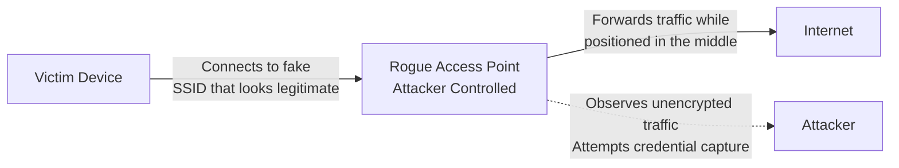
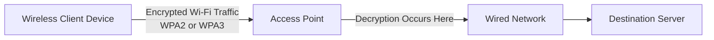

| Topic | Level | Reading Time | Prerequisites |
|---|---|---|---|
| Wireless Networks (Wi-Fi Security) | Beginner | ~18 min | Basic understanding of networking concepts and encryption fundamentals |

> **Goal of this section:**
>  You'll understand how Wi-Fi works, why it has to be encrypted, the difference between old and modern security standards, and how attackers exploit weaknesses such as Rogue Access Points.

## Learning Objectives

By the end of this section, you will be able to:

- Explain how **Wi-Fi (802.11)** works and why wireless traffic requires encryption.
- Compare deprecated security standards like **WEP** with modern standards like **WPA2** and **WPA3**.
- Describe the role of **SSID broadcasting**, **beacon frames**, and **MAC filtering**, and evaluate why they are not real security controls.
- Identify how a **Rogue Access Point** attack works and how it enables a **Man-in-the-Middle (MITM)** attack.
- Recommend practical mitigations for both individual users and organizations.

## Table of Contents

- [Introduction to Wi-Fi and the 802.11 Standard](#introduction-to-wi-fi-and-the-80211-standard)
- [Why Wireless Traffic Needs Encryption](#why-wireless-traffic-needs-encryption)
- [Evolution of Wi-Fi Security Standards](#evolution-of-wi-fi-security-standards)
  - [WEP: A Broken Standard](#wep-a-broken-standard)
  - [WPA and the Move to WPA2/WPA3](#-wpa-and-the-move-to-wpa2wpa3)
- [Management Frames and the Limits of Encryption](#management-frames-and-the-limits-of-encryption)
  - [The Role of Beacon Frames](#the-role-of-beacon-frames)
  - [What Remains Visible Even with Encryption](#what-remains-visible-even-with-encryption)
- [Common Wi-Fi Security Myths](#common-wi-fi-security-myths)
  - [Hiding the SSID](#-hiding-the-ssid)
  - [MAC Filtering](#mac-filtering)
- [Rogue Access Points and Man-in-the-Middle Attacks](#rogue-access-points-and-man-in-the-middle-attacks)
- [Wireless Attack Flow Diagram](#wireless-attack-flow-diagram)
- [Mitigations and Best Practices](#mitigations-and-best-practices)
- [Career Connection](#career-connection)
- [Key Terms Glossary](#key-terms-glossary)
- [Summary](#summary)

## Introduction to Wi-Fi and the 802.11 Standard

**Wi-Fi** is based on the family of wireless networking standards known as **IEEE 802.11**. Over time, a simpler naming scheme appeared to make it easier for everyday users to understand which generation they're using, so we started hearing terms like:

| Marketing Name | Technical Standard |
|---|---|
| Wi-Fi 4 | 802.11n |
| Wi-Fi 5 | 802.11ac |
| Wi-Fi 6 | 802.11ax |

The fundamental difference between wired and wireless networks is the **transmission medium**. In wired networks, data travels inside a cable, so you actually need a physical connection to be able to intercept it. With Wi-Fi, however, data is sent through the air (radio waves), which means any nearby device within range of the signal can "hear" or receive the wireless transmission, even if it isn't the intended recipient.

> [!NOTE]
> The "open" nature of the transmission medium in Wi-Fi is the root reason wireless security is such a sensitive topic, because anyone within range can, in theory, receive the signal.

## Why Wireless Traffic Needs Encryption

Since wireless traffic travels over a **shared medium** (one that anyone nearby can reach), **encryption** is essential, not optional. Without encryption, any device within range of the signal can capture the transmitted data and read it easily.

The key idea is that encryption here solves the **Confidentiality** problem: even if someone manages to receive the signal, the data itself will be unreadable without the correct key.

## Evolution of Wi-Fi Security Standards

### WEP: A Broken Standard

**WEP (Wired Equivalent Privacy)** was the first official attempt to secure Wi-Fi networks, but it turned out to be a **weak and broken** standard by design.

The core problem with WEP was its use of the **RC4** algorithm combined with weak handling of **Initialization Vectors (IVs)**. This weakness allowed attackers to collect enough traffic and use it to fully recover the key.

> [!WARNING]
> A common mistake is believing that increasing the key size fixes weak encryption. In reality, WEP's problem was in the **design itself** and in how randomness was generated, not just in the key length. Increasing the length without fixing the root problem doesn't solve anything.

### WPA and the Move to WPA2/WPA3

After WEP's flaws were discovered, **WPA (Wi-Fi Protected Access)** appeared as a temporary fix, but over time it too came to be considered insufficient for modern security.

The standards currently in use and recommended are:

- **WPA2**: uses a stronger encryption algorithm (AES) instead of RC4.
- **WPA3**: the newest standard, offering additional protection against password-guessing attacks (offline dictionary attacks) and improvements to the handshake process.

> [!IMPORTANT]
> Modern wireless networks must use **WPA2** or **WPA3** exclusively, with **strong passwords** and a **secure configuration**. Using WEP or the old WPA is no longer acceptable from a security standpoint in any production environment.

## Management Frames and the Limits of Encryption

### The Role of Beacon Frames

A Wi-Fi device uses the **Destination MAC Address** in the frame to decide whether the frame is actually meant for it and needs to be processed, or not.

But not everything in a Wi-Fi network can be fully encrypted. Certain types of frames, especially **802.11 management and control frames**, must remain visible (not fully encrypted) so devices can discover the network, join it, and manage it properly.

An example of this is **Beacon Frames**: frames that the **Access Point (AP)** sends out periodically and repeatedly, which usually contain information such as:

- The **SSID** (the network name).
- The **capabilities** supported by the network (such as the available standards and speeds).

### What Remains Visible Even with Encryption

Even if the network is running strong encryption (such as WPA2/WPA3), certain information may remain visible to anyone monitoring the traffic, including:

- The connection's **metadata**.
- Some **unencrypted management information**, such as the contents of beacon frames.

What matters here is that the actual **protected data** stays unreadable, even if the attacker can see that a connection is active, know the network name, or see other management information.

Once the encrypted traffic reaches the **Access Point**, it is **decrypted** at the appropriate point and then **forwarded** to the wired network according to the network's security architecture.

> [!TIP]
> For sensitive applications, relying on Wi-Fi encryption alone isn't always enough. Adding an extra layer of encryption such as **HTTPS** or a **VPN** provides real end-to-end protection regardless of the security of the wireless network itself.

## Common Wi-Fi Security Myths

### Hiding the SSID

The **SSID** is the name of the wireless network, and it's usually advertised through **beacon frames** so devices can discover the available networks.

There's a common belief that **hiding the SSID** (disabling SSID broadcasting) makes the network "invisible" or more secure. In reality, that isn't true, because the network can still be discovered through other wireless activity.

Also, when a client device tries to connect to a hidden network, the device itself may **reveal the network name** during the connection process, which gives an attacker monitoring wireless traffic the chance to discover the name easily.

> [!WARNING]
> Hiding the SSID provides **only a tiny amount of real security (security through obscurity)** and must not be treated as a substitute for real, strong encryption.

### MAC Filtering

**MAC Filtering** is a setting that lets the **administrator** specify exactly who, by MAC address, is allowed to connect to the network.

The problem is that MAC addresses aren't a reliable security mechanism, because an attacker can monitor the traffic, notice an allowed MAC address, and then **spoof** it (pretend to be the device that owns that address).

> [!IMPORTANT]
> **Strong authentication** and encryption through **WPA2** and **WPA3** are far more important than hiding the SSID or relying on MAC filtering as a primary layer of protection.

## Rogue Access Points and Man-in-the-Middle Attacks

A **Rogue Access Point** is an unauthorized wireless access point that an attacker places on the network or creates in order to lure victims into connecting to it.

The attacker may create a fake Wi-Fi network with a name that looks legitimate (such as the name of a hotel, an airport, a cafe, or even the company's own network) to trick users.

When the victim connects to the attacker's Access Point, the attacker can position their device between the victim and the internet, creating a potential **Man-in-the-Middle (MITM)** situation.

In this position, the attacker can monitor any traffic that isn't protected by additional encryption, and may try to:

- **Capture credentials**.
- **Redirect users** to fake pages.
- **Manipulate traffic**.

> [!NOTE]
> Using strong **HTTPS** helps protect application data even if the Wi-Fi network itself is untrusted, because the encryption here happens at the application level, not only at the wireless network level.

## Wireless Attack Flow Diagram

The following diagram shows how a Rogue Access Point attack leads to a Man-in-the-Middle situation:

And the following diagram shows the path of normal wireless traffic from the device to the Access Point and then to the wired network, highlighting the point where decryption happens:

## Mitigations and Best Practices

The following table summarizes the most important preventive measures for users and organizations:

| Category | Recommended Action |
|---|---|
| Everyday user | Avoid automatically connecting to unknown Wi-Fi networks |
| Everyday user | Verify the correct network name and authentication method before connecting |
| Everyday user | Rely on HTTPS and a VPN as an additional layer of protection |
| Organizations | Use WPA2/WPA3-Enterprise instead of the Personal modes |
| Organizations | Enable certificate-based authentication |
| Organizations | Implement wireless monitoring to detect Rogue APs |
| Organizations | Apply Network Access Control (NAC) |

## Career Connection

Understanding wireless network security has direct applications in several career paths:

- In **SOC (Security Operations Center)** work, alerts for detected Rogue Access Points from Wireless Intrusion Detection Systems (WIDS) tools are monitored.
- In **Pentesting**, Wireless Penetration Testing includes attempting to break WPA2/WPA3 and testing how effective the network's configuration is.
- In **GRC (Governance, Risk, and Compliance)**, having clear policies for the use of wireless networks is an essential part of the compliance requirements in many security standards.

## Key Terms Glossary

| Term | Definition |
|---|---|
| **802.11** | The IEEE family of standards for wireless communication networks (Wi-Fi). |
| **WEP (Wired Equivalent Privacy)** | An old wireless security standard that is broken by design due to weaknesses in the RC4 algorithm and IV generation. |
| **WPA / WPA2 / WPA3** | Successive generations of Wi-Fi security standards, with WPA2 and WPA3 being the ones currently recommended. |
| **SSID (Service Set Identifier)** | The name of the wireless network, usually advertised through beacon frames. |
| **Beacon Frame** | A type of management frame that the Access Point sends periodically to advertise the network. |
| **MAC Filtering** | A setting that lets you specify which MAC addresses are allowed to connect to the network; it isn't reliable as a standalone security measure. |
| **Rogue Access Point** | An unauthorized wireless access point used to lure victims and carry out attacks. |
| **Man-in-the-Middle (MITM)** | An attack in which the attacker places themselves between the two parties of a communication to monitor or manipulate it. |

## Summary

- **Wi-Fi** is based on the **802.11** standards and uses the air as a shared transmission medium, which makes encryption necessary rather than optional.
- **WEP** is a broken standard due to a design weakness in RC4 and in how IVs are generated, and it can't be fixed simply by increasing the key length.
- The modern recommended standards are **WPA2** and **WPA3**, with strong passwords and secure configuration.
- Some management frames, such as **Beacon Frames**, must remain not fully encrypted to allow network discovery and management, which allows some metadata to leak even when strong encryption is in place.
- **Hiding the SSID** and **MAC Filtering** aren't real security measures; you should always rely on strong encryption (WPA2/WPA3) as the primary layer of protection.
- **Rogue Access Points** are used to trick victims and carry out **Man-in-the-Middle** attacks; defending against them requires user awareness and the use of HTTPS/VPN, in addition to organizational controls such as WPA2/WPA3-Enterprise and wireless monitoring.

