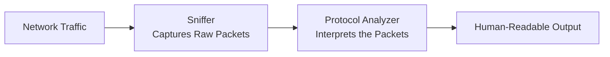
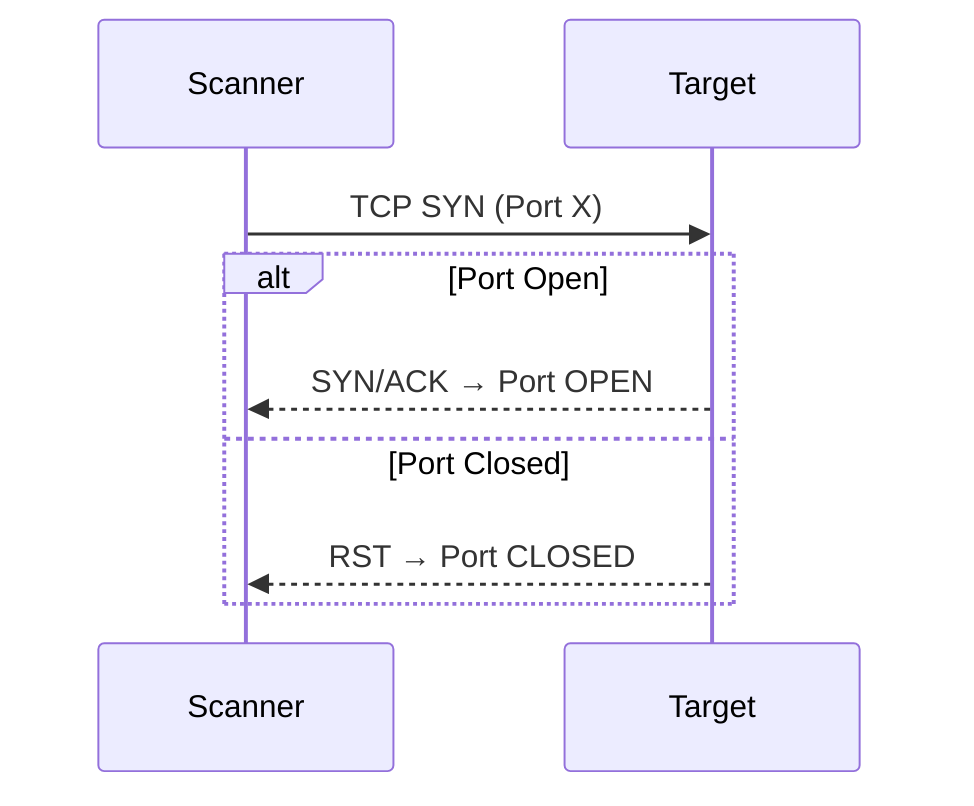
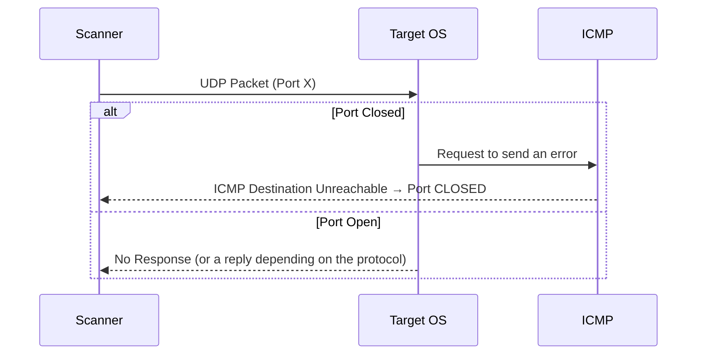
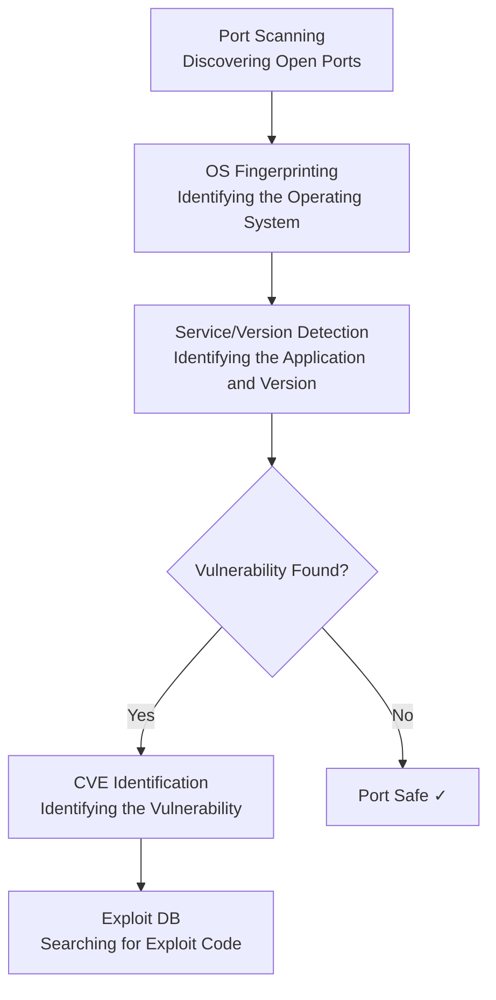
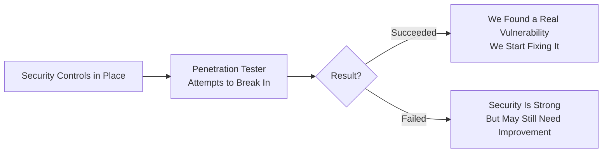
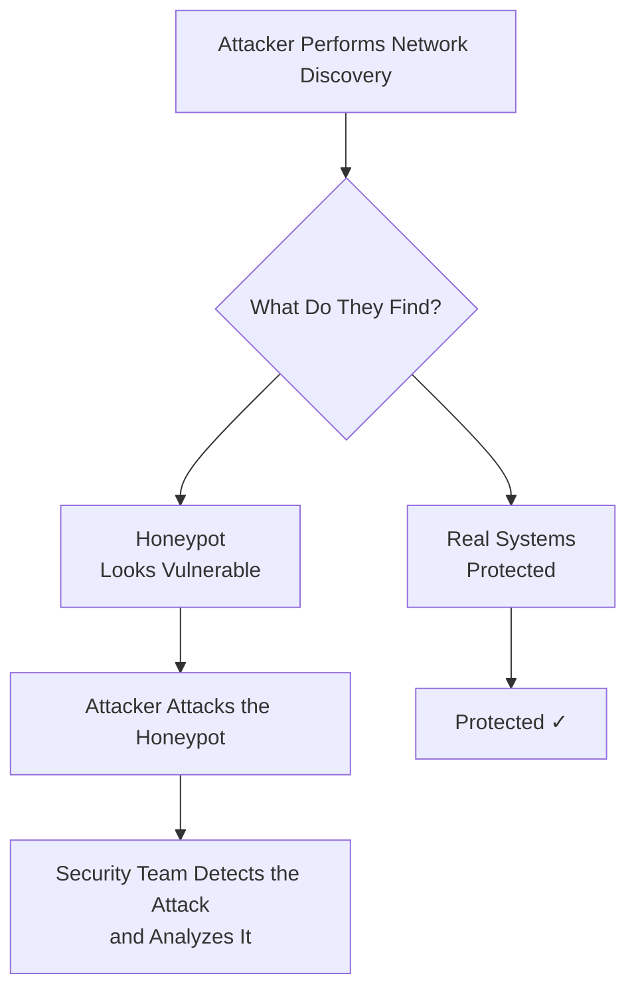

> **Goal of this section:**
> You'll get a simple understanding of the tools you use to see traffic, discover open ports, and find where the vulnerabilities are, and also how the very same tools are used by both attackers and defenders.

---

## Table of Contents

- [Sniffers — Packet Capture Tools](#sniffers)
- [Port Scanners — Port Scanning Tools](#port-scanners)
- [Vulnerability Scanners — Vulnerability Detection Tools](#vulnerability-scanners)
- [Penetration Testing — Testing Your Defenses by Attacking Them](#penetration-testing)
- [Honeypots — Traps for Attackers](#honeypots)
- [Summary](#Summary)

---

## Sniffers 

### What Is a Sniffer?

A **Sniffer** is a program that captures the **network packets** passing through its network interface.

> [!IMPORTANT]
> You need to know which interface you've placed the sniffer on, because that's what determines which packets you'll see.

**Example:** If you place the sniffer on the **perimeter firewall**, you'll capture all the packets coming from and going to the internet.

---

### Sniffer vs Protocol Analyzer

A sniffer captures only **raw packets**, meaning raw data that isn't readable as is.
To understand those packets, you need another program called a **Protocol Analyzer**, which converts the raw data into a **human-readable format**.

> [!NOTE]
> Tools such as **Wireshark** combine the two: sniffer + protocol analyzer in a single program.
> In contrast, **TCPdump** is a CLI-based sniffer: faster, but it displays less detailed data.

| Tool | Type | Interface | Speed |
|------|------|-----------|-------|
| Wireshark | Sniffer + Analyzer | GUI | Moderate |
| TCPdump | Sniffer only | CLI | Fast |

---

## Port Scanners 

### Why Does Port Scanning Matter?

For an attacker to attack a system remotely, they need to know:
1. The target's **IP address**
2. The **open ports** on the target, because each port points to a specific service

**Example:** If they find port 80 open → it means an HTTP service is running.

> [!WARNING]
> Knowing the port alone isn't enough. The more dangerous part is knowing the **version** of the application running on that port, because that lets the attacker look for **vulnerabilities** specific to that version.

---

### Nmap — The Most Popular Tool

**Nmap** is the most popular port scanning tool, and it can detect:
- **Open/closed ports**
- The target's **operating system**
- The **service** running on each port, as well as its **version**

---

### How Does a Port Scanner Work?

#### TCP Ports

#### UDP Ports

UDP has no SYN/RST, so it works differently:

> [!NOTE]
> **ICMP** here helps IP report errors, which is one of its most important original roles.

---

### Least Privilege for Ports

> [!IMPORTANT]
> Because port scanners exist, the **Least Privilege** rule applies to ports:
> **Open only the ports you need, and close everything else.**

---

## Vulnerability Scanners 

### The Next Stage After Port Scanning

After the open ports are discovered, the **Vulnerability Scanner** completes the picture:

### CVE and Exploit DB

| Term | Meaning |
|---------|--------|
| **CVE** | Common Vulnerabilities and Exposures: a standard identifier for every known vulnerability |
| **Exploit DB** | A database containing ready-made exploit code for each CVE |

> [!WARNING]
> The vulnerability scanner isn't just a defensive tool. Attackers use it in exactly the same way to find weak points in systems.

---

## Penetration Testing 

### The Core Idea

After you build the infrastructure and apply all the security controls, the question becomes:
**Is this security actually enough?**

The solution: you hire a **specialist** to try to break into your network in a legal, controlled way.

> [!TIP]
> If the pen tester succeeds in breaking in, that's actually a **positive** result for you, because you discovered the vulnerability before a real attacker did.

---

## Honeypots  

### What Is a Honeypot?

A **Honeypot** is a system that is **deliberately made to look weak and easy to compromise**. It sits on the network to:
- **Attract** attackers
- **Detect** intrusion attempts
- **Divert** them away from the real assets

> [!IMPORTANT]
> **No regular user needs to reach the Honeypot.** If someone reaches it, it means they're performing **network discovery**, which is in itself an **unauthorized** act.

> [!NOTE]
> The Honeypot is an **imitation** of a real system, but it's **not connected to real data**. Its only purpose is to catch the attacker.

---

## Summary
| Tool | Function | Who Uses It |
|--------|---------|-------------|
| **Sniffer** | Capturing raw network packets | Attackers and defenders |
| **Protocol Analyzer** | Analyzing and interpreting packets | Attackers and defenders |
| **Port Scanner** | Discovering open ports and services | Attackers and defenders |
| **Nmap** | Port scanning + OS/Version detection | Attackers and defenders |
| **Vulnerability Scanner** | Detecting CVEs and known vulnerabilities | Attackers and defenders |
| **Penetration Testing** | Testing security in a legal, controlled way | Defenders (who hire a specialist) |
| **Honeypot** | Catching attackers and analyzing attacks | Defenders only |

> [!NOTE]
> Notice that most of these tools **are used by both sides**: attackers and defenders. The only difference is **intent and legal authorization**.
