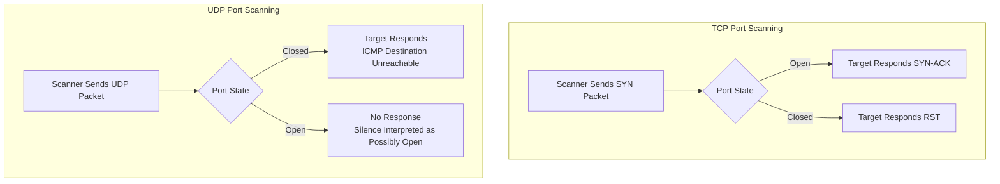

| Topic | Level | Reading Time | Prerequisites |
|---|---|---|---|
| Sniffers and Port Scanning | Intermediate | ~26 min | Basic understanding of TCP/IP, the 3-Way Handshake, and common port numbers |

> **Goal of this section:**
> You'll understand how Sniffing tools capture raw traffic on the network and how Port Scanning tools discover the open doors on a given system, whether over TCP or UDP, and you'll see why a tool like **Nmap** is much more important than just finding an open port.


## Learning Objectives

By the end of this section, you will be able to:

- Explain what a **Sniffer** does and why the placement of the network interface determines what traffic it can capture.
- Distinguish between a sniffer and a **protocol analyzer**, and explain why Wireshark is both.
- Compare **Wireshark** and **TCPdump** in terms of interface and typical use cases.
- Explain what a **Port Scanner** does and why it is one of the first steps in reconnaissance.
- Explain how TCP port scanning uses the 3-Way Handshake to determine if a port is open or closed.
- Explain how UDP port scanning works around the lack of a handshake using **ICMP**.
- Explain why identifying the exact service version (not just the port) is critical for an attacker, using a real CVE example.

## Table of Contents

- [Sniffers: Listening to Network Traffic](#sniffers-listening-to-network-traffic)
- [Why Placement Matters](#why-placement-matters)
- [Sniffer vs. Protocol Analyzer](#sniffer-vs-protocol-analyzer)
- [Popular Sniffing Tools](#popular-sniffing-tools)
  - [Wireshark](#wireshark)
  - [TCPdump](#tcpdump)
- [Port Scanners: Finding Open Doors](#port-scanners-finding-open-doors)
- [The Attack Process, Step by Step](#the-attack-process-step-by-step)
- [TCP Port Scanning: The 3-Way Handshake Trick](#tcp-port-scanning-the-3-way-handshake-trick)
- [UDP Port Scanning: Using ICMP as a Workaround](#udp-port-scanning-using-icmp-as-a-workaround)
  - [Special Case: DNS](#special-case-dns)
- [Nmap: Beyond Just Finding Open Ports](#nmap-beyond-just-finding-open-ports)
- [Why the Version Matters So Much](#why-the-version-matters-so-much)
- [Real-World Example: Apache Path Traversal](#real-world-example-apache-path-traversal)
- [Port Scanning Flow Diagram](#port-scanning-flow-diagram)
- [Career Connection](#career-connection)
- [Key Terms Glossary](#key-terms-glossary)
- [Summary](#summary)

## Sniffers: Listening to Network Traffic

A **Sniffer** is a software tool that **captures** network **packets** passing through the **network interface** it's connected to.

## Why Placement Matters

It's very important to understand **exactly where (on which interface)** you place the sniffer, because that determines exactly what traffic you can actually see.

You can only capture what passes through that point.

**Example**: if you place a sniffer on the **interface** of the **perimeter firewall** (the one facing the internet), it will only capture traffic going to and coming from the internet. It won't see internal traffic between two devices on your local network, because that traffic never touches the firewall's interface at all.

> [!TIP]
> Think of the sniffer as a security camera pointed at one specific hallway: it only records what passes through that hallway, not what happens in other rooms in the building.

## Sniffer vs. Protocol Analyzer

There's an important distinction to make: a Sniffer only captures **raw packets**, which are basically ones and zeros in a technical format.

To actually understand what's inside those packets (which website was visited, what data was sent), you need a **protocol analyzer** to translate that raw data into a **human-readable format**.

## Popular Sniffing Tools

### Wireshark

**Wireshark** is the best-known tool in this field, and it's actually a sniffer and a protocol analyzer at the same time, combined in a single application.

It captures the raw packets (the sniffer's job) **and** translates them into organized, readable details, showing you the source and destination IP addresses, the protocols, the headers, and even the actual data inside the packet, all in a nice visual interface (the protocol analyzer's job).

### TCPdump

**TCPdump** is another common tool, but it's **CLI-based** (command line, with no graphical interface).

Since it has no graphical interface to render, it's lighter and faster, and it's usually used on servers or in situations that call for quick, **low-overhead** capture without a full desktop environment.

Example command:

```bash
tcpdump -n tcp
```

This command tells your system: "Capture and display network packets, filtering specifically for TCP traffic, and disable **name resolutions** to speed up the output."

## Port Scanners: Finding Open Doors

A **Port Scanner** is a tool used to discover any open ports on a target system — in other words, any services that are running and able to accept connections.

This is one of the first steps an attacker takes when planning a remote attack: you can't attack a door you don't even know exists.

## The Attack Process, Step by Step

1. The attacker first needs the target's IP address (found through various reconnaissance techniques).
2. Once they have the IP, they scan it to find any open ports.
3. Each open port hints at the type of service running on it. For example, port 80 usually means an HTTP web server is running, port 22 means SSH, and port 3389 means Remote Desktop.

> [!TIP]
> Imagine a burglar walking around a house checking every door and window to see which one is open. A port scanner does the digital version of that, checking every door (port) on a system to see which one answers.

## TCP Port Scanning: The 3-Way Handshake Trick

Port scanners rely on how TCP naturally behaves when it tries to establish a connection (the same handshake process that any normal connection goes through).

The process:

1. The scanner sends a **TCP SYN packet** to the target port.
2. If the port is **open**, the system responds with a **SYN-ACK packet**.
3. If the port is **closed**, the system responds with an **RST packet** (reset), which means "No service is listening here; connection refused."

> [!TIP]
> It's like knocking on a door: if someone opens it and says "Hello" (SYN-ACK), that door is open (in use). If a voice shouts "Nobody lives here, go away" (RST), that door is closed.

This method works very well with TCP because it has a formal handshake process built in. But that raises a question: what about **UDP**? UDP has no handshake — no SYN, no RST — so how does the scanner know whether a UDP port is open?

## UDP Port Scanning: Using ICMP as a Workaround

Since UDP has no handshake process, scanners have to use a **clever workaround** involving **ICMP** (the protocol normally used for diagnostics and error messages on the network, such as ping).

The process:

1. The scanner sends a **UDP packet** directly to the target IP and port.
2. The target's operating system checks: "Is anything listening on this port?"
3. If the port is **closed**: the operating system replies with an **ICMP Destination Unreachable** message, telling the scanner specifically: "Your packet arrived, but nothing is listening on this port."
4. If the port is **open**: in most cases, you'll get **no response at all** — silence.

The scanner has to interpret the absence of a response as a possible sign that the port is open (although this isn't 100% certain, since packets can also simply be lost or filtered).

> [!NOTE]
> **ICMP** was designed specifically as part of the **Internet Protocol suite** to report errors and delivery problems for other protocols such as UDP and TCP. Since UDP itself has no built-in way to say "the port is closed," it borrows ICMP to deliver that message instead.

### Special Case: DNS

Some UDP-based services, such as **DNS** (port 53), actually do respond even while being scanned, because the DNS service itself sends a reply as part of its normal operation.

So scanners sometimes get a clearer, protocol-specific answer for certain well-known UDP services.

## Nmap: Beyond Just Finding Open Ports

**Nmap** is the most widely used tool for port scanning, used by attackers and security professionals alike (it's a legitimate and essential tool for defenders too, not just a hacking tool).

Nmap can also detect:

- The target's operating system.
- The specific service running on a given port.
- The version of that service (for example, not just "a web server," but specifically "Apache 2.4.49").

## Why the Version Matters So Much

Once the attacker knows the exact software and version, they can search **public vulnerability databases** for known, documented weaknesses in that specific version, and then use an existing exploit against it.

> [!IMPORTANT]
> Knowing that it's "a web server" isn't very useful, but knowing that it's specifically "Apache 2.4.49" can lead directly to a real, working attack.

This is exactly why the concept of **least privilege** matters for ports too: open only the ports your system actually needs, and nothing else.

> [!WARNING]
> Every unnecessary open port is a potential door the attacker can discover and exploit. The fewer open doors there are, the smaller the **attack surface** becomes.

## Real-World Example: Apache Path Traversal

A real-world example: **Apache Path Traversal (CVE-2021-41773)** is a well-known vulnerability from 2021 that affected only Apache version 2.4.49 specifically.

An attacker running Nmap could immediately tell whether the target was vulnerable as soon as they saw that specific version number in the scan results.

## Port Scanning Flow Diagram

The following diagram shows the difference between the TCP scanning path using the handshake and the UDP scanning path using ICMP as a workaround:



## Career Connection

Understanding Sniffing and Port Scanning tools has direct applications in several career paths:

- In **Pentesting**, using Nmap and Wireshark is a very essential part of the **reconnaissance** phase in any penetration test.
- In **SOC** work, analyzing traffic captured with tools like Wireshark helps in investigating security incidents and understanding the nature of an attack.
- In **Vulnerability Management**, understanding how attackers use version information (such as Apache 2.4.49) helps prioritize fixing vulnerabilities tied to specific services.
- In **Network Security Engineering**, applying the principle of least privilege to open ports is an essential part of reducing the attack surface.

## Key Terms Glossary

| Term | Definition |
|---|---|
| **Sniffer** | A tool that captures raw network packets passing through a specific network interface. |
| **Protocol Analyzer** | A tool that translates captured raw data into a human-readable format. |
| **Wireshark** | A tool that combines the functions of a sniffer and a protocol analyzer in a single graphical interface. |
| **TCPdump** | A lightweight packet capture tool that runs from the command line (CLI). |
| **Port Scanner** | A tool that discovers the open ports and running services on a target system. |
| **ICMP** | A protocol used for error reporting and network diagnostics, borrowed for UDP port scanning purposes. |
| **Nmap** | A widely used network scanning tool that reveals open ports, the operating system, and services and their versions. |
| **Least Privilege (for Ports)** | The principle of opening only the necessary ports to reduce the attack surface. |
| **Attack Surface** | The total set of potential points an attacker could exploit to gain access to a system or network. |

## Summary

- A **Sniffer** captures raw network traffic, but it only sees what passes through the specific interface it's connected to, so where you place it determines exactly what it can see.
- **Wireshark** is a sniffer and a protocol analyzer at the same time (with a graphical interface), while **TCPdump** is a lighter, faster tool that runs from the command line.
- A **Port Scanner** discovers any open ports on a given target, and it's one of the attacker's first steps in any remote attack.
- **TCP** port scanning relies on the 3-Way Handshake: SYN-ACK means the port is open, RST means the port is closed.
- **UDP** port scanning is harder because UDP has no handshake, so it relies on **ICMP**: a "Destination Unreachable" message means the port is closed, while silence may mean the port is open (not 100% certain).
- **Nmap** is a very powerful tool that can detect not only open ports, but also the operating system, the service, and its exact version.
- Knowing the exact version (such as Apache 2.4.49) leads the attacker straight to known, documented vulnerabilities, such as the real **Apache Path Traversal (CVE-2021-41773)** vulnerability from 2021.
- The principle of **least privilege** for ports — open only what you actually need — is an essential part of reducing the attack surface.

