| Topic | Level | Reading Time | Prerequisites |
|---|---|---|---|
| Secure Software Design and Fuzzing | Intermediate | ~18 min | Basic understanding of software development concepts and general security terminology |
> **Goal of this section:**
> You'll understand why security must be a core part of a program's design from day one rather than something added at the end, and you'll get to know a technique called Fuzzing that helps developers discover vulnerabilities before the program reaches users.

# Secure Software Design & Fuzzing

## Learning Objectives

By the end of this section, you will be able to:

- Explain why treating security as an **afterthought** is a common and costly mistake in the software industry.
- Describe the **mindset shift** from a reactive to a proactive approach to security.
- Explain why fixing a security flaw during the design phase is dramatically cheaper than fixing it after release.
- List the key practices developers must consider from the very beginning: **Input Validation**, **Authentication**, and **Logging and Monitoring**.
- Define **Fuzzing** and explain what kinds of problems it is designed to trigger.

## Table of Contents

- [Why Secure Software Design Matters](#why-secure-software-design-matters)
- [The Mindset Shift](#the-mindset-shift)
- [Why Security Must Start at the Design Phase](#why-security-must-start-at-the-design-phase)
- [The Cost Difference: Design Phase vs. Production](#the-cost-difference-design-phase-vs-production)
- [Key Things Developers Must Consider From the Beginning](#key-things-developers-must-consider-from-the-beginning)
  - [Input Validation](#input-validation)
  - [Authentication](#authentication)
  - [Logging and Monitoring](#logging-and-monitoring)
- [Other Secure Design Practices](#other-secure-design-practices)
- [Fuzzing: Automated Testing Through Chaos](#fuzzing-automated-testing-through-chaos)
- [What Fuzzing Is Looking to Trigger](#what-fuzzing-is-looking-to-trigger)
- [Secure Design vs. Reactive Patching Diagram](#secure-design-vs-reactive-patching-diagram)
- [Career Connection](#career-connection)
- [Key Terms Glossary](#key-terms-glossary)
- [Summary](#summary)

## Why Secure Software Design Matters

There's a very common problem in the software industry: security is treated as an **afterthought** instead of being a core part of the development process.

Developers often focus first on making the program **work**, and only think about security when something breaks or gets exploited.

> [!NOTE]
> Ideally, every developer and software engineer should study secure software design as part of their basic training, but in reality, many developers receive very little or no formal security education at all.

## The Mindset Shift

**Secure software design** means identifying and addressing security risks during the **design phase**, before a single line of code is even written — not just scanning the final code for bugs after it's finished.

> [!IMPORTANT]
> Instead of building a product first and patching vulnerabilities afterward (a **reactive** approach), security is built into the architecture, the **data flow**, and the application logic from day one (a **proactive** approach).

## Why Security Must Start at the Design Phase

## The Cost Difference: Design Phase vs. Production

Fixing a security flaw during the design phase can cost almost nothing — just a change to the design on paper.

Fixing the same flaw after the program is actually in **production** can cost **100 times more**, because it may require rewriting core components, **redeploying systems**, notifying affected users, and dealing with potential breaches.

> [!WARNING]
> The difference between "a change on paper" and "rewriting the entire system" isn't just a small cost difference; it's a fundamental difference in risk, in the company's reputation, and in real consequences for real users.

## Key Things Developers Must Consider From the Beginning

### Input Validation

Making sure any data the user enters (in a form, a URL, a file upload, etc.) is checked and **sanitized** before it's processed. This prevents attacks such as **buffer overflows** (which we studied in detail in a separate topic).

### Authentication

Properly verifying that users really are who they claim to be, using strong mechanisms (not just simple passwords).

### Logging and Monitoring

Building the ability to track what's happening inside the application, so that abnormal or malicious activity can be detected and investigated later.

## Other Secure Design Practices

Additional important practices for secure design:

- **Enforcing strong password policies** (minimum length, complexity requirements, no reuse of old passwords).
- **Using an encrypted connection such as HTTPS** instead of plain HTTP, so the data moving between the client and the server isn't easy to intercept and read.

## Fuzzing: Automated Testing Through Chaos

**Fuzzing** is an **automated software testing technique** in which the program is bombarded with unexpected, malformed, or completely random **inputs** to see how it behaves.

The goal is to deliberately try to make the program "break" by finding inputs the developers never planned for.

> [!TIP]
> Think of a fuzzing tool as a **brute-force** tool, but instead of trying passwords, it keeps feeding the program random or malformed data through its input fields, trying to find a case that makes the input handling collapse.

Fuzzing helps developers discover vulnerabilities **before** the program is released, instead of attackers discovering them **after** the program reaches users.

## What Fuzzing Is Looking to Trigger

The following table summarizes the types of problems fuzzing tries to provoke:

| Type | Description |
|---|---|
| **Crashes** | The program stops working unexpectedly |
| **Memory Corruption** | Data gets written in memory in a way that shouldn't happen, which attackers can sometimes exploit to run their own code |
| **Unhandled Exceptions** | Errors the program doesn't know how to handle, which can reveal sensitive internal information or cause instability |
| **Security Vulnerabilities** | Any of the above that an attacker could exploit if left unfixed |

## Secure Design vs. Reactive Patching Diagram

The following diagram compares the proactive approach (secure design from the start) with the reactive approach (patching after discovery):

```mermaid
flowchart TB
    subgraph Proactive["Proactive Approach: Secure by Design"]
        direction LR
        P1["Design Phase<br/>Identify Security Risks"] --> P2["Build Input Validation,<br/>Authentication, Logging"] --> P3["Write Code"] --> P4["Test with Fuzzing"] --> P5["Release Secure Product"]
    end
    subgraph Reactive["Reactive Approach: Patch Later"]
        direction LR
        R1["Write Code<br/>No Security Consideration"] --> R2["Release Product"] --> R3["Vulnerability Discovered<br/>By Attacker or Incident"] --> R4["Emergency Rewrite<br/>and Redeployment"] --> R5["Notify Affected Users"]
    end
```

## Career Connection

Understanding secure software design and Fuzzing has direct applications across several career paths:

- In **Application Security**, integrating secure design practices from the planning phase is an essential part of reducing vulnerabilities before they're even written.
- In **Malware Analysis and Exploit Development**, fuzzing tools are used extensively to discover new vulnerabilities (such as buffer overflows) in real programs.
- In **DevSecOps**, integrating fuzzing into CI/CD (**continuous integration/deployment**) pipelines allows vulnerabilities to be discovered automatically with every code update.

## Key Terms Glossary

| Term | Definition |
|---|---|
| **Secure Software Design** | Identifying and addressing security risks in the design phase, before the code is written. |
| **Proactive Approach** | Building security into the application's architecture and logic from the start. |
| **Reactive Approach** | Addressing security problems after they're discovered or exploited, after the product is released. |
| **Input Validation** | Validating and sanitizing any data the user enters before processing it. |
| **Authentication** | Verifying the user's identity using reliable mechanisms. |
| **Logging and Monitoring** | Tracking events inside the application to detect suspicious activity later. |
| **Fuzzing (Fuzz Testing)** | An automated testing technique that feeds the program random or malformed inputs to discover vulnerabilities. |
| **Memory Corruption** | Writing data to memory regions in an unintended way, which may be exploited by attackers. |

## Summary

- Security is often treated as an **afterthought** in the software industry, but it should be a core part of the design from day one.
- **Proactive secure design** means identifying and addressing risks during the design phase, not relying on the **reactive** approach after release.
- Fixing a security vulnerability in the design phase costs almost nothing, while fixing it after production can cost **100 times** more.
- Three core elements must be built in from the start: **Input Validation**, **Authentication**, and **Logging and Monitoring**.
- Additional important practices: enforcing strong password policies, and using HTTPS instead of HTTP.
- **Fuzzing** is an automated testing technique that bombards the program with random or malformed inputs, with the goal of discovering vulnerabilities before attackers do.
- Fuzzing tries to provoke four types of problems: **Crashes**, **Memory Corruption**, **Unhandled Exceptions**, and **Security Vulnerabilities**.

