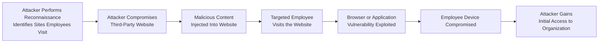

| Topic | Level | Reading Time | Prerequisites |
|---|---|---|---|
| Watering Hole Attack | Intermediate | ~12 min | Basic understanding of social engineering and reconnaissance concepts |

> **Goal of this section:**  
>  You'll understand what a Watering Hole Attack is, how the attacker targets a third-party website instead of attacking the organization directly, and how the SOC team can detect this attack.

## Learning Objectives

By the end of this section, you will be able to:

- Define a **Watering Hole Attack** and explain the analogy behind its name.
- Describe the role of **reconnaissance** in identifying the right compromise target.
- Explain why compromising a third-party website is attractive to attackers compared to attacking the organization directly.
- Trace the attack path from the compromised website to initial access into the organization's environment.
- Identify the indicators a **SOC** team monitors to detect this type of attack.

## Table of Contents

- [What Is a Watering Hole Attack](#what-is-a-watering-hole-attack)
- [Why the Name "Watering Hole"](#why-the-name-watering-hole)
- [Step One: Reconnaissance](#step-one-reconnaissance)
- [Why Attackers Target a Third-Party Website](#why-attackers-target-a-third-party-website)
- [Compromising the Website](#compromising-the-website)
- [From Visit to Initial Access](#from-visit-to-initial-access)
- [Attack Flow Diagram](#attack-flow-diagram)
- [Detection: The SOC Perspective](#detection-the-soc-perspective)
- [Career Connection](#career-connection)
- [Key Terms Glossary](#key-terms-glossary)
- [Summary](#summary)

## What Is a Watering Hole Attack

A **Watering Hole Attack** is a **targeted attack** in which the attacker compromises a website that employees of a particular organization visit frequently, instead of attacking the organization itself directly.

The core idea here is that the attacker isn't trying to break through the organization's strong defenses directly; instead, they look for a weaker point: an external website the employees trust and visit naturally as part of their work routine or interests.

> [!NOTE]
> A Watering Hole Attack is considered a type of **indirect attack**, because the ultimate target is the organization, but the actual point of compromise is a third party that doesn't belong to the organization itself.

## Why the Name "Watering Hole"

The attack's name comes from a nature analogy: the attacker compromises **a place where the targeted victims are known to gather**, in the same way a **predator** waits beside a **watering hole** because the **prey** naturally and repeatedly come there to drink.

In this case, the attacker doesn't chase the victim everywhere; instead, they wait in a place where they know the victim will come to them on their own, sooner or later.

## Step One: Reconnaissance

Before choosing the target website, the attacker performs **reconnaissance** to identify the websites, forums, services, or online resources that the targeted employees commonly use.

This research can include:

- News or specialized technical sites the employees follow.
- Professional forums related to the organization's field of work.
- Online services or tools the employees use frequently in their work.

> [!TIP]
> The quality of the reconnaissance phase determines the success of the entire attack; if the attacker picks a site the targeted employees don't actually visit, the attack will fail from the start, no matter how good the malicious code used is.

## Why Attackers Target a Third-Party Website

Since the target website is **outside the organization's direct control**, the organization itself may have very limited ability to secure or monitor that website.

This point is very important for understanding why this attack is effective: the organization may have very strong defenses on its internal network, but it has no control over the security level of an external website belonging to an entirely separate party.

> [!IMPORTANT]
> A Watering Hole Attack exploits a fundamental gap in the trust model: organizations secure their internal systems, but employees trust external sites that don't necessarily have the same level of protection.

## Compromising the Website

After the attacker identifies a suitable website, they try to compromise it and **inject** malicious code or other malicious content into it.

This code is usually designed to target the website's visitors in general, but the attacker is specifically interested in the employees who represent the targeted organization.

## From Visit to Initial Access

When a targeted employee visits the compromised website, the malicious content on it can try to **exploit a vulnerability** in the browser or another application on the employee's device, thereby **compromising** that device.

The compromised device can give the attacker **initial access** to the organization's environment, and this depends on:

- The exact type of attack used.
- The device's own privileges within the organization's network.

> [!WARNING]
> A common mistake students make is thinking that compromising the employee's device is the "end" of the attack. In reality, it's often just **the beginning**; the attacker uses this initial access as a launch point to move inside the organization's network and achieve larger goals.

## Attack Flow Diagram

The following diagram shows the full stages of a Watering Hole Attack, from reconnaissance all the way to initial access to the organization's environment:

## Detection: The SOC Perspective

From the perspective of the **SOC (Security Operations Center)** team, there are several indicators that help detect a Watering Hole attack. The most important are:

| Monitoring Indicator | The Goal of Monitoring |
|---|---|
| **Web Traffic Monitoring** | Spotting abnormal connections to certain external sites |
| **Suspicious Domains** | Detecting connections to suspicious or recently registered sites |
| **Unusual Downloads** | Noticing unexpected downloads following a visit to a particular site |
| **Endpoint Alerts** | Alerts from endpoint protection tools (EDR) when an exploit is attempted |
| **Known Malicious Infrastructure** | Matching connections against lists of infrastructure known to be associated with attackers |

> [!TIP]
> Detecting a Watering Hole Attack often relies on correlating scattered events together (**correlation**), such as a visit to a certain site followed by an endpoint alert, more than relying on a single indicator on its own.

## Career Connection

Understanding Watering Hole Attacks is important across several career paths:

- In the **SOC**, analyzing web traffic and monitoring endpoint alerts is a core part of detecting this type of attack.
- In **Threat Intelligence**, tracking known malicious infrastructure helps predict likely targeting sites.
- In **GRC**, assessing the risk of employees relying on external sites or services is part of managing third-party risk.

## Key Terms Glossary

| Term | Definition |
|---|---|
| **Watering Hole Attack** | A targeted attack in which the attacker compromises a website frequented by the employees of a particular organization. |
| **Reconnaissance** | The phase of gathering information about the target before carrying out the attack. |
| **Initial Access** | The first foothold the attacker gains inside the targeted organization's environment. |
| **Exploit** | Taking advantage of a security vulnerability in a program or system to perform an unauthorized action. |
| **Endpoint** | Any end device (such as an employee's computer) connected to the organization's network. |
| **Malicious Infrastructure** | A set of systems or sites used by attackers to carry out and support their attacks. |

## Summary

- A **Watering Hole Attack** is a targeted attack in which the attacker compromises a website that employees of a particular organization visit frequently, instead of attacking the organization directly.
- The attack's name comes from the analogy of a predator waiting beside a water source because its prey come to it on their own.
- The attack begins with a **reconnaissance** phase to identify the sites the targeted employees commonly visit.
- Attackers target sites outside the organization's direct control, because the organization has little ability to secure or monitor them.
- When the employee visits the compromised site, malicious content can exploit a vulnerability in the browser or another application and compromise their device, which can give the attacker **initial access** to the organization's environment.
- From the **SOC** perspective, monitoring web traffic, suspicious domains, unusual downloads, endpoint alerts, and connections to known malicious infrastructure are all key indicators for detecting this type of attack.

