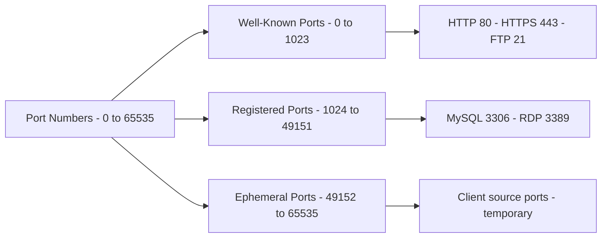
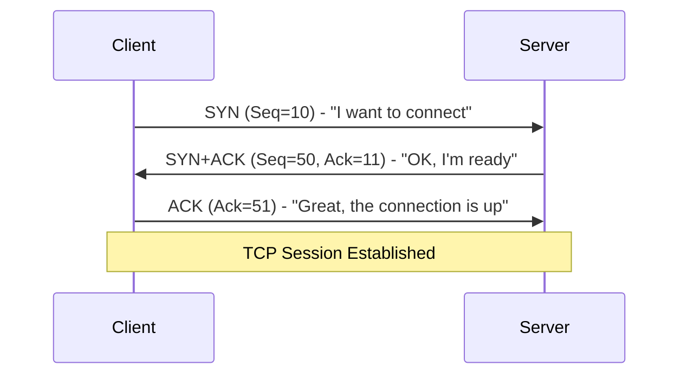
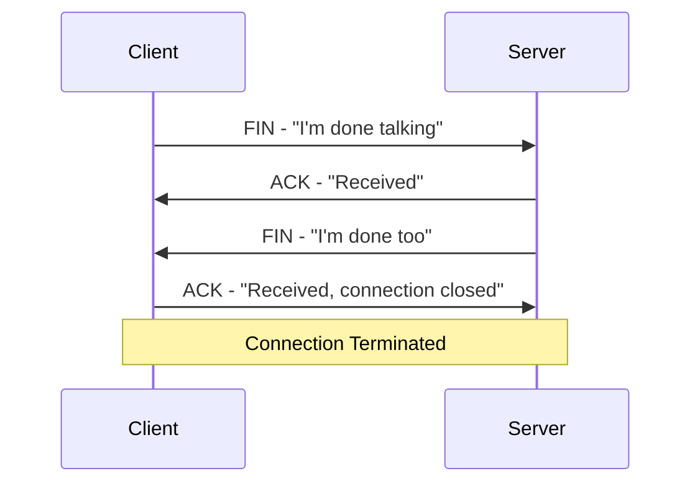

> **Goal of this section:**
> Explains how the Transport layer manages communication between devices using TCP and UDP, and helps you understand the role of ports, how sessions are opened and closed, and the difference between speed and reliability in data transfer.

---

## Table of Contents
  - [Network Ports](#network-ports)
  - [TCP — Transmission Control Protocol](#tcp--transmission-control-protocol)
  - [TCP Header and Flags](#tcp-header-and-flags)
  - [TCP 3-Way Handshake](#tcp-3-way-handshake)
  - [TCP 4-Way Termination](#tcp-4-way-termination)
  - [UDP — User Datagram Protocol](#udp--user-datagram-protocol)
  - [Summary](#summary)

---

## Transport Layer — TCP and UDP

### Network Ports

#### What Are Ports?

A **Network Port** is a **Logical Address** that distinguishes between different sessions or services on the same device. Think of the IP Address as a building's address and the Port as the apartment number: together they pinpoint an exact location.

Every packet contains a **Destination Port Number** in the Layer 4 header, which tells the receiving device which application or service the packet is intended for.

#### Types of Ports



| Port Range | Name | Description |
|---|---|---|
| 0 – 1023 | **Well-Known Ports** | Reserved for core services; don't use them |
| 1024 – 49151 | **Registered Ports** | For commercial applications; best avoided |
| 49152 – 65535 | **Ephemeral Ports** | Used by the client as a temporary Source Port |

#### The Most Important Well-Known Ports

| Port | Protocol | Service |
|---|---|---|
| 21 | FTP | File Transfer |
| 22 | SSH | Secure Shell |
| 25 | SMTP | Email Sending |
| 53 | DNS | Domain Name Resolution |
| 80 | HTTP | Web (Unencrypted) |
| 443 | HTTPS | Web (Encrypted) |
| 3306 | MySQL | Database |
| 3389 | RDP | Remote Desktop |

#### A Practical Example

When you open Google:

```
Client (Your PC)          Server (Google)
Source Port: 49155   -->  Destination Port: 443
                    <--
Source Port: 443          Destination Port: 49155
```

---

### TCP — Transmission Control Protocol

**TCP** is a **Connection-Oriented** protocol: it builds a connection between the two sides and monitors the state of that connection.

#### The Most Important Feature of TCP: Error Control

TCP doesn't guarantee the delivery of every **packet**, but it does guarantee the delivery of all the **data**.

**Example:** If you send 500 bytes of data and the receiver only gets 400, TCP detects this and retransmits the missing 100 bytes.

> [!IMPORTANT]
> TCP runs on top of IP, and IP is a Best Effort Protocol that doesn't guarantee delivery. That's why TCP can't guarantee that every packet arrives, but it has an **Error Control Mechanism** that retransmits the data that was lost.

---

### TCP Header and Flags

#### The Structure of the TCP Header

The minimum size of the TCP header is **20 Bytes**.

| Field | Size | Purpose |
|---|---|---|
| Source Port | 2 Bytes | The port the connection is coming from |
| Destination Port | 2 Bytes | The port the connection is going to |
| Sequence Number | 4 Bytes | Numbering the packets so they can be reordered |
| Acknowledgement | 4 Bytes | Confirming receipt of packets |
| Flags | Variable | Controlling the behavior of the connection |

#### TCP Flags

Flags are bits that control the behavior of the TCP session:

| Flag | Name | Purpose |
|---|---|---|
| **SYN** | Synchronize | Starts the 3-Way Handshake |
| **ACK** | Acknowledge | Confirms receipt of a previous packet |
| **FIN** | Finish | Requests that the connection be closed |
| **RST** | Reset | Immediately terminates the session when there's a problem |
| **PSH** | Push | Deliver the data immediately without waiting |

#### PSH Flag — A Practical Example

When you type a command in SSH such as `arp -a`:
- **Without PSH:** The receiver waits to collect all the data first before processing it
- **With PSH:** Each character is sent and processed immediately (`a` → `r` → `p` ...)

PSH is useful in:
- Chat Applications
- TCP-based Online Games

> [!TIP]
> If you see the PSH + ACK flags together in a packet capture, it means the packet **contains real data** and is also confirming receipt of a previous packet at the same time.

---

### TCP 3-Way Handshake

The **3-Way Handshake** is the procedure TCP performs to build a connection before sending any real data. It happens every time there's a new session between two devices.

**The goal:** Each side learns the other side's **Initial Sequence Number**.



| Packet | From | Flags | Content |
|---|---|---|---|
| 1st | Client → Server | SYN | Seq=10, "I want to start a session" |
| 2nd | Server → Client | SYN + ACK | Seq=50, Ack=11, "Agreed" |
| 3rd | Client → Server | ACK | Ack=51, "The connection is established" |

> [!NOTE]
> The minimum number of packets for a complete TCP communication is **10 Packets**:
> - 3 for the Handshake
> - 3 for the actual data exchange
> - 4 for closing the connection

---

### TCP 4-Way Termination

When the communication is over, the connection is closed in an orderly way in **4 steps**:



> [!TIP]
> The server may combine the FIN and the ACK into a single packet (FIN + ACK), so the packet capture shows 3 packets instead of 4. This is normal and correct.

> [!NOTE]
> If you see all 4 of these packets in a packet capture, it means the connection was closed cleanly with no problems.

---

### UDP — User Datagram Protocol

**UDP** is a **Connectionless Protocol**: it sends data without building a connection or waiting for confirmation.

#### UDP Header

The UDP header is much simpler than the TCP header:

| Field | Size | Purpose |
|---|---|---|
| Source Port | 2 Bytes | The sending port |
| Destination Port | 2 Bytes | The receiving port |
| UDP Length | 2 Bytes | The total size of the UDP packet |
| Checksum | 2 Bytes | A basic integrity check |

#### TCP vs UDP Comparison

| Feature | TCP | UDP |
|---|---|---|
| Connection | Connection-Oriented | Connectionless |
| Reliability | Guarantees data delivery | No guarantee |
| Speed | Slower | Faster |
| Overhead | Higher | Lower |
| Min Packets to Transfer | 10 | 2 |
| Use Case | Web, Email, File Transfer | Streaming, Gaming, DNS |

#### When Should We Use UDP?

- **Limited Bandwidth:** When the network is weak and you need speed
- **Real-Time Communications:** Video Streaming, Voice Calls, where delay is more harmful than packet loss
- **Repetitive Data:** Such as NTP (Network Time Protocol), which is sent every minute or two; if a packet is lost, another one will arrive soon

---

## Summary


- Ports determine which service the packet is going to
- TCP is connection-oriented and has error control
- The TCP 3-Way Handshake: SYN → SYN+ACK → ACK
- UDP is faster, with no guarantee of delivery
