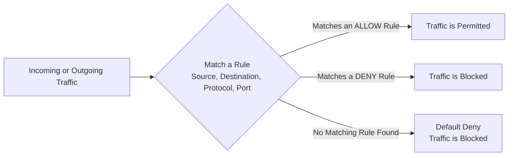
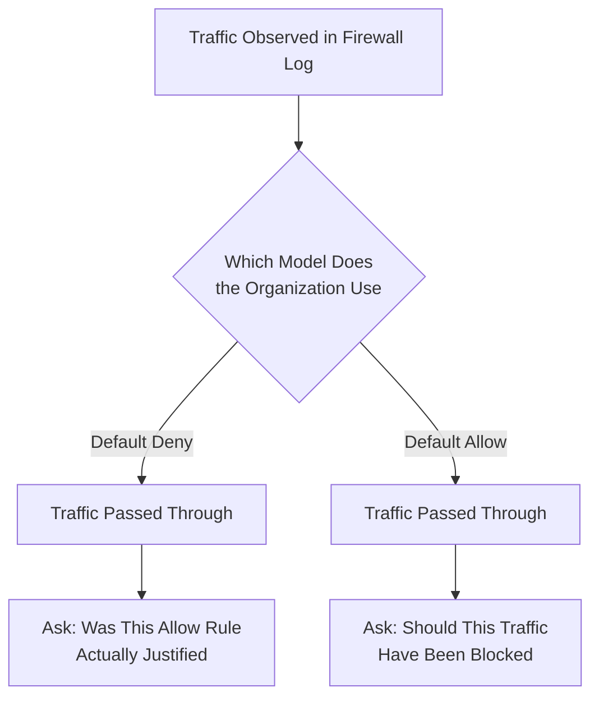

| Topic | Level | Reading Time | Prerequisites |
|---|---|---|---|
| Network Security Fundamentals: Firewall Rules and Default Policies | Intermediate | ~30 min | Basic understanding of firewalls, TCP/IP, and common port numbers |

> **The goal of this section:**  
> You'll understand how a Firewall actually works through rules and who is responsible for writing them. We'll walk through five real examples of common firewall rules, and finally you'll understand the fundamental difference between two philosophies for configuring a firewall: **Default Deny** and **Default Allow**.


## Learning Objectives

By the end of this section, you will be able to:

- Explain why a firewall is not "smart" on its own and depends entirely on rules written by humans.
- Define what a **rule** is in the context of a firewall, and explain the **Default Deny** principle.
- Identify who is typically responsible for writing firewall rules and why a **SOC Analyst** still needs to understand them.
- Read and interpret the logic of real-world firewall rules based on source, destination, protocol, port, and action.
- Explain the security reasoning behind common rules such as blocking FTP, geo-blocking, and forcing DNS through a controlled path.
- Compare **Default Allow** and **Default Deny** as overall firewall policies and explain their trade-offs.
- Explain why a SOC Analyst must know which default policy an organization uses before interpreting firewall logs.

## Table of Contents

- [Firewalls Are Not Smart on Their Own](#firewalls-are-not-smart-on-their-own)
- [What Is a Rule, Really](#what-is-a-rule-really)
- [Default Deny: The Core Principle](#default-deny-the-core-principle)
- [Who Writes These Rules](#who-writes-these-rules)
- [Why SOC Analysts Must Understand Rules Too](#why-soc-analysts-must-understand-rules-too)
- [How Rules Are Configured](#how-rules-are-configured)
- [Real Examples of Firewall Rules](#real-examples-of-firewall-rules)
  - [Example 1: Allowing Normal Web Browsing](#example-1-allowing-normal-web-browsing)
  - [Example 2: Blocking Unsolicited Inbound Traffic](#example-2-blocking-unsolicited-inbound-traffic)
  - [Example 3: Blocking Insecure FTP](#example-3-blocking-insecure-ftp)
  - [Example 4: Geo-Blocking](#example-4-geo-blocking)
  - [Example 5: Forcing DNS Through a Controlled Path](#example-5-forcing-dns-through-a-controlled-path)
- [Rule Logic Diagram](#rule-logic-diagram)
- [Default Allow vs. Default Deny: Two Competing Philosophies](#default-allow-vs-default-deny-two-competing-philosophies)
- [Default Deny: The Safer, More Common Approach](#default-deny-the-safer-more-common-approach)
- [Default Allow: The Riskier Approach](#11-default-allow-the-riskier-approach)
- [Side-by-Side Comparison](#side-by-side-comparison)
- [Why This Matters for a SOC Analyst](#why-this-matters-for-a-soc-analyst)
- [Which Model Do Organizations Actually Use](#which-model-do-organizations-actually-use)
- [Decision Flow Diagram](#decision-flow-diagram)
- [Career Connection](#career-connection)
- [Key Terms Glossary](#key-terms-glossary)
- [Summary](#summary)

## Firewalls Are Not Smart on Their Own

A **Firewall** isn't smart by nature. It doesn't decide on its own what's dangerous and what isn't. It's basically a **dumb, obedient machine** that only knows what you've told it, through **rules**.

> [!IMPORTANT]
> This idea is very important to understand from the start: the Firewall has no real "understanding" of danger; it just executes exactly the instructions it was given. Any mistake in those rules, whether too much or too little, will be carried out without question.

## What Is a Rule, Really

A **Rule** is simply a statement that says:

- This type of **traffic**: **allow it**.
- This type of traffic: **block it**.

Everything else on this topic builds on this simple concept.

## Default Deny: The Core Principle

There's a fundamental and very important concept in a firewall's **default behavior**: most firewalls follow a principle called **Default Deny**.

This principle means: if no rule specifically allows something, that thing is blocked automatically.

> [!NOTE]
> The key idea here is that the security assumption is "deny," not "accept." In other words, the firewall treats any traffic as suspicious or unknown until it's confirmed that the traffic is explicitly allowed.

## Who Writes These Rules

The **Network Security Team** is usually responsible for designing and writing these rules; they're the ones who decide the actual **security policy**.

But as a **SOC Analyst**, you're not completely out of the picture. You need to be able to read, understand, and interpret these rules well, for the following reasons:

- You'll investigate **alerts** that point to specific rules.
- You'll need to know whether traffic was blocked or allowed, and why.
- You may need to spot a rule that's misconfigured or more **permissive** than it should be.

## Why SOC Analysts Must Understand Rules Too

This point makes it clear that understanding rule logic isn't work reserved for the Network Security team alone. A SOC analyst who can read and understand these rules can figure out much faster whether there's an actual problem or just expected behavior.

> [!TIP]
> If you get an alert saying traffic was blocked, the first question you should ask is: "Exactly which rule blocked this traffic?" The answer gives you the full context and helps you judge whether it's a real threat or just normal, expected behavior.

## How Rules Are Configured

Most modern firewalls have a **GUI** (graphical interface), so you usually aren't typing scary command-line commands. You just fill in fields like: source, destination, port, action (allow/deny).

But the truly hard part isn't the interface itself; the hard part is **building the rule's logic correctly**. A badly built rule can either block legitimate traffic that's important to the business (and trigger angry complaints from employees), or mistakenly let something dangerous through.

> [!WARNING]
> Every organization's rules are completely different from the next. A bank's firewall rules won't look anything like a school's firewall rules. **There's no single universal rulebook**; everything depends on the business needs and the risks the organization is trying to manage.

## Real Examples of Firewall Rules

Now we'll see how these rules are actually written in practice. Don't worry about the exact syntax (it differs from vendor to vendor); focus on understanding the **logic**.

### Example 1: Allowing Normal Web Browsing

```
ALLOW TCP Internal_Network → Internet
PORTS 80, 443
```

**The logic**: let employees inside the company browse the internet using normal, secure websites. This is a very normal rule that exists almost everywhere; it basically lets employees use the internet for regular browsing.

### Example 2: Blocking Unsolicited Inbound Traffic

```
DENY ANY Internet → Internal_Network
```

**The logic**: nobody from the outside internet is allowed to simply walk into our internal network. This is a very basic defensive rule that prevents any random person on the internet from reaching the company's internal systems directly.

### Example 3: Blocking Insecure FTP

```
DENY TCP ANY → ANY PORT 21 (FTP)
```

**The logic**: block the FTP protocol everywhere, for everyone. **FTP** is an old, insecure file transfer protocol; it sends usernames and passwords in plain (unencrypted) text. Many organizations block it completely because it's an easy target for attackers to steal credentials just by monitoring traffic.

### Example 4: Geo-Blocking

```
DENY IP Country_List → Internal_Network
```

**The logic**: block traffic coming from a specific list of countries. This practice is called **Geo-Blocking**. Companies often do this if they don't do business in certain countries and are seeing a large volume of attack traffic coming from there, so they decide to cut off the connection entirely to reduce risk.

### Example 5: Forcing DNS Through a Controlled Path

```
DENY UDP Internal_Network → ANY PORT 53
```

**The logic**: block outbound DNS requests that try to use UDP port 53 to reach anywhere. Port 53 is used for **DNS**. On the surface this might look like it would break the internet for everyone, but this rule is usually used to force all DNS traffic through a specific, monitored internal DNS server, instead of letting devices query random external DNS servers directly.

> [!IMPORTANT]
> The reason behind this rule? **Malware** often uses external DNS requests covertly to communicate with hackers (this is called **DNS Tunneling**), so blocking direct outbound DNS forces everything through a controlled, monitored path.

Every rule has clear logic behind it: **source**, **destination**, **protocol**, **port**, and **action**. Once you're comfortable reading these rules, you'll be able to look at **any** firewall rule in the world and understand its purpose.

## Rule Logic Diagram

The following diagram shows the general logic that any firewall rule is built on, from the moment traffic arrives until the decision to allow or block it is made:



## Default Allow vs. Default Deny: Two Competing Philosophies

This is one of the most important foundational concepts in firewall configuration, and it affects the organization's **entire security posture**.

Choosing between the two philosophies isn't a minor technical detail; it's a strategic decision that determines how the whole network will handle any new or unknown traffic.

## Default Deny: The Safer, More Common Approach

In the **Default Deny** philosophy: everything is blocked by default. Only traffic that someone has explicitly approved is allowed.

> [!NOTE]
> Imagine an **exclusive building** for members only. If your name isn't on the approved list, security won't let you in, period.

**This is more secure**, because nothing gets through by accident.

**The downside?** It takes more effort up front: someone has to think through every type of legitimate traffic and manually write an allow rule for it. If you forget one, users will complain that something isn't working.

## Default Allow: The Riskier Approach

In the **Default Allow** philosophy: everything is allowed by default, and only what has been explicitly identified as harmful is blocked.

> [!NOTE]
> Imagine a **public park** with open access: anyone can come in unless they've been specifically banned or are on a "no entry" list.

**This is less secure**, because new threats that haven't been identified yet will pass through freely, since they're not on the block list yet.

**The advantage?** Less initial setup effort, and fewer complaints about legitimate traffic being blocked.

## Side-by-Side Comparison

The following table summarizes the fundamental difference between the two philosophies:

| Criterion | Default Deny | Default Allow |
|---|---|---|
| Default behavior | Block everything unless explicitly allowed | Allow everything unless explicitly blocked |
| Security level | Higher, because unknown threats are blocked automatically | Lower, because unknown threats pass freely |
| Initial setup effort | Greater; requires writing an allow rule for every type of legitimate traffic | Less; only requires identifying what is known to be harmful |
| User complaints | More likely when an allow rule for legitimate traffic is forgotten | Less likely, because most traffic passes by default |
| Handling new threats | Blocked automatically until approved | Pass freely until identified as harmful |

> [!IMPORTANT]
> The fundamental difference between the two philosophies isn't just the "strength" of the protection, but **the direction of the assumption itself**: is the assumption trust (Allow) or distrust (Deny)? The answer to that question shapes the nature of every other security decision on the network.

## Why This Matters for a SOC Analyst

When you're investigating an **incident**, knowing whether the organization uses **Default Allow** or **Default Deny** completely changes how you interpret the firewall logs.

- In a **Default Deny** environment: if you see traffic that got through, it means someone explicitly approved it. So the question you'll ask is: "Was this rule justified in the first place?"
- In a **Default Allow** environment: instead, you'll ask: "Should this traffic have been blocked, and it wasn't?"

> [!TIP]
> The two questions are completely different in nature, and understanding the philosophy the organization follows is the first step before you actually start analyzing any firewall log, so you ask the right question from the start.

## Which Model Do Organizations Actually Use

Most **security-mature organizations** tend to use **Default Deny**, because it reduces risk.

> [!WARNING]
> Although Default Deny is the most common in security-mature organizations, it's very important to know that both models really exist in practice, and you must **always confirm which model the organization uses** before you start analyzing its firewall's behavior.

## Decision Flow Diagram

The following diagram shows the difference in how a SOC analyst thinks when analyzing traffic under each model:



## Career Connection

Understanding firewall rule logic and the difference between Default Allow and Default Deny has direct applications across several career paths:

- In **SOC**, the ability to read and understand firewall logs and their associated rules, along with knowing which default philosophy is in use, is the foundation for investigating most day-to-day security alerts.
- In **Network Security Engineering**, designing precise, balanced firewall rules and choosing the right philosophy (usually Default Deny) is the core of the job.
- In **Pentesting**, examining firewall rules for permissive or **misconfigured** settings is an essential part of assessing network security.
- In **GRC**, documenting the philosophy in use (Default Allow or Default Deny) is part of compliance and security audit requirements.

## Key Terms Glossary

| Term | Definition |
|---|---|
| **Firewall Rule** | A statement that defines a specific type of traffic and decides either to allow it or block it. |
| **Default Deny** | A configuration principle under which all traffic is blocked by default unless an explicit rule allows it. |
| **Default Allow** | A configuration principle under which all traffic is allowed by default unless an explicit rule blocks it. |
| **Source / Destination** | The origin and destination address or network of the traffic specified in the rule. |
| **FTP (File Transfer Protocol)** | An old, insecure file transfer protocol that sends credentials in unencrypted text. |
| **Geo-Blocking** | Blocking traffic coming from specific countries or geographic regions. |
| **DNS Tunneling** | A technique attackers use to pass data or commands through external DNS requests to communicate covertly with their servers. |
| **Security Posture** | The organization's overall security state, resulting from all of its security policies and configurations combined. |
| **Security-Mature Organization** | An organization that has implemented advanced, carefully considered security practices and policies. |

## Summary

- A **Firewall** isn't smart by nature; it only executes the **rules** that the people in charge wrote for it, and every rule is basically a simple statement that says: allow or block this type of traffic.
- The **Default Deny** principle says that any traffic without an explicit rule allowing it is blocked automatically.
- The **Network Security Team** is usually responsible for writing the rules, but a **SOC** analyst must be able to read, understand, and interpret them, because they're the foundation for investigating day-to-day alerts.
- Rules are usually configured through a **GUI**, but the real challenge isn't the interface; it's **building the correct logic** for the rule.
- The real examples show the variety of rules: allowing normal web browsing, preventing random access from the internet, blocking the insecure **FTP** protocol, applying **Geo-Blocking**, and forcing **DNS** traffic through a monitored internal path to prevent techniques like **DNS Tunneling**.
- **Default Deny** blocks all traffic by default and allows only what has been explicitly approved; it's the most secure but requires more setup effort.
- **Default Allow** allows all traffic by default and blocks only what has been identified as harmful; it's less secure but requires less setup effort.
- As a **SOC** analyst, the question you ask when analyzing traffic is completely different depending on the model in use: "Was this rule justified?" under Default Deny, versus "Should this have been blocked?" under Default Allow.
- Most security-mature organizations lean toward **Default Deny** because it reduces risk, but both models really exist, and you must always confirm which model is in use before you start your analysis.

