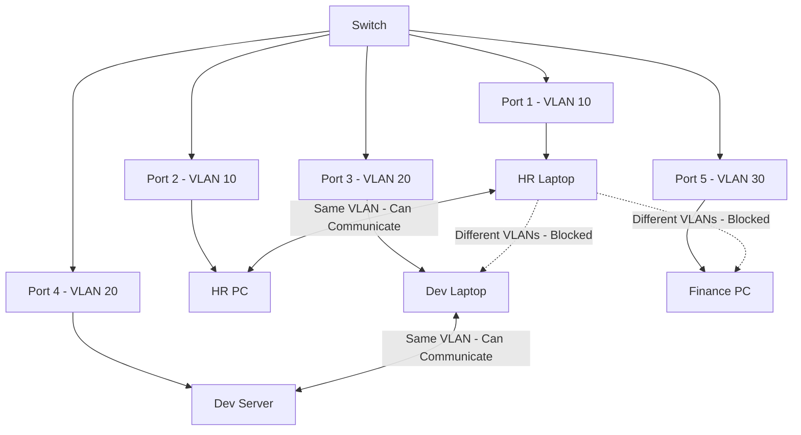
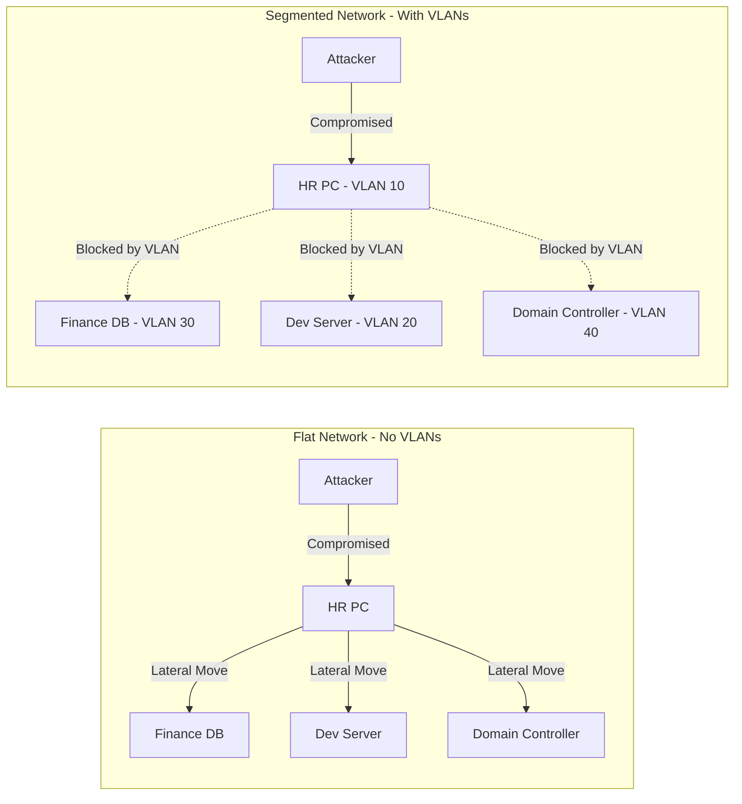
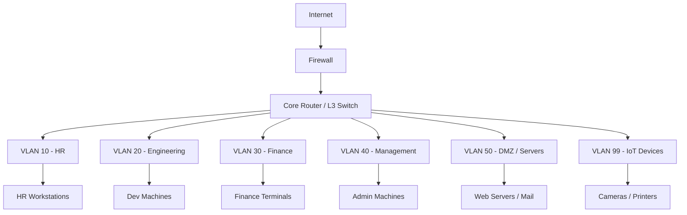
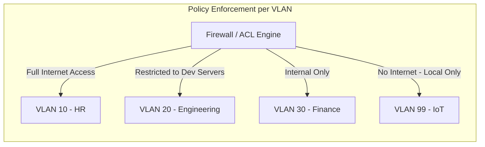
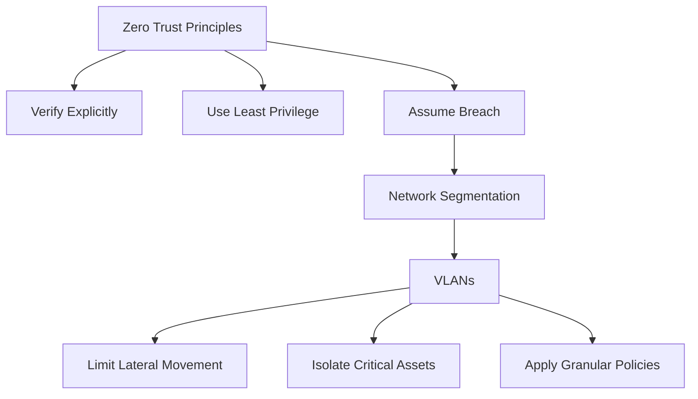
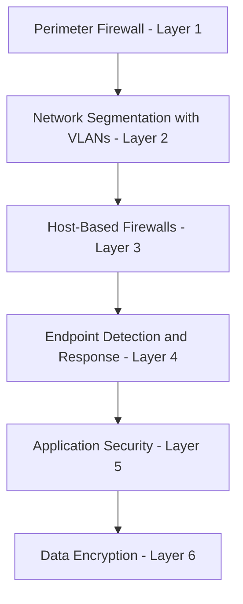
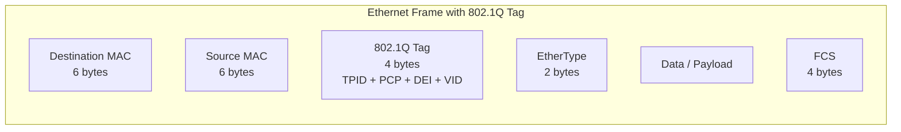
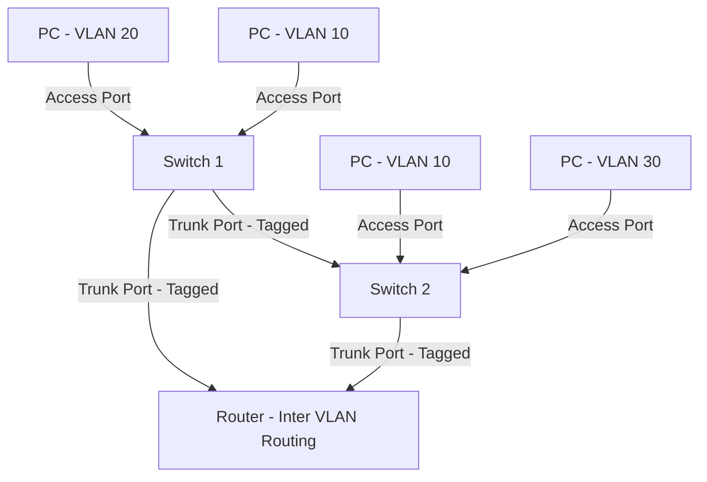
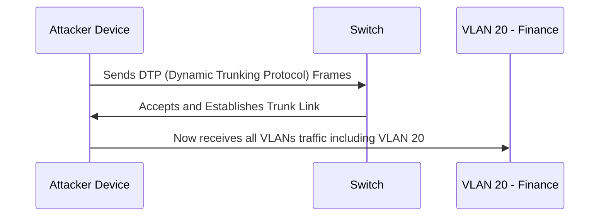
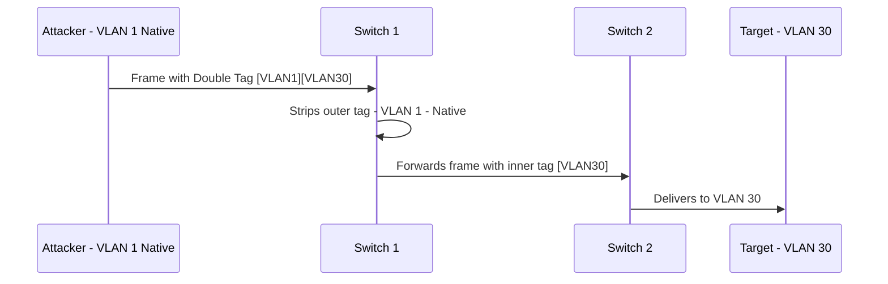

> **Goal of this section:**
> You will understand what a VLAN is and why it is used, how it helps segment the network to prevent attackers from moving laterally, and how, as a Cybersecurity Professional, you can use it to secure the network.

---

# VLANs (Virtual Local Area Networks)

## Table of Contents

- [What is a VLAN?](#what-is-a-vlan)
- [Why VLANs Exist — The Problem They Solve](#why-vlans-exist--the-problem-they-solve)
- [How VLANs Work](#how-vlans-work)
- [VLANs and Network Segmentation](#vlans-and-network-segmentation)
- [VLANs and Policy Enforcement](#vlans-and-policy-enforcement)
- [VLANs from a Security Perspective](#vlans-from-a-security-perspective)
- [VLAN Tagging — IEEE 802.1Q](#vlan-tagging--ieee-8021q)
- [Types of VLAN Ports](#types-of-vlan-ports)
- [Common VLAN Attacks](#common-vlan-attacks)
- [Summary](#summary)

---

## What is a VLAN?

**VLAN** stands for **Virtual Local Area Network**. It is a way to divide a single physical network into multiple logical networks that are independent of each other.

Imagine you have one **Switch** with 24 ports. Instead of all the devices connected to it being on the same network and talking to each other freely, a VLAN lets you say:

- Ports 1 to 8 → VLAN 10 (for example, for HR)
- Ports 9 to 16 → VLAN 20 (for Engineering)
- Ports 17 to 24 → VLAN 30 (for Finance)

Each VLAN is now a separate **Broadcast Domain**, meaning devices in VLAN 10 can't see or talk to devices in VLAN 20 unless a router or Layer 3 switch explicitly allows it.

```
Physical Network (One Switch)
┌─────────────────────────────────────┐
│                                     │
│  [HR PC]   [HR PC]   [HR Printer]   │  ← VLAN 10
│                                     │
│  [Dev PC]  [Dev PC]  [Dev Server]   │  ← VLAN 20
│                                     │
│  [Fin PC]  [Fin PC]  [Fin DB]       │  ← VLAN 30
│                                     │
└─────────────────────────────────────┘
```

> [!IMPORTANT]
> VLANs are created at **Layer 2 (Data Link Layer)** of the OSI Model. The switch manages the VLAN, not the router. If you want communication to pass between VLANs, you need to set up **Inter-VLAN Routing** using a router or a Layer 3 switch.

---

## Why VLANs Exist — The Problem They Solve

### The Problem Without VLANs

Imagine a large company with 500 devices all on the same network (a flat network). The problems you would face:

| Problem | Details |
|---|---|
| **Broadcast Storms** | Every broadcast a device sends reaches 499 other devices, which overloads the network |
| **Security Risk** | If an attacker gets into one device, they can easily see all the other devices |
| **No Policy Control** | It's hard to apply different rules to different departments |
| **Scalability Issues** | The more devices you add, the more broadcasts there are and the slower the network gets |

### The Solution with VLANs

VLANs solve all of these problems by:

- **Shrinking the Broadcast Domain** — each VLAN has its own broadcast domain
- **Isolating traffic** — devices in different VLANs don't see each other automatically
- **Applying policies** — you can apply different firewall rules or QoS to each VLAN

> [!NOTE]
> VLANs are created by **Network Administrators**, not Cybersecurity Professionals, but the Security Team benefits from them greatly when securing the network. The role of Security here is to design the segmentation strategy and the policies, and the role of the Network Admin is to implement them.

---

## How VLANs Work

A VLAN works by assigning each **Port** on the switch to a specific VLAN. The switch then knows which broadcast domain any traffic coming from that port belongs to.



The switch treats each VLAN as a completely separate network at Layer 2. Traffic from VLAN 10 doesn't pass to VLAN 20 unless a router allows it.

---

## VLANs and Network Segmentation

**Network Segmentation** is the concept of dividing the network into smaller parts to limit the spread of damage if a breach occurs. VLANs are the most common tool used to achieve segmentation at Layer 2.

### Lateral Movement and How VLANs Prevent It

**Lateral Movement** is when an attacker gets into a device on your network and starts moving from it to other devices inside the same network to reach more important assets, such as a Domain Controller or a Database Server.



> [!IMPORTANT]
> VLANs significantly reduce the **Attack Surface**. If the attacker compromises a device in VLAN 10, they are trapped inside that VLAN and can't reach the other VLANs unless there is a misconfiguration or they use an attack such as VLAN Hopping.

### A Practical Example of Segmentation

In a typical enterprise environment, segmentation looks like this:



> [!TIP]
> It is a best practice to put IoT devices in a separate VLAN, because most of them have vulnerabilities and aren't updated regularly. If a camera gets compromised, for example, it stays isolated from the rest of the network.

---

## VLANs and Policy Enforcement

One of the biggest advantages of VLANs is that they let you easily apply **different policies** to different teams.

### What Policies Can You Apply to Each VLAN?

| Type | Example |
|---|---|
| **Firewall Rules** | VLAN 10 (HR) can reach the Internet, while VLAN 30 (Finance) is only allowed to reach specific IPs |
| **QoS (Quality of Service)** | The VoIP VLAN gets higher bandwidth priority |
| **Access Control Lists (ACLs)** | VLAN 20 (Engineering) can only reach the Dev Servers, not the Finance DB |
| **DHCP Scope** | Each VLAN gets a different range of IPs |
| **Monitoring & Logging** | The servers' VLAN is monitored more closely than the regular employees' VLAN |



> [!NOTE]
> VLANs provide the segmentation, but the policies themselves are applied on the router or the firewall that controls Inter-VLAN Traffic. In other words, the VLAN defines "who is grouped with whom," and the firewall defines "who can talk to whom" when traffic crosses from one VLAN to another.

---

## VLANs from a Security Perspective

As a Cybersecurity Professional, VLANs are a very important tool in your defense strategy. These are the key points you need to know:

### The Principle of Least Privilege at the Network Level

VLANs apply the **Principle of Least Privilege** at the level of network segmentation, meaning each device can reach only the resources it needs and nothing more.

### Zero Trust and Its Relationship to VLANs

In a **Zero Trust** architecture, the principle is "don't trust anything automatically, even inside the internal network." VLANs help implement the **Network Segmentation** part of Zero Trust.



### Defense in Depth and VLANs

VLANs are a single layer in the concept of **Defense in Depth**, the idea that protection must be built in multiple layers:



> [!WARNING]
> VLANs are not a "Silver Bullet." They protect against Lateral Movement at Layer 2, but if the router or the firewall that controls Inter-VLAN Traffic has a misconfiguration or a vulnerability, the attacker can cross between them. There must always be monitoring and logging of Inter-VLAN Traffic.

---

## VLAN Tagging — IEEE 802.1Q

For VLANs to work over Trunk Links (the links that carry traffic from more than one VLAN), there has to be a way to distinguish the traffic, and that is what **VLAN Tagging** does using the **IEEE 802.1Q** standard.

### What Is a VLAN Tag?

When a frame moves over a **Trunk Link**, the switch adds **4 bytes** to the Ethernet header, called the 802.1Q Tag. This tag contains:

| Field | Size | Description |
|---|---|---|
| **TPID** (Tag Protocol Identifier) | 16 bits | Its value is fixed at `0x8100`, telling the switch that this frame is tagged |
| **PCP** (Priority Code Point) | 3 bits | Sets the priority for QoS |
| **DEI** (Drop Eligible Indicator) | 1 bit | Indicates whether the frame can be dropped if there is congestion |
| **VID** (VLAN Identifier) | 12 bits | The VLAN number, from 1 to 4094 |



> [!NOTE]
> The **Native VLAN** is the only VLAN whose traffic is sent over the Trunk Link **without** a tag. By default on Cisco switches, the Native VLAN is number 1. This matters for security because it is the source of an attack called VLAN Hopping.

---

## Types of VLAN Ports

There are two main types of ports on a switch:

### Access Port

- Connects to an end device such as a PC or a printer
- Belongs to only one VLAN
- Traffic is sent without a tag (the device doesn't need to know which VLAN it's in)

```
[PC] ──── Access Port (VLAN 10) ──── [Switch]
```

### Trunk Port

- Connects a switch to a switch, or a switch to a router
- Carries traffic from more than one VLAN at the same time
- Traffic is sent with the 802.1Q Tag so the other device knows which VLAN the frame belongs to

```
[Switch A] ──── Trunk Port (All VLANs) ──── [Switch B]
```



---

## Common VLAN Attacks

As a Security Professional, you need to know the attacks that can target VLANs:

### 1. VLAN Hopping

**VLAN Hopping** is an attack that lets the attacker move from one VLAN to another without passing through a router or a firewall.

There are two methods:

#### Switch Spoofing

The attacker makes their device act like a switch and negotiate a Trunk Link with the real switch, which lets them reach the traffic of all the VLANs.



#### Double Tagging

The attacker sends a frame with **two tags**: the first tag is for the Native VLAN, and the second tag is for the target VLAN. The switch strips the first tag (the Native VLAN Tag) and sends the frame to the other VLAN.



> [!WARNING]
> The Double Tagging Attack is **One-Way only**: the attacker can send to the other VLAN but can't receive the response directly. Even so, it can be dangerous when combined with another attack such as DoS.

### 2. Protecting Against VLAN Attacks

| Measure | Goal |
|---|---|
| **Disable DTP** on all Access Ports | Prevents Switch Spoofing |
| **Change the Native VLAN** to an unused VLAN (for example, VLAN 999) | Prevents Double Tagging |
| **Enable Port Security** | Prevents unknown devices from connecting |
| **Use Private VLANs** | Isolates devices even within the same VLAN |
| **Monitor the Trunk Ports** | Detects any unexpected Trunk Negotiation |

> [!TIP]
> Always change the Native VLAN from the default (VLAN 1) to a VLAN that no device uses, and disable DTP on all ports that aren't actually Trunk Ports. The best practice is to set every port to a hardcoded mode (either Access or Trunk) instead of leaving it in Dynamic Mode.

---

## Summary

### VLAN Summary

- A **VLAN (Virtual LAN)** is a way to divide the physical network into separate logical networks at **Layer 2**.

- It is created by **Network Administrators**, but the **Security Team** is the one that benefits from it to secure the network and apply policies.

- The most important security benefit is preventing **Lateral Movement**: if an attacker compromises a device in a VLAN, they are trapped in it and can't easily move to the other VLANs.

- VLANs make it easy to apply **different policies** to different departments: Firewall Rules, QoS, ACLs, DHCP Scopes.

- **802.1Q Tagging** is the standard used to distinguish VLAN traffic on Trunk Links.

- There are two types of ports: **Access Ports** (for a single end device in one VLAN) and **Trunk Ports** (for switches and routers, carrying all the VLANs).

- The most well-known attack on VLANs is **VLAN Hopping**, which is carried out in two ways: **Switch Spoofing** and **Double Tagging**. The fix is to disable DTP and change the Native VLAN.

- VLANs are an important part of **Defense in Depth** and **Zero Trust Architecture**, but they are not a complete replacement for the firewall and monitoring.
