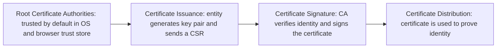

> **Goal of this section:**
> You will understand what a Digital Certificate is, who issues it (the Certificate Authority), and how this process solves the Identity Binding problem left open from the previous two topics (Asymmetric Encryption and Digital Signature). This is the final link in the whole series, showing you how everything we've studied comes together in a real HTTPS connection.

## Table of Contents
- [Recap: The Identity Binding Problem](#recap-the-identity-binding-problem)
- [What is a Digital Certificate?](#what-is-a-digital-certificate)
- [What a Certificate Contains](#what-a-certificate-contains)
- [How Certificates Work — Step by Step](#how-certificates-work--step-by-step)
- [Which Security Properties Does It Achieve?](#which-security-properties-does-it-achieve)
- [Policy-Based Trust, Not Mathematical Trust](#policy-based-trust-not-mathematical-trust)
- [What Can Still Go Wrong](#what-can-still-go-wrong)
- [Summary](#summary)
- [SOC Analyst Perspective](#soc-analyst-perspective)

---

## Recap: The Identity Binding Problem

In the **Asymmetric Encryption** and **Digital Signature** topics, we hit the same problem twice: encryption and digital signatures prove that something was done with a specific key, but **neither of them proves that the key actually belongs to the person who claims to own it**.

> [!IMPORTANT]
> Imagine this attack: Bob generates a key pair and hands the public key to Alice, lying about whose it is: he claims it is someone else's Public Key (Impersonation). Bob starts signing messages, and everyone who verifies them believes they came from that other person, because the signature is mathematically "valid." **This isn't a mathematical problem with the encryption itself. It's an Identity Binding problem.**

The question we need to answer: **How do we bind a Public Key to a real-world identity in a trustworthy way?**

---

## What is a Digital Certificate?

A Digital Certificate is an electronic document, like a **passport**, that proves this Public Key really belongs to this person or company.

More precisely, it is a **digitally signed statement** that says "this Public Key belongs to this identity," signed by a trusted party called a **Certificate Authority (CA)**.

> [!NOTE]
> Think of the CA as "the government that prints the passport." You don't trust the passport itself as a piece of paper; you trust it because a recognized authority (the government) issued it and vouched for its authenticity.

---

## What a Certificate Contains

A certificate isn't just a Public Key on its own. It is a complete package of information:

| Element | Description |
|---|---|
| **Subject Identity** | The identity of the certificate owner (such as the domain name or the company name) |
| **Subject Public Key** | The certificate owner's Public Key |
| **Validity Period** | The certificate's validity period (start and end dates) |
| **Issuer Identity** | The identity of the party that issued the certificate (the CA) |
| **Metadata** | Additional information (such as policies and usage restrictions) |
| **Digital Signature of the Issuer** | The CA's own signature over all of this content |

> [!IMPORTANT]
> The last element is the foundation of all the trust: the CA signs all of the certificate's data with its own private key, so any change to any of these elements immediately breaks the signature and reveals that the certificate has been tampered with or forged.

---

## How Certificates Work — Step by Step

### Step 1: Root Certificate Authorities (CAs)

The Public Key of the **Root CA** is **Trusted by Default** without needing any additional verification, because it is already stored inside a **Trust Store** built into the operating system and the browser.

**Where to find this Trust Store in practice:**

- **Windows Certificate Store:** Press `Win + R` → type `certmgr.msc` → Enter → this opens the Current User Certificate Store
- **Browser-specific stores:** Open Chrome → go to `chrome://settings/security` → scroll down to **Manage certificates** → click it → it will usually open the same Windows Certificate Manager

### Step 2: Certificate Issuance

The entity that wants a certificate goes through two stages:

**2.1 Entity Generates a Key Pair:**
- **Private Key** (secret, never shared)
- **Public Key** (the one that will be certified)

**2.2 Certificate Signing Request (CSR):**
The entity sends the CA a request containing:
- The Public Key
- Identity information (domain name, company name, etc.)
- **Proof that it actually holds the corresponding Private Key**

> [!NOTE]
> The CSR is "unsigned identity data + Public Key." No verification has happened yet; it's just the request.

### Step 3: Certificate Signature

The CA verifies the entity's identity (using methods that vary by certificate type, from simply confirming domain ownership to fully verifying official company documents), and then signs the certificate with its own private key.

### Step 4: Certificate Distribution

The signed certificate is now ready to be distributed and used, just as it will be in any HTTPS connection.

---

## Which Security Properties Does It Achieve?

| Security Property | Achieved? | How |
|---|---|---|
| Confidentiality | ❌ | The certificate itself is public data; anyone can view and download it |
| Integrity | ✅ (indirectly) | The certificate is digitally signed by the CA, so any change to it breaks the signature and is detected immediately |
| **Authentication** | ✅ (the main goal) | The certificate binds the Public Key to a real identity verified by a recognized third party |
| Non-repudiation | ✅ (indirectly) | The CA signed the certificate with its private key, so it can't deny issuing it |
| Key Exchange | ❌ (indirectly) | Not directly related, but it enables the Key Exchange process to happen **with trust** (as in the TLS Handshake) |

> [!IMPORTANT]
> **Digital Certificate → mainly achieves Authentication**, and it builds on all the concepts we studied earlier (Asymmetric Encryption + Digital Signature) to solve the **Identity Binding** problem that had been open from the start.

---

## Policy-Based Trust, Not Mathematical Trust

> [!WARNING]
> A very important conceptual point: trust in the Root CA is **not a mandatory mathematical proof** like the other concepts we studied (Hashing, Digital Signatures). It is **"Policy-Based Trust"**, meaning we trust the CA because the operating system or the browser "decided" to put it in the default Trust Store, not because a mathematical equation forces us to trust it.

In practice, this means that if someone manages to compromise your operating system and add a **malicious Root CA** to your Trust Store, they can issue "trusted" certificates for any domain they like, and your browser will trust them automatically without any warning, because the trust is based on policy, not mathematics.

---

## What Can Still Go Wrong

Even with the full certificate system in place, there are scenarios you need to be aware of:

| Scenario | Risk |
|---|---|
| **Self-Signed Certificates** | A certificate signed by its own owner rather than a trusted CA; no third party vouches for the identity |
| **Expired Certificates** | The certificate's validity has ended, so there is no guarantee it still represents the real identity |
| **Compromised CA** | If the CA itself is compromised, every certificate it issued becomes questionable |
| **Malicious Root CA Installation** | An attacker adds a malicious Root CA to the victim's machine to perform MITM without the browser warning |

> [!TIP]
> That's why any modern browser gives you a clear warning (such as "Your connection is not private") if it encounters a certificate that is self-signed, expired, or issued by a CA that isn't in the Trust Store. Always take that warning seriously.

---

## Summary

- A Digital Certificate is an electronic document that binds a Public Key to a real identity, signed by a trusted party called a **CA (Certificate Authority)**
- Its contents: Subject Identity, Subject Public Key, Validity Period, Issuer Identity, Metadata, Digital Signature of the Issuer
- The issuance process: a Root CA trusted by default → the entity creates a Key Pair and sends a CSR → the CA verifies and signs → the certificate is distributed and used
- It mainly achieves **Authentication**, and it builds on the concepts of Asymmetric Encryption and Digital Signature
- Trust in the Root CA is **Policy-Based**, not **Mathematical**, meaning it depends on a decision by the operating system/browser, not on a mandatory mathematical proof
- Potential risks: Self-Signed Certificates, Expired Certificates, a Compromised CA, or a malicious Root CA planted on your machine
- This is the final solution to the **Identity Binding** problem that started with the Asymmetric Encryption topic

---

## SOC Analyst Perspective

- Always verify the full **Certificate Chain of Trust** during any TLS traffic analysis. Not just the end certificate: you need to make sure the entire chain up to the Root CA is intact and trusted
- MITRE ATT&CK: technique **T1553.004 (Install Root Certificate)** describes exactly the scenario of an attacker planting a malicious Root CA on the victim's machine to perform a **MITM Attack** on all encrypted connections without the browser warning
- One of the most important indicators of compromise (IOCs) in corporate environments: the presence of **unknown or unauthorized Root Certificates** in the Trust Store of employees' machines. This should be monitored regularly as part of Endpoint Hardening
- Practical tools: `openssl s_client -connect domain:443 -showcerts` gives you full details about the certificate chain of any domain, and `certmgr.msc` or `chrome://settings/security` let you review the local Trust Store of any machine during Incident Response
