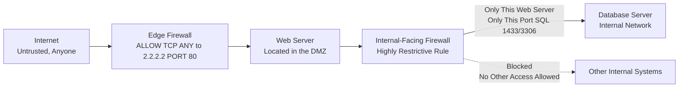

| Topic | Level | Reading Time | Prerequisites |
|---|---|---|---|
| The DMZ (Demilitarized Zone) | Intermediate | ~22 min | Basic understanding of firewalls, firewall rules, and network zones |

> **Goal of this section:**
> You'll understand what the DMZ is and why organizations place it between the internet and the internal network, see how traffic to and from it is controlled, and learn why you should always patch DMZ servers first, before anything else.

## Learning Objectives

By the end of this section, you will be able to:

- Define the **DMZ (Demilitarized Zone)** and explain the two different trust levels it separates.
- Explain why the DMZ requires closer monitoring than the internal network.
- Describe the two-step process of hardening a public-facing server: OS hardening and prioritized patching.
- Explain the golden rule "patch the DMZ first" and why it matters using a real-world vulnerability example.
- Explain how firewalls control traffic both entering the DMZ and moving from the DMZ into the internal network.

## Table of Contents

- [DMZ: The Public Lobby of Your Network](#dmz-the-public-lobby-of-your-network)
- [Two Trust Levels](#two-trust-levels)
- [Where You've Already Used a DMZ Today](#where-youve-already-used-a-dmz-today)
- [Key Mindset: No System Is 100% Secure](#key-mindset-no-system-is-100-secure)
- [Patch the Front Door Before the Back Rooms](#patch-the-front-door-before-the-back-rooms)
  - [Step One: Harden the OS](#step-one-harden-the-os)
  - [Step Two: Patch Fast, But Prioritize](#step-two-patch-fast-but-prioritize)
- [Case Study: Why This Isn't Just Theory](#case-study-why-this-isnt-just-theory)
- [Controlling Traffic In and Out of the DMZ](#controlling-traffic-in-and-out-of-the-dmz)
- [The DMZ Still Needs to Reach Inside: Carefully](#the-dmz-still-needs-to-reach-inside-carefully)
- [DMZ Architecture Diagram](#dmz-architecture-diagram)
- [Career Connection](#career-connection)
- [Key Terms Glossary](#key-terms-glossary)
- [Summary](#summary)

## DMZ: The Public Lobby of Your Network

A **DMZ (Demilitarized Zone)** is a dedicated network zone where you place all the services the public needs to reach: your website, your online store, your mobile app's backend, and so on.

> [!NOTE]
> Imagine a bank building: the **lobby** is open to anyone walking in from the street (that's the DMZ), but the vault room in the back only opens for bank employees with an ID badge (that's your internal network).

## Two Trust Levels

There are two main trust levels we need to distinguish between:

- **The Internal Network**: computers, internal servers, printers, and only employees who log in with a company account (these are people you trust).
- **The DMZ**: open to literally anyone on the internet: real customers, but also scammers, bots, and hackers (you don't know who's knocking on the door).

Since the DMZ lets in people you don't trust, it is watched very closely, with more **logging**, more **monitoring**, and more **alerts** than your internal network.

> [!TIP]
> Think of your house: you have a **front porch** (that's the DMZ) where any delivery worker or stranger can stand, and a **living room** (that's the internal network) that only family and invited guests enter. You wouldn't leave your car keys or family photos on the porch.

## Where You've Already Used a DMZ Today

Every time you order food, clothes, or anything else online, you're actually talking to a **web server**, and that server lives inside the company's **DMZ**.

Examples: the servers behind a banking app, or apps like Noon, Amazon, or Careem. Anything a customer reaches over the internet lives inside the DMZ.

## Key Mindset: No System Is 100% Secure

A core mindset to remember: **no system is 100% secure**.

Security doesn't mean building something that's impossible to break; it means making a breach **hard enough** that most attackers give up, while accepting the fact that one day, someone **will** find a vulnerability.

> [!IMPORTANT]
> Because of this, the real skill isn't just "block everything"; it's **being ready to respond quickly** when something goes wrong (detecting it, containing it, fixing it with a patch, and communicating about it).

> [!TIP]
> A bank vault isn't impossible to break into; it's designed to slow the thief down long enough for the alarm to bring the police before he gets through. Security = delay + detection + fast response, not an impossible wall.

## 5. Patch the Front Door Before the Back Rooms

A very common question in real job interviews: "How would you make a **public-facing** server more secure?"

### Step One: Harden the OS

Strip the server down until it has only exactly what it needs (close unused ports, remove unused software, disable default accounts). If a particular service isn't being used, it's just extra risk with no benefit.

**Example**: if your web server doesn't need FTP, shut FTP down completely; don't leave it "just in case."

### Step Two: Patch Fast, But Prioritize

When a vendor (such as Microsoft, F5, Cisco, etc.) announces a vulnerability, it usually releases a **patch**.

In a large company with thousands of servers, you can't update everything overnight, so you need to **set priorities**.

> [!IMPORTANT]
> **The golden rule**: **Patch the DMZ first**.
>
> Why? Because DMZ servers are fully exposed to the internet: anyone, anywhere, can try to exploit the vulnerability the moment it becomes public knowledge. Internal servers are protected behind layers of **access control**, so they are relatively lower risk in the short term.

## Case Study: Why This Isn't Just Theory

**F5** (a major vendor of load balancers and security appliances that are often deployed inside the DMZ) publicly announced multiple critical vulnerabilities in its products.

Reference: [K000156572](https://my.f5.com/manage/s/article/K000156572)

Announcements like this are exactly the moment when the "patch the DMZ first" rule matters: from the moment a vulnerability becomes public knowledge, attackers around the world start scanning the internet looking for unpatched servers.

> [!TIP]
> **A task for learners**: follow [The Hacker News](https://thehackernews.com) — an excellent free source for tracking real vulnerabilities and breaches as soon as they happen, so you build the habit of staying up to date like any real security professional.

**Summary**: **vulnerability disclosures** aren't rare; they happen constantly. Your job isn't to prevent vulnerabilities from existing, but to **close the window of exposure** as quickly as possible.

## Controlling Traffic In and Out of the DMZ

```
ALLOW TCP ANY -> 2.2.2.2 PORT 80
```

The firewall sits at the **edge** of the DMZ and allows only exactly the traffic that's needed, nothing more.

The rule above means: anyone on the internet (ANY) is allowed to talk to server `2.2.2.2`, but only on port 80 (normal web traffic).

Anything else to that same server, other ports or other protocols, is blocked by default.

> [!IMPORTANT]
> Why this matters: if the web server only needs port 80 (or 443 for HTTPS) open, then even if another unpatched service is running on it, the firewall stops external attackers from reaching it at all.

> [!TIP]
> It's like a security guard at a building entrance who only lets delivery workers use the delivery door. Even if other doors exist, they don't matter if no one is ever allowed to use them.

## The DMZ Still Needs to Reach Inside: Carefully

The DMZ isn't completely isolated; it usually needs to reach into your internal network.

**Example**: your public web server needs to query your database to display product listings, process orders, and so on. But that database server is **not directly exposed to the public**; customers never talk to it directly. Only the web server talks to it, and the web server is the one that relays the request.

Between the DMZ and the internal network, there's a second firewall (**a second layer of defense**), and this is very important: it is **not the same firewall** that protects the DMZ from the internet.

On this **internal-facing firewall**, you write a very narrow rule: only this specific server is allowed to reach only this specific database, on only the port it needs (such as SQL port 1433 or 3306).

> [!WARNING]
> This must be **extremely restrictive**, because if a hacker ever compromises your web server inside the DMZ, this rule is the **last line of defense** that stops them from moving deeper into your internal network.

> [!TIP]
> Think of a hotel: the guests (the DMZ) can order room service, and room service staff can enter the kitchen (the internal network) to get the food, but the guests themselves are never allowed into the kitchen. Only authorized staff, through one specific door, for one specific purpose.

## DMZ Architecture Diagram

The following diagram shows the full architecture of a network with a DMZ, including the two separate firewalls and the different trust layers:



## Career Connection

Understanding the DMZ has direct applications across several career paths:

- In **SOC**, monitoring DMZ servers with a higher level of alerting and logging than the internal network is a core part of daily monitoring work.
- In **Network Security Engineering**, designing two separate firewalls (edge and internal-facing) with restrictive rules between them is at the heart of any secure DMZ architecture.
- In **Vulnerability Management**, applying the "patch the DMZ first" rule is a core part of managing patching priorities in any large organization.
- In **Pentesting**, testing how effective the isolation between the DMZ and the internal network is (attempting pivoting) is a core part of assessing infrastructure security.

## Key Terms Glossary

| Term | Definition |
|---|---|
| **DMZ (Demilitarized Zone)** | An isolated network zone that hosts public-facing services, separated from the trusted internal network. |
| **Public-Facing Server** | A server that is exposed and reachable from the public internet. |
| **Hardening** | The process of reducing a system's attack surface by removing unnecessary services and accounts. |
| **Patch** | A software update that fixes a known security vulnerability. |
| **Window of Exposure** | The period of time from when a vulnerability is disclosed and discovered until it is actually patched. |
| **Edge Firewall** | The firewall at the edge of the DMZ that controls traffic coming in from the internet. |
| **Internal-Facing Firewall** | A second firewall that separates the DMZ from the internal network, with very restrictive rules. |
| **Pivoting** | An attacker moving from a compromised system to other systems inside the network. |

## Summary

- **DMZ (Demilitarized Zone)** is a dedicated network zone that hosts public-facing services, such as websites and online stores, separated from the trusted internal network.
- The internal network is trusted (employees only), while the DMZ is open to anyone on the internet, and is therefore monitored more intensively.
- No system is 100% secure; real security is a mix of delay, detection, and fast response, not impenetrable protection.
- Securing a public-facing server takes two steps: **Hardening** the operating system (removing everything unnecessary) and **prioritizing patching** so that DMZ servers are patched first.
- Vulnerability disclosures (like the real F5 case) happen constantly, and the security professional's job is to shrink the window of exposure as quickly as possible, not to prevent vulnerabilities from existing at all.
- A firewall at the edge of the DMZ allows only exactly the traffic that's needed (such as port 80 only) and blocks everything else by default.
- The DMZ still needs to reach the internal network (for example, a web server that needs to talk to a database), and this is done through a **second, separate firewall** with very restrictive rules, which is the last line of defense against any **pivoting** attempt if the DMZ is compromised.

