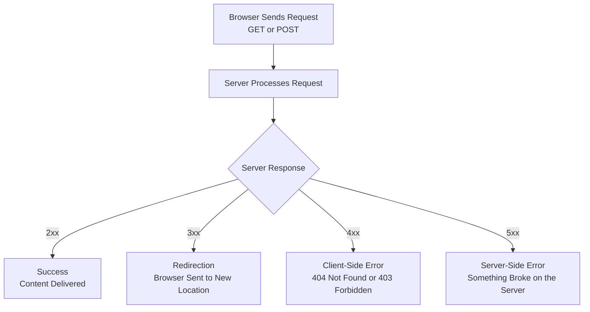

| Topic | Level | Reading Time | Prerequisites |
|---|---|---|---|
| HTTP: How Browsers Talk to Servers | Beginner | ~16 min | Basic understanding of how websites are built and hosted |

> **Goal of this section:**  
> You'll understand how the browser and the server talk to each other through HTTP, get to know the most common request types (GET and POST), understand all the status code categories, and see why the 403 error in particular is very important for a security analyst.

## Learning Objectives

By the end of this section, you will be able to:

- Explain the **client-server relationship** and why it's a strict one-directional flow.
- Distinguish between the **GET** and **POST** HTTP methods.
- Classify **HTTP status codes** into their four main categories: 200, 300, 400, and 500 series.
- Explain the difference between a **404** and a **403** error.
- Explain why a pattern of repeated 403 errors from the same source is a security red flag.
- Distinguish between **301** and **302** redirect codes.

## Table of Contents

- [How a Browser Talks to a Server](#how-a-browser-talks-to-a-server)
- [The One-Directional Flow](#the-one-directional-flow)
- [GET vs. POST](#get-vs-post)
- [Understanding HTTP Status Codes](#understanding-http-status-codes)
  - [200 Series: Success](#200-series-success)
  - [300 Series: Redirection](#300-series-redirection)
  - [400 Series: Client-Side Errors](#400-series-client-side-errors)
  - [500 Series: Server-Side Errors](#500-series-server-side-errors)
- [403 Errors and Security Monitoring](#403-errors-and-security-monitoring)
- [When a File Has Moved: Redirect Codes](#when-a-file-has-moved-redirect-codes)
- [Request-Response Flow Diagram](#request-response-flow-diagram)
- [Career Connection](#career-connection)
- [Key Terms Glossary](#key-terms-glossary)
- [Summary](#summary)

## How a Browser Talks to a Server

The communication happens using **HTTP (HyperText Transfer Protocol)** or its secure version **HTTPS**. The relationship is always the same: **the client asks, and the server responds**.

## The One-Directional Flow

- The **Client** (your browser) sends a **request**, for example: `GET /homepage.html`.
- The **Server** processes the request and sends back a **response**, which includes a **status code** plus the requested content (if available).

> [!IMPORTANT]
> This is a strict one-directional **flow**: the server never sends anything to the browser at random without being asked first. Every piece of content you see was **requested** by your browser.

## GET vs. POST

There are different types of HTTP requests, but the most common for ordinary browsing are:

| Type | Description |
|---|---|
| **GET** | Requests a particular **resource**, such as a page or an image |
| **POST** | Sends data to the server, such as submitting a login form |

> [!NOTE]
> There are other types such as `PUT` and `DELETE`, but `GET` and `POST` are the most used in basic browsing.

## Understanding HTTP Status Codes

Every response from the server includes a 3-digit **status code** that tells the browser what happened. These codes are divided into categories:

### 200 Series: Success

The request worked. Example: **200 OK** means the page was found and delivered successfully.

### 300 Series: Redirection

The requested resource has moved somewhere else. The browser is told the new address to go fetch it from.

### 400 Series: Client-Side Errors

There's something wrong with the request itself:

- **404 Not Found**: the client requested a file that doesn't exist.
- **403 Forbidden**: the file exists, but the client isn't allowed to access it.

### 500 Series: Server-Side Errors

Something broke on the server while it was trying to process the request (for example, a bug in the server code, a database crash, or a **misconfiguration**).

## 403 Errors and Security Monitoring

**403 Forbidden** means: "I know this exists, but you aren't allowed in." This is different from **404**, where the resource doesn't exist at all.

This is very important for **security monitoring**: if a security analyst sees a single IP address generating many 403 errors in a short time, that's a **red flag**.

> [!WARNING]
> **Why?** Because it usually means someone is deliberately trying to access restricted files or folders they shouldn't know about, which is a common sign of **reconnaissance** or a hacking attempt (such as someone repeatedly trying to browse `/admin`, `/config`, or `/backup`).

> [!IMPORTANT]
> **A single 403 is completely normal.** But **a pattern of repeated 403 attempts from the same source** is suspicious, and it's usually investigated.

## When a File Has Moved: Redirect Codes

If the requested file has moved, the server doesn't just fail; it can respond with a **redirect status code** and tell the browser exactly where to go instead, via the **Location header**.

| Code | Name | Description |
|---|---|---|
| **301** | **Moved Permanently** | The resource has permanently moved to a new address. Browsers (and search engines) remember this and use the new address permanently |
| **302** | **Found (Temporary Redirect)** | The resource has moved, but only temporarily. The browser should keep using the original address for future requests |

> [!TIP]
> As soon as the browser receives the redirect response, it automatically sends a new request to the new URL, without the user needing to do anything.

## Request-Response Flow Diagram

The following diagram shows the basic request-response cycle, plus the path for each category of codes:

## Career Connection

Understanding HTTP and status codes has direct applications across several career paths:

- In the **SOC**, monitoring patterns of repeated 403 errors from the same source is a core part of detecting reconnaissance or hacking attempts.
- In **Web Application Security**, understanding the difference between 404 and 403 helps diagnose whether a particular attack partially succeeded in discovering the site's structure.
- In **Pentesting**, response patterns (such as repeated 403s) are used to **map out** which paths exist and which are restricted on the site.

## Key Terms Glossary

| Term | Definition |
|---|---|
| **HTTP (HyperText Transfer Protocol)** | The core communication protocol between the browser and the server. |
| **Client-Server Relationship** | The relationship where the client sends requests and the server only responds to them. |
| **GET** | An HTTP request to fetch a particular resource. |
| **POST** | An HTTP request to send data to the server. |
| **Status Code** | A 3-digit code that indicates the result of the server processing the request. |
| **404 Not Found** | An error code indicating that the requested resource doesn't exist. |
| **403 Forbidden** | An error code indicating that the resource exists but access to it isn't allowed. |
| **Redirect (301 / 302)** | A code that automatically directs the browser to a new address, either permanently or temporarily. |
| **Reconnaissance** | The phase of gathering information about the target before carrying out the attack. |

## Summary

- Communication between the browser and the server happens through **HTTP/HTTPS**, with a strict one-directional relationship: the client asks, and the server responds.
- The most common request types are **GET** (requesting a resource) and **POST** (sending data).
- Status codes are divided into four categories: **200** (success), **300** (redirection), **400** (client-side error), and **500** (server-side error).
- **404** means the resource doesn't exist at all, while **403** means the resource exists but access to it is forbidden.
- A pattern of **repeated 403 errors** from the same source is a security warning sign, usually indicating reconnaissance or a hacking attempt.
- The **301** and **302** codes automatically direct the browser to a new address, the first permanent and the second temporary.

