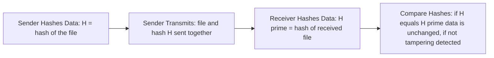
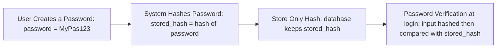

> **The goal of this section:**  
> You'll understand how Hashing works and what its core properties are (Deterministic, One-way, Fixed length, Avalanche Effect, Collision Resistance), how it's used for storing passwords and checking file integrity, and why, despite its strength, it still needs something extra to prove the sender's identity, not just the integrity of the data.

## Table of Contents
- [What is a Hash?](#what-is-a-hash)
- [Hash Function Properties](#hash-function-properties)
- [Which Security Properties Does It Achieve?](#which-security-properties-does-it-achieve)
- [File Integrity Verification — Step by Step](#file-integrity-verification--step-by-step)
- [Practical Example: Verifying File Integrity](#practical-example-verifying-file-integrity)
- [Hash vs Encryption](#hash-vs-encryption)
- [Hash Algorithms](#hash-algorithms)
- [How Hashing Is Used to Store Passwords](#how-hashing-is-used-to-store-passwords)
- [Hash Collisions](#hash-collisions)
- [Salting](#salting)
- [What Hashing Alone Does NOT Prevent](#what-hashing-alone-does-not-prevent)
- [Summary](#summary)
- [SOC Analyst Perspective](#soc-analyst-perspective)

---

## What is a Hash?

A Hash Function takes any **Input** (text, a file, a password, data of any size) and produces a **fixed-size Output** called the **Hash** or **Message Digest**.

> [!IMPORTANT]
> Hashing is **not Encryption**. It has no Key, and there's no way to get from the Hash back to the Original Data. It's an entirely One-Way process. If you forget your password, there's no way to "bring it back" — that's why any properly built system asks you to do a **Reset**, not a **Recovery**.

---

## Hash Function Properties

For a Hash Function to be considered cryptographically secure, it must satisfy all of these properties together:

| Property | Explanation |
|---|---|
| **Deterministic** | The same Input always produces exactly the same Hash — `hash("hello") = X` every time |
| **Fixed Output Size** | No matter how big the Input is, the Output size is always fixed (for example, SHA-256 always produces 256 bits) |
| **One-Way (Preimage Resistance)** | It's (computationally) impossible to get from the Hash back to the Original Data. Mathematically: given a specific Hash H, it's impossible to find an Input M such that `hash(M) = H` |
| **Avalanche Effect** | A tiny change in the Input (even a single character) produces a complete, totally different change in the Hash — `hash("hello") ≠ hash("Hello")` |
| **Collision Resistance** | It's (computationally) impossible to find two different Inputs M1 and M2 such that `hash(M1) = hash(M2)` |
| **Fast** | Very fast to compute compared to Encryption operations |

> [!NOTE]
> Notice the subtle difference between **One-Way (Preimage Resistance)** and **Collision Resistance**: the first says "it's impossible to get from the Hash back to the original Input," and the second says "it's impossible to find two different Inputs that give the same Hash." Both are important, but they protect against different attacks.

---

## Which Security Properties Does It Achieve?

As we agreed to do with every topic, let's apply the same 5 principles (Confidentiality, Integrity, Authentication, Non-repudiation, Key Exchange) to Hashing:

| Security Property | Achieved? | How |
|---|---|---|
| Confidentiality | ❌ | A Hash isn't designed to hide content — if you know the original Input, anyone can compute the same Hash and confirm it |
| **Integrity** | ✅ | This is the main and only goal Hashing was designed for |
| Authentication | ❌ (on its own) | A regular Hash proves the data matches, but it doesn't prove **who** sent it |
| Non-repudiation | ❌ | There's no link to any identity — anyone can compute the same Hash for the same data |
| Key Exchange | ❌ | It has nothing to do with this at all |

> [!IMPORTANT]
> **Hashing → achieves Integrity only.** That's its main, direct goal, and any other use built on it (such as storing passwords) is a secondary application of the same principle.

---

## File Integrity Verification — Step by Step

Imagine you're sending an important file over the internet. The process goes like this:



1. **Sender Hashes Data:** the sender computes a unique Hash (H) of the original file
2. **Sender Transmits:** the file and its Hash (H) are sent together to the receiver
3. **Receiver Hashes Data:** the receiver computes a new Hash (H') from the file it received
4. **Compare Hashes:** if `H == H'`, the data hasn't changed; if `H ≠ H'`, tampering has occurred

---

## Practical Example: Verifying File Integrity

If you download a program from the internet, like VLC, the official website displays the Hash of the `.exe`. After you download it, you compute the Hash yourself and compare — if it's different, the file has been modified or tampered with.

```bash
# On Windows
certutil -hashfile vlc.exe SHA256

# On Linux
sha256sum vlc.exe
```

> [!TIP]
> This step is essential in any Threat Hunting or Malware Analysis process — always compare the Hash of any file you download from an external source with the officially published Hash before you run it.

---

## Hash vs Encryption

| Criterion | Encryption | Hashing |
|---|---|---|
| Key | Requires a Key | No Key |
| Direction | Two-way (Reversible) | One direction only (One-Way) |
| Goal | Confidentiality | Integrity |
| Output size | Varies with the Input size | Always fixed regardless of the Input size |

**Uses of Encryption:**
- Disk Encryption
- VPNs
- Web Traffic (HTTPS)
- Protecting files

**Uses of Hashing:**
- Storing Passwords
- File Integrity Checks
- Digital Signatures

---

## Hash Algorithms

### MDX Family

| Algorithm | Size | Status |
|---|---|---|
| MD2 | 128-bit | Very slow, Obsolete |
| MD4 | 128-bit | Faster, obsolete |
| MD5 | 128-bit | Historically the best known, but not recommended |

> [!WARNING]
> The whole MDX Family is no longer used in modern security applications. MD5 in particular has known, documented Collisions — never use it for anything security-related (such as storing passwords or signatures).

### SHA Family

It gets its name from **NIST**, which designed it.

| Algorithm | Size | Status |
|---|---|---|
| SHA-0 | 160-bit | Flawed, obsolete |
| SHA-1 | 160-bit | Broken, don't use it |
| **SHA-256** | 256-bit | The Current Standard |
| SHA-512 | 512-bit | Stronger, relatively slower |
| SHA-3 | Variable | Very strong, a Backup in case SHA-2 is broken |

> [!NOTE]
> SHA-2 includes a group of Algorithms, and the name tells you the Hash size — so SHA-256 produces a 256-bit Hash. SHA-3 exists as a Backup in case someone discovers a major weakness in SHA-2 in the future, so the global system doesn't remain dependent on a single family.

---

## How Hashing Is Used to Store Passwords

The best-known use of Hashing in security is storing passwords. The process goes like this:



**At login:**
- `input_password → hash → compare with stored_hash`
- If they match → Access Granted
- If they don't match → Access Denied

**Why this method protects passwords:**

| Reason | Details |
|---|---|
| A Database Leak causes limited damage | If the database is stolen, the attacker only gets Hashes, not the real passwords |
| Hashes can't be reversed | It's (computationally) impossible to get from the Hash back to the original password |
| The attacker has to Brute-force | There's no quick way; the attacker is forced to try many guesses |

---

## Hash Collisions

A **Collision** is when two different Inputs produce exactly the same Hash.

This is very dangerous because:
- If you have File A, and you create a Collision with a malicious File B
- The Hash will look **correct** even though the file has actually changed

> [!WARNING]
> SHA-1 and the MDX Family have documented, known Collisions — that's a major reason they've been Deprecated in all modern security applications.

**A simplified example (Birthday Paradox):**
If you have a Hash Function that produces only 100 possible values, and you have 101 different files, then by mathematical necessity at least two files will give the same Hash. This principle is known as the **Birthday Paradox** in Cryptography, and it's the basis on which real Collision attacks against weak algorithms are built.

---

## Salting

**Salting** is adding a **Random Value** to the password before Hashing it:

```
hash(password || salt)
```

The result: the same password used by more than one user will produce a **completely different Hash for each of them**, because each user has a different Salt.

**Salting prevents:**
- **Rainbow Table Attacks** — because Precomputed Tables are no longer useful, since every Hash is now tied to a different Salt
- **Hash Reuse Across Users** — meaning that even if users use exactly the same password, the stored Hash will be different

> [!TIP]
> The Salt itself doesn't need to be secret — it's usually stored next to the Hash in the same database. Its strength isn't in being secret; its strength is in being **unique for each user**, which completely breaks the idea of precomputed tables.

---

## What Hashing Alone Does NOT Prevent

Despite all the strength of Hashing, there are very important limits you need to be aware of:

| Problem | Details |
|---|---|
| **Attacker Modifies Both** | An Active Attacker can modify the data **and its Hash together** in transit, so a Simple Comparison won't detect any tampering |
| **No Authentication** | Hashing doesn't prove **who** sent the data; it only proves the data hasn't changed since its Hash was computed |
| **No Protection Against Active Attackers** | There's no defense against someone actively tampering with the communication channel (Man-in-the-Middle) |

> [!IMPORTANT]
> **The problem:** if an attacker manages to intercept the data as it travels across the network and modifies **both the data itself and the attached Hash at the same time**, the receiving side won't be able to detect that tampering occurred — because the new Hash will match the modified data perfectly. Hashing only proves "the data is consistent with itself"; it doesn't prove its **Authenticity** or its **source**.
>
> **The solution:** **HMAC (Hash-based Message Authentication Code)** — which ties the Hashing process to a Secret Key known only to the two legitimate parties, so an attacker who doesn't have that Key can't forge a valid Hash even if they modify the data completely.

---

## Summary

- A Hash Function takes any Input and produces a fixed-size Output (Hash / Message Digest)
- Its core properties: **Deterministic, Fixed Output Size, One-Way (Preimage Resistance), Avalanche Effect, Collision Resistance, Fast**
- It achieves **Integrity only** out of the 5 Security Properties
- Hashing is completely different from Encryption: no Key, and no way back (One-Way)
- It's used for: storing passwords, File Integrity checks, and Digital Signatures
- **MD5 and SHA-1** are no longer secure because of documented Collisions — use **SHA-256** or higher
- **Salting** protects against Rainbow Table Attacks by making every Hash unique for each user
- **The problem:** Hashing alone doesn't protect against an active attacker who can modify the data and the Hash together — you need **HMAC** to add the Authentication layer

---

## SOC Analyst Perspective

- Hash Values are among the most important **IOCs (Indicators of Compromise)** — when you see a known Malware Hash (such as MD5 or SHA-256) in Logs or Files, it's conclusive evidence of a previously known threat
- MITRE ATT&CK: technique **T1553.004 (Install Root Certificate)** and other techniques related to Code Signing Bypass exploit weaknesses in some Hash verification mechanisms; attackers also use **T1027 (Obfuscated Files)** to change a Malware's Hash while keeping the same functionality (Hash Evasion)
- In Digital Forensics, Hashing is used to maintain the **Chain of Custody** — that is, to prove that the digital Evidence hasn't been tampered with from the moment it was seized until it's presented in court
- Practical tools: `VirusTotal` lets you search by the Hash of any suspicious file and see whether it's already known as Malware; tools like `HashCalc` and `sha256sum` are essential in any Incident Response Workflow
