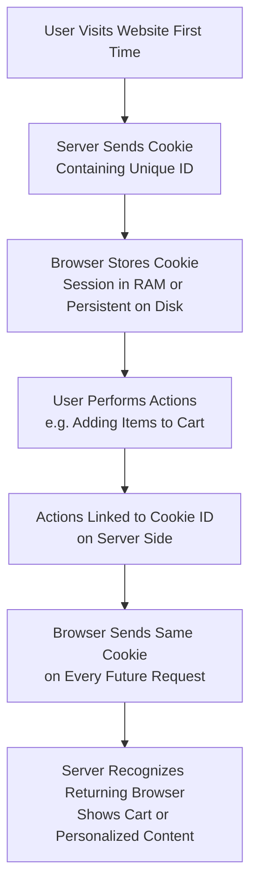

| Topic | Level | Reading Time | Prerequisites |
|---|---|---|---|
| Cookies: How Websites Remember You | Beginner | ~16 min | Basic understanding of HTTP and the client-server relationship |

> **Goal of this section:**
> You'll understand what a cookie actually is and why websites need one in the first place in order to "remember you." You'll see a real, practical example (a Noon shopping cart), and you'll learn about the different types of cookies and the security flags that protect them.

## Learning Objectives

By the end of this section, you will be able to:

- Define what a **Cookie** actually is at the data level, and explain what it can and cannot do.
- Explain why HTTP being a **stateless protocol** creates the need for cookies in the first place.
- Trace how a cookie lets a site like Noon remember your shopping cart across visits.
- Distinguish between **Session** and **Persistent** cookies, and between **First-Party** and **Third-Party** cookies.
- Explain the security purpose of the **Secure** and **HttpOnly** cookie flags.

## Table of Contents

- [What Exactly Is a Cookie](#what-exactly-is-a-cookie)
- [Session Cookies vs. Persistent Cookies](#session-cookies-vs-persistent-cookies)
- [Why Do We Even Need Cookies](#why-do-we-even-need-cookies)
- [Example: Noon Shopping Cart](#example-noon-shopping-cart)
- [Types of Cookies](#types-of-cookies)
  - [First-Party vs. Third-Party Cookies](#first-party-vs-third-party-cookies)
- [Security Flags: Secure and HttpOnly](#security-flags-secure-and-httponly)
- [Cookie Lifecycle Diagram](#cookie-lifecycle-diagram)
- [Career Connection](#career-connection)
- [Key Terms Glossary](#key-terms-glossary)
- [Summary](#summary)

## What Exactly Is a Cookie

A **Cookie** is a small piece of **text data** that a web server sends to your browser, which the browser then stores on your device.

> [!IMPORTANT]
> Cookies **are not programs and can't execute code**. They can't run scripts, install malware, or display images on their own. They only hold small pieces of information (such as a user ID, a session token, or a preference setting).

Cookies work as an **identifier**. They let the website recognize your specific browser/device on future visits, even without you being logged in.

## Session Cookies vs. Persistent Cookies

There are two main types, based on how long the cookie stays around:

| Type | Description |
|---|---|
| **Session Cookies** | Exist only temporarily in memory (**RAM**) and are deleted as soon as you close the browser |
| **Persistent Cookies** | Stored on your hard drive and remain even after you shut down and restart your device, until they expire or are deleted manually |

> [!IMPORTANT]
> **Persistent** cookies are what allow **long-term tracking**: they remember your activity over days, weeks, or months, and use that history to show personalized content or recommendations.

## Why Do We Even Need Cookies

By default, **HTTP is a stateless protocol**, which means every request the browser sends is treated as completely new. The server has no built-in memory of who you are or what you did in a previous request.

Without cookies, every time you clicked on a new page, the server would treat you as a completely new, unknown visitor: your shopping cart would be empty, you'd need to log in again, and your preferences would be forgotten.

> [!TIP]
> Cookies solve this problem by giving the server a way to **tag** your browser with an identifier. The browser then automatically sends that cookie with every subsequent request to the same site, and that's how the server remembers you across multiple page loads.

## Example: Noon Shopping Cart

When you add a product to your shopping cart on **Noon**, even when you're not logged in, the site can remember what's in your cart. Here's how that works:

1. As soon as you visit the site, the server sends your browser a cookie containing a **unique ID**.
2. Every action you take (such as adding products to the cart) is linked to that ID on the server side.
3. Your browser automatically sends that same cookie with every request to Noon.

That's why when you search for a product once and come back a few days later, or even restart your device, Noon can still recognize your browser through that stored cookie, show you your cart, or suggest products related to your previous search.

> [!NOTE]
> Without the cookie, the server wouldn't be able to link "the person who added product X yesterday" to the person browsing right now; remember that HTTP by itself has no memory.

## Types of Cookies

### First-Party vs. Third-Party Cookies

There's another classification, based on "who set the cookie":

| Type | Description |
|---|---|
| **First-Party Cookies** | Set by the website you're visiting directly (for example, Noon sets a cookie for `noon.com`) |
| **Third-Party Cookies** | Set by a domain different from the one you're visiting, often used by advertisers to track you across different sites (for example, an ad network embedded in many sites, building a profile of your browsing habits across all of them) |

> [!TIP]
> Session vs. Persistent and First-Party vs. Third-Party are two completely different classifications of cookies: the first describes **how long** the cookie stays around, and the second describes **who set it in the first place**. A single cookie can be both persistent and third-party at the same time.

## Security Flags: Secure and HttpOnly

Cookies can have **special flags** set on them to protect them:

| Flag | Description |
|---|---|
| **Secure** | Sent only over **HTTPS** connections |
| **HttpOnly** | Can't be accessed by **JavaScript**, which helps protect against certain attacks (such as **cross-site scripting**) |

> [!IMPORTANT]
> The **HttpOnly** flag in particular is very important for security: if a cookie containing a sensitive session token has this flag set, then even if a site is compromised and malicious JavaScript is injected, that code can't steal the cookie directly, because it isn't accessible to JavaScript at all.

## Cookie Lifecycle Diagram

The following diagram shows the lifecycle of a cookie, from its creation until it's used on future visits:

## Career Connection

Understanding cookies has direct applications across several career paths:

- In **Web Application Security**, understanding the **Secure** and **HttpOnly** flags is essential for assessing how well **user sessions** are protected against attacks such as **session hijacking**.
- In **Privacy Engineering and compliance (GRC)**, distinguishing between first-party and third-party cookies is a core part of complying with data protection laws (such as GDPR).
- In **Pentesting**, examining cookie settings (such as a missing HttpOnly flag) is a common part of web application security assessments.

## Key Terms Glossary

| Term | Definition |
|---|---|
| **Cookie** | A small piece of text data that the server sends to the browser to be stored on the user's device. |
| **Stateless Protocol** | A protocol that keeps no memory of previous requests, such as HTTP by default. |
| **Session Cookie** | A temporary cookie that exists only in memory and is deleted when the browser is closed. |
| **Persistent Cookie** | A cookie saved on the hard drive that remains even after the device is restarted, until it expires. |
| **First-Party Cookie** | A cookie set by the website you're visiting directly. |
| **Third-Party Cookie** | A cookie set by a domain different from the website you're visiting, often for advertising tracking purposes. |
| **Secure Flag** | A flag that ensures the cookie is sent only over HTTPS connections. |
| **HttpOnly Flag** | A flag that prevents the cookie from being accessed through JavaScript. |

## Summary

- A **Cookie** is a small piece of text data, not a program, and can't execute code. It's used as an identifier so the website can recognize your browser on future visits.
- Since **HTTP is a stateless protocol**, cookies are the solution that lets the server "remember you" across multiple requests and pages.
- The Noon example shows how a single cookie links your actions (such as adding a product to the cart) across multiple visits, even without logging in.
- There are two different classifications of cookies: **Session** vs. **Persistent** (based on duration), and **First-Party** vs. **Third-Party** (based on who set it).
- The **Secure** and **HttpOnly** flags provide additional security protection: the first restricts sending to HTTPS, and the second prevents access by JavaScript.

