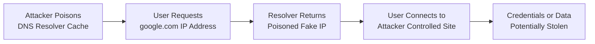
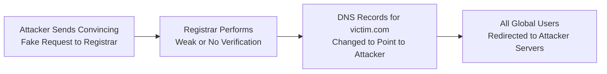

| Topic | Level | Reading Time | Prerequisites |
|---|---|---|---|
| DNS Attacks: Cache Poisoning and Domain Hijacking | Intermediate | ~22 min | Basic understanding of how DNS resolves domain names to IP addresses |

> **Goal of this section:**
> You'll understand why DNS is fundamentally built on trust without any real authentication, and how an attacker can exploit this weakness through **DNS Cache Poisoning** or **Domain Hijacking**.

## Learning Objectives

By the end of this section, you will be able to:

- Explain what **DNS (Domain Name System)** does and why it is essential to how the Internet works.
- Identify the core security weakness in DNS: the absence of built-in authentication.
- Explain how **DNS Cache Poisoning** works and why it can affect many users at once.
- Explain how **Domain Hijacking** exploits weak identity verification at the registrar level.
- Compare the scope and impact of Cache Poisoning versus Domain Hijacking.
- Describe modern defenses, including registrar-level verification and **DNSSEC**.

## Table of Contents

- [DNS: The Internet's Phonebook](#dns-the-internets-phonebook)
- [The Core Weakness: No Built-in Authentication](#the-core-weakness-no-built-in-authentication)
- [DNS Cache Poisoning: The Concept](#dns-cache-poisoning-the-concept)
- [DNS Cache Poisoning: Step by Step](#dns-cache-poisoning-step-by-step)
- [Why Cache Poisoning Is So Dangerous](#why-cache-poisoning-is-so-dangerous)
- [Domain Hijacking: The Concept](#domain-hijacking-the-concept)
- [Domain Hijacking: How the Attack Works](#domain-hijacking-how-the-attack-works)
- [Cache Poisoning vs. Domain Hijacking](#cache-poisoning-vs-domain-hijacking)
- [Attack Flow Diagrams](#attack-flow-diagrams)
- [Defenses Against DNS Attacks](#defenses-against-dns-attacks)
- [Career Connection](#career-connection)
- [Key Terms Glossary](#key-terms-glossary)
- [Summary](#summary)

## DNS: The Internet's Phonebook

**DNS (Domain Name System)** is essentially the internet's **phonebook**. It translates human-readable names (such as `google.com`) into the IP addresses that devices actually use to find each other (such as `142.250.190.14`).

Every time you visit a website, send an email, or open an internet-connected app, DNS works in the background to make it happen.

## The Core Weakness: No Built-in Authentication

The core problem is that DNS was designed in the early days of the internet, when security wasn't a major concern. As a result, it has **no strong built-in security mechanisms**.

Specifically:

- There's no **authentication** of the user asking the question.
- There's no **authentication** of the device requesting the information.
- There's no **authentication** of the DNS server giving the answer.

> [!IMPORTANT]
> Imagine calling a phonebook operator and asking for someone's number, and the operator gives you whatever number they feel is right, without verifying who you are, and without you being able to verify that the operator is legitimate and not a scammer.

Since trust is assumed almost everywhere in this system, DNS has become a **prime hunting ground** for attackers. In this section, we'll study two main types of DNS attacks: **DNS Cache Poisoning** and **Domain Hijacking**.

## DNS Cache Poisoning: The Concept

**DNS Cache Poisoning** happens when an attacker tricks a **DNS resolver** into storing a fake IP address for a real domain name.

In plain terms: the attacker manipulates and modifies the DNS cache, replacing the correct answer with a malicious one.

> [!NOTE]
> Imagine sneaking into a storeroom of physical phonebooks and changing the number for "Pizza Palace" so that the number printed there now actually rings a scammer's phone. Anyone who looks up Pizza Palace in that phonebook from now on will call the scammer without knowing it.

## DNS Cache Poisoning: Step by Step

Let's imagine you want to visit `google.com`:

1. Your device's **DNS resolver** sends a request asking: "What's the IP address of `google.com`?"
2. Normally, the DNS server would reply with the correct answer, for example `8.8.8.8` (a hypothetical example of Google's real address).
3. But in this scenario, the attacker has already tampered with the DNS server.
4. The attacker changed the cache so that instead of returning the real IP, it now returns `5.5.5.5`, the IP address of the attacker's malicious site.
5. So when your resolver asks "Where is `google.com`?", it gets back the poisoned answer: `5.5.5.5`.
6. Your browser, having no reason to doubt this answer, happily connects you to `5.5.5.5`, a fake site controlled by the attacker, which may be designed to look exactly like Google's real login page in order to steal your credentials.

> [!WARNING]
> The scary part is that you typed the correct address (`google.com`) the whole time. The attack happened silently, invisible to you, at the DNS lookup level, before your browser loaded a single pixel of the page.

## Why Cache Poisoning Is So Dangerous

Because DNS resolvers temporarily **cache** answers to speed things up, once a fake record is poisoned into that cache, **every user querying the same resolver** is redirected to the malicious site. Not just one victim, but potentially thousands of users who rely on the same resolver (such as a shared DNS server run by an internet service provider, or ISP).

This can be used for:

| Use | Description |
|---|---|
| **Phishing** | Redirecting users to fake login pages to steal usernames and passwords |
| **Malware Distribution** | Redirecting a software update domain to a server hosting infected files |
| **Surveillance** | Silently redirecting traffic to monitor access |
| **Censorship** | Silently redirecting traffic to block access |

> [!IMPORTANT]
> Since DNS has no built-in authentication, the resolver has no way to verify that the answer it received is genuine; it simply trusts any reply that comes back in the expected format.

## Domain Hijacking: The Concept

While Cache Poisoning attacks the DNS resolver, **Domain Hijacking** attacks a completely different weak link: the **domain registrar** (the company that officially manages who owns a domain name, such as GoDaddy or Namecheap).

The fundamental problem: many domain registrars do very little verification of the identity of anyone requesting a change to a domain's records.

> [!NOTE]
> Imagine your domain is like a house registered in your name at the **city hall** land registry. Domain Hijacking is like someone walking into city hall, submitting a fairly convincing letter claiming to be you, and saying "Please transfer the deed for this house to my name," and city hall, without carefully checking identities, actually... carries out the request.

## Domain Hijacking: How the Attack Works

The attacker crafts a convincing-looking email, pretending to be the legitimate owner of `victim.com`.

In this fake request, they ask the registrar to change the DNS records for `victim.com` so they now point to servers controlled by the attacker (`attacker.com` systems, for example).

Since many registrars have historically done little or no verification of the identity of whoever sends these change requests, the request may be processed blindly, with no confirmation phone call and no strict identity check.

Once the change is made, anyone visiting `victim.com` is sent straight to the attacker's servers, even though the domain is still officially "owned" by the original victim on paper.

> [!WARNING]
> This is especially dangerous because, unlike Cache Poisoning (which is usually temporary and local to a single resolver), **Domain Hijacking** can affect **every user in the world** trying to reach that domain, until the compromise is discovered and reversed.

## Cache Poisoning vs. Domain Hijacking

The following table shows the core difference between the two types:

| Criterion | DNS Cache Poisoning | Domain Hijacking |
|---|---|---|
| Point of attack | The DNS resolver | The domain registrar |
| Scope of impact | Local, limited to the users of a specific resolver | Global, affects everyone trying to reach the domain |
| Duration of impact | Usually temporary, until the cache expires or is corrected | Persists until the compromise is discovered and reversed |
| Exploitation mechanism | Manipulating temporarily cached data | Deceiving the registrar's identity verification process |

## Attack Flow Diagrams

The following diagram shows the sequence of a DNS Cache Poisoning attack:

And the following diagram shows the sequence of a Domain Hijacking attack:

## Defenses Against DNS Attacks

Some of the larger, more established registrars have started implementing stricter authentication mechanisms for any DNS change request, using methods such as:

- **Mail Header Checking**: Verifying that the request actually comes from an authorized, expected source, not a spoofed sender.
- **Passwords (Account Authentication)**: Requiring the requester to prove they actually have legitimate access to the account.
- **Encrypted and Signed Mail**: Using cryptographic signatures to confirm that the request really comes from the domain's actual owner and hasn't been tampered with.

> [!WARNING]
> This is **not universal**. A surprising number of registrars still do little or no verification, which leaves their customers' domains vulnerable to this same type of attack.

**Best practice for domain owners**: Enable **registrar-lock** features, use strong account security (**2FA**), and choose registrars known for strict verification policies for change requests.

In addition, there's a modern technology known as **DNSSEC**, which adds **cryptographic signing** to DNS responses, helping resolvers verify that the answer they receive is authentic. DNSSEC is considered the modern industry-standard solution to DNS's lack of authentication.

> [!TIP]
> Notice that the defenses against Cache Poisoning and Domain Hijacking work at two completely different levels: DNSSEC protects the level of the answers themselves, while identity verification at the registrar protects the level of domain management. Both are needed for complete protection.

## Career Connection

Understanding DNS attacks connects directly to several career paths:

- In **SOC**, monitoring abnormal DNS queries helps detect cache poisoning attempts early.
- In **Cloud Security**, securing DNS records for cloud applications and services by enabling DNSSEC and registrar-lock is a key part of protecting the infrastructure.
- In **GRC**, setting policies for managing access to registrar accounts is part of enterprise risk management for digital assets.

## Key Terms Glossary

| Term | Definition |
|---|---|
| **DNS (Domain Name System)** | A system that translates human-readable domain names into the IP addresses that devices use. |
| **DNS Resolver** | The component responsible for receiving domain translation requests and returning the appropriate IP address. |
| **DNS Cache Poisoning** | An attack in which the attacker tricks the resolver into storing a fake IP address for a real domain. |
| **Domain Registrar** | The company officially responsible for managing the ownership of domain names. |
| **Domain Hijacking** | An attack that exploits weak identity verification at the registrar to change a legitimate domain's records. |
| **DNSSEC** | A security extension to the DNS protocol that adds a cryptographic signature to verify the authenticity of responses. |
| **Registrar-Lock** | A feature that prevents changes to domain records without additional verification steps. |

## Summary

- **DNS** is essential to how the internet works, but it was built without any authentication mechanisms for users, devices, or servers, which makes it inherently vulnerable to exploitation.
- **DNS Cache Poisoning**: The attacker corrupts the records cached in a specific resolver and silently redirects anyone looking up a legitimate domain to a malicious IP address.
- **Domain Hijacking**: The attacker exploits weak identity verification at the registrar and tricks it into pointing a legitimate domain's records to servers controlled by the attacker.
- Both attacks are dangerous because they exploit **trust**, not brute technical force, and victims often have no clear warning sign, because the domain name they typed still looks completely correct.
- Cache Poisoning's impact is usually local and temporary, while Domain Hijacking's impact is global and persists until it's discovered and reversed.
- Defenses include stricter verification at the registrar (passwords, signatures, header checks) as well as technologies such as **DNSSEC**, which is considered the modern industry-standard solution.

