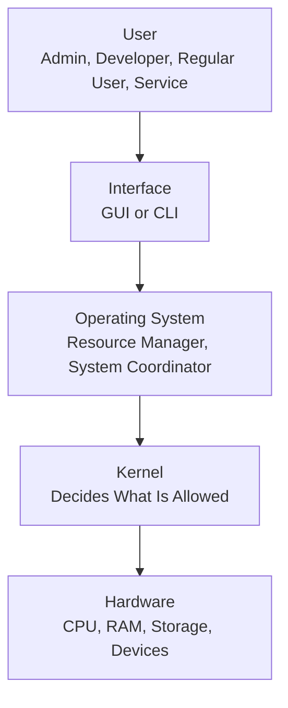
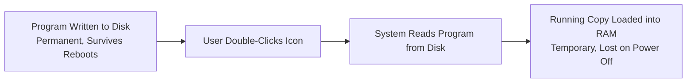

| Topic | Level | Reading Time | Prerequisites |
|---|---|---|---|
| Operating Systems | Beginner | ~24 min | None |

> **The goal of this section:**  
> You'll understand what an operating system actually is and its three core roles, get to know the Kernel and why it's the most critical part of any system, take a quick look at the types of operating systems, and understand the difference between the HDD and RAM and why that difference is so fundamental for any forensic analyst.

## Learning Objectives

By the end of this section, you will be able to:

- Define an **Operating System** and explain its three core roles: Resource Manager, Interface Provider, and System Coordinator.
- Explain why every resource allocation the OS makes is also a security boundary.
- Compare **GUI** and **CLI** as two ways of interacting with an OS.
- Define the **Kernel** and explain why a kernel vulnerability means total control of the system.
- Compare **Windows**, **Linux**, and **Mobile & Embedded** operating systems in terms of typical use and attack relevance.
- Distinguish between **HDD/SSD** (permanent storage) and **RAM** (temporary storage), and explain why this distinction matters for forensic analysis.

## Table of Contents

- [What Is an Operating System](#what-is-an-operating-system)
- [The OS as a Resource Manager](#the-os-as-a-resource-manager)
- [The OS as an Interface Provider](#the-os-as-an-interface-provider)
- [The OS as a System Coordinator](#the-os-as-a-system-coordinator)
- [The Kernel](#the-kernel)
- [Operating System Types](#operating-system-types)
- [Storage and Memory: Where Data Lives](#storage-and-memory-where-data-lives)
- [Hard Drive vs. RAM](#hard-drive-vs-ram)
- [Example: What Happens When You Open Word](#example-what-happens-when-you-open-word)
- [OS Architecture Diagram](#os-architecture-diagram)
- [Career Connection](#career-connection)
- [Key Terms Glossary](#key-terms-glossary)
- [Summary](#summary)

## What Is an Operating System

An **Operating System (OS)** is "the bridge between the hardware and everyone who uses it."

It's what decides how programs run, how memory is used, how devices communicate with each other, and how data moves through the system. Without it, the computer is just circuits and silicon; the OS is what gives that system order and rules.

Almost every device you touch runs an operating system: laptops, phones, routers, cameras, and even cars.

There are three core roles that any operating system plays:

## The OS as a Resource Manager

The OS manages physical resources (CPU, RAM, disks, devices) and logical resources (such as partitions and virtual memory).

| Resource | Role | Security Note |
|---|---|---|
| **CPU** | Decides which process runs, for how long, and in what order (**scheduling**) | Every program believes the processor belongs to it alone, but no program actually has it that way |
| **Memory** | Allocates space, keeps processes isolated from each other, and swaps them in and out | This isolation is a **security control**: a crashed or malicious program can't reach another program's memory |
| **Storage** | Organizes files, tracks free space, and controls who can open what | This is where file permissions live, and where forensics begins after any incident |
| **Devices** | Manages printers, keyboards, and network cards without conflicts | Drivers run with very high privileges, which is exactly why drivers with weak security are a favorite of attackers |

> [!IMPORTANT]
> Every **allocation** is also a **security boundary**, and something an attacker tries to break.

## The OS as an Interface Provider

There are two main ways to interact with an operating system:

**GUI — Graphical User Interface**

Windows, icons, menus. Easy to explore and forgiving; you can find a particular setting without knowing its name.

Great for everyday work, but slow and not repeatable if you want to do the same thing on 400 machines.

**CLI — Command-Line Interface**

Text goes in, text comes out. Precise, scriptable, and available over a remote connection with the lowest possible bandwidth usage.

The main working environment for IT and security professionals, and for attackers too, which is exactly why **command lines** are **logged** so heavily.

> [!TIP]
> **Discussion question**: why would anyone choose the command line over a perfectly good graphical interface? The answer usually comes down to needing to repeat the same operation precisely across a large number of machines, or working remotely with the lowest possible resource usage.

## The OS as a System Coordinator

| Function | Description | Note |
|---|---|---|
| **File Management** | Creates, reads, writes, and organizes files, and tracks where each block physically sits on the disk | A deleted file has rarely actually disappeared, and that gap is where forensics lives |
| **Security Management** | Controls user access, permissions, and authentication — the AAA framework we studied earlier, but implemented in code | Every login and every permission check happens here |
| **Networking** | Lets the device talk to other devices, and decides which programs can open which connections | The **host firewall** is part of this function |
| **System Monitoring** | Tracks performance, records activity, detects errors, and writes the log you'll investigate later | No logs here means no investigation is possible there |

> [!IMPORTANT]
> Three of these four functions generate the **telemetry** that a SOC analyst lives on in their daily work.

## The Kernel

**The Kernel** is "the core of the operating system, the first thing to load and the last thing to shut down."

**What it is**: the central component. Everything else in the OS — the desktop, the services, your programs — sits on top of it and makes requests to it.

**What it does**: it's the bridge to the hardware. It connects user programs to the physical hardware safely: the program makes a request, the kernel decides whether it's allowed or not, and carries out the operation.

**Why security cares**: code running inside the kernel can do anything on that machine. A kernel vulnerability isn't just a "bad day"; it's **total control of the system**.

> [!WARNING]
> **User space** requests, **Kernel space** decides, and **rootkits** exist precisely to cross that line.

## Operating System Types

| Type | Typical Use | Examples |
|---|---|---|
| **Windows** | Mostly **clients**, the dominant desktop in corporate environments, and therefore the most common starting point for any attack, because that's where the users are | Active Directory, the corporate desktop, most **phishing** landing pages |
| **Linux** | Mostly servers, web servers, infrastructure, containers, and the entire top tier of supercomputing | Web servers, cloud workloads, security tools, Splunk labs |
| **Mobile & Embedded** | Everywhere else: Android and iOS on phones; stripped-down systems inside routers, cameras, and industrial control devices | IoT devices that nobody updates, and the devices that make up botnets |

> [!IMPORTANT]
> A Linux vulnerability can be catastrophic, because Linux runs servers, the cloud, and infrastructure; a single vulnerability reaches a huge number of systems at the same time.

## Storage and Memory: Where Data Lives

Now that we understand that the OS manages memory as a core resource, we'll move on to understand in detail how data is actually stored and lives at runtime, and why a **forensic analyst** cares so much about this difference.

## Hard Drive vs. RAM

| | **Hard Disk Drive (HDD / SSD)** | **Random Access Memory (RAM)** |
|---|---|---|
| **Type** | **permanent storage** | **temporary storage** |
| **Description** | Keeps its contents when the power goes off. Large, relatively slow, and where everything gets installed and saved | Empties the moment the power goes off. Small, very fast, and the only place where code can actually execute |
| **From a Forensics perspective** | Survives a reboot. Gives you installed programs, saved files, and traces of deleted files | Holds running processes, open connections, decrypted data and passwords, and all of it is lost if the machine is shut down |

> [!IMPORTANT]
> Nothing runs directly from the disk. It has to be loaded into RAM first.
>
> And that's exactly why **Fileless Malware** exists: code that lives only in memory leaves far less of a trace on the disk. (Remember our detailed explanation of Fileless Malware earlier? This is exactly the technical point that makes it so effective.)

## Example: What Happens When You Open Word

1. **Install**: the program is written to the hard disk. It now exists permanently and will still be there after ten reboots.
2. **Execute**: you double-click the icon. The system reads the program from the disk and starts building a **running copy** of it.
3. **Run**: a copy is loaded into RAM. The copy you're actually typing in lives in memory. The disk copy is just sitting there.

> [!TIP]
> **Question**: where do you look for a program that's running right now? **Answer**: in memory. The disk tells you what was installed; RAM tells you what's actually happening right now.

## OS Architecture Diagram

The following diagram shows the order of the layers from the user down to the hardware, and the Kernel's position as the critical point between them:

And the following diagram shows a program's journey from installation to actual execution:

## Career Connection

Understanding operating system and memory fundamentals has direct applications across several career paths:

- In **Digital Forensics**, the difference between HDD and RAM is fundamental; live **memory forensics** reveals processes and activity that don't exist on the disk at all.
- In **SOC**, understanding that the command line is heavily logged helps when investigating suspicious activity through the CLI.
- In **Malware Analysis**, understanding why Fileless Malware is so effective (because there's no file on the disk to scan) is essential for analyzing modern threats.
- In **Vulnerability Management**, knowing that any Linux vulnerability can affect a huge number of servers guides patching priorities.

## Key Terms Glossary

| Term | Definition |
|---|---|
| **Operating System (OS)** | The core software that makes the hardware usable and manages resources and interfaces. |
| **Kernel** | The central core of the operating system, responsible for making every decision related to hardware access. |
| **GUI** | A graphical user interface based on windows and icons. |
| **CLI** | A command-line interface based on text input and output. |
| **HDD/SSD** | A permanent storage medium that keeps data even after the power goes off. |
| **RAM** | Temporary memory that is cleared as soon as the power goes off, and the only place where code actually executes. |
| **Fileless Malware** | Malicious software that runs entirely in memory without writing files to the disk. |
| **Telemetry** | The data and logs the system generates, used for security monitoring. |

## Summary

- An **Operating System** is the bridge between the hardware and its users, and it has three core roles: **Resource Manager**, **Interface Provider**, and **System Coordinator**.
- Every resource allocation the OS makes is also a security boundary that an attacker tries to break.
- **The Kernel** is the most critical component in the system, because any code running inside it can control the entire machine.
- **Windows** is mostly for clients (and the most common starting point for attacks), **Linux** is mostly for servers and infrastructure, and **Mobile & Embedded** is everywhere else.
- **HDD/SSD** is permanent storage that reflects what has been installed, while **RAM** is temporary storage that reflects what is actually happening now, and this difference is fundamental in digital forensic investigations.
- **Fileless Malware** exploits the fact that code has to be loaded into memory, and lives only there to leave less of a trace on the disk.

