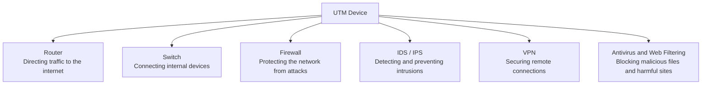
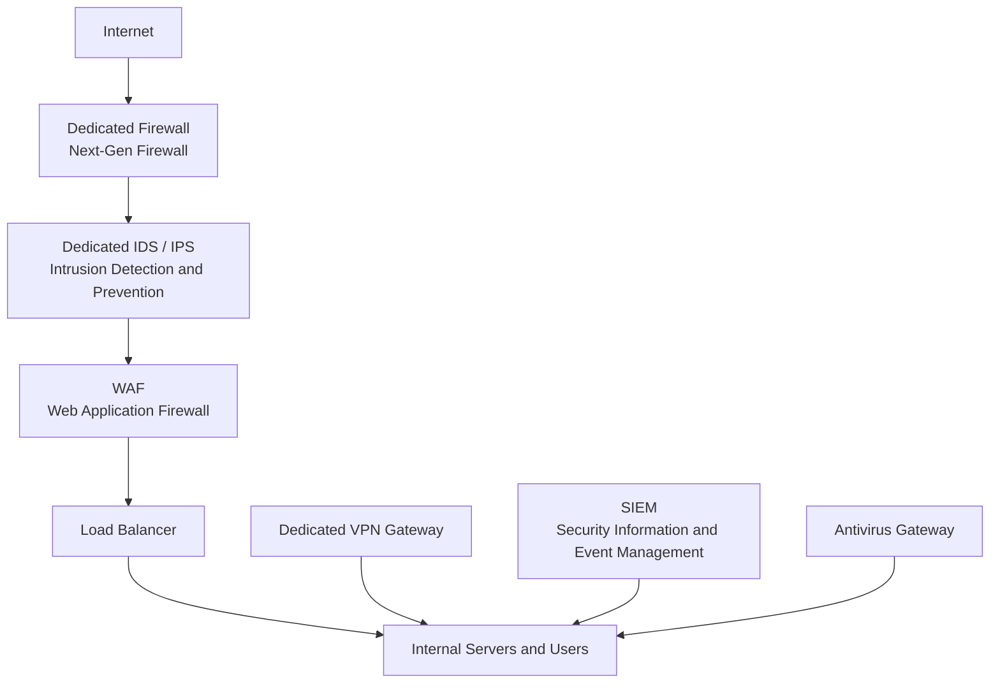

> **Goal of this section:**  
> You'll understand what a UTM is, how it combines all the protection tools into a single device, and when to use it and when to avoid it — and you'll be able to tell the difference between a UTM and an Enterprise Security Setup with full confidence.

---

# UTM (Unified Threat Management)

## Table of Contents

- [What Is a UTM?](#what-is-a-utm)
- [UTM Components](#utm-components)
- [Advantages of a UTM](#advantages-of-a-utm)
- [Drawbacks of a UTM in Large Environments](#drawbacks-of-a-utm-in-large-environments)
- [The Enterprise Alternative: Best-of-Breed](#the-enterprise-alternative-best-of-breed)
- [UTM vs Enterprise Setup — Full Comparison](#utm-vs-enterprise-setup--full-comparison)
- [UTM vs NGFW](#utm-vs-ngfw)
- [Summary](#summary)

---

## What Is a UTM?

A **UTM (Unified Threat Management)** is a single security device that combines **more than one security function** at the same time.

The core idea: instead of buying 5 or 6 separate security devices, a UTM gives you all of them in **a single device** with a single management interface.

> [!NOTE]
> Think of a UTM like a **Swiss Army Knife** — one knife with scissors, a screwdriver, a fork, and everything else. It's not the best at any one function, but it's good enough and very practical for most situations.

**A real-world example:** your home router is the simplest form of a UTM — it has:
- **Routing** → it directs traffic to the internet
- **Switching** → it connects the devices together
- **Basic Firewall** → it protects the network from external attacks

```
[ Internet ]
     |
[ UTM Device ]  ←── Router + Switch + Firewall + IDS/IPS + VPN + Antivirus
     |
[ Internal Network ]
```

---

## UTM Components

A full UTM device usually includes all of these components integrated together:



| Component | Function |
|---|---|
| **Router** | Directing traffic between the internal network and the internet |
| **Switch** | Connecting devices within the local network |
| **Firewall** | Filtering packets and protecting the network from attacks |
| **IDS / IPS** | Detecting and preventing intrusion attempts |
| **VPN** | Encrypting connections for remote workers |
| **Antivirus** | Scanning files and traffic and blocking malware |
| **Web Filtering** | Blocking harmful or inappropriate sites |

> [!IMPORTANT]
> Not every UTM necessarily includes all of these components — some devices focus on certain functions more than others, depending on the manufacturer and the model.

---

## Advantages of a UTM

### 1. Cost-Effective
Instead of buying a separate firewall + a separate IDS + a separate VPN gateway + a separate antivirus gateway, a UTM gives you all of that in **a single device at a much lower price**.

### 2. Easy Management
All the security functions are managed from **a single dashboard**. You don't need deep expertise or a dedicated team for each device separately.

> [!TIP]
> A UTM is ideal for a **small business** or a **startup** that doesn't have a large IT team — one person can manage everything.

### 3. Centralized Visibility
You see everything happening on the network from one place — the logs, the alerts, and the reports are all in the same interface.

**Ideal use cases for a UTM:**
- **Home Networks** → the home router
- **Small to Medium Businesses (SMB)** → companies with 10 to 200 employees
- **Startups** → environments that need fast protection without complexity

---

## Drawbacks of a UTM in Large Environments


When all the heavy traffic passes through a single device, problems appear:

### 1. Performance Constraints
All the traffic passes through a single device → this can cause a **bottleneck** when the numbers grow.

### 2. Limited Flexibility
A large enterprise needs **high customization** in each security function — a UTM provides generic, non-specialized solutions.

### 3. Single Point of Failure
If the device goes down or is attacked → **the entire network and all its protection stop** at the same time. This is a very serious risk in sensitive environments.

> [!WARNING]
> The **Single Point of Failure** is the most dangerous drawback of a UTM in large environments. If the single device fails, there's no firewall, no IDS, no VPN — everything stops together.

### 4. Limited Scalability
A UTM isn't designed to handle the thousands of users or the high traffic you see in an enterprise or data centers.

---

## The Enterprise Alternative: Best-of-Breed

A **large enterprise** uses a completely different approach — instead of a single device, it deploys **a dedicated device for each function**:



Each device in this setup is:
- **100% specialized** in its function
- **High-performance** and designed for heavy load
- **Independent** — if one device goes down, the rest keep running
- **Scalable** on its own, without affecting the other devices

---

## UTM vs Enterprise Setup — Full Comparison

| Criterion | UTM | Enterprise Setup |
|---|---|---|
| **Cost** | Low | Very high |
| **Management** | Simple (a single interface) | Complex (separate devices) |
| **Performance** | Suitable for small networks | Much better for large networks |
| **Specialization** | Limited | Each device is 100% specialized |
| **Single Point of Failure** | Yes — a major risk | No — each device is independent |
| **Scalability** | Limited | Very high |
| **Ideal use** | Home Network / SMB | Enterprise / Data Centers |
| **Management team** | One person is enough | A dedicated IT team |

> [!NOTE]
> A UTM is very suitable for home networks and small companies — but a large enterprise needs separate, specialized devices to handle the load, deliver better performance, and avoid the single point of failure.

---

## UTM vs NGFW

The **NGFW (Next-Generation Firewall)** is sometimes marketed in a way similar to a UTM, but there are fundamental differences:

| Property | UTM | NGFW |
|---|---|---|
| **Primary goal** | An all-in-one solution | An advanced firewall with extra capabilities |
| **Application Awareness** | Limited | Very high — it understands apps, not just ports |
| **Deep Packet Inspection** | Basic | Very advanced |
| **Performance** | Lower on large networks | Higher, designed for enterprise |
| **SIEM Integration** | Limited | Much stronger |
| **Optimal use** | SMB and Home | Enterprise and Data Centers |


> [!TIP]
> If you work in a small environment and need fast, simple protection → **UTM**. If you work in an enterprise and have a budget and a team → **NGFW with a Best-of-Breed setup**.

---

## Summary

### Key Points to Remember:

- A **UTM** is a single device that combines Router + Switch + Firewall + IDS/IPS + VPN + Antivirus in the same place — exactly like a Swiss Army Knife.

- **Its big advantages:** cost-effective, easy to manage, and very suitable for home networks and SMBs.

- **Its biggest drawback:** the **Single Point of Failure** — if the device goes down, everything stops. And its performance isn't enough for large networks.

- **The enterprise** prefers **Best-of-Breed** — separate, specialized devices for each function, higher performance, and no single point of failure.

- The **NGFW** is more powerful than a UTM in Application Awareness and Deep Packet Inspection, and it's the optimal choice for large environments.

- **The general rule:**
  - UTM → **Home Network / Small Business**
  - NGFW / Enterprise Security → **Large Networks / Data Centers**
