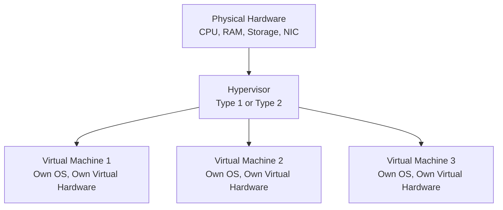
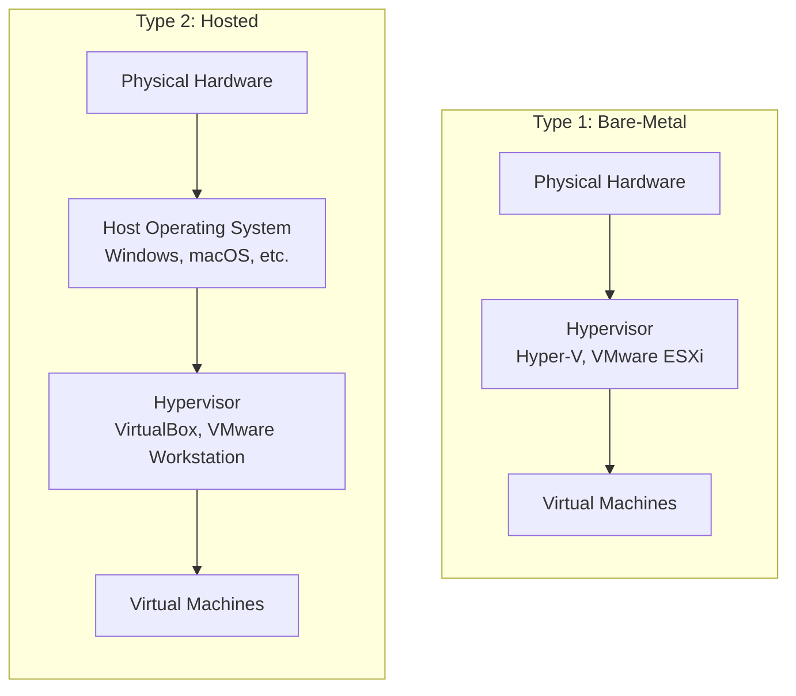

| Topic | Level | Reading Time | Prerequisites |
|---|---|---|---|
| Virtualization | Beginner | ~14 min | Basic understanding of computer hardware components (CPU, RAM, storage, network) |

> **Goal of this section:**
>  You'll understand how a single physical machine can be "split" into multiple machines that are completely independent of each other, get to know the concept of the hypervisor and its two types, and see why this concept is the foundation that all of cloud computing is built on.

## Learning Objectives

By the end of this section, you will be able to:

- Define **Virtualization** and explain what a **Virtual Machine (VM)** is.
- Explain the role of the **Hypervisor** in making virtualization possible.
- Distinguish between **Type 1 (Bare-Metal)** and **Type 2 (Hosted)** hypervisors, with real examples of each.
- Explain why the hardware seen by a VM is not physically real, and how the hypervisor manages actual physical resources behind the scenes.
- Explain why virtualization is considered foundational to modern IT infrastructure and cloud computing.

## Table of Contents

- [Virtualization: Running Multiple Computers on One Machine](#virtualization-running-multiple-computers-on-one-machine)
- [The Hypervisor](#the-hypervisor)
- [Type 1 vs. Type 2 Hypervisors](#type-1-vs-type-2-hypervisors)
- [Virtual Hardware: It's All Fake, But It Works](#virtual-hardware-its-all-fake-but-it-works)
- [Foundational to Modern IT](#foundational-to-modern-it)
- [Virtualization Architecture Diagram](#virtualization-architecture-diagram)
- [Career Connection](#career-connection)
- [Key Terms Glossary](#key-terms-glossary)
- [Summary](#summary)

## Virtualization: Running Multiple Computers on One Machine

**Virtualization** is a technology that lets you run multiple **Virtual Machines (VMs)** on just one physical computer, with each VM behaving as if it were a completely independent machine with its own operating system, storage, and (virtual) hardware.

## The Hypervisor

This is achieved through a piece of software called a **Hypervisor**.

Among the best-known examples of hypervisors are **VMware** and **VirtualBox**.

## Type 1 vs. Type 2 Hypervisors

There are two main types of hypervisors:

| Type | Description | Examples | Common Use |
|---|---|---|---|
| **Bare-Metal Hypervisors (Type 1)** | Installed directly on the physical hardware, with no need for a **host OS** underneath it | Microsoft Hyper-V, VMware ESXi | Enterprise environments and **data centers**, because they are more efficient and have less **overhead** |
| **Hosted Hypervisors (Type 2)** | Installed on top of an existing operating system, like any regular application | VirtualBox, VMware Workstation | Common on personal computers for testing or running a second operating system alongside your main one |

> [!TIP]
> Think of the difference this way: **Type 1** is a standalone operating system dedicated solely to managing virtual machines (as if it were the server's "operating system" itself), while **Type 2** is just a program you run inside a regular operating system you're already using (such as Windows or macOS).

## Virtual Hardware: It's All Fake, But It Works

Every virtual machine, when you look at its settings, appears to have its own dedicated hardware: a network card (**NIC**), a graphics card, a hard disk, memory, and so on.

In reality, **none of this hardware physically exists** for that particular VM; it is entirely **virtualized/emulated** by the hypervisor software, which divides and distributes portions of the real physical hardware resources among all the VMs running on the same **host**.

> [!IMPORTANT]
> This is exactly what allows multiple VMs to run independently on the same physical machine, each one convinced it has a complete set of its own hardware, while the hypervisor manages the real physical resources underneath behind the scenes.

## Foundational to Modern IT

This concept is fundamental to modern IT infrastructure, because it enables things like:

- **Server Consolidation**: running a large number of virtual servers on fewer physical machines.
- **Isolated Testing Environments**.
- And, as we'll see later, **cloud computing itself**.

## Virtualization Architecture Diagram

The following diagram shows how multiple VMs run on the same physical machine through the hypervisor:

And the following diagram shows the difference in where the hypervisor sits in the two types:

## Career Connection

Understanding virtualization has direct applications across several career paths:

- In **Cloud Security**, understanding the hypervisor is essential because it's the layer all of cloud computing is built on.
- In **Pentesting**, distributions like Kali Linux are often run inside a VM using a Type 2 hypervisor for an isolated, safe testing environment.
- In **Malware Analysis**, VMs are used as isolated environments (similar to the sandbox concept we studied earlier) to analyze suspicious files without risk to the real system.
- In **System Administration**, managing server consolidation with Type 1 hypervisors is a core part of designing cost-effective infrastructure.

## Key Terms Glossary

| Term | Definition |
|---|---|
| **Virtualization** | A technology that allows multiple independent virtual machines to run on a single physical machine. |
| **Virtual Machine (VM)** | A virtual machine that behaves as an independent machine with its own operating system and resources. |
| **Hypervisor** | Software responsible for creating and managing virtual machines and distributing physical hardware resources among them. |
| **Type 1 Hypervisor (Bare-Metal)** | Installed directly on the physical hardware without the need for a host operating system. |
| **Type 2 Hypervisor (Hosted)** | Installed on top of an existing operating system, like any regular application. |
| **Host** | The physical machine that runs the hypervisor and the virtual machines. |
| **Server Consolidation** | Running a large number of virtual servers on fewer physical machines. |

## Summary

- **Virtualization** allows multiple **Virtual Machines** to run on a single physical machine, with each VM behaving as a completely independent machine.
- This is achieved through software called a **Hypervisor**, with VMware and VirtualBox among the best-known examples.
- There are two types: **Type 1 (Bare-Metal)**, installed directly on the hardware and used in enterprise environments (such as Hyper-V and ESXi), and **Type 2 (Hosted)**, installed on top of an existing operating system and used on personal computers (such as VirtualBox).
- The hardware each VM sees (network card, graphics card, etc.) **doesn't actually exist**; it is entirely emulated by the hypervisor, which distributes the real physical resources among all the VMs.
- This concept is fundamental to modern IT, enabling server consolidation and isolated testing environments, and it is the foundation that cloud computing is built on.

