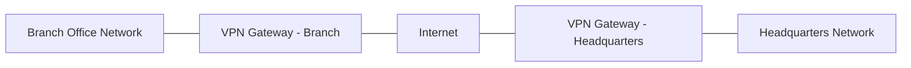
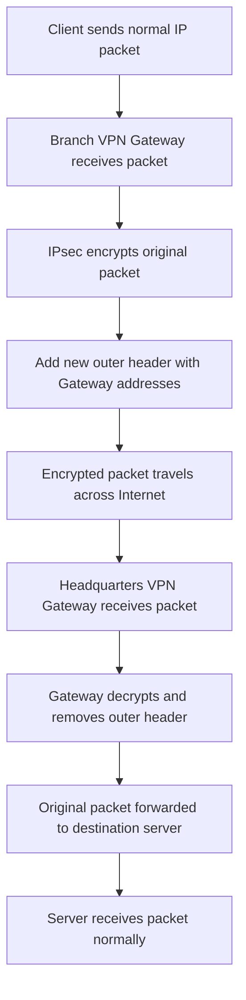

| Topic | Level | Reading Time | Prerequisites |
|---|---|---|---|
| Virtual Private Networks (VPN) | Beginner | ~15 min | Basic understanding of IP networking and the OSI/TCP-IP model |

> **Goal of this section:**
> You'll understand what a **VPN** is, how it works technically using **IPsec**, and why companies rely on it instead of expensive leased lines, and you'll also follow a packet's journey step by step from a branch office to the headquarters.


## Learning Objectives

By the end of this section, you will be able to:

- Define what a **VPN** is and explain the business problem it solves compared to traditional leased lines.
- Identify the three core security properties a VPN provides: confidentiality, integrity, and (as we will see) authentication.
- Describe how **IPsec** operates at Layer 3 to protect IP traffic regardless of the application generating it.
- Trace the full lifecycle of a packet traveling through an IPsec VPN tunnel, from the Branch Office to the Headquarters.
- Explain typical real-world VPN use cases, including remote access, site-to-site connectivity, and internal network segmentation.

## Table of Contents

- [Learning Objectives](#learning-objectives)
- [Table of Contents](#table-of-contents)
- [What Is a VPN](#what-is-a-vpn)
- [Why Organizations Use VPNs Instead of Leased Lines](#why-organizations-use-vpns-instead-of-leased-lines)
- [The Role of IPsec in VPNs](#the-role-of-ipsec-in-vpns)
- [Security Properties Provided by a VPN](#security-properties-provided-by-a-vpn)
- [VPN Deployment Scenarios](#vpn-deployment-scenarios)
- [How a VPN Tunnel Works: Step-by-Step Packet Flow](#how-a-vpn-tunnel-works-step-by-step-packet-flow)
- [Encapsulation Explained Visually](#encapsulation-explained-visually)
- [VPN and Cybersecurity Career Paths](#vpn-and-cybersecurity-career-paths)
- [Key Terms Glossary](#key-terms-glossary)
- [Summary](#summary)

## What Is a VPN

A **VPN** (Virtual Private Network) is a technology that creates a secure connection between two private networks over a public network such as the internet. Instead of a company running a dedicated physical cable between two offices, the VPN creates a *virtual tunnel* between the two ends, as if they were connected by a direct private link, even though the data actually travels across an untrusted public network.

The core idea is that a VPN doesn't change the physical network; it creates a logical layer on top of the existing infrastructure, which is what makes this solution so flexible and cost-effective compared to traditional solutions.

> [!NOTE]
> The word "Virtual" here means the connection doesn't physically exist as a dedicated line, but it behaves logically as if it were a private line, while "Private" means the data is protected and not accessible to anyone else using the same public network.

## Why Organizations Use VPNs Instead of Leased Lines

Before VPNs appeared, if a company wanted to connect two branches securely, it would turn to a **Leased Line**: a dedicated circuit rented from a service provider. This solution faced two main problems:

- **Time**: Installing a leased line could take months before it was fully active.
- **Cost**: It cost thousands of dollars per month, a major financial burden, especially if the company wanted to connect more than one branch.

A VPN solved both problems because it uses the existing internet connection instead of paying for new dedicated infrastructure. As a result, companies could connect branches, business partners, and remote users quickly and at a much lower cost, while maintaining roughly the same level of security.

| Criterion | Leased Line | VPN |
|---|---|---|
| Deployment Time | Weeks to months | Minutes to hours |
| Cost | Thousands of dollars per month | Uses existing Internet connection |
| Infrastructure | Dedicated physical circuit | Logical tunnel over public network |
| Scalability | Limited, requires new circuits | Easily scalable across sites |
| Security Model | Physical isolation | Cryptographic protection (encryption/integrity) |

> [!IMPORTANT]
> A VPN doesn't eliminate the need for security; it shifts the responsibility for protection from physical isolation to encryption. In other words, security now depends on the strength of the algorithms used and the correctness of the configuration, not on the line being physically dedicated.

## The Role of IPsec in VPNs

The vast majority of VPNs rely on a protocol called **IPsec** (Internet Protocol Security). IPsec operates at **Layer 3** of the OSI model, which means it protects the IP traffic itself regardless of the type of application producing that data.

This gives us a very important advantage: any protocol or application running on top of IP, such as **email**, **web browsing (HTTP/HTTPS)**, **FTP**, or **instant messaging**, can use the same VPN tunnel without any modification to the application itself. Encryption and protection happen at the network layer, not separately for each application.

```bash
# Example: checking active IPsec Security Associations on a Linux gateway
ipsec status
```

```bash
# Example: viewing configured IPsec tunnels (strongSwan)
sudo ipsec statusall
```

> [!TIP]
> If you work in networking or security, you'll find that understanding IPsec is essential, because it's used not only in traditional VPNs but also to protect sensitive internal communications within the company itself.

## Security Properties Provided by a VPN

A VPN doesn't just connect two networks; it provides a set of core security properties:

- **Confidentiality**: Data is encrypted before it crosses the public network, which prevents anyone monitoring network traffic (sniffing/eavesdropping) from understanding the actual content of the data.
- **Integrity**: The VPN ensures that data hasn't been altered while traveling across the network, so if someone tries to modify the packet in transit, the other end can detect it.
- **Authentication**: The parties in the VPN verify each other's identity before the actual data exchange begins.

> [!WARNING]
> A common mistake is thinking VPN = complete anonymity. In reality, a VPN protects data *in transit* between the two ends, but it doesn't necessarily hide your identity completely, especially if the VPN provider itself keeps logs.

## VPN Deployment Scenarios

Not all VPN uses are the same. The most common scenarios are:

- **Site-to-Site VPN**: Connects two private networks, such as the connection between a branch office and the company's headquarters.
- **Remote Access VPN**: Allows a remote user to connect securely to the company's internal network from anywhere.
- **Internal / Intra-organization VPN**: Used within the company itself to protect highly sensitive communications between different parts of the internal network, even if that network isn't directly connected to the public internet.

> [!NOTE]
> Using a VPN inside the internal network itself (not just across the internet) shows that the goal isn't only "crossing the internet securely," but also applying the principle of **Defense in Depth** by protecting sensitive communications even within a relatively trusted network.

## How a VPN Tunnel Works: Step-by-Step Packet Flow

To understand VPNs in depth, we need to trace the packet's journey step by step, from the moment it's sent from a device in the branch office until it reaches the server at the headquarters:

1. A device in the **Branch Office** sends a **normal IP packet** to a server on the **Headquarters** network.
2. The packet first reaches the Branch Office's **VPN Gateway**.
3. The VPN Gateway takes the entire original IP packet and performs **encapsulation**, placing it inside another IP packet.
4. The **IPsec** protocol encrypts the original packet, so anyone monitoring internet traffic can't see the content of the data or the details of the internal communication.
5. A new **Outer Header** is added containing the addresses of the VPN Gateways at both ends, so the encrypted packet can travel across the internet.
6. The packet travels across the internet as an **encrypted IPsec packet**, and ordinary routers simply forward it without understanding its content.
7. When the packet reaches the **Headquarters VPN Gateway**, the gateway decrypts it and removes the outer encapsulation.
8. The **Original IP Packet** is restored to its normal form and forwarded to the target server inside the Headquarters network.
9. The server receives the packet completely normally, without needing to know that the connection passed through a VPN tunnel at all.

> [!IMPORTANT]
> The most important point here is that all the encapsulation and encryption happens at the gateways only. The end devices (the branch computer and the server) don't need any additional configuration, which is what makes the solution transparent to applications.

## Encapsulation Explained Visually

The first diagram shows the overall structure of the connection between the Branch Office and the Headquarters across the internet:



The second diagram shows the processing steps for the packet itself, from the moment it's sent until it reaches the final server:



> [!TIP]
> When explaining encapsulation to someone new to the field, use the envelope-inside-an-envelope analogy: the original packet is the "letter," IPsec puts it inside a "sealed, encrypted envelope," and then that goes inside a "second envelope" with only the gateways' addresses written on it, so the postal service (the internet) knows where to deliver it without knowing what the original letter says.

## VPN and Cybersecurity Career Paths

Understanding VPNs isn't just important as a theoretical concept; it's a foundation for several cybersecurity career paths:

- **SOC (Security Operations Center)**: A SOC analyst may need to monitor VPN logs to detect unauthorized login attempts or abnormal sessions.
- **Penetration Testing**: A pentester may examine the VPN Gateway's configuration itself, looking for encryption weaknesses or weak settings.
- **Cloud Security**: Most cloud providers offer services such as **Site-to-Site VPN** to securely connect on-premises infrastructure to the cloud environment.
- **GRC (Governance, Risk, and Compliance)**: Ensuring that VPN usage policies comply with security standards and regulatory compliance standards such as ISO 27001.

## Key Terms Glossary

| Term | Definition |
|---|---|
| VPN (Virtual Private Network) | A technology that creates a secure logical connection between two private networks over a public network such as the internet. |
| IPsec | A suite of protocols that operates at Layer 3 to encrypt and protect IP traffic. |
| Leased Line | A dedicated physical communication line rented from a service provider; a traditional and more expensive alternative to a VPN. |
| Encapsulation | The process of placing the original packet inside another packet with a different outer header. |
| VPN Gateway | The device or service responsible for creating and managing the VPN tunnel at each end of the connection. |
| Confidentiality | A security property that ensures data is encrypted and unreadable to any unauthorized party. |
| Integrity | A security property that ensures data hasn't been altered while traveling across the network. |
| Site-to-Site VPN | A type of VPN that connects two private networks, such as a branch and a headquarters. |
| Remote Access VPN | A type of VPN that allows an individual user to connect securely to the company network remotely. |

## Summary

- A **VPN** provides a secure, logical connection between two private networks over a public network, without the need for a leased line that is expensive and slow to install.
- VPNs usually rely on **IPsec**, which operates at Layer 3 and protects any type of traffic on top of IP, whether email, web, or FTP, without requiring changes to the applications themselves.
- The core security properties a VPN provides are **Confidentiality**, **Integrity**, and also **Authentication** between the parties.
- A VPN isn't just a solution for crossing the internet securely; it's also used internally to protect sensitive communications within the company itself.
- A packet's journey through a VPN tunnel goes through clear stages: reception, encryption, encapsulation, crossing the internet, decryption, and then normal delivery to the final server.
- Understanding VPNs is essential for several career paths, such as **SOC**, **Penetration Testing**, **Cloud Security**, and **GRC**.

