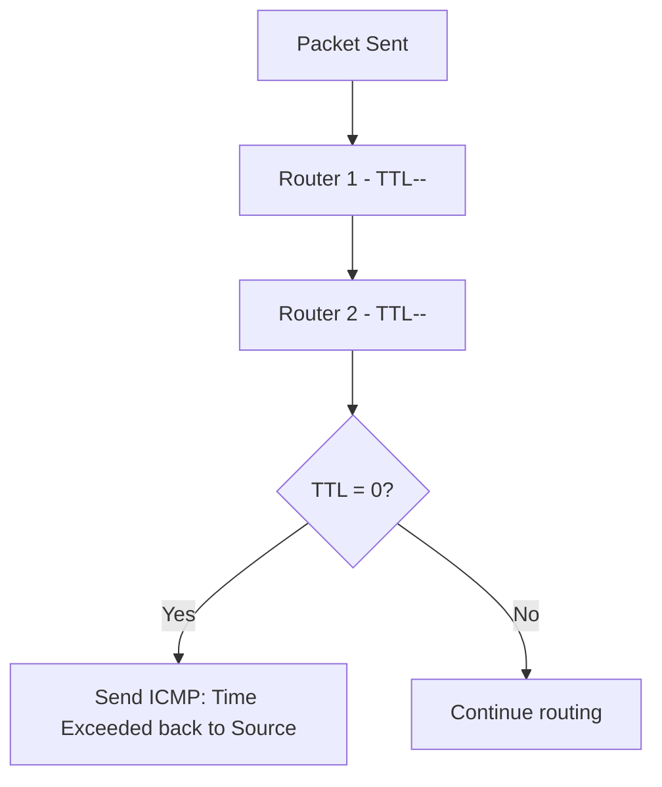
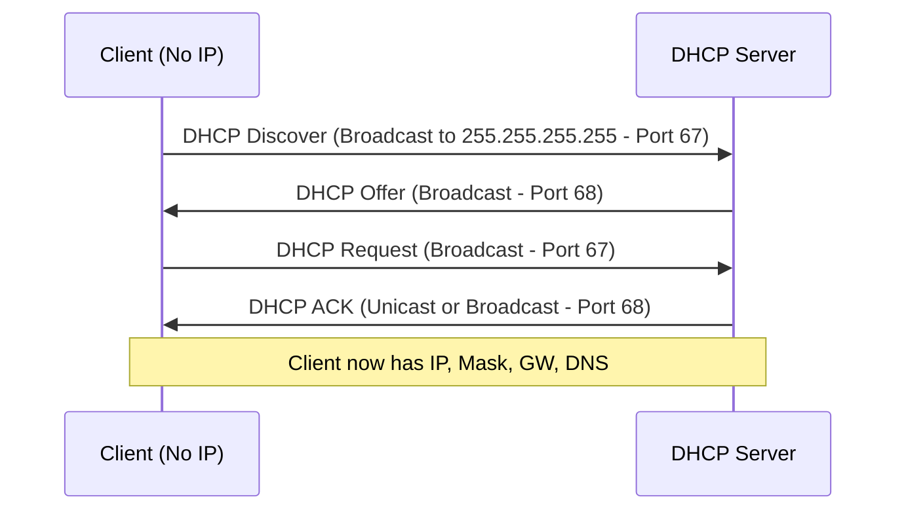
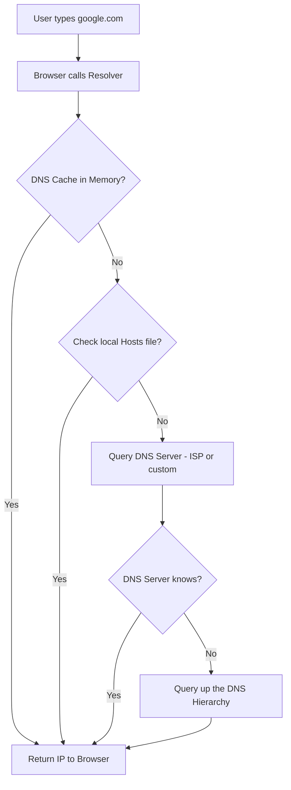

> **Goal of this section:**  
> This explains the supporting network protocols such as ICMP, DHCP, and DNS, and the role of each one in running the network efficiently — from diagnosing errors, to distributing IPs, to translating site names into IP addresses.

---

## Table of Contents
  - [ICMP Protocol](#icmp-protocol)
  - [DHCP Protocol](#dhcp-protocol)
  - [DNS Protocol](#dns-protocol)
  - [Summary](#summary)

---

## Supporting Network Protocols

### ICMP Protocol

#### What Is ICMP?

The **IP Protocol** is a **best-effort protocol** — it sends the packet and hopes it arrives, but without a connection and without acknowledgment. That makes it **unreliable**.

That's why there's **ICMP (Internet Control Message Protocol)** — it's the **error-reporting mechanism** of the IP Protocol.

#### Examples of ICMP Messages

| Scenario | ICMP Message |
|---|---|
| The TTL reached 0 at a router | "Time to live exceeded in transit" |
| The router doesn't know where to send the packet | "Destination unreachable, Network unreachable" |
| The network was reached but the device isn't responding | "Destination unreachable, Host unreachable" |

---

### DHCP Protocol

#### What Is DHCP?

The **DHCP (Dynamic Host Configuration Protocol)** is the mechanism for giving every device on the network an **IP address automatically**.

Without it, you'd have to set an IP manually on every device — that's possible with 10 devices, but impossible with 100,000.

#### Static vs Dynamic IP

| Type | Who Sets It | Use Case |
|---|---|---|
| **Static** | The administrator sets it manually | Servers — they always need a fixed IP |
| **Dynamic (DHCP)** | The DHCP Server automatically | Clients — user devices |

#### What Does DHCP Provide?

- IP Address
- Subnet Mask
- Default Gateway
- DNS Server IP

#### DHCP DORA Process

| Step | Who | What |
|---|---|---|
| **Discover** | Client | "Is there a DHCP Server here?" |
| **Offer** | Server | "Yes, and here's the IP I'll give you" |
| **Request** | Client | "I want this config" |
| **ACK** | Server | "Here you go, the config is ready" |

> [!NOTE]
> DHCP runs over **UDP**:
> - The client listens on **Port 68**
> - The server listens on **Port 67**
>
> The client initially has no IP, so it uses the broadcast address `255.255.255.255` as the source IP.

#### IP Lease

The assigned IP isn't permanent — the device "leases" it for a period:
- In a stable environment (a company): a day or a week
- In a changing environment (a university campus): 60-90 minutes

---

### DNS Protocol

#### What Is DNS?

The **DNS (Domain Name System)** is the protocol that translates **domain names** (such as google.com) into real **IP addresses**. Because the computer doesn't understand `google.com` in the packet header — it needs an IP address.

**TLD (Top Level Domain):** the last part of the domain, such as `.com`, `.net`, `.edu`, `.org`

#### The DNS Resolution Journey

#### DNS Resolution Steps

1. The user types `google.com` into the browser
2. The browser calls the **Resolver**
3. The Resolver checks the **DNS Cache** in the RAM first
4. If it's not there, it checks the **Local Hosts File**
5. If it's not there, it sends a query to a **DNS Server** (provided by the ISP via DHCP)
6. If the DNS Server doesn't know, it asks a server higher up in the hierarchy
7. Finally, the IP address is returned to the browser

#### Public DNS Servers

| Provider | Primary | Secondary |
|---|---|---|
| **Cloudflare** | 1.1.1.1 | 1.0.0.1 |
| **Google DNS** | 8.8.8.8 | 8.8.4.4 |
| **OpenDNS** | 208.67.222.222 | 208.67.220.220 |

> [!TIP]
> You don't have to use your ISP's DNS Server. You can switch to any server from this table. Cloudflare (1.1.1.1) is known for speed and privacy.

---

## Summary

- ICMP is IP's error reporting
- DHCP gives devices an IP automatically (the DORA process)
- DNS translates domain names into IP addresses
