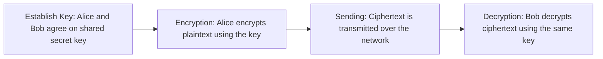

> **Goal of this section:**
> You'll understand how Symmetric Encryption works, which of the Security Properties (CIA + Non-repudiation + Key Exchange) it actually achieves, and why, despite its speed and efficiency, it can't solve the Key Distribution problem on its own. This is the foundation for understanding afterward why we needed Asymmetric Encryption and Diffie-Hellman.


## Table of Contents
- [What is Symmetric Encryption?](#what-is-symmetric-encryption)
- [How Symmetric Encryption Works](#how-symmetric-encryption-works)
- [Which Security Properties Does It Achieve?](#which-security-properties-does-it-achieve)
- [Advantages](#advantages)
- [Disadvantages — The Key Distribution Problem](#disadvantages--the-key-distribution-problem)
- [Common Symmetric Algorithms](#common-symmetric-algorithms)
- [Where Symmetric Encryption Is Used](#where-symmetric-encryption-is-used)
- [Limitations & What Comes Next](#limitations--what-comes-next)
- [Summary](#summary)
- [SOC Analyst Perspective](#soc-analyst-perspective)

---

## What is Symmetric Encryption?

Symmetric Encryption is the oldest and simplest form of Cryptography. Its core idea is that **the same Key** is used in two operations:
- Encryption: turning the Plaintext into Ciphertext
- Decryption: turning the Ciphertext back into Plaintext

This means both parties (the sender and the receiver) must **know the same Key from the start**, before any secure communication can begin.

> [!NOTE]
> Think of it as "a lock and a door with only one key" — anyone who has a copy of that key can lock and unlock the door. There's no distinction between who encrypted and who decrypted.

---

## How Symmetric Encryption Works

The process runs in 4 basic steps:




| Step | What happens |
|---|---|
| 1. Establish Key | Alice and Bob agree on a secret Key (for example, Key = 123) |
| 2. Encryption | Alice encrypts the word "HELLO" using the Key, producing "XQ9#A" |
| 3. Sending | The encrypted message "XQ9#A" is sent across the network |
| 4. Decryption | Bob receives "XQ9#A" and uses the same Key (123) to turn it back into "HELLO" |

> [!IMPORTANT]
> The fundamental condition everything rests on: **both parties must have exactly the same Key**. If the Key is different, or even a single character in it changes, decryption will fail completely.

The short mathematical form of the process:

```
Ciphertext = Encrypt(Plaintext, Key)
Plaintext  = Decrypt(Ciphertext, Key)
```

---

## Which Security Properties Does It Achieve?

As we discussed in the **Security Properties** section, there are 5 core principles we measure any Cryptographic mechanism against:
**Confidentiality, Integrity, Authentication, Non-repudiation, Key Exchange**

The important question here: which of these principles does Symmetric Encryption actually achieve?

**The direct answer: Symmetric Encryption → primarily and directly achieves Confidentiality.**

That is its **Primary Design Goal**, from start to finish. The only goal the algorithm was designed for is to make data unreadable to anyone who doesn't have the Key, whether it's stored (Data at Rest) or being transmitted (Data in Transit).

| Security Property | Achieved? |
|---|---|
| **Confidentiality** | Yes — this is its main goal |
| Integrity | No (in the standard mode) |
| Authentication | No (not reliably) |
| Non-repudiation | No |
| Key Exchange | No — this is actually its problem, not its solution |

> [!NOTE]
> There are Modern implementations such as **AES-GCM** that add an Authentication Tag within the process itself, so they give you Integrity along with Confidentiality (this type is called AEAD - Authenticated Encryption with Associated Data). But that's an extra enhancement on top of the algorithm, not the core goal of Symmetric Encryption as a principle.

> [!WARNING]
> A common mistake: many beginners think that "encryption = complete security," meaning it achieves everything (Integrity + Authentication + Non-repudiation). That's wrong. Encryption on its own achieves only Confidentiality, and the other properties need other mechanisms (Hashing, HMAC, Digital Signatures), which we'll explain in the upcoming Sections.

---

## Advantages

Symmetric Encryption is very strong in its domain, and its main advantages are:

- **Efficiency:** It's very fast and needs very little Computational Power compared to Asymmetric
- **Bulk Data:** Ideal for encrypting large amounts of data — huge files, Streaming Video, entire databases
- **Low computational cost:** It's cheap to compute, which makes it suitable even for devices with limited capabilities

---

## Disadvantages — The Key Distribution Problem

Despite its efficiency, Symmetric Encryption faces a very big obstacle when we talk about the massive scale of the internet.

> [!IMPORTANT]
> **The Distribution Problem:** If Alice and Bob are on completely opposite sides of the world, how can they securely agree on a secret Key? If an Attacker manages to intercept the Key while it's being delivered, the whole system is compromised immediately — not just this message, but all future messages too.

This problem is exactly what made the world need a solution such as **Diffie-Hellman Key Exchange** or **Asymmetric Encryption**, which we'll explain in the upcoming Sections.

Additional disadvantages:
- It needs a separate secure channel to deliver the Key (Out-of-band exchange)
- If one Key is used by a large number of parties, the difficulty of Key Management grows significantly

---

## Common Symmetric Algorithms

| Algorithm | Status |
|---|---|
| **DES** | Very old and broken (Obsolete) — must not be used today |
| **3DES** | An improvement on DES, but also largely abandoned (Mostly Deprecated) |
| **AES (Advanced Encryption Standard)** | The current Global Gold Standard — secure and fast, used especially for encrypting stored data |
| **ChaCha20** | Very fast and light on the CPU, widely used in mobile apps and devices with limited capabilities |

---

## Where Symmetric Encryption Is Used

- **Disk Encryption:** Encrypting the entire hard disk (such as BitLocker, FileVault)
- **Database Encryption:** Encrypting the data stored in databases
- **HTTPS (after Key Exchange):** After the Browser and the Server agree on a Session Key through Asymmetric/Diffie-Hellman, the rest of the actual data transfer is done with Symmetric Encryption for speed

> [!TIP]
> This is exactly the secret behind the strength of the Hybrid Approach we see in the TLS/HTTPS Handshake — we use Asymmetric for Authentication and Key Exchange at the beginning (slow but secure), and then switch to Symmetric for the actual data transfer (fast and efficient). We'll explain this in detail in the HTTPS Handshake Section.

---

## Limitations & What Comes Next

We've now made it clear that Symmetric Encryption achieves only Confidentiality. The logical question: how do we achieve the remaining Security Properties (Integrity, Authentication, Non-repudiation, Key Exchange)?

Each of Symmetric Encryption's problems was a direct reason for inventing a new technology to solve it. Let's go through this chain one problem at a time.

### Problem 1: Key Distribution Problem

Alice and Bob need to agree on a secret Key before they start any communication. If they try to send it over the internet in the ordinary way, any eavesdropping attacker (Man-in-the-Middle) can intercept it, and after that the entire communication is fully exposed — not just a single message.

> [!IMPORTANT]
> We needed a way to agree on a secret Key **without actually sending it** over the network, even if someone is listening to everything being exchanged. That's what **Diffie-Hellman Key Exchange** solves.

### Problem 2: No real Authentication

Since both parties have exactly the same Key, there's no mathematical way to tell "who actually sent the message" or to confirm that the other party really is who they claim to be.

> [!IMPORTANT]
> We needed a mechanism that lets a party prove its identity reliably, without sharing a secret that the other party also knows. That's what **Asymmetric Encryption (Public/Private Key)** began to solve.

### Problem 3: No reliable Integrity

If an attacker modifies the Ciphertext while it's traveling across the network, it can reach the other party and decrypt into something else, and there's no automatic way to detect that the data was changed at all.

> [!IMPORTANT]
> We needed a way to confirm that the data hadn't changed between the time it was sent and the time it arrived. That's what **Hashing** began to solve, and then **HMAC** solved it more robustly (because it ties the Hash to a secret key, so no one but the two parties can forge it).

### Problem 4: No Non-repudiation

Since both parties have the same Key, no one can prove "exactly who sent the message" — either party can deny it and say "the other party sent it, not me," and there's no conclusive evidence to settle it.

> [!IMPORTANT]
> We needed a mechanism that provides mathematical proof that one specific person, and only that person, signed or sent the message, and can't deny it afterward. That's what **Digital Signatures** solve definitively.

---

## Summary

- Symmetric Encryption uses **the same Key** for encryption and decryption
- The main and only goal it directly achieves is **Confidentiality**
- It doesn't reliably achieve Integrity, Authentication, or Non-repudiation (unless we use AEAD modes such as AES-GCM)
- It doesn't solve the Key Exchange problem — on the contrary, that's the biggest problem it faces (the Key Distribution Problem)
- Its advantages: high speed, efficiency, low computational cost → suitable for encrypting large amounts of data
- Its disadvantages: the difficulty of securely delivering the Key between distant parties
- The best-known algorithms: **AES** (the current standard), **ChaCha20** (for mobile), while **DES** and **3DES** are no longer secure

---

## SOC Analyst Perspective

- When you see Symmetric encryption in the work environment (such as Disk Encryption or Database Encryption), remember that it protects only Confidentiality — if the encrypted data is tampered with, the system won't detect it automatically unless there's a separate Integrity mechanism (such as HMAC or AES-GCM)
- From a Threat Hunting angle: if you find a Symmetric Encryption Key leaked or exposed in Logs, that's an immediate Critical Incident — because anyone with the Key can decrypt all the data associated with it (not just what leaked at that moment)
- MITRE ATT&CK: Techniques such as **T1573 (Encrypted Channel)** use Symmetric Encryption inside C2 Communication to hide the content from Network Detection tools — as a Defender, it's important to monitor Traffic Patterns, not just the content, when encryption prevents you from reading it directly
- Practical tools: Wireshark can help you notice if a Symmetric Key is being exchanged insecurely (in Plaintext) in the Traffic — that's a major warning sign (Red Flag) that must be escalated immediately
