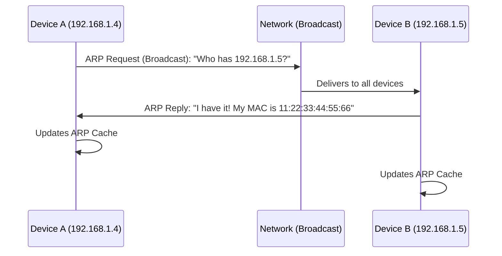
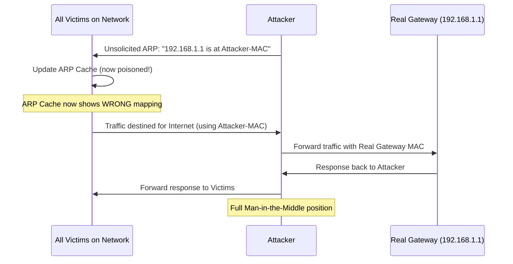
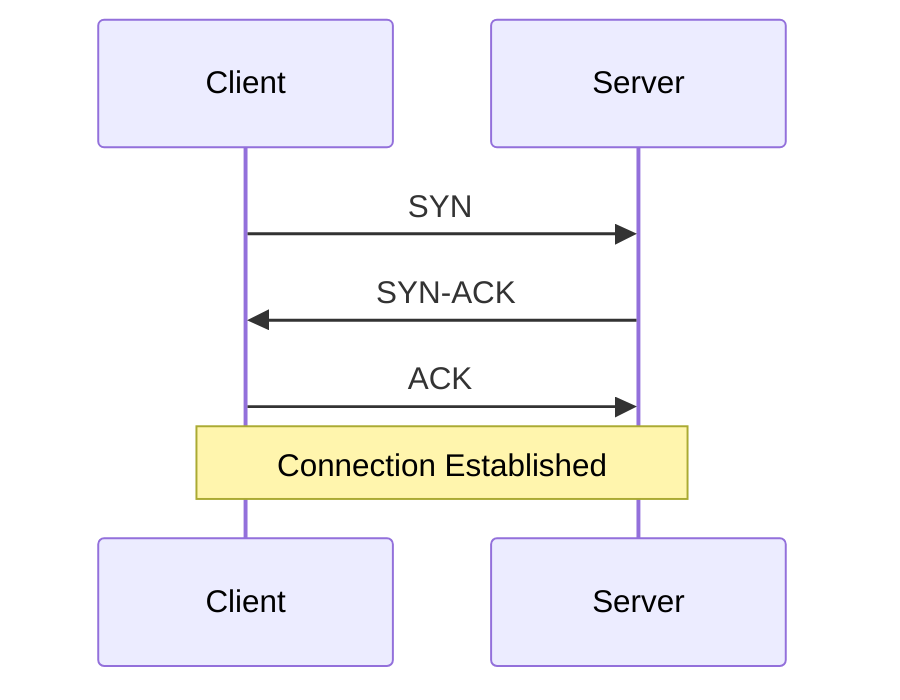
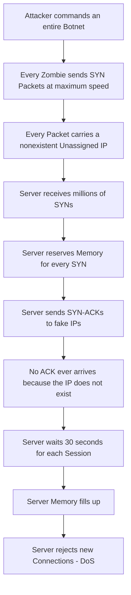

> **Goal of this section:**
> We'll get to know a set of the most dangerous network-level attacks that target the core infrastructure of networks and systems.

---

## Table of Contents

- [Network-Level Attacks](#network-level-attacks)
  - [Spoofing](#spoofing)
  - [ARP Cache Poisoning](#arp-cache-poisoning)
  - [SYN Flood Attack](#syn-flood-attack)
  - [Buffer Overflow](#buffer-overflow)
- [Summary](#summary)

---

## Network-Level Attacks

### Spoofing

#### What Is Spoofing?

**Spoofing** is the use of fake information for malicious purposes. In plain terms: the attacker pretends to be someone else.

| Spoofing Type | Description |
|---|---|
| **IP Spoofing** | Putting any IP address in the packet regardless of the real source |
| **MAC Spoofing** | Changing the MAC address to bypass MAC filtering |
| **Email Spoofing** | Changing the sender of an email so it looks like it came from someone else |

---

### ARP Cache Poisoning

#### Understanding Normal ARP First

**ARP (Address Resolution Protocol)** is the protocol responsible for translating an **IP Address** into a **MAC Address** on the local network.

Every device has an **ARP Cache** — a table where it stores this mapping:

```
IP Address      MAC Address
192.168.1.1     AA:BB:CC:DD:EE:FF
192.168.1.5     11:22:33:44:55:66
```

```bash
# To view the ARP cache on your machine
arp -a
```

#### How Does Normal ARP Work?



#### Unsolicited ARP (Gratuitous ARP)

There's a type of ARP called **Unsolicited ARP** that is sent without anyone requesting it. Its legitimate uses:

- When a router starts up, it announces itself: "I'm here, and I have this IP"
- When a MAC address changes, the new update is announced
- Updating the ARP tables across the network

> [!IMPORTANT]
> This feature has no authentication. Any device can send an unsolicited ARP with any information, even false information — and every device on the network will believe it and update its ARP cache.

#### How Does the ARP Cache Poisoning Attack Work?



#### The Attack Step by Step

1. The attacker sends an **Unsolicited ARP** saying "I am the gateway"
2. All the devices believe it and update their ARP caches
3. All traffic headed for the internet goes to the attacker
4. The attacker uses a tool such as **Ettercap** to:
   - See all the traffic (Man-in-the-Middle)
   - Rewrite the MAC addresses and forward the traffic to the real gateway
5. The gateway replies, and the attacker forwards the reply to the victim

> [!TIP]
> To detect ARP poisoning, look for **Duplicate IP Addresses** in the ARP cache — if one IP has different MAC addresses, something is wrong. Or use tools such as **XArp** for monitoring.

---

### SYN Flood Attack

#### Quick Review: The TCP 3-Way Handshake



#### How Does a SYN Flood Work?

When the server receives a SYN, it does the following:
- **Reserves memory** for that session
- **Sends a SYN-ACK** to the client
- **Waits for the ACK** for about 30 seconds

The attacker exploits this:



> [!IMPORTANT]
> The attacker doesn't need a million machines to create a million sessions. Every machine in the botnet sends packets as fast as it can — each packet with a different fake IP.

#### Solutions

| Solution | Description | Effectiveness |
|---|---|---|
| Reducing the SYN timeout | Reducing the wait time from 30 seconds | Somewhat helpful, but not enough if the attack is strong |
| SYN Cookies | A technique that avoids reserving memory before the ACK | Better |
| Firewall with SYN Proxy | The firewall completes the handshake on behalf of the server | The best, but expensive |

---

### Buffer Overflow

#### What Is a Buffer?

A **Buffer** is simply a piece of memory a program uses to store data temporarily — such as an array or a string.

#### What Is a Buffer Overflow?

When you try to put more data into a buffer than it was designed for, the extra data "overflows" and overwrites the adjacent memory. That is a **Buffer Overflow**.

> [!NOTE]
> Buffer overflows are very common in **C** and **C++** because they **don't perform automatic bounds checking**. As a developer, you're responsible for making sure the data doesn't exceed the buffer's size.
> 
> ```c
> char buffer[10];  // Reserves only 10 bytes
> // If you write 50 bytes here, C won't stop you!
> ```

#### The Memory Layout and How the Attack Works

```mermaid
flowchart TD
    subgraph Normal["Normal Execution"]
        N1[Instruction A] --> N2[Instruction B]
        N2 --> N3[Instruction C: Go to Buffer Q]
        N3 --> N4[Buffer Q: Process user input]
        N4 --> N5[Return Pointer: Go back to D]
        N5 --> N6[Instruction D: Continue]
    end

    subgraph Attack["Buffer Overflow Attack"]
        A1[Instruction A] --> A2[Instruction B]
        A2 --> A3[Instruction C: Go to Buffer Q]
        A3 --> A4[Buffer Q: Attacker fills with NOP sled]
        A4 --> A5[Overflow overwrites Return Pointer]
        A5 --> A6[New Return Pointer points to Malicious Code]
        A6 --> A7[Malicious Code Executes]
        A7 --> A8[Return to D to avoid suspicion]
    end
```



#### Why Does the Attacker Need to Overwrite the Return Address?

> [!IMPORTANT]
> The processor doesn't run code automatically just because it exists in memory. Code only executes when the CPU's instruction pointer (IP/EIP/RIP) jumps to its address. So even if the attacker places shellcode in memory, it remains just bytes that never execute — the attacker has to redirect the execution flow to it.

#### The NOP Sled

A **NOP (No Operation)** is a legitimate instruction that tells the processor "do nothing, move on to the next instruction." The attacker fills the buffer with NOPs to:

- Widen the "landing zone" for the jump
- Ensure execution eventually reaches the malicious code

```
[NOP][NOP][NOP]...[NOP][NOP][Shellcode][Return to D]
       ← NOP Sled →
```

> [!TIP]
> Protection against buffer overflows comes in several forms: **Input Validation** (checking the entered data), **ASLR (Address Space Layout Randomization)** (randomizing memory addresses), and **Stack Canaries** (special values placed before the return address that get verified).

---

## Summary
- **Spoofing:** forging the IP, MAC, or email
- **ARP Poisoning:** poisoning the ARP cache to become a MITM
- **SYN Flood:** flooding the server with fake SYN packets until it collapses
- **Buffer Overflow:** overwriting memory to redirect execution to malicious code
