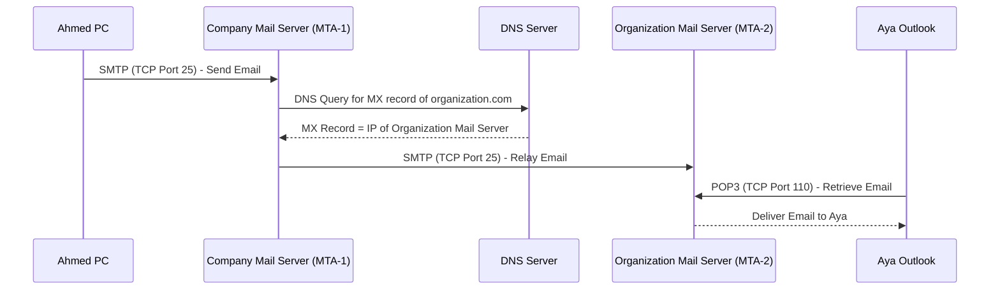
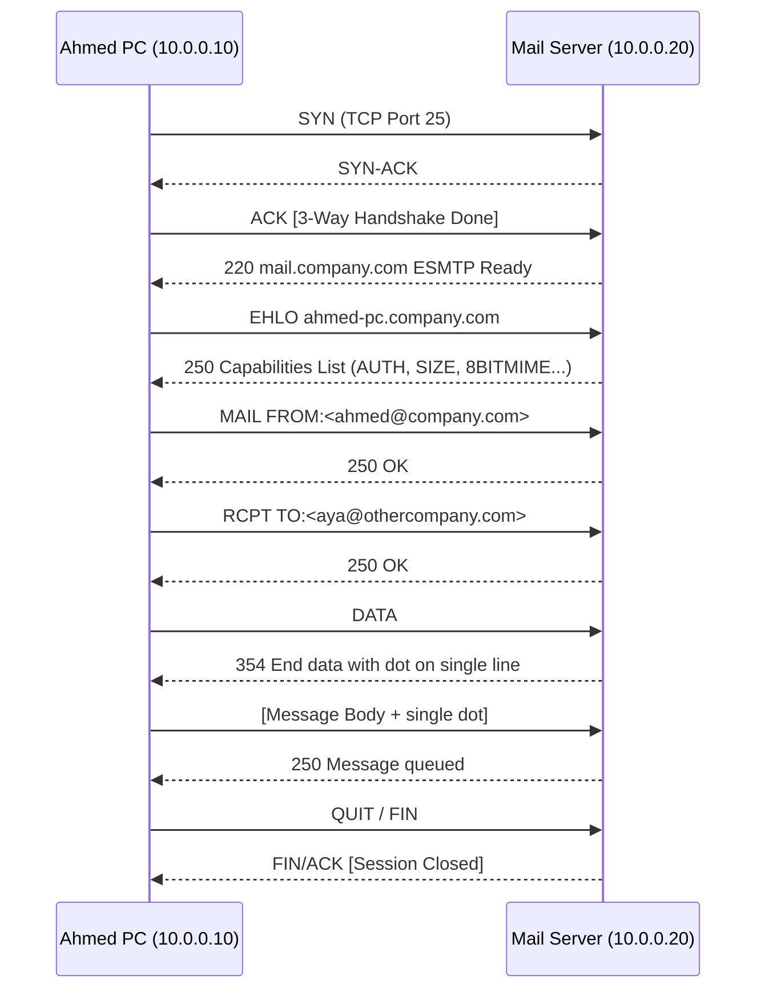
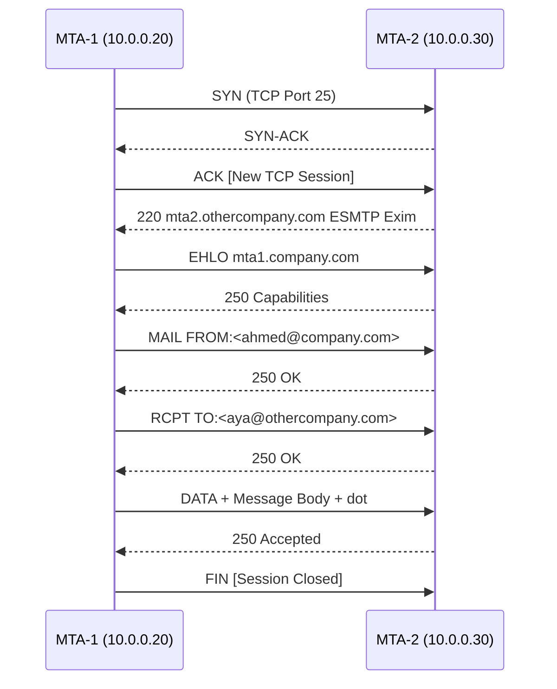

> **Goal of this section:**  
> You'll understand how an email is sent from one person to another step by step, the role of the Mail Server and DNS in this process, and you'll see SMTP from the inside in Wireshark.

---

## Table of Contents
- [How Email Works](#how-email-works)
  - [The Core Concept](#the-core-concept)
  - [The Email Sending Steps in Detail](#the-email-sending-steps-in-detail)
  - [The Protocols Used](#the-protocols-used)
- [Important Lab — Email PCAP Analysis (Wireshark)](#important-lab--email-pcap-analysis-wireshark)
  - [Client to Mail Server (Ahmed's PC → MTA-1)](#client-to-mail-server-ahmeds-pc--mta-1)
  - [Server to Server Relaying (MTA-1 → MTA-2)](#server-to-server-relaying-mta-1--mta-2)
- [Summary](#summary)

---

## How Email Works

### The Core Concept

Imagine you sent someone a letter in the old days — you don't deliver it yourself; you hand it to **the postal service**, which delivers it. Exactly the same idea happens with email.

When Ahmed writes an email and hits Send, his computer is **not** the one that sends the email directly. Something called a **Mail Server** plays the role of the postman.

```
Ahmed@company.com  ──→  sends an email to  ──→  Aya@organization.com
```

Each company has its own **Mail Server**:
- **Company.com Mail Server** — serves Ahmed
- **Organization.com Mail Server** — serves Aya

---

### The Email Sending Steps in Detail



**The steps one by one:**

**1. Ahmed writes the email and hits Send**
- The email client (such as Outlook) connects to the Company Mail Server on **TCP Port 25** using the **SMTP** protocol.

**2. Ahmed's Mail Server goes to work**
- It looks at the recipient: `Aya@organization.com`
- It figures out that it needs to send to `organization.com`
- The problem: it doesn't know the IP address of Organization's Mail Server

**3. A DNS Query to find out the MX Record**

> [!IMPORTANT]
> The DNS query here isn't asking about the website for organization.com; it's asking about the **MX Record** (Mail Exchange Record). This MX Record is what provides the IP of the Mail Server, not the Web Server.

**4. The Server-to-Server Transfer (Relaying)**
- After MTA-1 fetched the MX Record, it opened a connection on **TCP Port 25** with MTA-2
- It sent it the email — this process is called **Relaying**

**5. Aya opens the email**
- Aya opens Outlook, which connects to the Organization Mail Server on **TCP Port 110**
- It fetches the email using the **POP3** protocol

---

### The Protocols Used

| Protocol | Full Name | Port | Function |
|----------|-----------|------|---------|
| **SMTP** | Simple Mail Transfer Protocol | TCP 25 | Sending email (Client→Server & Server→Server) |
| **POP3** | Post Office Protocol v3 | TCP 110 | Retrieving email from the Mail Server |
| **DNS MX** | Mail Exchange Record | UDP/TCP 53 | Finding the address of the intended Mail Server |

> [!NOTE]
> There's another protocol used to retrieve email called **IMAP (TCP Port 143)**, which is newer than POP3 and doesn't delete the messages from the server. But what was covered in this lecture is POP3.

---

## Important Lab — Email PCAP Analysis (Wireshark)

### Lab Setup

| Device | IP Address | Role |
|--------|-----------|-------|
| Ahmed's PC | 10.0.0.10 | The sender |
| Company Mail Server (MTA-1) | 10.0.0.20 | Ahmed's Mail Server |
| Organization Mail Server (MTA-2) | 10.0.0.30 | Aya's Mail Server |
| Sender Email | ahmed@company.com | — |
| Recipient Email | aya@othercompany.com | — |

> [!TIP]
> In this lab we'll assume that each server knows the other's IP, so we can skip the DNS step and focus on the details of SMTP.

---

### Client to Mail Server (Ahmed's PC → MTA-1)



**Explanation of each step:**

**The 3-Way Handshake**
- The first 3 packets are the usual TCP handshake on **Port 25**
- After the connection is opened, the server announces itself

**`220` — Server Greeting**
- `220 mail.company.com ESMTP Ready`
- The `220` is a response code meaning "the server is ready"

**`EHLO` — Client Identity**
- `EHLO ahmed-pc.company.com`
- The client identifies itself and requests the server's list of capabilities

**`250` — Server Capabilities**
- The server replies with a list of capabilities such as: the maximum email size, whether it supports authentication, whether it supports encryption...

**`MAIL FROM`**
- Specifies the sender: `MAIL FROM:<ahmed@company.com>`
- This is called the **Envelope Sender** — like writing your name on the envelope

**`RCPT TO`**
- Specifies the recipient: `RCPT TO:<aya@othercompany.com>`
- The server replies with `250 OK` if the recipient is accepted

**`DATA` and the message**
- The client sends the `DATA` command
- The server replies with `354`, meaning "send the message and end it with a single dot on a line by itself"
- The message sent:

```
Subject: Hello Aya
From: ahmed@company.com
To: aya@othercompany.com

Hello Aya,
This is a test mail.
Regards,
Ahmed
.
```

> [!IMPORTANT]
> The `.` (a single dot on a line) is the marker that tells the server the message is finished. This is a standard in SMTP.

**Ending the session**
- The server replies `250 Message queued`, meaning the message was accepted and is in the queue
- Ahmed starts the FIN sequence to close the TCP connection

> [!NOTE]
> The server sent the `FIN/ACK` in a single packet instead of two — this is called **Piggybacking** and happens when the server decides to ACK and FIN at the same time.

---

### Server to Server Relaying (MTA-1 → MTA-2)



**Important concepts in relaying:**

**What is an MTA?**
- **MTA = Mail Transfer Agent**
- It's the server-side software responsible for sending, receiving, and routing emails between Mail Servers
- Well-known examples: **Postfix, Sendmail, Exim, Microsoft Exchange**

**Why is there a second handshake?**
- The first TCP connection was between **Ahmed's PC** and **MTA-1**
- Now MTA-1 opens a **completely new connection** with MTA-2 — that's why there's a second handshake
- Same SMTP protocol, same Port 25

**`220 mta2.othercompany.com ESMTP Exim`**
- Exim is the name of the MTA software running on MTA-2
- `ESMTP` = Extended SMTP (an extended version that supports additional capabilities)

**`EHLO` and `250` Capabilities**
- The same process — the servers negotiate the capabilities before they begin
- Important because they determine whether they'll do authentication or not, and what features are available

> [!WARNING]
> The SMTP in this example is **not encrypted** — everything is sent in cleartext. In the real world, **SMTPS (Port 465)** or **STARTTLS (Port 587)** must be used to protect emails in transit.

---


## Summary

#### How Email Works
- Email isn't sent from one machine to another directly — it passes through **Mail Servers** that play the role of the postman
- The sending protocol is **SMTP on TCP Port 25**
- The Mail Server uses a **DNS MX Record** to find the address of the other party's Mail Server
- The process of transferring the email between two servers is called **Relaying**, and the responsible software is called an **MTA**
- Aya retrieves her email via **POP3 on TCP Port 110**

#### Lab Highlights (Wireshark)
- The first 3 packets are always the **3-Way Handshake** on Port 25
- The SMTP sequence: `EHLO` → `MAIL FROM` → `RCPT TO` → `DATA` → `250 OK` → `QUIT`
- The message ends with **a single dot on a line** (`.`)
- The important server codes: `220` (Ready), `250` (OK), `354` (Start Data)


