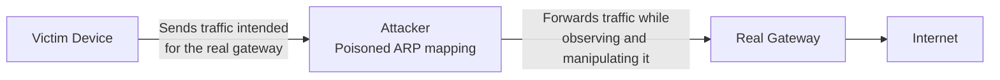
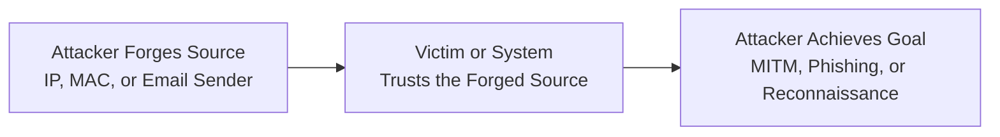

| Topic | Level | Reading Time | Prerequisites |
|---|---|---|---|
| Spoofing | Beginner | ~14 min | Basic understanding of networking concepts (IP addressing, MAC addresses) |

> **Goal of this section:**
> You'll understand what Spoofing is, how an attacker can forge the source of a communication at different levels (IP, MAC, Email), and why it's dangerous and used as part of larger attacks.

## Learning Objectives

By the end of this section, you will be able to:

- Define **Spoofing** and explain the core idea behind it.
- Describe how **IP Spoofing** works at the network layer.
- Describe how **MAC Spoofing** and **ARP Poisoning** work at the local network level.
- Explain how **Email Spoofing** can make a message appear to come from a trusted sender.
- Identify how spoofing is used as part of larger attacks and list common defenses against it.

## Table of Contents

- [What Is Spoofing](#what-is-spoofing)
- [IP Spoofing](#ip-spoofing)
- [MAC Spoofing and ARP Poisoning](#mac-spoofing-and-arp-poisoning)
- [Email Spoofing](#email-spoofing)
- [Types of Spoofing at a Glance](#types-of-spoofing-at-a-glance)
- [Why Spoofing Is Dangerous](#why-spoofing-is-dangerous)
- [Spoofing as Part of Larger Attacks](#spoofing-as-part-of-larger-attacks)
- [Spoofing Attack Flow Diagram](#spoofing-attack-flow-diagram)
- [Defenses Against Spoofing](#defenses-against-spoofing)
- [Career Connection](#career-connection)
- [Key Terms Glossary](#key-terms-glossary)
- [Summary](#summary)

## What Is Spoofing

**Spoofing** is using **false or manipulated information** to make a communication appear to come from a **trusted source**.

In plain terms: the **attacker** pretends to be someone else — whether that's a device, a network address, or even a real person — to gain the victim's trust or bypass a particular verification mechanism.

> [!NOTE]
> The core idea in every type of Spoofing is the same: forging the **source** of the communication, not necessarily forging the content itself. The attacker changes "who sent this message," not necessarily "what's inside the message."

## IP Spoofing

At the **network layer**, the attacker can manipulate packet information to make traffic appear to come from an IP address completely different from the real source. This is known as **IP Spoofing**.

In other words, the attacker puts any **IP Address** in the packet regardless of their real source, so the receiving device or system may make decisions (such as granting access or trusting the packet) based on a forged address.

> [!WARNING]
> IP Spoofing is widely used in attacks such as **Denial of Service (DoS/DDoS)**, because the attacker can hide their real identity or direct the responses to a third-party victim instead of their own machine.

## MAC Spoofing and ARP Poisoning

At the **local network level**, attackers can manipulate their **MAC Address** information. This is called **MAC Spoofing**.

The common goal of MAC Spoofing is to use an allowed MAC address to bypass the **MAC Filtering** mechanism on the network (which we covered in the Wireless Networks topic).

In addition, there's a technique called **ARP Poisoning** (also known as ARP Spoofing), in which the attacker sends fake ARP messages on the local network to associate their MAC address with the IP address of another device (such as the default gateway). As a result, traffic that's supposed to go to the real device is redirected to the attacker's machine instead, which allows them to eavesdrop on or manipulate the communication between devices.

> [!IMPORTANT]
> ARP Poisoning is one of the most popular ways to carry out **Man-in-the-Middle** attacks within the local network itself, which shows how forging something as simple as a MAC address can lead to major security problems.

## Email Spoofing

Email addresses and **sender information** can also be forged, which makes an email appear to come from a person or organization other than the real sender.

**Email Spoofing** relies on changing the **Sender** field in the email header, so the victim sees a familiar, trusted name or address, while the message actually comes from a completely different source.

> [!TIP]
> Email Spoofing is often the first step in **Phishing** or **Spear Phishing** attacks, because a message that appears to come from a trusted source increases the likelihood that the victim will trust it and interact with it.

## Types of Spoofing at a Glance

The following table summarizes the main types of Spoofing and the level they affect:

| Spoofing Type | Description | Affected Level |
|---|---|---|
| **IP Spoofing** | Putting any IP address in the packet regardless of the real source | Network Layer |
| **MAC Spoofing** | Changing the MAC address to bypass MAC Filtering | Local Network |
| **ARP Poisoning** | Associating the attacker's MAC address with another device's IP address to redirect traffic | Local Network |
| **Email Spoofing** | Changing the sender in an email so it looks like it's from someone else | Application Layer |

## Why Spoofing Is Dangerous

Spoofing is considered dangerous because it can **make a malicious communication appear legitimate and trustworthy**. The victim, or even the technical systems themselves, may make trust decisions based on a forged source, which opens the door for the attacker to achieve other goals.

> [!IMPORTANT]
> The real danger of Spoofing isn't just the forgery itself, but the fact that it's used as an **enabler** for other, larger and more dangerous attacks.

## Spoofing as Part of Larger Attacks

Spoofing is usually not an end goal in itself; it's used as part of broader attacks, the most well-known of which are:

- **Man-in-the-Middle (MITM)** attacks: as we saw with ARP Poisoning.
- **Phishing** campaigns: as we saw with Email Spoofing.
- **Network Reconnaissance** operations: so the attacker can hide their identity while gathering information about the target network.

## Spoofing Attack Flow Diagram

The following diagram shows how ARP Poisoning is used to carry out a Man-in-the-Middle attack within the local network:

And the following diagram shows the general path that any type of Spoofing follows, from forgery to exploitation:

## Defenses Against Spoofing

To reduce the risks of all types of Spoofing, a combination of the following mechanisms is used:

| Mechanism | Role in Protection |
|---|---|
| **Authentication** | Verifying the sender's real identity instead of relying only on the apparent source |
| **Digital Signatures** | Proving that the message or data really comes from the stated source and hasn't been altered |
| **Secure Protocols** | Using protocols that include built-in verification mechanisms (such as HTTPS, DNSSEC) |
| **Network Monitoring** | Detecting abnormal traffic patterns that may indicate spoofing |
| **Anti-Spoofing Controls** | Network-level settings (such as filtering packets with illogical addresses) to prevent IP Spoofing |

> [!TIP]
> No single defense mechanism is enough to prevent every type of Spoofing; effective protection relies on multiple layers working together at different levels of the network and the application.

## Career Connection

Understanding Spoofing is directly tied to several career paths:

- In the **SOC**, detecting abnormal IP or ARP patterns is an essential part of traffic analysis work.
- In **Pentesting**, ethically carrying out ARP Poisoning or IP Spoofing attacks is used to test how well the network withstands Man-in-the-Middle attacks.
- In **Cloud Security**, protecting systems from IP Spoofing is part of designing network rules (network security groups) in cloud environments.

## Key Terms Glossary

| Term | Definition |
|---|---|
| **Spoofing** | Using false or manipulated information to make a communication appear to come from a trusted source. |
| **IP Spoofing** | Forging the source IP address in a packet so it appears to come from another device. |
| **MAC Spoofing** | Changing a device's MAC address to bypass mechanisms such as MAC Filtering. |
| **ARP Poisoning** | A technique in which fake ARP messages are sent to associate the attacker's MAC address with another device's IP address. |
| **Email Spoofing** | Forging the sender field in an email so the email appears to come from another person or entity. |
| **Man-in-the-Middle (MITM)** | An attack in which the attacker places themselves between the two parties of a communication to monitor or manipulate it. |

## Summary

- **Spoofing** is using false information to make a communication appear to come from a trusted source.
- **IP Spoofing** happens at the network layer, by forging the source IP address in the packet.
- **MAC Spoofing** and **ARP Poisoning** happen at the local network level, and are used to bypass MAC Filtering or carry out Man-in-the-Middle attacks.
- **Email Spoofing** happens at the application level, by forging the sender field in the email, and it's often the first step in Phishing attacks.
- Spoofing is dangerous because it makes a malicious communication appear legitimate and trustworthy, and it's often used as part of larger attacks such as MITM, Phishing, and Network Reconnaissance.
- Effective protection relies on multiple layers such as **Authentication**, **Digital Signatures**, **Secure Protocols**, **Network Monitoring**, and **Anti-Spoofing Controls**.

