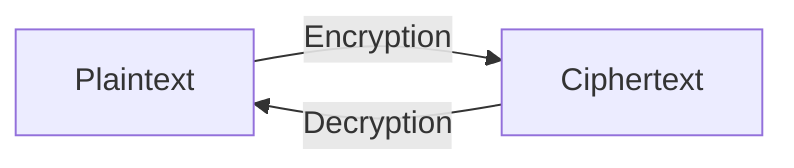

> **Goal of this section:**
> You'll understand what Cryptography fundamentally is, the most important terms you'll encounter in every upcoming topic (Plaintext, Ciphertext, Key, Algorithm...), and why the Algorithm can be publicly known while the Key must stay secret. This section is the foundation that all the upcoming sections will build on.


## Table of Contents
- [What is Cryptography?](#what-is-cryptography)
- [Without Encryption vs With Encryption](#without-encryption-vs-with-encryption)
- [Important Terms in Cryptography](#important-terms-in-cryptography)
- [Algorithm vs Key — Who Stays Secret?](#algorithm-vs-key--who-stays-secret)
- [The Conceptual Formula](#the-conceptual-formula)
- [Key Space](#key-space)
- [A Historical Note: Steganography](#a-historical-note-steganography)
- [Summary](#summary)
- [SOC Analyst Perspective](#soc-analyst-perspective)

---

## What is Cryptography?

**Cryptography** is the science and art of securing information by transforming it into a format that's unreadable to unauthorized people.

Its goal is to ensure that data is:

| Property | Meaning |
|---|---|
| **Confidential** | No one sees it except its owner |
| **Authentic** | The data really comes from the right source |
| **Unaltered** | No one modified it along the way |

> [!NOTE]
> These three principles are a small part of a larger set of **Security Properties** (Confidentiality, Integrity, Authentication, Non-repudiation, Key Exchange) that we'll explain in full detail in the next section, and every encryption topic we discuss after that will be measured against them.

> [!NOTE]
> The sentence `Ygneqog vq Eadgt Ugewtkva Htkgpfu` isn't gibberish — it's a sentence encrypted with the **Caesar Cipher** using a shift of 2. If you decrypt it, you'll find: **"Welcome to Cyber Security Friends"**. This shows that if you don't know the Algorithm or the Key, you won't be able to decrypt it, even with the whole sentence right in front of you.

---

## Without Encryption vs With Encryption

Before we get into the terms, let's understand why we need Cryptography in the first place with a simple example:

| Case | Analogy | Description |
|---|---|---|
| **Without Encryption** | Like a **Postcard** | Anyone who handles it along the way can easily read it — passwords, messages, and bank details are all exposed |
| **With Encryption** | Like a **High-Security Vault** | Even if someone intercepts the data in transit, it will look like gibberish to them, and Confidentiality stays protected |

---

## Important Terms in Cryptography

These are the basic terms you need to memorize and understand well, because they'll come up again in every upcoming topic:



| Term | Definition |
|---|---|
| **Plaintext** | The original readable text — what you're reading right now |
| **Ciphertext** | The encrypted text — unreadable to an ordinary person |
| **Encryption** | The process of converting Plaintext into Ciphertext |
| **Decryption** | The process of converting Ciphertext back into Plaintext |
| **Algorithm** | The set of public rules the encryption system is built on |
| **Cryptanalysis** | The science of breaking encryption algorithms |
| **Key** | A numeric value with a specific length in bits — it's the secret part of encryption |
| **Key Space** | The number of possible values the Key can take |

---

## Algorithm vs Key — Who Stays Secret?

> [!IMPORTANT]
> The **Algorithm** is publicly known — everyone knows that the Caesar Cipher performs a shift, and that AES works in a specific way that's known and officially published. What actually makes the difference is the **Key**, which is supposed to be secret. If someone knows the Key and knows the Algorithm, they can decrypt anything encrypted with them.

> [!TIP]
> This is a core principle of modern Cryptography called **Kerckhoffs's Principle**: an encryption system should stay secure even if everything about it is known **except the Key**. That's why strong algorithms (such as AES) are published and available for everyone to examine, and security relies entirely on the secrecy of the Key, not on hiding how the algorithm works.

---

## The Conceptual Formula

Everything we discussed above can be summed up in a simple formula:

```
Ciphertext = Encrypt(Plaintext, Key)
Plaintext  = Decrypt(Ciphertext, Key)
```

> [!TIP]
> Come back to this formula whenever you get confused in any upcoming encryption topic — every type of encryption we'll explain (Symmetric, Asymmetric) is basically a different way of carrying out this same formula; they just differ in the type and number of keys used.

---

## Key Space

The **Key Space** is the number of possible values the Key can take, and it directly determines the strength of the encryption against attacks such as Brute Force.

| Key Length | Number of Possible Combinations |
|---|---|
| **56-bit** | Roughly 72 quadrillion possible combinations (72,000,000,000,000,000) |
| **128-bit** | An astronomically large number, vastly bigger than 56-bit |

> [!NOTE]
> The longer the Key in bits, the more the number of possible combinations grows — **exponentially**, not linearly. We'll talk in detail about the strength of different algorithms (Algorithm Strength) in later topics.

---

## A Historical Note: Steganography

A fun story from history: in ancient times, people would shave a slave's head, write the message on his scalp, wait for the hair to grow back, and then send him to the other party. The other party would shave his head and read the message.

> [!WARNING]
> This is an ancient example of **Steganography**, not **Cryptography** — and the difference is very important: Steganography is the art of **hiding the existence** of the message in the first place (no one knows there's a message at all), while Cryptography is the art of **encrypting the content** of a message whose existence is known, so that no one can read it without the Key.

---

## Summary

- Cryptography is the science and art of securing information by transforming it into a format that's unreadable to unauthorized people
- It ensures that data is: **Confidential, Authentic, Unaltered**
- The most important terms: **Plaintext, Ciphertext, Encryption, Decryption, Algorithm, Cryptanalysis, Key, Key Space**
- **The Algorithm is publicly known; the Key is the secret part** — this is the foundation of every modern encryption system's security
- The short formula for everything: `Ciphertext = Encrypt(Plaintext, Key)` and `Plaintext = Decrypt(Ciphertext, Key)`
- The bigger the Key Space, the exponentially harder Brute Force attacks become
- Cryptography is different from Steganography — the first encrypts the content, and the second hides the existence of the message itself

---

## SOC Analyst Perspective

- When you analyze any malware or encrypted traffic, the first question to ask yourself is: **"Which Algorithm is being used?"** — because it's usually known and published, and the real challenge is obtaining or breaking the Key
- From a Threat Hunting angle: if you find strange-looking data in a file or in traffic, first ask yourself whether it's **Encrypted** (visibly encrypted content) or **Steganographic** (hidden inside another file, such as an image or audio) — that difference completely changes how you analyze it
- MITRE ATT&CK: technique **T1027.003 (Steganography)** describes attackers hiding malicious payloads inside ordinary files (images, documents) — a direct application of the difference we explained between Cryptography and Steganography
- Kerckhoffs's Principle is very important when evaluating any new security tool your company uses — if a tool relies on hiding how it works (Security through Obscurity) instead of relying only on the secrecy of the Key, that's a red flag about the quality of its security design
