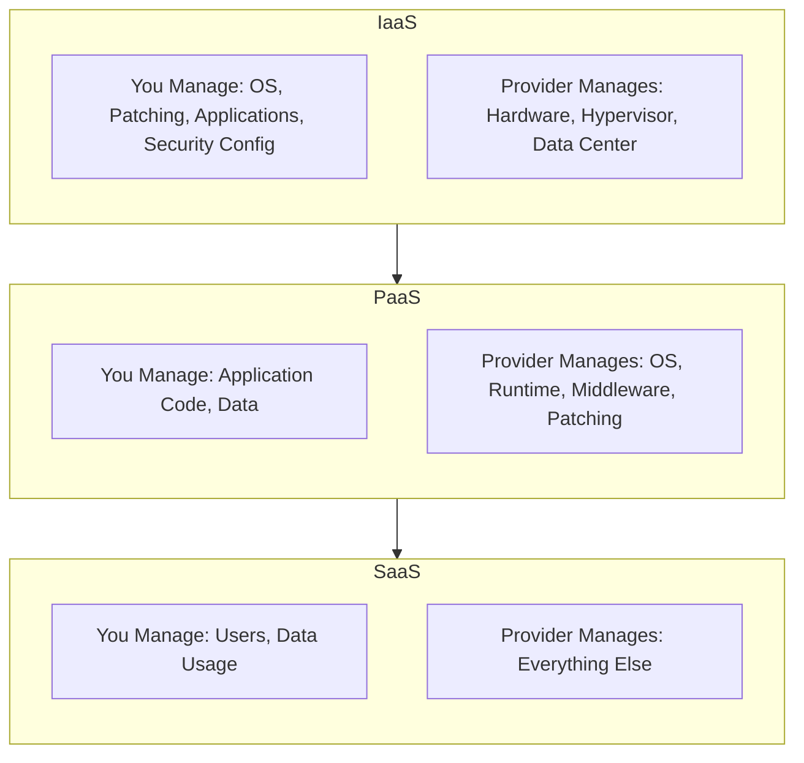
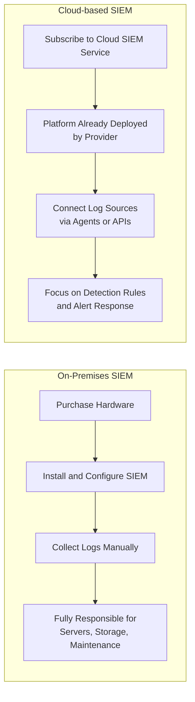

| Topic | Level | Reading Time | Prerequisites |
|---|---|---|---|
| Cloud Computing and Cloud-based Cybersecurity | Intermediate | ~20 min | Basic understanding of virtualization and the role of a hypervisor |

> **Goal of this section:**  
> You'll understand what Cloud Computing really is and how it's built on the Virtualization concept we studied earlier, you'll learn the difference between the three service models (IaaS, PaaS, SaaS), and you'll see a real practical example comparing a traditional deployment of a security tool like a SIEM with deploying it in the cloud.

## Learning Objectives

By the end of this section, you will be able to:

- Define **Cloud Computing** and explain how it relates to the virtualization concepts covered earlier.
- Distinguish between the three cloud service models: **IaaS**, **PaaS**, and **SaaS**.
- Explain, for each model, exactly what the customer manages versus what the provider manages.
- Compare an **on-premises SIEM deployment** with a **cloud-based SIEM deployment** in terms of responsibility and overhead.
- Explain how the division of responsibility shifts as you move from IaaS toward SaaS.

## Table of Contents

- [What Is Cloud Computing](#what-is-cloud-computing)
- [The Core Idea: Rent Exactly What You Need](#the-core-idea-rent-exactly-what-you-need)
- [Cloud Service Models: IaaS, PaaS, SaaS](#cloud-service-models-iaas-paas-saas)
- [IaaS: Infrastructure as a Service](#iaas-infrastructure-as-a-service)
- [PaaS: Platform as a Service](#paas-platform-as-a-service)
- [SaaS: Software as a Service](#saas-software-as-a-service)
- [The Responsibility Spectrum](#the-responsibility-spectrum)
- [Cloud-based Cybersecurity: The SIEM Example](#cloud-based-cybersecurity-the-siem-example)
  - [On-Premises SIEM Deployment](#on-premises-siem-deployment)
  - [Cloud-based SIEM Deployment](#cloud-based-siem-deployment)
  - [Division of Responsibility](#division-of-responsibility)
- [Service Models and Responsibility Diagram](#service-models-and-responsibility-diagram)
- [Career Connection](#career-connection)
- [Key Terms Glossary](#key-terms-glossary)
- [Summary](#summary)

## What Is Cloud Computing

**Cloud Computing** is the delivery of **computing resources** over the internet, including servers, storage, networks, databases, and software, available **on demand** and **at scale**, without the customer needing to physically own or manage the infrastructure behind them.

In practice: a cloud provider (such as **AWS**, **Microsoft Azure**, or **Google Cloud**) runs huge data centers full of physical servers. Instead of buying and maintaining your own hardware, you rent either raw computing resources (**bare-metal**-like access) or higher-level services built on top of that hardware.

> [!TIP]
> Remember the **Virtualization** topic we studied earlier? Cloud Computing is essentially a large-scale practical application of that same concept: the cloud provider uses hypervisors to divide its huge data centers into millions of VMs, then rents them out to customers.

## The Core Idea: Rent Exactly What You Need

> [!IMPORTANT]
> **The core idea**: you rent exactly what you need, and you can scale it up or down based on demand, instead of being locked into fixed physical infrastructure you bought up front.

## Cloud Service Models: IaaS, PaaS, SaaS

When you rent resources from a cloud provider, there are three main service models you need to understand, based on how much you manage yourself versus how much the provider manages for you.

## IaaS: Infrastructure as a Service

| Responsibility | Who Is Responsible |
|---|---|
| The operating system (installing, configuring, choosing the OS) | **You** |
| Patching (applying updates yourself) | **You** |
| Applications (installing and maintaining any software you run) | **You** |
| Security settings (firewalls, access controls, etc.) | **You** |
| The physical hardware | **The provider** |
| The Hypervisor (the Virtualization layer) | **The provider** |
| The physical data center (power, cooling, physical security) | **The provider** |

In short: the provider gives you a **raw virtual machine**, and everything from the operating system up becomes your responsibility. This gives you maximum flexibility and control, but it also requires the most technical administrative effort.

> [!NOTE]
> **Example**: renting a virtual server on **AWS EC2**.

## PaaS: Platform as a Service

| Responsibility | Who Is Responsible |
|---|---|
| The application code (what you build and deploy) | **You** |
| The data (your application's data) | **You** |
| The operating system | **The provider** |
| The **runtime environment** (the software actually required to execute your code) | **The provider** |
| The Middleware (software that connects different parts of the application) | **The provider** |
| Patching (keeping the underlying platform up to date) | **The provider** |

In short: you only focus on writing and deploying your application code, and the provider takes care of the entire **platform** the application runs on. This greatly reduces the administrative burden compared to IaaS, at the cost of less **low-level control**.

## SaaS: Software as a Service

| Responsibility | Who Is Responsible |
|---|---|
| The users (who has access to the software) | **You** |
| Data usage (the data you enter/generate inside the software) | **You** |
| Everything else: the application itself, the servers, the operating system, the platform, security, updates, and infrastructure | **The provider** |

**SaaS** is the most **hands-off** model for the customer: you simply use the finished software as a service, without worrying about anything running underneath it.

> [!NOTE]
> **Example**: **Microsoft 365** (Word, Excel, Outlook, etc., delivered as a cloud service).

> [!TIP]
> SaaS is usually the **most expensive model per user**, since you're paying for the convenience of the provider managing literally everything for you.

## The Responsibility Spectrum

These models sit on a **spectrum**: the more you move from **IaaS** toward **SaaS**, the more responsibility the provider takes on, and the less direct control you keep (but also the less administrative burden you carry).

| | More control, more management | | Less control, less management |
|---|---|---|---|
| | **IaaS** | **PaaS** | **SaaS** |

## Cloud-based Cybersecurity: The SIEM Example

We'll use a **SIEM (Security Information and Event Management)** solution as an example showing how cybersecurity tools differ between a traditional (**on-premises**) deployment and a cloud deployment.

### On-Premises SIEM Deployment

1. You buy the hardware needed to run the SIEM software yourself, or in some cases, the vendor ships you preconfigured bare-metal servers with the software already installed.
2. After setting up the physical servers, you start collecting logs from various sources across your network (firewalls, servers, endpoints, applications, etc.).
3. You're fully responsible for managing the servers, in addition to ongoing log collection, storage, and maintenance.

> [!NOTE]
> This model gives you full control over your data and infrastructure, but it comes with large up-front hardware costs and ongoing management responsibility (patching, scaling storage, ensuring uptime, etc.).

### Cloud-based SIEM Deployment

1. You simply subscribe to a cloud SIEM service offered by a particular provider; there's nothing for you to buy, install, or manage in terms of hardware.
2. The SIEM platform itself is already deployed and managed by the provider in its cloud environment.
3. You then configure **log ingestion** by connecting your various log sources, such as cloud services, endpoints, and network devices, using **agents** (small pieces of software installed on your systems) or **APIs** (direct programmatic connections).

### Division of Responsibility

| Responsibility | Who Is Responsible |
|---|---|
| The underlying infrastructure, system availability, and scaling the platform as log volume grows | **The cloud provider** |
| Configuring log sources correctly, building and tuning detection rules, and responding to the security alerts the system generates | **You** |

> [!IMPORTANT]
> This model significantly reduces up-front cost and administrative burden compared to an on-premises SIEM, which lets security teams focus more on analysis and response instead of maintaining infrastructure.

## Service Models and Responsibility Diagram

The following diagram shows how responsibility is distributed across the three service models:

And the following diagram shows the difference between deploying a SIEM tool traditionally and deploying it in the cloud:

## Career Connection

Understanding Cloud Computing and its models has direct applications across several career paths:

- In **Cloud Security**, understanding how responsibility is divided between IaaS, PaaS, and SaaS is essential for determining exactly who is responsible for securing what (a concept known as the **Shared Responsibility Model**).
- In the **SOC**, moving to tools like a cloud SIEM shifts the nature of daily work from maintaining infrastructure to a greater focus on alert analysis and response.
- In **GRC**, understanding what the provider manages and what the organization is responsible for is a core part of risk assessment and compliance in any cloud environment.

## Key Terms Glossary

| Term | Definition |
|---|---|
| **Cloud Computing** | The on-demand delivery of computing resources over the internet, without needing to own the physical infrastructure. |
| **IaaS (Infrastructure as a Service)** | A service model that provides raw infrastructure (a virtual server) and leaves the customer to manage everything from the operating system up. |
| **PaaS (Platform as a Service)** | A service model that provides a complete runtime platform, leaving the customer to focus only on the application code and its data. |
| **SaaS (Software as a Service)** | A service model that provides a ready-to-use application, with everything else managed by the provider. |
| **SIEM (Security Information and Event Management)** | A system that collects and analyzes security logs from multiple sources to detect threats. |
| **Log Ingestion** | The process of collecting and feeding log data from different sources into a central analysis system. |
| **Shared Responsibility Model** | A framework that defines how security responsibilities are divided between the cloud provider and the customer. |

## Summary

- **Cloud Computing** is the on-demand delivery of computing resources over the internet at scale, built fundamentally on the concept of **Virtualization**.
- The core idea: rent exactly what you need, and scale up or down based on demand.
- There are three service models: **IaaS** (more control and management; the provider manages only the hardware and the hypervisor), **PaaS** (the provider manages the entire platform; you only manage the code and data), and **SaaS** (the provider manages everything; you only manage users and data usage).
- The more you move from IaaS toward SaaS, the less direct control you have, but the less administrative burden you carry as well.
- The **SIEM** example shows the practical difference: an **on-premises** deployment requires buying and managing hardware and fully handling ongoing maintenance, while a **cloud-based** deployment makes the provider responsible for infrastructure and availability, and you focus on configuring log sources, tuning detection rules, and responding.

