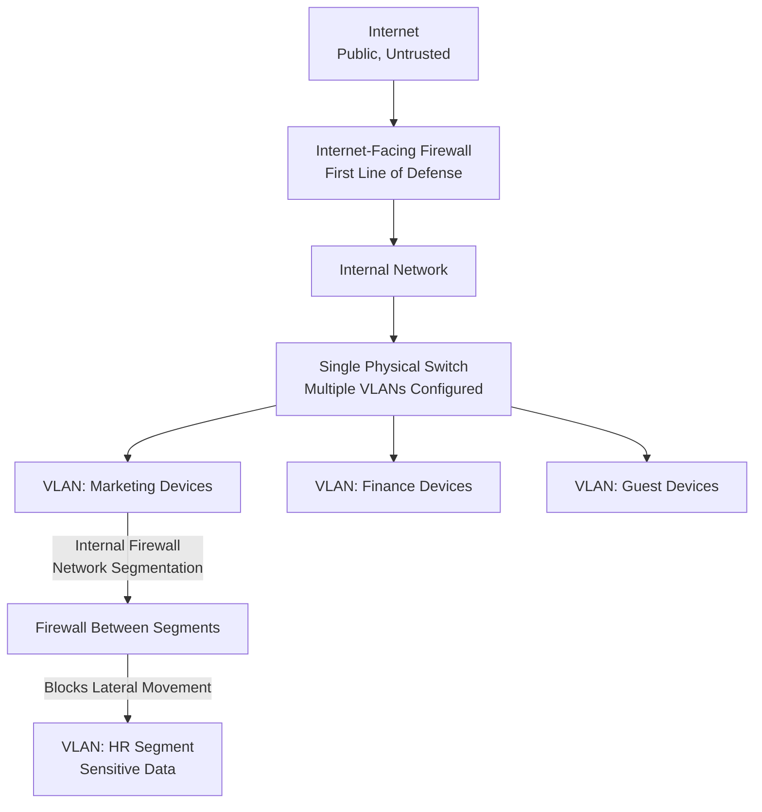

| Topic | Level | Reading Time | Prerequisites |
|---|---|---|---|
| Network Security Fundamentals: VLANs and Firewalls | Beginner | ~18 min | Basic understanding of networks, switches, and IP addressing |

> **Goal of this section:**
>   You'll understand how VLANs divide a single physical network into multiple logical networks, and how firewalls act as the network's security guard, not just at the internet edge, but also inside the organization itself through network segmentation.

# Network Security Fundamentals: VLANs and Firewalls

## Learning Objectives

By the end of this section, you will be able to:

- Define a **VLAN** and explain how it divides a physical network into logical networks.
- List the four main benefits VLANs provide: security, performance, organization, and flexibility.
- Define a **Firewall** and explain its role as a checkpoint between two network zones.
- Correct the common misconception that a firewall only exists at the internet edge.
- Explain **Network Segmentation** and how internal firewalls help prevent **Lateral Movement**.

## Table of Contents

- [VLANs: What Are They](#vlans-what-are-they)
- [Why Organizations Use VLANs](#why-organizations-use-vlans)
- [How Communication Works Across VLANs](#how-communication-works-across-vlans)
- [Firewalls: What Are They](#firewalls-what-are-they)
- [Where a Firewall Sits](#where-a-firewall-sits)
- [Common Misconception: Is There Only One Firewall](#common-misconception-is-there-only-one-firewall)
- [Internal Firewalls and Network Segmentation](#internal-firewalls-and-network-segmentation)
- [Preventing Lateral Movement](#preventing-lateral-movement)
- [Network Architecture Diagram](#network-architecture-diagram)
- [Career Connection](#career-connection)
- [Key Terms Glossary](#key-terms-glossary)
- [Summary](#summary)

## VLANs: What Are They

A **VLAN (Virtual Local Area Network)** is a way of dividing a single physical network into multiple **logical networks**.

The core idea is that devices in different VLANs behave as if they were connected to completely separate **switches**, even if they actually all share the same single physical switch.

> [!NOTE]
> The word "Virtual" here means that the separation between the networks happens at the **logical** level only, not at the level of the cables or the physical devices.

## Why Organizations Use VLANs

Organizations use VLANs to provide four core benefits:

| Benefit | Description |
|---|---|
| **Security** | Keeping sensitive devices separate; for example, finance department devices can't communicate directly with guest devices |
| **Performance** | Reducing unnecessary traffic by limiting the size of broadcast domains |
| **Organization** | Grouping devices by department, function, or location, instead of relying on physical cabling |
| **Flexibility** | Moving devices without needing to change any cabling in the network |

> [!TIP]
> Think of a VLAN like dividing a large building with one open floor into separate rooms using virtual partitions. Even though the floor and ceiling (the physical structure) are shared, the people in each room behave as if they were in a completely separate space.

## How Communication Works Across VLANs

Devices in the **same VLAN** communicate with each other as if they were on the same LAN, completely normally and simply.

Devices in **different VLANs**, however, remain **isolated** from each other, unless **routing** between them is explicitly and deliberately configured.

> [!IMPORTANT]
> This isolation isn't a flaw or a limitation; it's exactly the core security goal of using VLANs in the first place: preventing unwanted communication between different groups of devices, unless the administrators have explicitly decided to allow it through routing.

## Firewalls: What Are They

A **Firewall** is essentially a security guard standing at the door of your network. Every piece of traffic, whether incoming or outgoing data, has to pass this guard first.

The guard checks: "Are you allowed in? Are you allowed out?" If the answer is yes, the traffic passes. If the answer is no, it's blocked.

## Where a Firewall Sits

A firewall always sits between two **zones**, and the most common place to find one is between your internal network (private) and the internet (public, untrusted).

> [!TIP]
> Think of the firewall like the wall between your house and the street.

## Common Misconception: Is There Only One Firewall

There's a very common misconception we need to correct: most people believe there's **only one firewall** in the company, the big one facing the internet.

This belief is **wrong**, and it's very important to clear it up.

It's true that the internet-facing firewall is the biggest and most important one, because it's the first line of defense against the entire outside world. But it's **not the only one**.

## Internal Firewalls and Network Segmentation

The part people often forget: firewalls are also used **inside** the organization itself to separate different parts of the network from each other. This process is called **Network Segmentation**.

### A Practical Example

Imagine your company has a **Marketing** team and an **HR** team. The HR department handles highly sensitive data, such as salaries, employees' personal data, and medical information. The Marketing department handles social media posts and advertising campaigns.

You don't want someone on the Marketing network to be able to casually browse the HR servers, right?

That's why you put a **Firewall** between the Marketing network segment and the HR network segment.

> [!IMPORTANT]
> Now, even if a hacker compromises a laptop belonging to the Marketing department, they'll hit a wall (literally) when they try to **move sideways** into the HR network.

## Preventing Lateral Movement

This process is called **Lateral Movement Prevention**, and it's a very big topic in cybersecurity, because attackers often get in through a single weak point and then try to move around internally in the network to reach more valuable targets.

> [!WARNING]
> A single weak point of compromise (such as an employee's laptop in a non-sensitive department) can become a very dangerous launching point for the attacker if the network as a whole isn't properly **segmented**. Segmentation turns a breach from a "total disaster" into an "incident contained to a single zone."

As a **SOC** analyst, understanding this topic in depth is very important, because a large share of the **alerts** and investigations you'll work on will involve **firewall logs**.

## Network Architecture Diagram

The following diagram shows how VLANs and firewalls work together to isolate different departments within the same organization, in addition to the internet-facing firewall:

## Career Connection

Understanding VLANs and firewalls connects directly to several career paths:

- In **SOC**, analyzing firewall logs is a core part of daily monitoring and of detecting lateral movement attempts.
- In **Network Security Engineering**, designing the VLAN and segmentation architecture is a core part of the secure design of any organization's network.
- In **Pentesting**, testing how effective segmentation is by attempting lateral movement between networks is a core part of assessing internal network security.
- In **GRC**, ensuring there are clear policies for isolating sensitive systems (such as HR and finance) is part of the compliance requirements of several security standards.

## Key Terms Glossary

| Term | Definition |
|---|---|
| **VLAN (Virtual Local Area Network)** | A logical division of a single physical network into multiple networks that behave separately. |
| **Broadcast Domain** | The group of devices that receive broadcast messages sent from any device within the same domain. |
| **Firewall** | A security system that controls incoming and outgoing traffic between two network zones based on defined rules. |
| **Network Segmentation** | Dividing the internal network into separate segments to restrict unnecessary communication between them. |
| **Lateral Movement** | An attacker's movement inside the network after an initial point of compromise, in search of higher-value targets or privileges. |
| **Internet-Facing Firewall** | The firewall that directly faces the internet; it's considered the first line of defense against the outside world. |
| **Internal Firewall** | A firewall used inside the organization itself to separate different network segments. |

## Summary

- A **VLAN** divides a single physical network into multiple logical networks, so that devices in different VLANs behave as if they were on completely separate switches.
- VLANs provide four core benefits: **Security**, **Performance**, **Organization**, and **Flexibility**.
- Devices in the same VLAN communicate normally, while devices in different VLANs remain isolated unless routing is explicitly configured.
- A **Firewall** is a security guard that controls all incoming and outgoing traffic between two network zones, and its most common location is between the internal network and the internet.
- A common misconception is that there's only one firewall in the company, but in reality **Internal Firewalls** are also used inside the organization itself through **Network Segmentation**.
- Dividing the internal network into segments (such as separating Marketing from HR) helps prevent **Lateral Movement**, so that compromising one device doesn't lead to compromising the entire network.
- As a **SOC** analyst, understanding firewall logs and how segmentation works is a core part of alert analysis and investigations.

