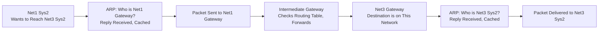
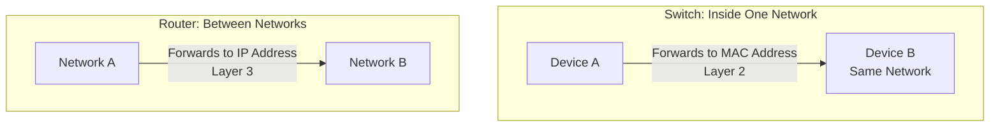

| Topic | Level | Reading Time | Prerequisites |
|---|---|---|---|
| Networking: LAN, WAN, Routers, Switches, and ARP | Beginner | ~28 min | Basic understanding of IP addresses and MAC addresses |

> **Goal of this section:**
> You will understand the difference between a LAN and a WAN and the fundamental difference between a router and a switch. You will trace the complete journey of a real data packet across multiple networks until it reaches its destination, and understand in detail how the ARP protocol lets that packet find its way to a device it has never met before.


## Learning Objectives

By the end of this section, you will be able to:

- Distinguish between **LAN (Local Area Network)** and **WAN (Wide Area Network)**, and explain the role of subnets.
- Compare a **Switch** and a **Router** in terms of what they forward to, what they connect, and which layer they operate at.
- Trace the complete journey of a single packet across multiple networks, hop by hop.
- Define **ARP (Address Resolution Protocol)** and explain how it maps an IP address to a MAC address.
- Read a real ARP request/reply exchange at the packet level.
- Explain why ARP has no built-in authentication, and how to inspect your own ARP cache.

## Table of Contents

- [LAN and WAN](#lan-and-wan)
- [Routers vs. Switches](#routers-vs-switches)
- [The Journey of One Packet](#the-journey-of-one-packet)
- [ARP: The Address Resolution Protocol](#arp-the-address-resolution-protocol)
- [Hop 1: Getting Out of Net1](#hop-1-getting-out-of-net1)
- [The Middle Hops: The Same Question, Again](#the-middle-hops-the-same-question-again)
- [Final Hop: Arriving at Net3](#final-hop-arriving-at-net3)
- [What ARP Actually Looks Like on the Wire](#what-arp-actually-looks-like-on-the-wire)
- [Exercise: Look Inside Your Own ARP Cache](#exercise-look-inside-your-own-arp-cache)
- [Packet Journey Diagram](#packet-journey-diagram)
- [Career Connection](#career-connection)
- [Key Terms Glossary](#key-terms-glossary)
- [Summary](#summary)


## LAN and WAN

**LAN — Local Area Network**

A single location: an office, a floor, a building.

A LAN can be built from several smaller networks connected together, which makes it more efficient and much easier to manage. These smaller pieces are called **subnets**; multiple subnets connect together to form the LAN.

> [!NOTE]
> Almost everything in this course happens inside a LAN.

**WAN — Wide Area Network**

Many locations: a city, a country, a continent.

A WAN covers a wide geographic area. A company usually uses it to connect its LANs in different locations, such as the Cairo office connecting to the Dubai office, or both of them connecting to a specific cloud region.

> [!IMPORTANT]
> **The Internet is the largest WAN in existence.**
>
> Subnets exist for two reasons: **performance** and **containment**.

## Routers vs. Switches

| Criterion | **Switch** | **Router** |
|---|---|---|
| **Scope** | Within a single network | Between different networks |
| **Forwards to** | A hardware address (**MAC address**) | The destination IP address |
| **Connects** | Computers, servers, and printers to each other | Switches, and therefore entire networks, to each other |
| **Operates at** | **Layer 2** — the **data link layer** | **Layer 3** — the **network layer** |
| **Understands** | MAC addresses | IP addresses |

> [!TIP]
> Same wire, but two different questions: "Which device here?" (the switch) versus "Which network next?" (the router).

## The Journey of One Packet

**The scenario**: **Net1 Sys2** wants to send data to **Net3 Sys2**, a device on a completely different network, with three **gateways** between them.

The network layout:

- **Net1**: contains Sys1, Sys2, and Sys3, connected to a switch, followed by the Net1 Gateway.
- **Intermediate**: an intermediate gateway between the two networks.
- **Net3**: contains the Net3 Gateway, connected to a switch, followed by Sys1, Sys2, and Sys3.

> [!IMPORTANT]
> The **packet** knows the destination IP address. **It doesn't know a single MAC address along the way.**
>
> Each **hop** has to be **resolved** on its own, and that is exactly what the **ARP** protocol does.

## ARP: The Address Resolution Protocol

What exactly does **ARP** do: **"It maps an IP address to a MAC address on the local network."**

**The Link**: between Layer 3 and Layer 2

Data is addressed to an IP address, but it is physically sent to a MAC address. ARP is the translation between these two worlds.

**The Method**: ask everyone, once

The sender **broadcasts a question** to the entire local network. Every device hears it, but only the owner of that IP replies.

**The Memory**: the ARP Cache

The answer is stored in memory for a certain period of time, so the question doesn't need to be asked again for every packet.

> [!WARNING]
> **Nothing in ARP verifies the answer. Any device can reply, and it will be believed.**

## Hop 1: Getting Out of Net1

The steps that happen when **Net1 Sys2** starts its journey:

1. **Is the destination on this network?** → No. So use the Net1 Gateway.
2. **"Who is the Net1 Gateway?"** (broadcast to everyone on Net1).
3. The gateway replies: "I'm the Net1 Gateway, here's my MAC."
4. Remember this answer for a while: store it in the ARP cache.
5. Send the packet to the Net1 Gateway's MAC address.

## The Middle Hops: The Same Question, Again

At **every gateway**, the same question is asked: "Do I know where this destination is?" If not, forward to the next gateway, and ARP for the MAC address of the next hop.

**The Routing Decision**: each gateway decides where to send the packet based on its configuration, its **routing table**. If it doesn't know the destination, it uses a **default route**.

> [!NOTE]
> **This repetition isn't a mistake.**
>
> It's a highly repetitive process (question, answer, remember, forward) that happens at close to the speed of light, at each hop separately.
>
> **The packet never takes the whole path at once; it only learns the next step.**

## Final Hop: Arriving at Net3

1. **Can I reach Net3 Sys2 directly?** → Yes, it's on this network.
2. **"Who is Net3 Sys2?"** (broadcast on Net3).
3. The server replies: "I'm Net3 Sys2."
4. Remember the answer for a while.
5. Send the packet to Net3 Sys2. **Delivered.**

## What ARP Actually Looks Like on the Wire

The following shows what the real ARP packets being exchanged look like, a very small amount of data:

**Address Resolution Protocol (Request)**

| Field | Value |
|---|---|
| Opcode | request (0x0001) |
| Sender MAC | 00:50:da:ca:0f:33 |
| Sender IP | 10.64.0.164 |
| Target MAC | ff:ff:ff:ff:ff:ff |
| Target IP | 10.64.0.1 |

**Meaning**: "Who has 10.64.0.1? Tell 00:50:da:ca:0f:33." The Target MAC is all Fs, and that is exactly the question being asked.

**Address Resolution Protocol (Reply)**

| Field | Value |
|---|---|
| Opcode | reply (0x0002) |
| Sender MAC | 00:80:3e:4b:3e:ce |
| Sender IP | 10.64.0.1 |
| Target MAC | 00:50:da:ca:0f:33 |
| Target IP | 10.64.0.164 |

**Meaning**: "10.64.0.1 is at 00:80:3e:4b:3e:ce." This answer goes straight into the ARP cache of the device that asked for it.

> [!WARNING]
> **Just two packets, with no authentication of any kind. That's the entire protocol.**

## Exercise: Look Inside Your Own ARP Cache

**The task**: Search online for "how to see my ARP cache," and then run the command on your own machine.

```
> arp -a

Interface: 10.64.0.164 --- 0x5
  Internet Address    Physical Address    Type
  10.64.0.1           00-80-3e-4b-3e-ce   dynamic
  10.64.0.7           00-1c-42-9a-11-04   dynamic
  10.64.0.255         ff-ff-ff-ff-ff-ff   static
```

**Then answer**:

- Which entry is your gateway, and how did you know?
- Why are some entries "dynamic" and one "static"?

> [!TIP]
> Think about the difference like this: the **dynamic** entries were learned from real ARP requests/replies and expire after a while, while the **static** entry (such as the broadcast address `ff-ff-ff-ff-ff-ff`) is fixed and predefined, so it doesn't need ARP to resolve it at all.

## Packet Journey Diagram

The following diagram summarizes the packet's complete journey from Net1 Sys2 to Net3 Sys2, including the ARP operations that happen at each hop:



The following diagram shows the difference between the switch path (inside one network) and the router path (between networks):



## Career Connection

Understanding LAN, WAN, and ARP has direct applications in several career paths:

- In the **SOC**, analyzing abnormal ARP traffic is essential for detecting attacks such as **ARP Poisoning**, which we studied in detail earlier.
- In **Network Engineering**, understanding the precise difference between the role of the router (Layer 3) and the switch (Layer 2) is the foundation of designing any network infrastructure.
- In **Digital Forensics**, examining the ARP cache on a specific machine can reveal devices that recently communicated with it, which is useful in investigations.
- In **Pentesting**, exploiting the lack of authentication in ARP is the basis of techniques such as Man-in-the-Middle inside the local network.

## Key Terms Glossary

| Term | Definition |
|---|---|
| **LAN (Local Area Network)** | A local network covering a single location, such as an office or a building. |
| **WAN (Wide Area Network)** | A network covering a wide geographic area, connecting multiple locations. |
| **Subnet** | A smaller piece of the network used to improve performance and containment. |
| **Switch** | A device that forwards traffic within a single network based on the MAC address. |
| **Router** | A device that forwards traffic between different networks based on the IP address. |
| **Gateway** | The exit point from a specific network toward another network. |
| **Routing Table** | A table the router uses to decide where to forward traffic. |
| **ARP (Address Resolution Protocol)** | A protocol that maps an IP address to a MAC address on the local network. |
| **ARP Cache** | Temporary memory that stores previous ARP answers to avoid asking the question again. |

## Summary

- A **LAN** covers a single location and can be made up of several **subnets**, while a **WAN** covers wide geographic areas, and the Internet is the largest WAN in existence.
- A **Switch** forwards to a MAC address within a single network (Layer 2), while a **Router** forwards to an IP address between different networks (Layer 3).
- The packet only knows the final destination's IP address; it doesn't know any MAC address along the way, so each hop has to be resolved on its own.
- **ARP** maps an IP address to a MAC address by broadcasting a question to the entire local network, and the answer is cached temporarily in the **ARP Cache**.
- At every hop along the packet's journey, the same process repeats: Is the destination here? If not, forward to the next gateway and ARP for its address.
- The ARP protocol **has no built-in authentication**: any device can answer an ARP question and it will be believed, and this is the foundation that attacks such as ARP Poisoning exploit.
- You can inspect your own ARP cache using the `arp -a` command.

