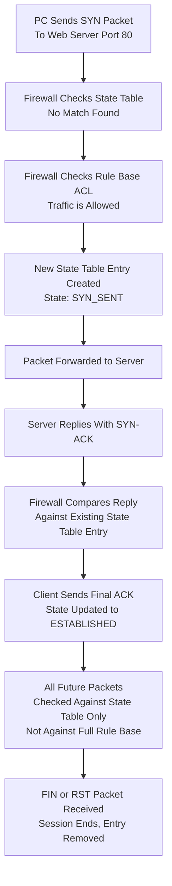

| Topic | Level | Reading Time | Prerequisites |
|---|---|---|---|
| Stateless vs. Stateful Firewalls | Intermediate | ~25 min | Basic understanding of firewalls, firewall rules, and the TCP 3-Way Handshake |

> **Goal of this section:**  
>  You'll understand the fundamental difference between a firewall that has no memory (**Stateless**) and one that tracks sessions in full (**Stateful**), and we'll walk step by step through a complete real-world example showing how a Stateful firewall manages the state table from the first SYN until the connection ends.

## Learning Objectives

By the end of this section, you will be able to:

- Define a **Stateless Firewall** and explain why it treats every packet as a stranger.
- Explain what a **Stateful Firewall** is and how it uses a **State Table** to track entire sessions.
- Trace how a state table entry evolves through the stages of a TCP connection: `SYN_SENT → ESTABLISHED`.
- Explain the specific security benefit stateful firewalls provide that stateless firewalls miss.
- Walk through a complete real-world connection step by step, from the initial SYN packet to the shortcut used for all subsequent packets.

## Table of Contents

- [Stateless Firewalls: The Basics](#stateless-firewalls-the-basics)
- [The Key Concept: No Memory](#the-key-concept-no-memory)
- [What a Stateless Firewall Can Actually Check](#what-a-stateless-firewall-can-actually-check)
- [The ACL: Naming the Rule List](#the-acl-naming-the-rule-list)
- [The Limitation of Stateless Firewalls](#the-limitation-of-stateless-firewalls)
- [Stateful Firewalls: Introducing Memory](#stateful-firewalls-introducing-memory)
- [The State Table: How the Firewall Remembers](#the-state-table-how-the-firewall-remembers)
- [Watching the Conversation Evolve](#watching-the-conversation-evolve)
- [Why This Matters: The Security Benefit](#why-this-matters-the-security-benefit)
- [Stateless vs. Stateful: In Short](#stateless-vs-stateful-in-short)
- [Cleaning Up the State Table](#cleaning-up-the-state-table)
- [Full Step-by-Step Walkthrough](#full-step-by-step-walkthrough)
  - [The Request Begins](#the-request-begins)
  - [Checking the State Table First](#checking-the-state-table-first)
  - [Creating the Session](#creating-the-session)
  - [Completing the Handshake](#completing-the-handshake)
  - [The Big Shortcut](#the-big-shortcut)
- [Connection Lifecycle Diagram](#connection-lifecycle-diagram)
- [Career Connection](#career-connection)
- [Key Terms Glossary](#key-terms-glossary)
- [Summary](#16-summary)

## Stateless Firewalls: The Basics

A **Stateless Firewall** is the simplest type of firewall there is, with no extra bells and whistles (**no-frills**). It's so simple that even an ordinary **router** can act as a firewall if it's configured with filtering rules.

## The Key Concept: No Memory

The core concept here is the **absence of memory (no memory)**.

The word **Stateless** literally means "without state," meaning this firewall has no memory of any previous traffic.

Every packet that arrives is judged completely independently, as if it were the first packet the firewall had ever seen, even if it's actually packet number 500 in an ongoing conversation between two machines.

> [!NOTE]
> Imagine a security guard with **amnesia** who forgets everything that happened every 5 seconds. Someone walks in wearing a visitor badge; the guard checks the badge and lets them in. That person walks out and comes back two seconds later, and the guard checks the badge all over again, because he doesn't remember seeing them before. No memory, no context, no "wait, I already let this person in, and they just went back to their car."

## What a Stateless Firewall Can Actually Check

A Stateless firewall only looks at the **Layer 3 (IP layer)** and **Layer 4 (Transport layer)** headers.

That includes: the source IP address, the destination IP address, the source port, the destination port, and the protocol. It's essentially the same filtering capability we covered earlier under the name **Shallow Inspection**.

## The ACL: Naming the Rule List

The list of rules used for this filtering has a name: **ACL — Access Control List**.

The term is very common, especially with routers (Cisco routers, for example, use ACLs extensively).

> [!IMPORTANT]
> Stateless firewalls are fast and simple, but they treat every packet as a stranger, even packets that are clearly part of a conversation that was already allowed a few seconds ago. That's exactly the limitation Stateful firewalls were built to solve.

## The Limitation of Stateless Firewalls

Since every packet is judged on its own, a Stateless firewall can't tell whether a packet is actually part of a legitimate, previously approved conversation or random traffic unrelated to anything.

## Stateful Firewalls: Introducing Memory

Unlike the amnesiac guard we described for the Stateless firewall, a **Stateful** firewall actually **remembers**.

It has all the same basic capabilities as a Stateless firewall (checking IP, port, protocol), plus something much smarter: it tracks **entire sessions**, not just isolated individual packets.

> [!IMPORTANT]
> That's exactly why Stateful firewalls are **the most common type** used in real organizations today.

## The State Table: How the Firewall Remembers

How does the firewall remember? Through something called the **State Table**.

Think of it as a **logbook** or a guest list that tracks every active conversation passing through the firewall in real time.

**Example**: when the client wants to start a connection, it first sends a **SYN packet** (the first step of the TCP handshake, basically saying "Hi, I want to talk to you"). The moment the firewall sees that SYN packet, it creates a new **entry** in the state table to start tracking that specific conversation:

| Src IP | Src Port | Dst IP | Dst Port | State |
|---|---|---|---|---|
| 1.1.1.1 | 54236 | 2.2.2.2 | 80 | SYN_SENT |

## Watching the Conversation Evolve

The state table isn't static; it's updated as the conversation progresses.

Here's what happens next: when the server replies with a **SYN-ACK packet** (the second step of the handshake), the firewall updates that same entry to reflect that the connection is progressing. Once the client sends the final **ACK** and the TCP 3-way handshake is complete, the firewall changes the connection's state to **ESTABLISHED**.

Now the firewall knows this traffic matches a TCP connection that successfully completed its normal 3-way handshake.

## Why This Matters: The Security Benefit

This tracking ability lets Stateful firewalls notice something Stateless firewalls miss entirely: **unsolicited packets with no matching session**.

**Example**: imagine your network suddenly receives a random **ACK packet** out of nowhere, with no prior SYN, no prior SYN-ACK, nothing. That could be an attacker trying to sneak traffic through, scan your network, or exploit something.

| Firewall Type | Reaction to the Random ACK |
|---|---|
| **Stateless Firewall** | It checks the header: the IP looks fine, the port looks fine, the protocol looks fine, so it lets it through. It has no idea this packet doesn't belong to any real ongoing conversation. |
| **Stateful Firewall** | It checks its state table first, finds no active session matching this ACK packet, immediately realizes something is wrong, and rejects it (**drops it**). |

> [!IMPORTANT]
> Attackers often send odd or out-of-sequence packets to probe networks or bypass simple filters. Stateful firewalls notice this because they know the difference between part of a real conversation and a random packet pretending to belong to one.

## Stateless vs. Stateful: In Short

| Criterion | Stateless Firewall | Stateful Firewall |
|---|---|---|
| Core behavior | Inspects every packet independently, without any memory | Tracks the full state of the connection and decides based on the whole session |
| Decision based on | The single packet on its own | The entire session |
| Detecting random packets | Can't distinguish them from legitimate traffic | Detects them immediately because there's no matching session |

## Cleaning Up the State Table

An important extra detail: Stateful firewalls also clean up after themselves.

When the firewall sees a **FIN packet** (normal and polite, meaning "I'm done talking, bye") or an **RST packet** (an abrupt reset; the connection was ended sharply), it understands the session is over and removes that entry from the state table.

This keeps the table clean and prevents it from filling up with dead, finished conversations.

## Full Step-by-Step Walkthrough

We'll trace a complete real connection from start to finish, step by step, and show exactly what the firewall does at each stage. This is exactly the kind of scenario you need to be able to picture in your head as a **SOC Analyst**.

### The Request Begins

**Step 1: The request begins**

A PC wants to visit a website, so it sends a **TCP SYN packet** addressed to port 80 (web traffic) on an external web server.

**Step 2: The firewall checks direction and intent**

The firewall looks at this packet and understands: "OK, this traffic is going from **inside** our network **out** to the internet on port 80; it's a normal web browsing attempt."

### Checking the State Table First

**Step 3: Checking the state table first**

Before doing anything else, the firewall checks its state table: "Do I already have an active session matching this?" Since this is a brand-new connection, the answer is "no match found"; nothing exists yet for this specific PC-to-server conversation.

**Step 4: Falling back to the actual rule base**

Since there's no existing session, the firewall now checks its regular rule base (the ACL) to see: "Is this internal PC even allowed to reach the internet on port 80?" It finds a matching rule that says "Yes, this type of traffic is allowed."

### Creating the Session

**Step 5: Creating the session**

Now the firewall takes the details from that SYN packet (source IP, source port, destination IP, destination port) and creates a brand-new entry in the state table. The packet is then **forwarded** to the actual web server.

> [!IMPORTANT]
> Notice the order of operations: the state table is checked **first**, and only if there's no match is the full rule base checked **after that**. This is very important for performance, because checking the state table is much faster than evaluating an entire rule list every time.

### Completing the Handshake

**Step 6: The server replies**

The web server replies with a **SYN-ACK packet** addressed back to the original PC.

**Step 7: The firewall inspects the reply**

When that SYN-ACK packet reaches the firewall, it **doesn't just** check the rule base again. Instead, it compares the details of this packet with the existing entry it created in the state table. It checks things like: Is this reply coming from the correct IP it was expecting? Is the port number correct? Does it match the session it's tracking?

**Step 8: Match confirmed, the table is updated**

If everything matches correctly, the firewall updates that state table entry once the connection is established and the client replies with an ACK (changing its state, as we saw earlier, to **ESTABLISHED**).

### The Big Shortcut

**Step 9: The big shortcut, the heart of the whole topic**

From now on, **all future packets** between this PC and this server **won't be checked against the firewall rules (ACL) at all**. Instead, the firewall just quickly checks them against the state table entry, which is much faster.

> [!IMPORTANT]
> **The most important sentence in this whole section**: in a Stateful firewall, only **the first packet** of a connection is fully evaluated against the rule base. Every packet after that relies on the state table entry instead. That's exactly what makes Stateful firewalls much smarter **and more efficient** than re-checking every individual packet against a long list of rules every time.

## Connection Lifecycle Diagram

The following diagram shows the complete lifecycle of a connection through a Stateful firewall in detail:

## Career Connection

Understanding the difference between Stateless and Stateful firewalls has direct applications across several career paths:

- In the **SOC**, picturing the complete connection lifecycle (like the diagram above) helps you understand why certain alerts fire, especially when a random packet is blocked because there's no matching session.
- In **Network Security Engineering**, choosing the right type of firewall (usually Stateful for modern organizations) is a core part of designing a secure network architecture.
- In **Pentesting**, understanding how Stateful firewalls check the state table helps in designing tests that try to uncover weaknesses in how that table itself is configured.

## Key Terms Glossary

| Term | Definition |
|---|---|
| **Stateless Firewall** | A simple firewall that inspects each packet completely independently, without any memory of previous traffic. |
| **ACL (Access Control List)** | The list of rules used to filter traffic in stateless firewalls and routers. |
| **Stateful Firewall** | A firewall that tracks the full state of a connection across entire sessions, not just isolated individual packets. |
| **State Table** | A table that records every active session the firewall is managing in real time. |
| **SYN_SENT** | A state in the state table indicating that a SYN packet was sent and a new connection attempt has started. |
| **ESTABLISHED** | A state in the state table indicating that the 3-way handshake completed successfully. |
| **FIN Packet** | A packet indicating the normal, polite termination of a TCP connection. |
| **RST Packet** | A packet indicating an abrupt, sharp termination of a TCP connection. |

## Summary

- A **Stateless Firewall** inspects every packet completely independently, without any memory of previous traffic, and relies only on inspecting the headers (IP, port, protocol), as defined by a rule list called an **ACL**.
- A **Stateful Firewall** tracks entire sessions through a **State Table**, starting with the `SYN_SENT` state and moving to `ESTABLISHED` once the 3-way handshake is complete.
- The main security advantage of a Stateful firewall is that it can detect and reject random packets (such as an ACK with no prior SYN) that have no matching session, something a Stateless firewall can't do.
- A Stateful firewall also cleans up after itself, removing state table entries when it sees a **FIN** or **RST** packet signaling the end of the session.
- In a real connection, the firewall checks the state table **first**, and only if there's no match does it fall back to the full rule base (**ACL**).
- **The real heart of the topic**: only the first packet of any connection is fully evaluated against the rule base, and every packet after that relies on the state table entry instead, which is what makes Stateful firewalls both smarter and more efficient.

