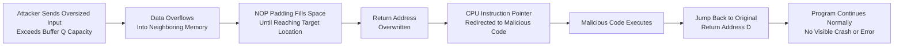
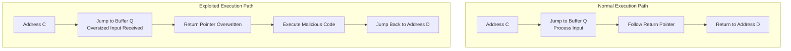

| Topic | Level | Reading Time | Prerequisites |
|---|---|---|---|
| Buffer Overflow Attacks | Intermediate | ~25 min | Basic understanding of memory, variables, and how programs execute instructions |

> **Goal of this section:**
>  You will understand what a buffer is, how it can overflow, and how an attacker can exploit this problem to divert the program's execution flow and run malicious code without anyone noticing.


## Learning Objectives

By the end of this section, you will be able to:

- Define a **Buffer** and explain why its fixed size creates a security concern.
- Explain what a **Buffer Overflow** is using a real-world analogy.
- Explain why **C** and **C++** are especially vulnerable to buffer overflows compared to languages like Python or Java.
- Trace the normal execution flow of a program, including the role of the **return pointer**.
- Explain step by step how an attacker hijacks the **return address** to redirect the **instruction pointer** and execute malicious code.
- Explain why buffer overflow exploits are dangerous specifically because they hide inside trusted software.

## Table of Contents

- [What Is a Buffer](#what-is-a-buffer)
- [What Is a Buffer Overflow](#what-is-a-buffer-overflow)
- [Why C and C++ Are Especially Vulnerable](#why-c-and-c-are-especially-vulnerable)
- [Normal Program Execution: The Baseline](#normal-program-execution-the-baseline)
- [Normal Execution Flow: Step by Step](#normal-execution-flow-step-by-step)
- [The Attack Begins: Exploiting Buffer Q](#the-attack-begins-exploiting-buffer-q)
- [Hijacking the Return Address](#hijacking-the-return-address)
- [Why This Is So Dangerous: The Trust Problem](#why-this-is-so-dangerous-the-trust-problem)
- [The Key Question: Why Bother Overwriting the Return Address](#the-key-question-why-bother-overwriting-the-return-address)
- [Attack Flow Diagram](#attack-flow-diagram)
- [Mitigations and Defenses](#mitigations-and-defenses)
- [Career Connection](#career-connection)
- [Key Terms Glossary](#key-terms-glossary)
- [Summary](#summary)

## What Is a Buffer

A **Buffer** is an **area of memory** that a program uses to store data.

Programs use buffers constantly, because data often needs to be stored temporarily before it is processed. A simple example: when you type your name into a form on a website, the program may store those characters in a buffer before processing and sending them.

The core problem is that a buffer has a **fixed size**, and this creates a very important security concern: the program must make sure that the amount of data written into the buffer does not exceed the size allocated to it. If the program writes more data than that, the extra data can be written into other memory locations that belong to other data or program components.

This situation is called a **Buffer Overflow**, and it can cause:

- Program **crashes**.
- **Corrupted data**.
- **Unexpected behavior** in the program.
- In some cases, serious **security vulnerabilities**.

> [!IMPORTANT]
> The key idea is that a buffer is a temporary memory area with a fixed size, and the program must guarantee that it never stores more data than the buffer was designed for.

## What Is a Buffer Overflow

A **Buffer Overflow** happens when a program tries to cram more data into a buffer than it was designed to hold.

Imagine this: a **parking lot** with only 10 spaces, but 15 cars show up and the attendant doesn't stop them. The 5 extra cars don't disappear; they **spill over** onto the road, the sidewalk, or even a neighboring lot where cars aren't supposed to park.

Translating this example into memory terms:

- The 5 extra cars = **extra bytes of data**.
- The road and the sidewalk = **neighboring memory addresses** that belong to something else, which could be another variable or even **critical control data**.

> [!WARNING]
> The real danger is that this neighboring memory can control **how the program behaves next**, not just store random data. This is what makes a Buffer Overflow a real security risk rather than just an ordinary bug.

Buffer Overflow is not limited to one type of software. It can happen in operating systems, mobile apps, web servers, IoT devices, and practically anything written in a programming language that is prone to it. There are thousands of known Buffer Overflow vulnerabilities that attackers are actively exploiting today.

## Why C and C++ Are Especially Vulnerable

The **C** and **C++** languages are like giving someone the keys to a **warehouse** without any security guard. You are trusted to take only what you need, and nobody checks that you haven't gone over the allowed limit.

These two languages **don't perform automatic bounds checking** when you write data into a buffer, meaning there is no automatic check to make sure the written data won't exceed the buffer's boundaries.

Compare this with languages like **Python** or **Java**, which act like a strict warehouse manager: if you try to put more items on a shelf than it can hold, the manager stops you immediately with an error message.

A practical example:

```c
char buffer[10];  // This buffer can safely hold 10 bytes
```

If your code tries to write 50 bytes into it, C and C++ won't stop you or warn you. The program will simply let the extra 40 bytes overwrite whatever is in the memory right after it.

> [!NOTE]
> This is a clear trade-off: C and C++ give the programmer direct control over memory, which is excellent for speed and performance (as in operating systems), but that power comes with the responsibility for the programmer to manually make sure that inputs never exceed the buffer's boundaries.

## Normal Program Execution: The Baseline

Imagine a program's memory as a long street full of houses. Each house (memory address) has a unique address: A, B, C, D, E... (In real systems these are long hex addresses like `0x7ffee23a`, but we'll simplify them to letters.)

Each house (memory address) stores one of these two things:

- A program **instruction** to be executed.
- **Data**, such as something the user typed.

Every time the program receives **input** from the user, such as a name, a password, or a file, that data is also placed in one of these memory addresses.

> [!IMPORTANT]
> This is exactly why **input handling** is so critical: user data and program instructions live in the same "neighborhood" (the memory space). If you don't control what the user puts in, they could theoretically interfere with the instructions next to it.

## Normal Execution Flow: Step by Step

Picture the left side of our "memory street": the instructions run in order, first at address A, then B.

- At address **C**, the program says: "I need to go process the buffer at address **Q**. That's where I'll process the user's input."
- The program jumps to Q and processes the data there (for example, checking a password or reading a file name).
- When it's done, it looks for the **return pointer**, which is a **note left behind** that says: "When you're done here, go back to address D."
- The program follows that pointer, returns to D, and continues its work normally.

> [!TIP]
> Think of it like a manager who leaves their office (C) to quickly check something in the file room (Q), carrying a sticky note that says "Go back to your office (D) when you're done." As long as nobody tampers with that note, everything runs smoothly.

## The Attack Begins: Exploiting Buffer Q

Now let's look at the right side, the **exploited** version of the same program.

Address **Q** is the same place where the program stores and processes user input, exactly as before. But this time, the user is actually an **attacker**, and instead of typing a normal name or password, they deliberately send far more data than Q was designed to hold.

This flood of extra data doesn't disappear; it spills over into the memory directly next to Q, the same way the 15 cars spilled out of a lot with only 10 spaces.

Much of this overflow data is filled with something called **NOP (No Operation)**, a special instruction that literally means "do nothing, just move on to the next instruction."

> [!NOTE]
> Think of NOPs as **padding**, like the bubble wrap the attacker uses to safely fill the space until they reach exactly the point they want to hit.

## Hijacking the Return Address

Remember the sticky note from earlier? The **return pointer** that tells the program "go back to address D when you're done"?

The flood of NOP padding is large enough to **completely overwrite that note**. The attacker replaces it with an address of their own, one that points to **malicious code** they secretly hid in memory, often inside that same overflowing input.

At the end of their malicious code, the attacker adds one final instruction: "Go back to the original address D."

Why would the attacker bother going back to D? So the program looks like it finished its work completely normally, with no **crash**, no error message, nothing that catches the attention of the user or the system.

**The result**: the malicious code runs in full, and then the program carries on as if nothing happened.

## Why This Is So Dangerous: The Trust Problem

Imagine a well-known, highly trusted program, something from Microsoft, for example, that has this vulnerability.

When the exploit runs, the operating system doesn't see an "attacker program" running. It sees the legitimate, **signed**, trusted program doing its normal work.

Even a security analyst monitoring the system might look at it and say: "That's just a Microsoft program running, nothing to worry about."

> [!IMPORTANT]
> This is exactly what makes Buffer Overflow attacks so dangerous: they hide inside trusted software and abuse the trust that software already has. It is also why software updates and patches are so important: every time you see a "critical security update" in a patch note, there's a good chance it fixes a bug exactly like this one, closing a door attackers could have walked through disguised as a trusted guest.

## The Key Question: Why Bother Overwriting the Return Address

An important question to ask: if the attacker has already managed to place malicious code (**shellcode**) in memory, why do they need the extra step of hijacking the return address?

**The answer**: because **memory ≠ execution** (code being in memory is not the same as it being executed).

The CPU doesn't scan all of memory looking for code to run. It only executes the instruction at the address pointed to by a special register called the **instruction pointer** (called IP, EIP, or RIP depending on the system).

> [!TIP]
> Think of memory as a huge bookshelf full of pages. Just because a page with dangerous instructions sits on the shelf doesn't mean anyone is reading it. Someone has to actually open the book to that exact page for its words to have any effect. The instruction pointer is like the **bookmark** that tells the CPU exactly which page (address) to read next.

So even if the malicious shellcode is sitting quietly in RAM, it is just **inert data**, completely harmless, until the CPU's bookmark (the instruction pointer) is directed to it.

And that is the whole purpose of hijacking the return address: it is the attacker's way of forcing the CPU to move its bookmark to point at their malicious code, finally forcing the **processor** to read that page and execute it.

## Attack Flow Diagram

The following diagram shows the sequence of a Buffer Overflow attack, from the oversized input through the execution of the malicious code and the return to normal execution:



The following diagram shows the difference between the normal execution path and the execution path after exploitation:



## Mitigations and Defenses

Although the original content focused on explaining how the attack works, it's important to know that there are common defensive measures that reduce the danger of Buffer Overflow, including:

| Mechanism | Protective Role |
|---|---|
| **Bounds Checking** | Programmatically verifying that the written data does not exceed the allocated buffer size |
| **Stack Canaries** | A value placed before the return address and checked to make sure it hasn't been tampered with |
| **ASLR (Address Space Layout Randomization)** | Randomizing the layout of memory addresses to make the location of malicious code hard to predict |
| **DEP / NX Bit (Data Execution Prevention)** | Preventing code execution from memory regions reserved for data only |
| **Safe Languages / Managed Memory** | Using languages like Python and Java, which enforce bounds checking automatically |
| **Regular Patching** | Applying security updates regularly to close known vulnerabilities |

> [!TIP]
> No single defense mechanism is enough on its own. Strong protection against Buffer Overflow relies on multiple layers working together, from secure code design all the way to protection at the operating system level.

## Career Connection

Understanding Buffer Overflow has direct applications in several career paths:

- In **Pentesting** and **Exploit Development**, understanding how Buffer Overflow works is the foundation for learning to write and analyze real exploits.
- In **Application Security**, reviewing source code (**code review**) and looking for unsafe uses of memory is a core part of securing software.
- In the **SOC**, understanding how this attack hides inside trusted software helps explain strange behavior from processes that look "legitimate" on the surface.

## Key Terms Glossary

| Term | Definition |
|---|---|
| **Buffer** | A fixed-size memory area used to store data temporarily. |
| **Buffer Overflow** | Writing more data than the allocated buffer size, causing it to spill into neighboring memory regions. |
| **Bounds Checking** | A mechanism that verifies that written data does not exceed the boundaries of the memory allocated to it. |
| **Return Pointer / Return Address** | A memory address that specifies where program execution should return after completing a specific task. |
| **NOP (No Operation)** | An instruction that does nothing, often used as padding in Buffer Overflow attacks. |
| **Shellcode** | Malicious code that the attacker plants in memory with the aim of executing it later. |
| **Instruction Pointer (IP / EIP / RIP)** | A processor register that holds the address of the next instruction to be executed. |
| **Stack Canary** | A protective value placed before the return address to detect any memory tampering. |
| **ASLR** | A technique used to randomize memory addresses, making it hard to predict the location of malicious code. |

## Summary

- A **Buffer** is a fixed-size memory area used to store data temporarily, and the program must make sure it never writes more data than that size.
- A **Buffer Overflow** happens when the data written into a buffer exceeds its size and spills into neighboring memory that may belong to variables or critical control data.
- **C** and **C++** have no automatic bounds checking, which makes them prone to exploitation, unlike languages such as Python or Java.
- In normal execution, the program uses a **return pointer** to go back to the right place after processing data in a given buffer.
- The attacker exploits this weakness by flooding the buffer with extra data, often padded with **NOPs**, to overwrite the return address and replace it with an address that points to malicious **shellcode**.
- The malicious code eventually returns to the original return address, so the program continues normally without any sign of compromise.
- The danger of this attack is that it hides inside trusted software, which makes it hard to detect even for professional security analysts.
- The real key to the attack is not just placing code in memory, but controlling the CPU's **instruction pointer** so that it actually executes that code.
- Common defenses include bounds checking, stack canaries, ASLR, DEP/NX bit, and the use of memory-safe programming languages, along with continuous patching.

