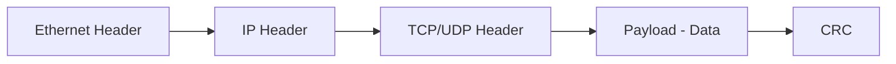
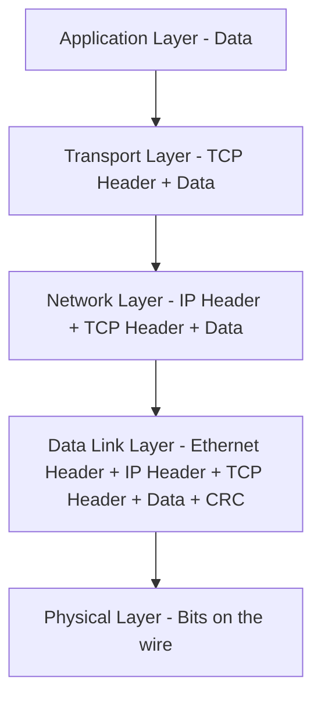

> **Goal of this section:**
> Understand how data travels in the form of packets, how packets are structured, and how they are wrapped and unwrapped (Encapsulation / De-encapsulation) as they move between devices.
---

## Table of Contents

  - [Packets and Packet Structure](#packets-and-packet-structure)
  - [Encapsulation and De-encapsulation](#encapsulation-and-de-encapsulation)
  - [Summary](#summary)

--- 

## Data Transmission — Packets and Encapsulation

### Packets and Packet Structure

#### What Is a Packet?

Data on the network isn't sent as one big block; it is split into small **packets**. Imagine you're sending a long letter by mail: instead of sending it in one big envelope, you split it across smaller envelopes, each holding part of the letter.

Every **packet** has two main parts:

| Part | Description |
|---|---|
| **Header** | Information about the packet: where it's coming from, where it's going, and what type of data it contains |
| **Payload (Data)** | The actual data the packet carries |

> [!NOTE]
> In most cases, when you send an email, a file, or a web page, that data doesn't travel in a single packet; it may need thousands or even millions of packets.

#### Packet Structure on Ethernet

- **Ethernet Header:** The first thing in the packet; it contains the MAC Addresses
- **IP Header:** Contains the IP Addresses and the routing information
- **TCP/UDP Header:** Contains the Port Numbers and the Transport Layer information
- **Payload:** The actual data
- **CRC (Cyclical Redundancy Check):** A number produced by a mathematical formula. The receiver performs the same calculation; if the result matches, the packet arrived intact and nobody tampered with it

> [!TIP]
> The CRC is the first level of integrity checking on the network. As a Security Analyst, you need to know the difference between a packet that arrived intact and a packet that was tampered with.

---

### Encapsulation and De-encapsulation

#### What Is Encapsulation?

**Encapsulation** is the process of wrapping data with the necessary protocol information before it is sent over the network. Picture it like putting a letter in an envelope, that envelope inside a bigger envelope, and the second envelope inside a box: each wrapper adds more information.

In the OSI model, each layer adds its own **Header** (and sometimes a **Trailer**) to the data coming from the layer above it.

#### The Encapsulation Process Step by Step:

1. The data starts at the **Application Layer** (for example, sending an email)
2. It moves down the stack, and each layer adds its own header
3. At the receiver, the data moves back up the stack (**De-encapsulation**)
4. Each layer removes its own header and processes the information

> [!WARNING]
> **IP Spoofing:** When a computer receives a packet and replies to it, it uses the Source IP in the header. The attacker can put a fake IP address as the source, and your machine will reply to that fake IP without knowing that the real source was someone else. This is called **IP Spoofing**.

---
## Summary

- Data travels in packets; each packet has a Header and a Payload
- Encapsulation = each layer adds a header as you go down the stack
- De-encapsulation = each layer removes its header as you go up
