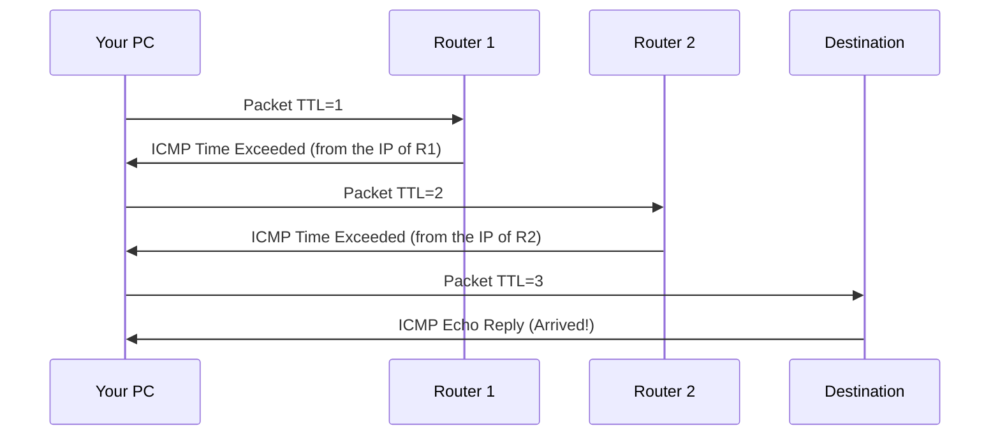

> **Goal of this section:**
> An explanation of the basic diagnostic tools, such as ping, traceroute, and loopback, that help you understand the state of the network, test connectivity, and quickly pinpoint where a problem is.

---

## Table of Contents
  - [Ping](#ping)
  - [Traceroute / Tracert](#traceroute--tracert)
  - [Loopback Address](#loopback-address)
  - [Summary](#summary)

---

## Diagnostic Tools

### Ping

**Ping** is the simplest tool for testing connectivity between two devices or for confirming that a specific device is available.

**How does it work?**
1. It creates an **ICMP Echo Request** packet and sends it to the target
2. The target replies with an **ICMP Echo Reply**
3. The tool calculates the Round-Trip Time (RTT)

```bash
# Example
ping google.com
ping 8.8.8.8
```

**Uses:**
- Testing whether a device is available
- Measuring latency (delay)
- Troubleshooting network problems

---

### Traceroute / Tracert

**Traceroute** (Linux/Mac) or **Tracert** (Windows) helps you discover the **actual path** packets take between two devices.

**How does it work?**

It manipulates the **TTL Field** in the IP header:



1. It sends a packet with TTL=1 → the first router drops it and sends back ICMP Time Exceeded with its IP
2. It sends a packet with TTL=2 → the second router drops it and sends back ICMP Time Exceeded with its IP
3. And so on, until it reaches the destination

```bash
# Windows
tracert google.com

# Linux / Mac
traceroute google.com
```

> [!TIP]
> Traceroute is very useful for a security analyst, because it lets you see whether there's a strange hop in the path or whether the traffic is passing through a network it shouldn't be passing through.

---

### Loopback Address

The **Loopback Address** is `127.0.0.1`: any packet you send to it is sent back to your own device.

**Uses:**
- Internal services on your device use it to talk to each other
- Testing applications locally without needing a network

```bash
ping 127.0.0.1
# If you get a reply = the network stack on your device is working correctly
```

> [!NOTE]
> The Loopback Address is **the most used IP address in the world**, because every running computer uses it internally.

---

## Summary


**Category 7 — Diagnostic Tools:**
- `ping` for testing connectivity
- `traceroute` / `tracert` for finding the path packets take
- `127.0.0.1` is your device's Loopback Address

