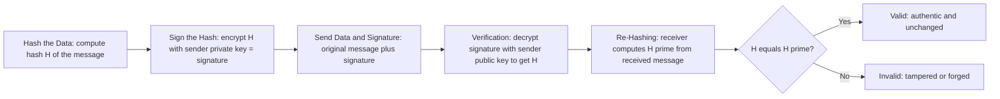

> **Goal of this section:**
> You'll understand what a Digital Signature is, how it works step by step, and how it guarantees Integrity + Authentication + Non-repudiation together — which is exactly the solution to the HMAC problems we talked about. And at the end, you'll see what new problem still needs a solution.

## Table of Contents
- [Recap: What HMAC Couldn't Solve](#recap-what-hmac-couldnt-solve)
- [What is a Digital Signature?](#what-is-a-digital-signature)
- [How Digital Signatures Work — Step by Step](#how-digital-signatures-work--step-by-step)
- [Which Security Properties Does It Achieve?](#which-security-properties-does-it-achieve)
- [Why This Is Cryptographically Powerful](#why-this-is-cryptographically-powerful)
- [What Digital Signatures Do NOT Guarantee](#what-digital-signatures-do-not-guarantee)
- [Real-World Use Cases](#real-world-use-cases)
- [The Problem That's Still Not Solved](#the-problem-thats-still-not-solved)
- [Summary](#summary)
- [SOC Analyst Perspective](#soc-analyst-perspective)

---

## Recap: What HMAC Couldn't Solve

In the **HMAC** topic, we ran into a big problem: since the Secret Key is shared between the two parties, there's no **Non-repudiation** (each party can deny or blame the other), and there's no **Public Verification** (you have to know the secret to verify).

We needed a mechanism that achieves 3 things together:
- Only one party can create the proof
- Anyone can verify it without knowing a secret
- The sender can't deny having sent it

> [!TIP]
> This is exactly what the **Digital Signature** comes to solve, using the same idea as the Asymmetric Encryption we explained earlier — except here we use it in reverse (signing with the Private Key, verifying with the Public Key).

---

## What is a Digital Signature?

A Digital Signature is an **electronic signature**: its owner uses their **Private Key** to sign the data, and anyone else can verify that signature using their **Public Key**.

> [!IMPORTANT]
> It's mathematical proof that **the owner of a specific Private Key approved a specific message**, and anyone can verify this proof.

---

## How Digital Signatures Work — Step by Step

1. **Hashing the Data:** the system computes the Hash (H) of the file or message
2. **Signing the Hash:** the sender encrypts (signs) the Hash with their **Private Key** — this is the Digital Signature itself
3. **Sending Data + Signature:** the original data + the signature are sent together. No confidentiality is required here; the data can be readable
4. **Verification:** the receiver decrypts the signature using the sender's **Public Key**, which gives them the original H
5. **Re-Hashing:** the receiver computes a new Hash (H') from the data they actually received
6. **Comparison:** if `H == H'`, everything is fine (Valid); if they're different, tampering has occurred (Invalid/Tampered)

> [!IMPORTANT]
> A very important note about the direction in which the keys are used here, because it's **the reverse** of the normal use of Asymmetric Encryption:
> - In regular encryption: **we encrypt with the Public Key**, **and decrypt with the Private Key**
> - In a digital signature: **we sign (encrypt) with the Private Key**, **and verify (decrypt) with the Public Key**

---

## Which Security Properties Does It Achieve?

| Security Property | Achieved? | How |
|---|---|---|
| Confidentiality | ❌ | The data itself stays readable to anyone; the signature doesn't hide it |
| **Integrity** | ✅ | Any change to the data will change the Hash, so the signature will immediately fail to match during the comparison |
| **Authentication** | ✅ | Only the owner of the Private Key can produce this signature, so verifying it with the Public Key proves their identity |
| **Non-repudiation** | ✅ | Since nobody else has a copy of the Private Key, its owner can't later deny having signed |
| Key Exchange | ❌ | Not related; that's a completely different topic |

> [!IMPORTANT]
> **Digital Signature → achieves Integrity + Authentication + Non-repudiation** together at the same time. This is exactly the solution to the 3 problems HMAC couldn't solve.

---

## Why This Is Cryptographically Powerful

This mechanism is very powerful for four reasons:

| Reason | Details |
|---|---|
| **Only one entity could create the signature** | Only the owner of the Private Key can produce a valid signature |
| **Any modification breaks the hash** | Any tiny change to the data will change the Hash completely (Avalanche Effect) and expose the tampering immediately |
| **No shared secrets** | The complete opposite of HMAC — there's no secret shared between the two parties; nobody else has a copy of the Private Key at all |
| **Public verification is possible** | Anyone who has the Public Key can verify the signature without needing to know any secret |

---

## What Digital Signatures Do NOT Guarantee

Despite all this strength, there are very important limits you need to know:

| Issue | Details |
|---|---|
| **Confidentiality** | The message stays readable to anyone who intercepts it — the signature doesn't encrypt the content |
| **Trust by Themselves** | The signature proves: "This was signed with Alice's Private Key." But it **doesn't prove**: "This Private Key really belongs to the real Alice" |

> [!WARNING]
> This second point is the most dangerous thing in the whole topic. The signature proves the link between the message and the key, but it **doesn't prove the identity of the key's owner**. This is exactly the same Identity Binding Problem we talked about at the end of the Asymmetric Encryption topic.

---

## Real-World Use Cases

Digital Signatures are everywhere in our daily lives without us noticing:

- **Emails:** to make sure the email really comes from the right sender (such as DKIM/PGP)
- **Software:** signing `.exe` files and Installers before distribution
- **Windows Updates:** Microsoft signs every Update to guarantee it really comes from Microsoft
- **Drivers:** Windows doesn't allow any Driver to run unless it's digitally signed
- **Linux Packages, iOS Apps:** and many other applications and systems

> [!WARNING]
> **The Drivers story:** Drivers run in **Kernel Space** — the most dangerous place on the machine. If an attacker puts malicious code in a Driver, they'll have complete access to the entire machine (Full System Compromise). That's why Windows now refuses to run any Driver that isn't digitally signed by its manufacturer — a direct, practical application of the Authentication and Integrity principles we talked about.

---

## The Problem That's Still Not Solved

The Digital Signature completely solved the HMAC problems, but there's still one fundamental gap.

> [!IMPORTANT]
> **The problem:** The signature proves mathematically that a specific message was signed with a specific private key, but it **doesn't prove** that this key really belongs to the person claiming to own it. If Bob creates a key pair and says "this belongs to Alice" while lying, anyone who verifies the signature will find it 100% "valid" mathematically, yet they'll be vouching for a completely forged identity.

**The part that will solve this problem:** **Digital Certificates + Certificate Authority (CA)** — a trusted third party that binds the Public Key to a real, verified identity, so nobody can claim to own a key that isn't theirs without being exposed.

---

## Summary

- Digital Signature = signing with the Private Key + verifying with the Public Key
- The steps: Hash → Sign with the Private Key → send the data + the signature → verify with the Public Key → recompute the Hash → compare
- It achieves **Integrity + Authentication + Non-repudiation** together
- Its core strength: there are no shared secrets, and anyone can verify publicly
- **It doesn't achieve Confidentiality**; the message stays readable to anyone
- **Most importantly:** it proves the message was signed with a specific key, but it doesn't prove that this key really belongs to the claimed person
- Its practical uses are very widespread: Emails, Software Signing, Windows Updates, Drivers
- **The new problem:** how do we trust that a specific Public Key really belongs to its owner? → The solution comes in **Digital Certificates & CA**

---

## SOC Analyst Perspective

- If you see an **Unsigned** Executable or Driver trying to install itself in the work environment, that's an immediate Red Flag that must be flagged — modern systems (like Windows) refuse to run unsigned Drivers specifically to prevent access to Kernel Space
- MITRE ATT&CK: the technique **T1553.002 (Code Signing)** describes attackers abusing stolen or forged signing certificates to make Malware look "trusted" and bypass defenses such as Windows SmartScreen or Antivirus
- In Phishing Analysis, the absence of a valid DKIM/PGP signature, or a signature that fails verification (Verification Failure), is a strong indicator of an impersonation attempt (Spoofing)
- Practical tools: `signtool` on Windows and `gpg --verify` on Linux are used to verify digital signatures on files and packages during an Incident Investigation
