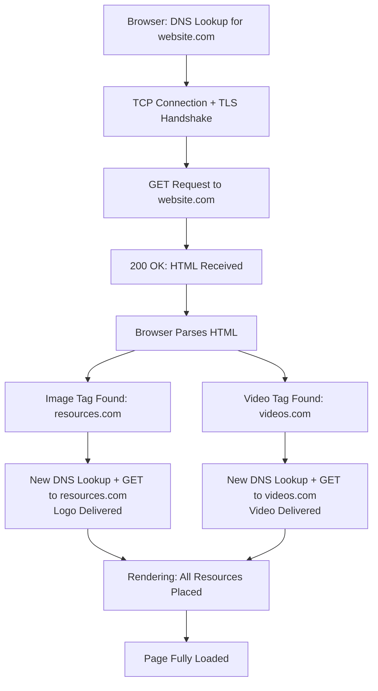

| Topic | Level | Reading Time | Prerequisites |
|---|---|---|---|
| CDNs, Multi-Server Pages, and the Full Page Load | Intermediate | ~20 min | Basic understanding of how websites are built and hosted, HTTP, DNS, and firewall rules |

> **Goal of this section:**
> You'll understand that the single page you see in your browser is actually the result of several different servers working together, you'll learn the concept of a CDN and how it speeds up website loading, and you'll see why a firewall configured to allow only one domain can break an entire website.


## Learning Objectives

By the end of this section, you will be able to:

- Define a **CDN (Content Delivery Network)** and explain the role of **edge servers**.
- Trace how a browser actually reaches an edge server, from DNS lookup to cache hit or miss.
- Explain why loading a single webpage often means talking to several different servers.
- Explain why allowing only one domain on a firewall is not enough to load a modern website correctly.
- Walk through the complete step-by-step process of loading a real page, from DNS lookup to full rendering.

## Table of Contents

- [What Is a CDN](#what-is-a-cdn)
- [How You Actually Reach an Edge Server](#how-you-actually-reach-an-edge-server)
- [Same CDN Domain, Different Answer](#same-cdn-domain-different-answer)
- [One Page, Many Servers](#one-page-many-servers)
- [Resources Hosted on a Different Domain](#resources-hosted-on-a-different-domain)
- [Why Allowing One Domain Isn't Enough](#why-allowing-one-domain-isnt-enough)
- [Exercise: Trace a Full Page Load](#exercise-trace-a-full-page-load)
- [Step-by-Step Walkthrough](#step-by-step-walkthrough)
- [Multi-Server Page Load Diagram](#multi-server-page-load-diagram)
- [Career Connection](#career-connection)
- [Key Terms Glossary](#key-terms-glossary)
- [Summary](#summary)

## What Is a CDN

A **CDN (Content Delivery Network)** is a group of servers, called **edge servers**, spread across many locations around the world.

Instead of every user fetching images, video, CSS, or JS from a single distant **origin server**, they get a **cached copy** from an edge server close to them.

**The result**: faster loading, less load on the origin server, and better reliability.

## How You Actually Reach an Edge Server

The process happens in the following steps:

1. The page's HTML points to a resource located on the CDN's domain, not the main website (for example `cdn-provider.com/logo.png`).
2. The browser looks up that CDN domain in DNS.
3. The CDN's DNS is **location-aware**; it doesn't return a single fixed address. It returns whichever edge server is closest or least congested for that browser right now.
4. The browser connects directly to that edge server.
5. **Cache Hit**: the edge server already has the file and sends it immediately. **Cache Miss**: it fetches the file from the origin once, stores a copy, and then sends it.

## Same CDN Domain, Different Answer

> [!IMPORTANT]
> Two users in different locations (or at different times) can be directed to completely different edge servers for exactly the same request.

## One Page, Many Servers

Loading a single web page rarely means you're talking to just one server.

The main HTML usually comes from the website's own server, for example `website.com`. But the images, video, and scripts referenced inside that HTML often live on a completely different domain, most commonly a CDN.

## Resources Hosted on a Different Domain

Sometimes the logo or video referenced in the HTML isn't hosted on the same server as the website itself.

```html

```

This **image tag** contains a full URL pointing to a completely different domain. When the browser reads this element, it sends a separate HTTP request directly to the CDN's domain, not to the main website's server.

> [!TIP]
> This means loading a single page can involve talking to several different servers, each responsible for a different part of the content.

## Why Allowing One Domain Isn't Enough

**The scenario**: a firewall is configured to allow only `facebook.com`. Will the website load completely?

**What actually happens**:

- The main HTML from `facebook.com` loads fine; that request matches the rule.
- But the images, scripts, video, and API calls are often served from separate CDN or partner domains that the rule never accounted for.
- Those requests get blocked, so the page loads partially or breaks.

**Why this happens**:

- Modern websites rely on far more than a single domain: CDNs, APIs, authentication services, and third-party tools.
- CDN-backed domains can **resolve** to different IP addresses depending on the user's location or the server load, so even an IP-based allow list isn't reliable.
- That's why real firewalls rely on **URL/domain-aware filtering** (such as FQDN objects and domain categories) instead of a single **hardcoded** rule.

> [!IMPORTANT]
> **The key lesson**: allowing a single domain doesn't mean allowing the entire application that depends on it.

> [!NOTE]
> This is exactly the same logic as **Default Deny**, which we studied earlier in the network security topics: an "allow only one domain" rule looks secure on paper, but in practice it breaks the application because it ignores all of its hidden **dependencies**.

## Exercise: Trace a Full Page Load

**The scenario**: a user types `website.com` into their browser.

- **website.com**: hosts the main HTML page.
- **resources.com**: hosts the logo referenced in the HTML.
- **videos.com**: hosts the video, also referenced in the HTML.

**The task**: explain step by step how the page loads, from DNS all the way to full rendering.

## Step-by-Step Walkthrough

**Step 1: DNS Lookup**

The browser doesn't know the IP address of `website.com`; it only knows its name. It sends a DNS query asking: "What is the IP address of `website.com`?" The DNS system responds with the correct IP address.

**Step 2: TCP Connection**

Using that IP address, the browser opens a connection to the web server (usually on port 443). If HTTPS is used, a **TLS handshake** also takes place here to encrypt the connection.

**Step 3: HTTP GET Request**

The browser sends `GET / HTTP/1.1` to the `website.com` server, requesting the homepage.

**Step 4: Server Response**

The server responds with **200 OK** and sends the HTML file (such as `index.html`).

**Step 5: HTML Parsing Begins**

The browser starts reading the HTML from top to bottom and builds the page structure.

**Step 6: Logo Request**

The browser finds an `` element pointing to a logo hosted on `resources.com`. This requires a new DNS lookup for `resources.com`, a new TCP connection, and a new GET request to fetch `logo.png`. `resources.com` responds with **200 OK** and the image data.

**Step 7: Video Request**

In the same way, the browser finds a video element pointing to `videos.com`. Another DNS lookup, TCP connection, and GET request take place, this time fetching the video file from `videos.com`.

**Step 8: Parallel Loading**

Modern browsers usually send these different requests (the logo, the video, CSS, scripts) at the same time (**in parallel**) rather than one after another, to load the page faster.

**Step 9: Rendering**

As each resource arrives, the browser places it into the page: it displays the text, positions the logo image, and prepares the video player.

**Step 10: Page Fully Loaded**

Once all the referenced resources have been fetched and placed successfully, the page is considered fully **rendered** and ready for the user to interact with.

> [!IMPORTANT]
> **Key takeaway**: a single visible web page can involve several DNS lookups, several servers, and dozens of individual HTTP requests happening behind the scenes.

## Multi-Server Page Load Diagram

The following diagram shows the complete journey, from typing the domain to fully rendering the page, across multiple servers:



## Career Connection

Understanding CDNs, multi-server pages, and the complete page-load journey has direct applications in several career paths:

- In **Network Security Engineering**, designing **domain-aware** firewall rules instead of fixed IP-based rules is an essential part of running modern web applications securely.
- In **SOC** work, understanding that a single page involves requests to several domains helps distinguish normal traffic from suspicious traffic.
- In **Web Application Security**, knowing a website's hidden dependencies (CDNs, APIs) is an essential part of assessing the full attack surface of any application.

## Key Terms Glossary

| Term | Definition |
|---|---|
| **CDN (Content Delivery Network)** | A geographically distributed group of servers that speeds up content delivery to users. |
| **Edge Server** | A server belonging to the CDN network that is geographically closer to the end user. |
| **Origin Server** | The original server that holds the master copy of the files before they're cached on the CDN. |
| **Cache Hit / Cache Miss** | Whether the requested file is already available on the edge server (hit) or isn't, so it has to be fetched from the origin (miss). |
| **FQDN (Fully Qualified Domain Name)** | The full, specific name of a domain, used in domain-aware firewall rules. |
| **URL/Domain-Aware Filtering** | Firewall filtering based on the domain name instead of a fixed IP address. |
| **Rendering** | The process of building and visually displaying the page after all of its resources have been received. |

## Summary

- A **CDN** is a group of globally distributed **edge servers** that provide a cached copy of content close to each user, improving loading speed and reliability.
- The CDN's DNS is "location-aware," so the same domain can return different IP addresses to different users.
- Loading a single web page rarely means talking to just one server; there are usually separate domains for images, video, and scripts.
- A firewall rule that allows only one domain (such as `facebook.com`) isn't enough, because a modern application depends on multiple dependency domains (CDNs, APIs), which makes domain-based (URL-aware) filtering necessary instead of relying on a fixed IP.
- The complete page-load journey includes: DNS lookup, a TCP/TLS connection, a GET request, receiving the HTML, **parsing** it, additional requests for the linked resources (images, video), parallel loading, and then the final rendering.
- A single visible page can hide dozens of requests and several completely different servers behind it.

