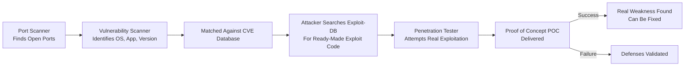

| Topic | Level | Reading Time | Prerequisites |
|---|---|---|---|
| Vulnerability Scanning, Penetration Testing, Honeypots, and Sandboxes | Intermediate | ~24 min | Basic understanding of port scanning, CVEs, firewalls, IDS/IPS, and the DMZ |

> **Goal of this section:**
> You'll understand how the journey continues from simply discovering an open port all the way to proving that a vulnerability is actually exploitable. You'll see the difference between automated scanning (Vulnerability Scanning) and real human testing (Penetration Testing), and finally you'll get to know two clever traps: the Honeypot and the Sandbox.

## Learning Objectives

By the end of this section, you will be able to:

- Explain how a **Vulnerability Scanner** goes a step beyond a port scanner to identify exploitable weaknesses.
- Define **CVE** and explain how it relates to public exploit databases like Exploit-DB.
- List popular vulnerability scanning tools used by both attackers and defenders.
- Explain what **Penetration Testing** is and how it differs from an automated vulnerability scan.
- Interpret both possible outcomes of a pentest engagement, and distinguish **Red Team** from **Blue Team**.
- Define a **Honeypot** and explain why any connection to it is inherently suspicious.
- Define a **Sandbox** and explain how it safely analyzes suspicious files and malware.

## Table of Contents

- [Vulnerability Scanners: From Open Port to Exploitable Weakness](#vulnerability-scanners-from-open-port-to-exploitable-weakness)
- [The Process, Step by Step](#the-process-step-by-step)
- [Understanding CVE](#understanding-cve)
- [From CVE to Exploit-DB](#from-cve-to-exploit-db)
- [Popular Vulnerability Scanning Tools](#popular-vulnerability-scanning-tools)
- [Penetration Testing: Hiring Someone to Try to Break In](#penetration-testing-hiring-someone-to-try-to-break-in)
- [How Pentesting Differs From a Vulnerability Scan](#how-pentesting-differs-from-a-vulnerability-scan)
- [The Proof of Concept (POC)](#the-proof-of-concept-poc)
- [Two Possible Outcomes](#two-possible-outcomes)
- [Red Team vs. Blue Team](#red-team-vs-blue-team)
- [Honeypots: The Decoy That Catches Attackers](#honeypots-the-decoy-that-catches-attackers)
- [Why the Honeypot Is Made to Look Vulnerable](#why-the-honeypot-is-made-to-look-vulnerable)
- [The Critical Rule: No Legitimate Reason to Connect](#the-critical-rule-no-legitimate-reason-to-connect)
- [Real-World Value of Honeypots](#real-world-value-of-honeypots)
- [Sandbox: A Safe Room for Suspicious Files](#sandbox-a-safe-room-for-suspicious-files)
- [Assessment Pipeline Diagram](#assessment-pipeline-diagram)
- [Career Connection](#career-connection)
- [Key Terms Glossary](#key-terms-glossary)
- [Summary](#summary)

## Vulnerability Scanners: From Open Port to Exploitable Weakness

A **Vulnerability Scanner** picks up where the **port scanner** leaves off.

It doesn't just find open ports; it goes a step further to determine exactly what's running, and whether it's actually **exploitable** or not.

## The Process, Step by Step

1. It identifies the open ports (similar to a port scanner).
2. It tries to identify the operating system, and the specific application and version listening on each port.
3. It then compares that operating system, application, and version against a database of missing patches and known, documented vulnerabilities.

In short: the vulnerability scanner tells you, "This system is running Windows Server 2019, this port is running Apache 2.4.49, and more importantly, this specific version has a known vulnerability, identified as **CVE-2021-41773**."

## Understanding CVE

**CVE** stands for **Common Vulnerabilities and Exposures**. It's a **standardized public ID** given to every known, documented vulnerability, so security professionals around the world can refer to the exact same issue without any confusion.

## From CVE to Exploit-DB

What happens after the CVE is discovered: the attacker doesn't stop there. They take that CVE number and search **Exploit-DB** (a public database of exploit code) to find ready-made code that actually exploits that specific vulnerability.

> [!IMPORTANT]
> The full journey is: discover a specific version → find its CVE number → search for ready-made exploit code in Exploit-DB. Each step brings the attacker closer to a real, working attack.

## Popular Vulnerability Scanning Tools

Common tools such as **Nessus**, **OpenVAS**, and **Qualys** are vulnerability scanners used by attackers and defenders alike.

> [!TIP]
> Security teams use these exact same tools to find and fix their own weaknesses **before** attackers get to them.

## Penetration Testing: Hiring Someone to Try to Break In

Once you've built your data center and applied the basics — firewalls, a DMZ, IDS, IPS, patching, the principle of least privilege, and so on — the natural next question is: **does all of this actually work in reality?**

The answer is to hire a **penetration tester** (often called an **Ethical Hacker**), a specialist whose whole job is to legally and safely try to break into your network, exactly as a real attacker would.

## How Pentesting Differs From a Vulnerability Scan

This is different from vulnerability scanning: the scanner only automatically lists potential weaknesses.

**The pentester actually tries to exploit them**, **chain them together**, and prove a real, practical impact — not just "this door might be unlocked," but "I actually got in through it, into your living room, and here's a photo to prove it."

## The Proof of Concept (POC)

The pentester delivers a **POC (Proof of Concept)**, real practical evidence proving that the exploit is real and not just a theoretical assumption.

## Two Possible Outcomes

There are two possible outcomes of any penetration test:

**They succeeded in breaking in**

This is actually a **positive** result for your security posture. It means you identified a real, exploitable weakness before a real attacker got to it, and you can fix it. That's valuable information, not a failure.

**They failed to break in**

If they're skilled and still couldn't get in, that's a strong indicator that your defenses are solid, and it justifies the money and effort spent on your security program in front of management.

> [!NOTE]
> If the tester consistently fails to find anything significant, management may start to question whether the money spent on this engagement (or this tester) was worth it in the first place.

## Red Team vs. Blue Team

A common real-world term: this is often called a **Red Team engagement** when it's a full, realistic attack simulation, as opposed to the **Blue Team**, the team of defenders trying to detect and stop that attack.

## Honeypots: The Decoy That Catches Attackers

A **Honeypot** is a **fake system** deliberately designed to look like a real, valuable target, but it's actually **not part of your real infrastructure**, and it holds no real data.

Its purpose: it exists for one reason — to be **bait**, to attract attackers, let you detect and study their behavior, and draw their attention away from your real, valuable systems.

## Why the Honeypot Is Made to Look Vulnerable

A key design decision: the Honeypot is deliberately designed to look **weak** — old software, weak configurations, open services that look tempting.

> [!TIP]
> That's exactly what makes it attractive to an attacker scanning your network looking for an easy target.

## The Critical Rule: No Legitimate Reason to Connect

The critical rule: **no legitimate employee ever has any reason to connect to this system**. It isn't mentioned anywhere, it isn't tied to any real business process, and no one has told anyone to use it.

> [!IMPORTANT]
> That's exactly what makes it such a powerful detection tool: since no one has a legitimate reason to connect to it, any connection attempt to the honeypot is automatically suspicious. In fact, the only way someone would even find it is by actively scanning the network looking for targets, which is itself an illegal and unauthorized activity. In other words, merely touching the honeypot is practically evidence of malicious intent.

## Real-World Value of Honeypots

The real value of Honeypots:

- They let security teams study attackers' techniques and tools in a safe, isolated environment.
- They generate **high-confidence alerts** (very few false positives, since there's no legitimate reason for them to trigger).
- They **buy time** by distracting attackers away from the real critical systems.

## Sandbox: A Safe Room for Suspicious Files

A **Sandbox** is an **isolated environment** where suspicious files, programs, or malware can be executed and analyzed safely, without affecting the real system.

It monitors their behavior — such as the **processes** they create, the files they modify, network connections, and system changes — to determine whether they're malicious or not.

> [!TIP]
> Think of the Sandbox as a sealed testing room: you can open any "suspicious box" inside it and see exactly what it will do, with no risk of it affecting anything outside that room.

## Assessment Pipeline Diagram

The following diagram shows the full journey from a simple open port all the way to proving actual exploitation, along with the supporting detection and analysis tools:

## Career Connection

Understanding vulnerability scanning, penetration testing, and Honeypots/Sandboxes is very important across multiple career paths:

- In **Pentesting**, the full journey from reconnaissance to vulnerability scanning to actual exploitation is the core of the daily work.
- In the **SOC**, monitoring honeypot alerts provides high-confidence signals of real suspicious activity.
- In **Malware Analysis**, using Sandboxes is an essential part of safely analyzing suspicious file samples.
- In **GRC**, organizing Red Team/Blue Team engagements is part of proving the security program's effectiveness to management and auditors.

## Key Terms Glossary

| Term | Definition |
|---|---|
| **Vulnerability Scanner** | A tool that identifies the running systems, services, and versions, and compares them against a database of known vulnerabilities. |
| **CVE (Common Vulnerabilities and Exposures)** | A standardized public ID given to every known, documented vulnerability. |
| **Exploit-DB** | A public database containing ready-made exploit code for known vulnerabilities. |
| **Penetration Testing** | A legal, authorized attempt to break into a system or network to prove how exploitable it actually is. |
| **Proof of Concept (POC)** | Practical evidence proving that a specific vulnerability is actually exploitable. |
| **Red Team** | A team that simulates a full, realistic attack to test the organization's defenses. |
| **Blue Team** | The team of defenders trying to detect and stop the red team's attack. |
| **Honeypot** | A fake system designed to attract attackers and study their behavior, with no real data or value. |
| **Sandbox** | An isolated environment for safely executing and analyzing suspicious files without affecting the real system. |

## Summary

- A **Vulnerability Scanner** picks up where the port scanner leaves off: it identifies the operating system, application, and version, and compares them against a database of known vulnerabilities (**CVE**).
- The attacker takes the CVE number and searches **Exploit-DB** for ready-made exploit code.
- Tools such as **Nessus**, **OpenVAS**, and **Qualys** are used by attackers and defenders alike.
- **Penetration Testing** is different from automated vulnerability scanning, because the pentester actually exploits the vulnerabilities and proves a real impact through a **POC**.
- Whether the pentester succeeds or fails, both are valuable outcomes: success reveals a real, fixable vulnerability, and failure proves the defenses are solid.
- The **Red Team** simulates a full, realistic attack, while the **Blue Team** is the team of defenders trying to detect and stop it.
- A **Honeypot** is a fake system deliberately designed to look weak and attractive, and no one ever has a legitimate reason to connect to it, so any connection to it is automatically suspicious.
- A **Sandbox** is an isolated environment that allows suspicious files and malware to be executed and analyzed safely by monitoring their actual behavior.

