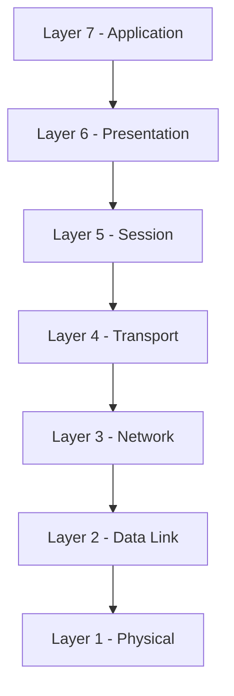
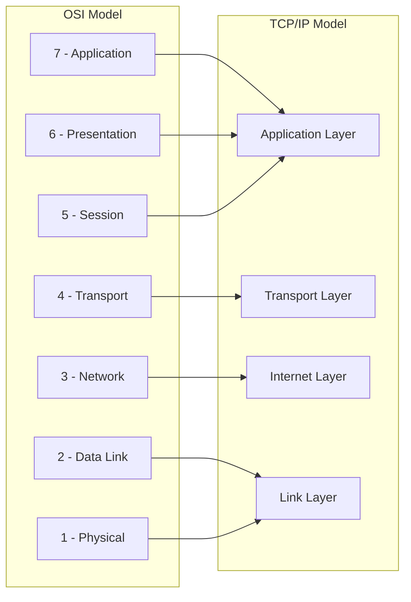

> **The goal of this section:**  
> Understanding network models (OSI and TCP/IP), how each Layer plays a role in moving data, and the difference between the theoretical model and the practical one in real-world work.

---

## Table of Contents

  - [OSI Model](#osi-model)
  - [TCP/IP Model](#tcpip-model)
  - [OSI vs TCP/IP Comparison](#osi-vs-tcpip-comparison)
  - [Summary](#summary)
---
## Network Models — OSI and TCP/IP

### OSI Model

The **OSI (Open Systems Interconnection) Model** is a theoretical 7-Layer model that explains how devices communicate with each other. Each Layer has a specific function.

> [!NOTE]
> Remember this rule: the lower layers are closer to the Wires, and the upper layers are closer to the End User.

#### Layer 1 — Physical Layer

The Physical Layer is the first Layer, and it deals with **the actual transmission of data** over the physical medium.

- Electrical Pulses on the wires
- Connection Specifications between hardware
- Voltage and Current

#### Layer 2 — Data Link Layer

It connects the physical part of the network (the wires and signals) to the abstract part (the Packets and Data Streams).

- **Physical Addressing** using **MAC Addresses**
- It creates the Headers and the Validation Information
- **CRC** lives here

#### Layer 3 — Network Layer

It handles **IP Addressing** and Connectivity across multiple network Segments.

- It defines how systems on different Segments find each other and communicate
- **Routing** lives here

#### Layer 4 — Transport Layer

It handles your data and prepares it for transmission across the network.

- It ensures end-to-end **Reliable Connectivity**
- It controls the **Sequencing** of Packets
- Its core function is **Segmentation** — splitting up the data
- **Ports** live here
- **TCP** (more reliable) or **UDP** (faster)

#### Layer 5 — Session Layer

It manages **Sessions** between devices.

- It starts, manages, and ends Sessions
- It determines when devices stay connected and how they Synchronize data

#### Layer 6 — Presentation Layer

It's responsible for **Data Formatting, Translation, Encryption, and Compression**.

- It translates data between the Application Format and the Network Format
- It encrypts/decrypts data for security
- It compresses data to improve the Transfer
- Examples: JPEG, PNG, MPEG, GIF

#### Layer 7 — Application Layer

This is where users and applications interact with the network.

- It provides Network Services to applications
- Example protocols:
  - HTTP / HTTPS — Web Browsing
  - SMTP / POP3 / IMAP — Email

| Layer | Name | Key Function | Key Protocol/Tech |
|---|---|---|---|
| 7 | Application | User Interface | HTTP, SMTP, FTP |
| 6 | Presentation | Data Format & Encryption | SSL/TLS, JPEG |
| 5 | Session | Session Management | NetBIOS |
| 4 | Transport | End-to-End Delivery | TCP, UDP |
| 3 | Network | IP Routing | IP, ICMP |
| 2 | Data Link | MAC Addressing | Ethernet, ARP |
| 1 | Physical | Bits on Wire | Cables, Wi-Fi |

---

### TCP/IP Model

The **TCP/IP Model** is the practical model the internet actually runs on. It has 4 Layers instead of 7.

#### Link Layer
It defines how to connect to a specific Network Topology, such as Ethernet.
- OSI equivalent: Layers 1 and 2

#### Internet Layer
It defines how Datagrams are formed and handles Routing.
- Examples: IPv4, IPv6, ICMP
- OSI equivalent: Layer 3

#### Transport Layer
It provides end-to-end data delivery service.
- Examples: TCP, UDP
- OSI equivalent: Layer 4

#### Application Layer
It contains the application programs and serves as the Network Interface for users.
- Examples: Telnet, FTP, DNS
- OSI equivalent: Layers 5, 6, 7

---

### OSI vs TCP/IP Comparison

| OSI Layer | TCP/IP Layer |
|---|---|
| Application (7) | Application |
| Presentation (6) | Application |
| Session (5) | Application |
| Transport (4) | Transport |
| Network (3) | Internet |
| Data Link (2) | Link |
| Physical (1) | Link |

> [!IMPORTANT]
> The OSI Model is a **theoretical** model for understanding and teaching, while the TCP/IP Model is the **practical** model that real networks run on. As a Security Analyst, you'll use both in your analysis.

---
## Summary

- OSI = 7 Layers for theoretical understanding
- TCP/IP = 4 Layers for real-world implementation
- Both are important in Cybersecurity
